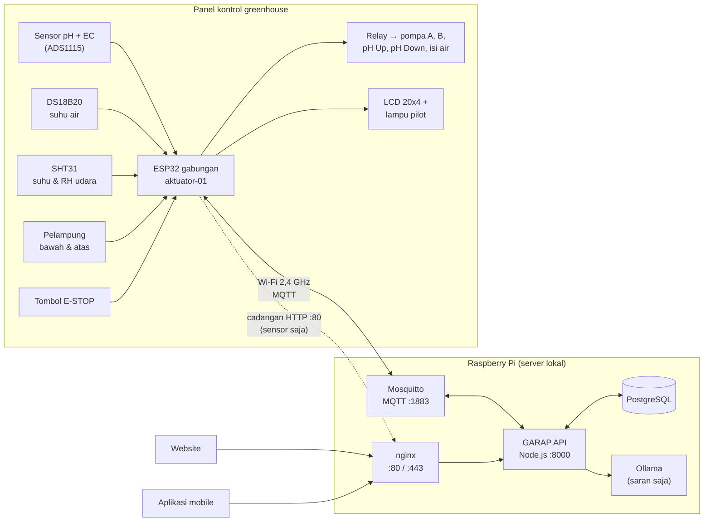
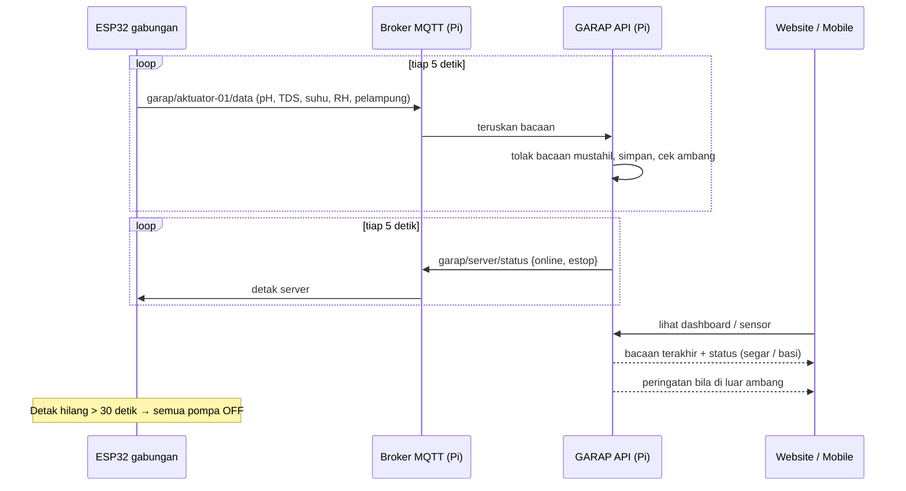
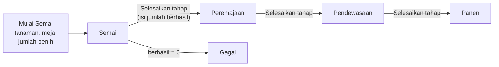

# PETUNJUK PELAKSANAAN NASIONAL (JUKNAS) SISTEM GARAP – SMART HIDROPONIK

## Halaman Identitas Dokumen

| Atribut | Isi |
|---|---|
| Judul | Petunjuk Pelaksanaan (Juknas) Sistem GARAP – Smart Hidroponik |
| Nomor dokumen | GARAP-JUKNAS-01 |
| Versi | 1.0 |
| Tanggal terbit | 12 November 2026 |
| Status | Draf resmi — menunggu pengesahan pengelola |
| Pemilik sistem | Vertonik Smart Farm / Greenhouse GARAP |
| Penyusun | Tim Dokumentasi GARAP |
| Dasar penyusunan | Audit kode sumber 12 November 2026 (web, mobile, backend, firmware `gabungan-0.6`, konfigurasi Raspberry Pi) |
| Dokumen terkait | Juknis Website (GARAP-JUKNIS-01), Juknis IoT (GARAP-JUKNIS-02), Juknis Instalasi (GARAP-JUKNIS-03), SOP Pengoperasian (GARAP-SOP-01), SOP Pemeliharaan (GARAP-SOP-02) |

### Riwayat revisi

| Versi | Tanggal | Perubahan | Disetujui |
|---|---|---|---|
| 1.0 | 12-11-2026 | Terbitan pertama berdasarkan audit kode | [PERLU VERIFIKASI] |

### Lembar pengesahan

| Peran | Nama | Tanda tangan | Tanggal |
|---|---|---|---|
| Penanggung jawab sistem | [PERLU VERIFIKASI] | | |
| Administrator sistem | [PERLU VERIFIKASI] | | |
| Koordinator greenhouse | [PERLU VERIFIKASI] | | |

> [!WARNING]
> **STATUS DOSING: BELUM DIIZINKAN.**
> Alur persetujuan dosing sudah dirancang di server, tetapi **eksekusi dosis diblokir** oleh gerbang keselamatan (`EKSEKUSI_DIIZINKAN = false`). Tidak ada pompa nutrisi atau pH yang boleh dijalankan otomatis oleh sistem. Pemberian nutrisi tetap dilakukan **manual oleh operator** sesuai SOP sampai pemilik sistem menyatakan validasi keselamatan selesai.

---

## BAB 1. Latar Belakang

Budidaya hidroponik menuntut larutan nutrisi yang terjaga: keasaman (pH), kepekatan nutrisi (EC/TDS), dan suhu air. Pemeriksaan manual memakan waktu, mudah terlewat, dan sulit dicatat rapi. Greenhouse GARAP memiliki beberapa meja hidroponik (NFT dan DFT) dengan tandon penampung bersama.

GARAP dikembangkan untuk:

1. memantau kondisi larutan dan udara secara terus-menerus;
2. mencatat setiap tahap tanam dari semai sampai panen;
3. memberi peringatan bila kondisi keluar dari batas aman;
4. menyiapkan dasar otomasi dosing yang **aman**, berlapis pengaman, dan selalu melibatkan persetujuan manusia.

## BAB 2. Tujuan Pengembangan

| No | Tujuan | Status saat ini |
|---|---|---|
| 1 | Pemantauan pH, EC/TDS, suhu air, suhu dan kelembapan udara secara langsung | Tersedia di web dan mobile; perangkat di lapangan [PERLU VERIFIKASI] |
| 2 | Pencatatan siklus tanam (semai, peremajaan, pendewasaan, panen) | Tersedia |
| 3 | Pengaturan target nutrisi per tanaman dan per penampung | Tersedia (pengaturan saja) |
| 4 | Peringatan kondisi tidak normal | Tersedia (web, notifikasi mobile) |
| 5 | Dosing otomatis dengan persetujuan operator | **Belum diizinkan** — server menolak eksekusi |
| 6 | Jejak audit setiap perubahan | Tersedia |

## BAB 3. Ruang Lingkup Sistem

**Termasuk dalam lingkup:**

- Website GARAP (pemantauan, pengelolaan data, pengaturan).
- Aplikasi mobile GARAP (Android/iOS) untuk operator.
- Perangkat IoT: satu papan ESP32 gabungan (sensor + aktuator) per penampung, dengan LCD, lampu pilot, pelampung, dan tombol E-STOP.
- Server lokal Raspberry Pi: API, basis data PostgreSQL, broker MQTT Mosquitto, server web nginx, asisten AI lokal (Ollama).

**Tidak termasuk dalam lingkup dokumen ini:**

- Pengaktifan eksekusi dosing otomatis (diputuskan terpisah oleh pemilik setelah validasi).
- Perubahan kode, firmware, atau konfigurasi.
- Rekomendasi agronomi di luar yang tersimpan di sistem.

## BAB 4. Sasaran Pengguna

| Pengguna | Peran di sistem | Kebutuhan utama |
|---|---|---|
| Administrator | `admin` | Mengelola akun, master data, parameter, saklar, kalibrasi |
| Operator greenhouse / petani | `petani` | Memantau, mencatat tahap tanam, menanggapi peringatan |
| Teknisi IoT | (akun `admin` bila perlu akses Kalibrasi/Koneksi Alat) | Memasang, menguji, merawat perangkat |
| Pengelola sistem | `admin` | Server Pi, cadangan data, keamanan |
| Pihak kampus / mitra industri | `demo` | Melihat tanpa bisa mengubah data |

## BAB 5. Gambaran Umum GARAP

GARAP terdiri atas tiga lapisan:

1. **Lapisan lapangan** — sensor dan pompa di panel kontrol dekat tandon.
2. **Lapisan server lokal** — Raspberry Pi di jaringan greenhouse menerima data, menyimpan, menilai keamanan, dan meneruskan perintah aman (STOP, E-STOP).
3. **Lapisan pengguna** — website dan aplikasi mobile.

Prinsip keselamatan yang tertanam di sistem:

- Firmware **tidak mempercayai server begitu saja**: batas mL per suntikan, batas mL per jam, batas durasi pompa, satu pekerjaan dalam satu waktu.
- Bila detak server hilang lebih dari **30 detik**, semua pompa dimatikan (fail-safe).
- Tombol **E-STOP** fisik mematikan dan mengunci semua output.
- Pompa nutrisi berhenti bila **pelampung bawah** menunjukkan air kurang; pompa isi berhenti bila **pelampung atas** penuh.
- Server menolak bacaan mustahil (mis. pH 99) dan menandai bacaan basi (lebih dari 120 detik).
- Asisten AI hanya memberi saran teks dan **tidak punya jalur ke pompa**.

## BAB 6. Arsitektur Sistem

Rincian teknis ada di `04-REFERENSI/Arsitektur_Sistem.md`.

## BAB 7. Komponen Sistem

### 7.1 Website

Aplikasi web (React) yang dibuka melalui browser ke alamat server Pi. Menu dikelompokkan menjadi PANTAU, KENDALI, DATA, SISTEM, SIKLUS TANAM, dan MASTER DATA. Rincian di Juknis Website.

### 7.2 Aplikasi mobile

Aplikasi Flutter untuk operator di lapangan: dashboard, sensor, peringatan dengan notifikasi, tanam, target naik harian, saklar, uji lab, laporan PDF, CCTV, asisten AI, profil, dan tombol STOP pompa.

### 7.3 Perangkat IoT

| Komponen | Fungsi |
|---|---|
| ESP32 gabungan (`aktuator-01`, firmware `gabungan-0.6`) | Membaca sensor tiap 5 detik, menjalankan perintah aman, mengendalikan relay |
| ADS1115 + probe pH + probe EC | Mengukur keasaman dan kepekatan nutrisi |
| DS18B20 | Suhu air tandon |
| SHT31 | Suhu dan kelembapan udara |
| Pelampung bawah/atas | Pengaman level air |
| Relay + pompa peristaltik 12 V (A, B, pH Up, pH Down) | Penakar larutan — **eksekusi dosing BELUM DIIZINKAN** |
| Pompa isi air | Pengisian tandon — kontrol dari aplikasi **TIDAK AKTIF** |
| LCD 20x4 + lampu merah/hijau/biru | Informasi kondisi di panel |
| Tombol E-STOP dan tombol RESET | Penghentian darurat dan informasi jaringan |
| Raspberry Pi | Server lokal |

Daftar lengkap dan status verifikasi ada di `04-REFERENSI/Daftar_Komponen.md`.

## BAB 8. Cara Kerja Sistem

Alur tanam yang dipakai antarmuka saat ini:

Alur siklus bertahap dengan konfirmasi H+4 dan persetujuan dosing dijelaskan di SOP Pengoperasian Bab 6. Keduanya **belum tersedia di antarmuka**.

## BAB 9. Pembagian Tanggung Jawab

| Kegiatan | Operator (petani) | Administrator | Teknisi IoT |
|---|---|---|---|
| Pemeriksaan harian sebelum operasi | **Pelaksana** | Pemantau | — |
| Memantau dashboard dan peringatan | **Pelaksana** | Pemantau | — |
| Mencatat semai dan menyelesaikan tahap | **Pelaksana** (mobile) | Pelaksana (web) | — |
| Menandai peringatan sudah ditangani | — | **Pelaksana** | — |
| Mengubah saklar, parameter, target | — | **Pelaksana** | Konsultan |
| Kalibrasi sensor | Membantu | Mencatat di web | **Pelaksana** |
| Membuka panel listrik, wiring, flash firmware | **Dilarang** | — | **Pelaksana** |
| Mengelola akun dan cadangan data | — | **Pelaksana** | — |
| Menekan E-STOP saat darurat | **Wajib** | Wajib | Wajib |
| Mereset E-STOP di server | — | **Pelaksana** setelah penyebab diperiksa | Pemeriksa |

## BAB 10. Ketentuan Umum Pengoperasian

1. Sistem hanya dioperasikan oleh pengguna yang punya akun. Satu orang satu akun; sandi tidak dibagikan.
2. Akun `demo` hanya untuk melihat. Semua perubahan dari akun demo ditolak.
3. Angka di layar dipercaya hanya bila status alat **tersambung** dan bacaan **segar**. Bila muncul tanda "bacaan terakhir" atau "perangkat offline", angka tersebut **bukan kondisi saat ini**.
4. Setiap perubahan parameter dicatat di Riwayat Audit; perubahan wajib punya alasan.
5. Parameter keselamatan yang belum berstatus **SIAP** membuat fitur terkait tidak berjalan. Jangan mengisi angka tebakan.
6. Pemberian nutrisi dan koreksi pH dilakukan **manual** oleh operator, diukur dengan alat ukur pembanding, dan dicatat.
7. Saran dari Asisten AI dan kartu "Saran nutrisi" adalah **saran**, bukan perintah. Keputusan tetap pada operator.

## BAB 11. Ketentuan Keselamatan

> [!CAUTION]
> Greenhouse memiliki kelembapan tinggi. Listrik dan cairan berada berdekatan. Kelalaian dapat menyebabkan sengatan listrik, korsleting, atau kerusakan tanaman.

1. Panel listrik hanya dibuka oleh **teknisi**, dalam keadaan daya **dimatikan**.
2. Tangan harus kering saat menyentuh panel, saklar, atau steker.
3. Jangan menyemprot air ke panel, Raspberry Pi, atau catu daya.
4. Kenali letak tombol **E-STOP** sebelum bekerja. Tekan bila ada pompa berjalan tidak wajar, bau terbakar, percikan, atau kebocoran.
5. Larutan pH Up/pH Down dan nutrisi pekat ditangani dengan sarung tangan dan kacamata pelindung.
6. Uji pompa **selalu dengan air bersih**, selang diarahkan ke gelas ukur, bukan ke tandon tanaman.
7. Daya pompa 12 V tidak boleh diambil dari pin ESP32; harus lewat relay/MOSFET dengan dioda flyback.
8. Eksekusi dosing otomatis **BELUM DIIZINKAN**. Jangan mencoba menjalankannya dengan cara apa pun.
9. Tombol STOP di aplikasi hanya **mengantre** perintah berhenti. Bila pompa harus berhenti seketika, gunakan **E-STOP fisik**.

## BAB 12. Pemeliharaan Sistem

| Frekuensi | Kegiatan | Pelaksana | Acuan |
|---|---|---|---|
| Harian | Pemeriksaan sebelum operasi, cek peringatan | Operator | SOP-01 |
| Mingguan | Bersihkan probe, cek kabel dan selang, cek kalibrasi dengan larutan standar | Teknisi | SOP-02 |
| Bulanan | Kalibrasi pH dua titik dan EC, cek relay dan E-STOP, cadangan basis data | Teknisi + Admin | SOP-02 |
| Saat ada gangguan | Penanganan sesuai jenis gangguan | Sesuai SOP-02 | SOP-02 |

## BAB 13. Evaluasi dan Pengembangan

### 13.1 Indikator evaluasi

| Indikator | Cara ukur |
|---|---|
| Ketersediaan data | Celah bacaan tidak lebih dari 2 menit dalam 24 jam |
| Ketepatan sensor | Selisih terhadap alat pembanding (pH ≤ 0,1; EC ≤ 5 %; suhu air ≤ 0,5 °C) |
| Respons peringatan | Waktu dari peringatan muncul sampai ditangani |
| Keandalan pengaman | Hasil uji E-STOP, fail-safe, dan pelampung (Juknis IoT Bab 10) |

### 13.2 Syarat sebelum dosing boleh diaktifkan (keputusan pemilik)

- [ ] Kalibrasi pH, EC, dan laju setiap pompa selesai dan tercatat.
- [ ] Seluruh uji pengaman saat pompa berjalan lulus (E-STOP, server hilang, Wi-Fi putus, air kurang, tandon penuh, daya ESP32 putus).
- [ ] Uji tahan 24 jam tanpa dosis lulus.
- [ ] Parameter dosing dan preset berstatus **TERVALIDASI**/**SIAP**.
- [ ] Antarmuka persetujuan dosing selesai dan diuji.
- [ ] Peninjauan kode dan keputusan tertulis pemilik untuk mengubah gerbang.

### 13.3 Rencana pengembangan yang tercatat

- Antarmuka siklus budidaya bertahap (konfirmasi tandon, peremajaan H+4, jumlah benih).
- Antarmuka persetujuan dosing.
- Pengiriman kalibrasi EC dan paket pemulihan papan ke ESP32 (kalibrasi pH dan laju pompa sudah dikirim, belum diuji di perangkat).
- Pengaktifan kontrol air setelah validasi.

## BAB 14. Lampiran

| Lampiran | Lokasi |
|---|---|
| A. Arsitektur sistem rinci | `04-REFERENSI/Arsitektur_Sistem.md` |
| B. Daftar komponen | `04-REFERENSI/Daftar_Komponen.md` |
| C. Glosarium | `04-REFERENSI/Glosarium.md` |
| D. Daftar verifikasi dokumentasi | `04-REFERENSI/Daftar_Verifikasi_Dokumentasi.md` |
| E. Laporan inventarisasi audit | `00-INVENTARISASI/Laporan_Inventarisasi_Audit.md` |
| F. Poster panduan | `02-POSTER-PANDUAN/` |
