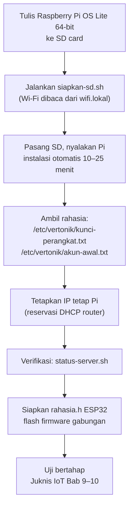

# PETUNJUK TEKNIS (JUKNIS) INSTALASI DAN KONFIGURASI GARAP

| Atribut | Isi |
|---|---|
| Nomor dokumen | GARAP-JUKNIS-03 |
| Versi | 1.0 |
| Tanggal | 12 November 2026 |
| Pembaca | 🔧 **KHUSUS TEKNISI** dan pengelola sistem. Operator tidak menjalankan prosedur ini. |
| Sumber | `deploy-pi/MULAI_DEPLOY.md`, `deploy-pi/PANDUAN_SERVER_PI.md`, `deploy-pi/PANDUAN_MQTT.md`, `deploy-pi/mosquitto/*`, `deploy-pi/systemd/vertonik-api.service`, `deploy-pi/nginx/vertonik.conf`, firmware `gabungan.ino` |

> ⛔ **BELUM DIIZINKAN.** Instalasi tidak boleh mengubah gerbang dosis (`EKSEKUSI_DIIZINKAN`) di backend. Jangan menjalankan perintah DOSIS dari web, curl, atau Serial — server menolaknya (`423`) dan itu disengaja.

> ⚠️ **Rahasia.** Sandi Wi-Fi, API key perangkat, dan akun awal tersimpan di berkas lokal (`*.lokal`, `rahasia.h`, `/etc/vertonik/*.txt`). Jangan menyalinnya ke dokumen, chat, atau repository.

---

## 1. Komponen Perangkat Lunak di Raspberry Pi

| Layanan | Fungsi | Port | Berkas |
|---|---|---|---|
| `vertonik-api` (Node.js) | API GARAP | 127.0.0.1:8000 | `systemd/vertonik-api.service`, `WorkingDirectory=/opt/vertonik/backend` |
| PostgreSQL | Basis data | lokal | — |
| Mosquitto | Broker MQTT | 1883 (semua antarmuka), tanpa anonim | `mosquitto/garap.conf`, `garap.acl` |
| nginx | Web + reverse proxy | 80 (hanya `/api/device/` dan alih ke HTTPS), 443 | `nginx/vertonik.conf`, `server_name garap.local vertonik.local` |
| Ollama | Asisten AI lokal (saran saja) | lokal | `ollama/Modelfile.garap` |
| fail2ban | Pengaman login SSH | — | dicek oleh `status-server.sh` |

Spesifikasi Pi (model, RAM, kapasitas SD): [PERLU VERIFIKASI]. Panduan lama menyebut Raspberry Pi 4/5 dengan Raspberry Pi OS Lite 64-bit.

## 2. Alur Instalasi

## 3. Langkah Instalasi Raspberry Pi (Jalur SD card baru)

1. Buka **Raspberry Pi Imager** → pilih perangkat → **Raspberry Pi OS Lite (64-bit)** → pilih SD card dengan hati-hati → **Write**. Pada pertanyaan *OS customisation*, pilih **No/Skip**.
2. Cabut dan pasang lagi SD card agar volume `bootfs` muncul.
3. Di folder proyek: `bash deploy-pi/siapkan-sd.sh`.
4. Pasang SD ke Pi, sambungkan kabel LAN bila ada, nyalakan. Tunggu 10–25 menit.
5. Pantau: `ssh <user>@vertonik.local 'sudo tail -f /var/log/vertonik-install.log'`.
6. Ambil rahasia hasil instalasi dari `/etc/vertonik/` dan simpan di tempat aman.
7. Tetapkan IP tetap: reservasi DHCP di router (disarankan), atau `sudo bash pasang-server.sh --ip-statis <IP>/24 --gateway <GW>`.

Jalur B (Pi sudah ber-OS dan bisa SSH): lihat `deploy-pi/MULAI_DEPLOY.md` Bab 3.

## 4. Verifikasi Server

| Uji | Perintah / cara | Hasil normal |
|---|---|---|
| Layanan | `sudo bash /opt/vertonik/deploy-pi/status-server.sh` | `vertonik-api`, `postgresql`, `nginx`, `fail2ban`, `ollama` = active |
| Web | Browser ke `https://<ip-pi>/` | Halaman GARAP |
| Pengaman perangkat | `curl http://<ip-pi>/api/device/v1/ambang` tanpa kunci | 403 |
| Broker | Koneksi anonim ke 1883 | Ditolak |
| Wi-Fi client isolation | `ping <ip-pi>` dari laptop di Wi-Fi yang sama | Berhasil. Bila gagal: matikan isolasi di router atau pakai hotspot Pi (`Vertoniksmartfarm`, Pi = `10.42.0.1`) |

## 5. Konfigurasi MQTT

`deploy-pi/mosquitto/garap.conf`:

| Kunci | Nilai |
|---|---|
| `listener` | `1883 0.0.0.0` |
| `allow_anonymous` | `false` |
| `password_file` | `/etc/mosquitto/garap.passwd` |
| `acl_file` | `/etc/mosquitto/garap.acl` |
| `max_packet_size` | 4096 |
| `max_queued_messages` | 100 |

Pengguna MQTT dan hak topik (ACL): `garap-api` (backend), `sensor-01` (rancangan dua papan), `aktuator-01` (papan gabungan: tulis `data`, `status`, `hasil`; baca `perintah`, `ack`, `garap/server/status`). Backend memeriksa ulang peran dan API key setiap pesan.

Variabel backend (`.env`, nilai tidak dicantumkan): `MQTT_URL`, `MQTT_USER`, `MQTT_PASS`. Kosong = jembatan MQTT mati, HTTP tetap jalan.

## 6. Konfigurasi Backend yang Berkaitan dengan Keselamatan

| Variabel / konstanta | Nilai bawaan | Arti | Boleh diubah teknisi? |
|---|---|---|---|
| `EKSEKUSI_DIIZINKAN` (kode, `gerbangDosis.js`) | `false` | Gerbang eksekusi dosis | ⛔ **Tidak.** Hanya lewat perubahan kode + review + keputusan pemilik |
| `UJI_POMPA_DIIZINKAN` (`.env`) | tidak diisi = mati | Izin uji/kalibrasi pompa dari aplikasi (fitur sedang dikembangkan) | Hanya admin server, untuk sesi uji air bersih, lalu dimatikan lagi |
| `SIKLUS_PENJADWAL` (`.env`) | tidak diisi = mati | Penjadwal konfirmasi siklus budidaya | Belum ada antarmukanya; biarkan mati |
| Variabel `OTOMASI*` | dihapus | Pengendali dosis lama | Tidak dibaca lagi |

## 7. Konfigurasi dan Flash Firmware ESP32

1. Salin `deploy-pi/firmware/gabungan/rahasia.h.contoh` → `rahasia.h` (berkas ini diabaikan git).
2. Isi:

| Kunci | Isi |
|---|---|
| `WIFI_JARINGAN` | Daftar Wi-Fi 2,4 GHz dan sandinya |
| `SERVER_IP` | IP Pi cadangan bila mDNS dan pemindaian gagal |
| `ID_MEJA` | ID meja/penampung dari menu **Meja Tanaman** (0 = bacaan umum) |
| `API_KEY_AKTUATOR` | Baris `aktuator-01` dari `/etc/vertonik/kunci-perangkat.txt` |
| `AKTIFKAN_BACA_ESTOP` | **Biarkan 1** di lapangan. 0 hanya untuk meja uji tanpa pompa. |

3. Arduino IDE: board **ESP32 Dev Module**; pustaka ArduinoJson 7.x, PubSubClient 2.8, OneWire, DallasTemperature, Adafruit SHT31 (+ Adafruit BusIO).
4. Upload, buka Serial Monitor 115200. Pastikan muncul `ADS1115 ada, SHT31 ada, LCD ada` dan koneksi MQTT berhasil.

> ⚠️ **Koreksi panduan lama.** `MULAI_DEPLOY.md` dan `PANDUAN_SERVER_PI.md` menyuruh "jumper GPIO13 ke GND" bila E-STOP belum dipasang. Pada firmware gabungan, **GPIO 13 adalah lampu merah**; E-STOP dibaca di **GPIO 36** lewat pembagi 33k/10k. Jangan ikuti instruksi lama itu. Panduan lama juga menyuruh "kirim DOSIS kecil"; perintah itu kini ditolak server dan **tidak boleh** dicoba.

## 8. Cadangan dan Pemulihan Data

Ikuti `docs/BACKUP_RESTORE_PI.md`. Prinsip: dump basis data ke folder cadangan, periksa berkas tidak kosong, simpan salinan di luar Pi. Jadwal cadangan: minimal bulanan dan sebelum pembaruan.

## 9. Daftar Periksa Serah Terima Instalasi

- [ ] Semua layanan aktif (`status-server.sh`).
- [ ] IP tetap Pi tercatat: [PERLU VERIFIKASI].
- [ ] Sandi bawaan akun Pi dan aplikasi sudah diganti (risiko P1 di audit 11 Nov 2026).
- [ ] ESP32 tersambung, LCD `MODE: MQTT AKTIF`.
- [ ] Uji Juknis IoT Bab 9 (sensor) dan 10.1 (pengaman) lulus.
- [ ] `EKSEKUSI_DIIZINKAN` tetap `false`.
- [ ] Cadangan basis data pertama dibuat.
