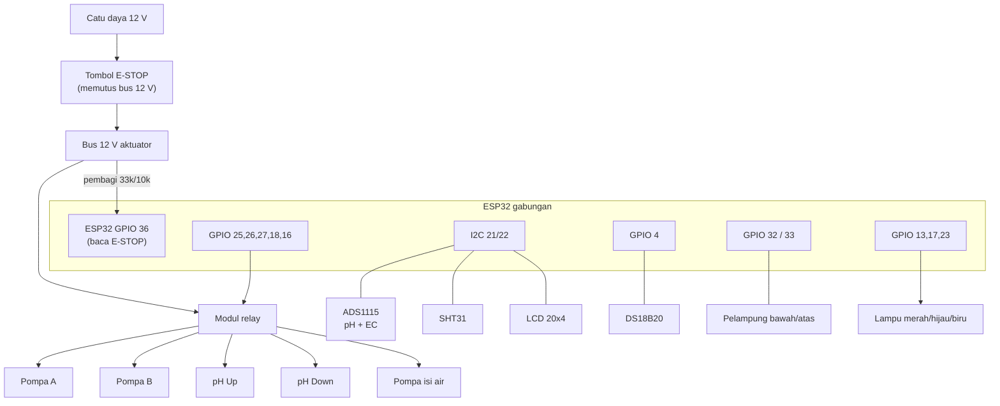
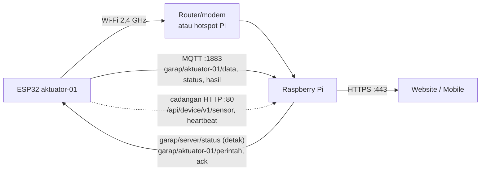

# PETUNJUK TEKNIS (JUKNIS) PENGOPERASIAN PERANGKAT IoT GARAP

| Atribut | Isi |
|---|---|
| Nomor dokumen | GARAP-JUKNIS-02 |
| Versi | 1.0 |
| Tanggal | 12 November 2026 |
| Berlaku untuk | Papan ESP32 gabungan, firmware `gabungan-0.6` (`deploy-pi/firmware/gabungan/gabungan.ino`), Raspberry Pi (`deploy-pi/`) |
| Status perangkat | **BELUM TERVERIFIKASI di lapangan.** Firmware v0.6 sudah di-commit (12 Nov 2026) tetapi belum di-flash dan diuji dalam audit ini. Raspberry Pi tidak terjangkau saat audit 11 November 2026. |

**Penanda di dokumen ini**

| Penanda | Arti |
|---|---|
| 🔧 **KHUSUS TEKNISI** | Hanya boleh dikerjakan teknisi IoT yang terlatih |
| ⚠️ **PERINGATAN** | Risiko listrik, cairan kimia, atau kerusakan tanaman |
| ⛔ **BELUM DIIZINKAN** | Prosedur yang tidak boleh dijalankan sampai ada keputusan pemilik |
| [PERLU VERIFIKASI] | Data tidak ditemukan di konfigurasi; cocokkan dengan perangkat nyata |

> ⛔ **BELUM DIIZINKAN — EKSEKUSI DOSING.** Server menolak setiap perintah dosis nutrisi/pH (`EKSEKUSI_DIIZINKAN = false`). Juknis ini **tidak** berisi prosedur menjalankan dosing otomatis. Pompa A, B, pH Up, dan pH Down hanya boleh dijalankan untuk **uji dengan air bersih** oleh teknisi.

---

## 1. Pengenalan Perangkat

Perangkat GARAP adalah panel kontrol di dekat tandon. Isinya satu papan **ESP32 gabungan** yang membaca sensor dan mengendalikan pompa. ESP32 terhubung lewat Wi-Fi ke **Raspberry Pi** (server lokal). Operator membaca kondisi lewat **LCD** dan **lampu pilot** di panel, serta lewat website/aplikasi.

Identitas perangkat di sistem: **`aktuator-01`** (berperan "gabungan": sensor + aktuator).

## 2. Fungsi Masing-Masing Komponen

| Komponen | Fungsi | Pin / alamat (firmware) | Status |
|---|---|---|---|
| ESP32 Dev Module | Otak panel: baca sensor, kirim data, jalankan perintah aman | — | Ada |
| ADS1115 | Mengubah tegangan probe pH dan EC menjadi angka | I2C 0x48, SDA 21 / SCL 22; A0 = pH, A1 = EC (pembagi 10k/10k) | Ada |
| Probe pH | Mengukur keasaman larutan | lewat ADS1115 A0 | Model [PERLU VERIFIKASI] (prompt menyebut DFRobot Gravity KB2003) |
| Probe EC/TDS | Mengukur kepekatan nutrisi | lewat ADS1115 A1 | Model [PERLU VERIFIKASI] |
| DS18B20 | Suhu air tandon | GPIO 4 | Ada |
| SHT31 | Suhu dan kelembapan udara | I2C 0x44 | Ada (bukan DHT22) |
| Pompa peristaltik A dan B | Nutrisi A dan B | GPIO 25, 26 | ⛔ dosing BELUM DIIZINKAN |
| Pompa pH Up / pH Down | Koreksi pH | GPIO 27, 18 | ⛔ dosing BELUM DIIZINKAN |
| Pompa isi air | Mengisi tandon | GPIO 16 | Kontrol dari aplikasi TIDAK AKTIF |
| Modul relay | Saklar listrik pompa 12 V (HIGH = nyala) | — | Ada |
| Pelampung bawah | Air kurang → pompa nutrisi tidak boleh jalan | GPIO 32 | Ada |
| Pelampung atas | Penuh → pompa isi berhenti; kabel putus dibaca "penuh" | GPIO 33 | Ada |
| Lampu merah / hijau / biru | Status panel | GPIO 13 / 17 / 23 (via ULN2003) | Ada |
| LCD 20x4 | Tampilan nilai dan status | I2C 0x27 | Ada |
| Tombol RESET | Tampilkan info Wi-Fi/IP di LCD 4 detik; lepas kunci E-STOP lokal bila aman | GPIO 19 | Ada di v0.6 |
| Tombol E-STOP | Memutus bus 12 V aktuator; ESP32 membaca lewat pembagi 33k/10k | GPIO 36 | Ada |
| Catu daya 12 V | Daya pompa dan relay | — | Kapasitas [PERLU VERIFIKASI] |
| Solenoid valve | — | **Tidak ada di firmware aktif** | [PERLU VERIFIKASI] |
| Raspberry Pi | Server API, basis data, broker MQTT, web | — | Ada |

**Batas pengaman yang tertanam di firmware**

| Batas | Nilai |
|---|---|
| Maks per suntikan A+B / pH | 214 mL / 10 mL |
| Maks per jam A+B / pH | 450 mL / 30 mL |
| Maks durasi pompa A, B / pH Up, pH Down / isi air | 70 detik / 12 detik / 600 detik |
| Jeda pompa A ke B | 60 detik |
| Uji pompa | maks 120 detik |
| Fail-safe tanpa detak server | 30 detik |
| Interval kirim sensor / status | 5 detik / 30 detik |
| Laju pompa awal | 0 mL/detik = **belum dikalibrasi**, perintah berbasis mL ditolak |

## 3. Arsitektur Perangkat



## 4. Diagram Koneksi Sistem



**Cara ESP32 menemukan server:** nama mDNS `garap.local`, `vertonik.local`, `vertonic.local`; pemindaian subnet umum (192.168.8.x, 192.168.100.x, 192.168.1.x, 192.168.0.x, 172.20.10.x); IP cadangan `SERVER_IP` di `rahasia.h`; alamat hotspot Pi `10.42.0.1`; atau IP yang disimpan teknisi lewat Serial. Alamat IP Pi di greenhouse: [PERLU VERIFIKASI] (audit 11 Nov 2026 mencoba `192.168.1.172`, tidak terjangkau).

**Wi-Fi yang dicoba** (dari `rahasia.h.contoh`): `VertonikModem`, `Pokjar Permata`, `Biruni`, `Rumah Permata`, `WALAWE`, `Vertoniksmartfarm` (hotspot Pi). Daftar aktual di `rahasia.h` lapangan [PERLU VERIFIKASI]. Hanya Wi-Fi **2,4 GHz**.

## 5. Persiapan Sebelum Menyalakan Perangkat

- [ ] Lantai sekitar panel kering; tangan kering.
- [ ] Panel tertutup; tidak ada kabel terkelupas atau terendam.
- [ ] Tombol **E-STOP** mudah dijangkau dan dalam posisi lepas (tidak tertekan).
- [ ] Tandon berisi air sampai di atas pelampung bawah.
- [ ] Probe pH dan EC terendam; tutup penyimpanan probe pH sudah dilepas.
- [ ] Selang pompa nutrisi/pH tidak bocor dan tidak tertekuk.
- [ ] Raspberry Pi menyala (lampu daya Pi menyala).
- [ ] Router/modem Wi-Fi menyala.

🔧 **KHUSUS TEKNISI (instalasi pertama atau setelah perbaikan):**

- [ ] Kabel dicocokkan dengan peta pin Bab 2.
- [ ] Multimeter: tidak ada hubung singkat 12 V–GND dan 3,3 V–GND.
- [ ] Pembagi tegangan 33k/10k terpasang di GPIO 36. Tanpa pembagi, pin terbaca "E-STOP ditekan" dan semua pompa terkunci.
- [ ] `AKTIFKAN_BACA_ESTOP` **tidak** diubah ke 0 (nilai 0 hanya untuk meja uji tanpa pompa).
- [ ] Pompa 12 V lewat relay + dioda flyback, tidak mengambil daya dari pin ESP32.

## 6. Prosedur Menyalakan Perangkat

1. Nyalakan **Raspberry Pi**. Tunggu sekitar 2 menit.
2. Nyalakan **catu daya panel**.
3. Perhatikan LCD. Urutan normal:
   - `WIFI MATI` → mencari Wi-Fi.
   - `TUNGGU SERVER...` → Wi-Fi tersambung, menunggu detak server.
   - `PENAMPUNG CUKUP` / `PENAMPUNG KURANG` / `PENAMPUNG PENUH` → siap.
4. Perhatikan lampu:

| Lampu | Arti |
|---|---|
| Hijau saja | Normal |
| Merah + hijau bersamaan | Peringatan: server belum tersambung, MQTT putus, atau air kurang |
| Merah saja | **E-STOP aktif** |
| Biru menyala | Ada pompa yang sedang bekerja |

5. Buka website → Dashboard. Label harus **Alat tersambung** dan angka berubah.

## 7. Prosedur Menghubungkan Perangkat ke Jaringan

**Cara operator:** tekan tombol **RESET** sekali. LCD menampilkan selama 4 detik:

```
WIFI:<nama Wi-Fi>
ESP :<IP ESP32>
SRV :<IP server>
MODE: MQTT AKTIF / HTTP (NO MQTT) / MENUNGGU...
```

Catat isinya dan laporkan ke teknisi bila tidak `MQTT AKTIF`.

🔧 **KHUSUS TEKNISI — menambah Wi-Fi atau IP server tanpa compile ulang:**

1. Sambungkan ESP32 ke laptop dengan kabel USB, buka Serial Monitor **115200 baud**.
2. Perintah yang tersedia: `status`, `scan`, `cari`, `baca`, `wifi <SSID>|<SANDI>`, `server <IP>`, `help`.
3. Ketik `scan` untuk melihat Wi-Fi 2,4 GHz sekitar.
4. Ketik `wifi NAMA|SANDI` untuk menyimpan Wi-Fi baru (tersimpan permanen di NVS).
5. Ketik `server <IP Pi>` bila server tidak ditemukan otomatis.
6. Ketik `status` untuk memastikan.

> ⚠️ Jangan menuliskan sandi Wi-Fi di kertas yang ditempel di panel atau di dokumen umum.

## 8. Pemeriksaan Koneksi MQTT

| Cara | Langkah | Normal |
|---|---|---|
| LCD | Tekan RESET | `MODE: MQTT AKTIF` |
| Website | **SISTEM → Koneksi Alat** | Broker siap; alat `aktuator-01` |
| Serial 🔧 | ketik `status` | `MQTT=OK` |
| Pi 🔧 | `sudo bash /opt/vertonik/deploy-pi/status-server.sh` | Layanan `vertonik-api`, `postgresql`, `nginx` aktif |

Bila LCD menunjukkan `HTTP SENSOR ONLY`: port MQTT 1883 diblokir. Data sensor tetap masuk lewat HTTP, tetapi **semua pompa tetap terkunci** oleh fail-safe. Laporkan ke teknisi.

Topik MQTT (`deploy-pi/mosquitto/garap.acl`):

| Topik | Arah | Isi |
|---|---|---|
| `garap/aktuator-01/data` | ESP32 → Pi | Bacaan sensor tiap 5 detik |
| `garap/aktuator-01/status` | ESP32 → Pi | Status tiap 30 detik (retained, LWT) |
| `garap/aktuator-01/hasil` | ESP32 → Pi | Hasil perintah, diulang sampai di-ack |
| `garap/aktuator-01/perintah` | Pi → ESP32 | Perintah (STOP, STOP_DARURAT, uji, kalibrasi) |
| `garap/aktuator-01/ack` | Pi → ESP32 | Tanda terima hasil |
| `garap/server/status` | Pi → ESP32 | Detak server `{online, estop}` |

## 9. Pemeriksaan Pembacaan Sensor

Bandingkan **LCD**, **website (Sensor)**, dan **alat ukur pembanding**.

| Sensor | Tampilan LCD | Lulus bila (selisih terhadap pembanding) |
|---|---|---|
| EC/TDS | baris 1 `EC x.xxmS  xxxxppm` | ≤ 5 % setelah kalibrasi (larutan 1.413 µS/cm) |
| pH | baris 2 `pH x.xx` | ≤ 0,1 setelah kalibrasi (buffer 4,0 dan 7,0) |
| Suhu air | baris 2 `Air xx.xC` | ≤ 0,5 °C |
| Suhu/RH ruang | baris 3 `Ruang xxC  RH xx%` | ≤ 2 °C, ≤ 5 % RH |

Tanda `pH --.--` atau `EC ----` = probe tidak terbaca (lepas/rusak). Website juga tidak menampilkan angka baru untuk sensor itu.

**Batas yang dipakai server**

| Jenis | Nilai | Akibat |
|---|---|---|
| Batas fisik | pH 0–14, TDS 0–5.000 ppm, suhu −50–80 °C, RH 0–100 % | Di luar ini ditolak, tidak disimpan |
| Batas kewajaran | pH 3–9, TDS 50–2.500 ppm, suhu air 5–45 °C | Disimpan tetapi ditandai tidak wajar; AI menyarankan periksa alat |
| Bacaan basi | lebih dari 120 detik | Ditandai basi |

## 10. Pemeriksaan Aktuator

🔧 **KHUSUS TEKNISI.** Operator tidak menjalankan pompa.

> ⚠️ **PERINGATAN:** Semua uji pompa memakai **air bersih**. Selang keluaran ke **gelas ukur**, bukan ke tandon tanaman. Satu orang berjaga di tombol E-STOP.

**10.1 Uji masukan pengaman (pompa tanpa daya)**

| Uji | Cara | Lulus bila |
|---|---|---|
| Pelampung bawah | Turunkan dengan tangan | LCD `PENAMPUNG KURANG`, lampu merah + hijau |
| Pelampung atas | Angkat | LCD `PENAMPUNG PENUH` |
| Kabel pelampung atas putus | Cabut | Terbaca penuh |
| E-STOP | Tekan | LCD `E-STOP AKTIF!`, lampu merah saja |

**10.2 Uji pompa satu per satu (air bersih)**

Uji pompa dari aplikasi (halaman Kalibrasi) **dikunci bawaan**: server hanya menerimanya dari **admin** bila admin server mengaktifkan `UJI_POMPA_DIIZINKAN=1` dan **mode pemeliharaan** aktif. Bila belum, uji ditunda.

1. Aktifkan mode pemeliharaan (halaman Kalibrasi).
2. Jalankan uji pompa A selama 5 detik.
3. Pastikan hanya pompa A berputar, lampu biru menyala, LCD `DOSING A...`, lalu berhenti sendiri.
4. Ulangi untuk B, pH Up, pH Down, isi air.
5. Pompa yang salah berputar = kabel relay tertukar. Perbaiki kabel, jangan ubah kode.

**10.3 Uji pengaman saat pompa berjalan (air bersih)**

| Uji | Lulus bila |
|---|---|
| Tekan E-STOP saat pompa jalan | Pompa berhenti seketika |
| Matikan layanan API di Pi | Pompa berhenti ≤ 30 detik |
| Matikan Wi-Fi | Pompa berhenti ≤ 30 detik |
| Turunkan pelampung bawah saat pompa nutrisi jalan | Berhenti, alasan `air_kurang_float_bawah` |
| Angkat pelampung atas saat isi air | Berhenti, alasan `tandon_penuh` |
| Cabut daya ESP32 saat pompa jalan | Pompa berhenti. Bila tetap jalan: **hentikan pemakaian**, perbaiki wiring relay |

Bila satu baris gagal, perangkat **tidak boleh** dipasang ke tandon tanaman.

## 11. Monitoring Kondisi Perangkat

| Pesan LCD baris 4 | Arti | Tindakan operator |
|---|---|---|
| `PENAMPUNG CUKUP` | Normal | — |
| `PENAMPUNG KURANG` | Pelampung bawah turun | Tambah air sesuai SOP |
| `PENAMPUNG PENUH` | Pelampung atas naik | Hentikan pengisian manual |
| `MENGISI AIR...` | Pompa isi bekerja | Awasi |
| `DOSING A...`, `DOSING B...`, `pH UP...`, `pH DOWN...` | Pompa penakar bekerja | Hanya boleh saat **uji teknisi**. Di luar itu: tekan E-STOP, laporkan |
| `TUNGGU SERVER...` | Belum ada detak server | SOP-02 Bab 5 |
| `WIFI MATI` | Wi-Fi putus | SOP-02 Bab 5 |
| `HTTP SENSOR ONLY` | MQTT diblokir | Laporkan teknisi |
| `E-STOP AKTIF!` | Darurat aktif | Lihat Bab 13 |

## 12. Prosedur Mematikan Perangkat

1. Pastikan tidak ada pompa bekerja (lampu biru padam).
2. Tekan **STOP** di aplikasi bila ada pekerjaan; tunggu konfirmasi.
3. Matikan **catu daya panel**.
4. Bila Pi juga dimatikan 🔧: `sudo shutdown -h now` lewat SSH, tunggu lampu aktivitas Pi padam, baru cabut daya. **Jangan cabut daya Pi langsung** (risiko basis data rusak).
5. Catat waktu dan alasan di buku log.

## 13. Prosedur Restart

| Situasi | Langkah |
|---|---|
| ESP32 macet (LCD membeku) | Matikan daya panel 10 detik, nyalakan lagi. ESP32 juga punya watchdog yang me-reset otomatis. Saat boot semua output OFF lebih dulu. |
| Setelah E-STOP | 1) Periksa dan atasi penyebab. 2) Putar/lepas tombol E-STOP. 3) Bila E-STOP juga aktif di server (dari aplikasi atau perintah STOP_DARURAT), **admin** mereset E-STOP di server. 4) Kunci E-STOP lokal lepas sendiri bila tombol lepas, server sudah reset, dan detak server segar; atau tekan RESET. |
| Layanan API Pi 🔧 | `sudo systemctl restart vertonik-api` lalu cek `status-server.sh` |
| Pi seluruhnya 🔧 | `sudo reboot` |

## 14. Troubleshooting

| Gejala | Penyebab mungkin | Tindakan |
|---|---|---|
| LCD mati | Daya panel atau ESP32 mati | Cek steker/sekring; 🔧 cek catu daya |
| LCD `WIFI MATI` lama | Router mati, sandi berubah, Wi-Fi 5 GHz | Cek router; 🔧 `scan`, `wifi SSID|SANDI` |
| LCD `TUNGGU SERVER...` | Pi mati, IP berubah, layanan API mati | Cek Pi; 🔧 `server <IP>`, `status-server.sh` |
| `HTTP SENSOR ONLY` | Port 1883 diblokir | 🔧 buka port di router/ufw |
| Lampu merah saja | E-STOP aktif | Bab 13 |
| Semua perintah ditolak `estop` meski tombol lepas | Pembagi 33k/10k GPIO 36 tidak terpasang | 🔧 pasang pembagi |
| `pH --.--` / `EC ----` | Probe lepas/rusak, ADS1115 tak terbaca | Cek konektor; 🔧 Serial `ADS1115 TIDAK TERBACA` |
| Angka pH/EC tampak wajar tapi beda dari pembanding | Belum dikalibrasi | SOP-02 Bab 3 |
| Pompa tidak jalan saat uji | Laju belum dikalibrasi (`belum_dikalibrasi`), E-STOP, air kurang, server hilang | Lihat alasan di Koneksi Alat |
| Pompa jalan sendiri tanpa uji | **Gangguan berbahaya** | Tekan **E-STOP**, matikan daya, laporkan |

## 15. Pemeliharaan Berkala

| Frekuensi | Kegiatan | Pelaksana |
|---|---|---|
| Harian | Cek LCD, lampu, kebocoran, level tandon | Operator |
| Mingguan | Bilas probe pH/EC dengan air suling; cek selang pompa; cek kabel dan konektor dari korosi | Teknisi |
| Bulanan | Kalibrasi pH dua titik dan EC; uji E-STOP dan pelampung; cek relay | Teknisi |
| 3 bulanan | Kalibrasi ulang laju pompa; cadangan basis data Pi | Teknisi + Admin |
| Sesuai umur pakai | Ganti probe pH | Teknisi; umur probe [PERLU VERIFIKASI] |

Rincian langkah ada di **SOP Pemeliharaan dan Penanganan Gangguan (GARAP-SOP-02)**.
