# PETUNJUK TEKNIS (JUKNIS) PENGOPERASIAN WEBSITE GARAP

| Atribut | Isi |
|---|---|
| Nomor dokumen | GARAP-JUKNIS-01 |
| Versi | 1.0 |
| Tanggal | 12 November 2026 |
| Berlaku untuk | Website GARAP (React), rute dan menu sesuai `react-web-app/src/router.tsx` dan `src/layouts/AppShell.tsx` |
| Sumber gambar | Tangkapan layar asli dari website lokal, akun **demo**, 12 November 2026. Data di layar adalah data pengembangan, alat sedang tidak tersambung. |
| Acuan | Juknas GARAP-JUKNAS-01 |

> [!WARNING]
> **Dosing otomatis BELUM DIIZINKAN.** Halaman **Target Nutrisi**, **Saklar**, dan **Kalibrasi** hanya menyimpan pengaturan. Tidak ada tombol di website yang menjalankan dosis nutrisi atau pH. Server menolak setiap perintah dosis (`423`).

---

## Daftar Isi

1. Akses dan hak pengguna
2. Login dan logout
3. Tata letak layar
4. Dashboard
5. Sensor (monitoring)
6. Peringatan (notifikasi)
7. Kebun Saya (pengelolaan tanaman)
8. Siklus Tanam: Semai, Peremajaan, Pendewasaan, Panen (konfirmasi tahap)
9. Target Nutrisi (preset, target nutrisi, parameter)
10. Saklar
11. Kalibrasi
12. Data, Laporan, dan Riwayat Audit (riwayat data)
13. Master Data: Jenis Tanaman, Meja Tanaman (tandon), Ambang Sensor
14. Sistem: Pengaturan Alat, Pemulihan Papan, Koneksi Alat
15. Manajemen User dan Akun Saya (pengaturan pengguna)
16. CCTV dan Asisten AI
17. Tombol STOP pompa
18. Fitur yang belum tersedia
19. Tabel masalah umum

---

## 1. Akses dan Hak Pengguna

Website dibuka melalui browser ke alamat server Raspberry Pi, misalnya `https://garap.local` atau `https://vertonik.local` (alamat IP Pi bila nama tidak ditemukan). Alamat tetap greenhouse: [PERLU VERIFIKASI].

| Menu | Admin | Petani | Demo |
|---|---|---|---|
| Dashboard, Sensor, Peringatan, CCTV, Asisten AI, Kebun Saya, Akun Saya | Ya | Ya | Ya (lihat) |
| Saklar, Target Nutrisi, Kalibrasi, Data, Catatan Aktivitas, Laporan | Ya | Tidak | Ya (lihat) |
| Pengaturan Alat, Pemulihan Papan, Koneksi Alat, Manajemen User | Ya | Tidak | Ya (lihat) |
| Semai, Peremajaan, Pendewasaan, Panen | Ya | Tidak | Ya (lihat) |
| Jenis Tanaman, Meja Tanaman, Ambang Sensor | Ya | Tidak | Ya (lihat) |
| Mengubah data | Ya | Terbatas (mulai semai, selesaikan tahap) | **Tidak** (ditolak 403) |

Akun demo menampilkan pita **"Mode Demo (Hanya Terima Data)"** di bagian atas layar.

---

## 2. Login dan Logout

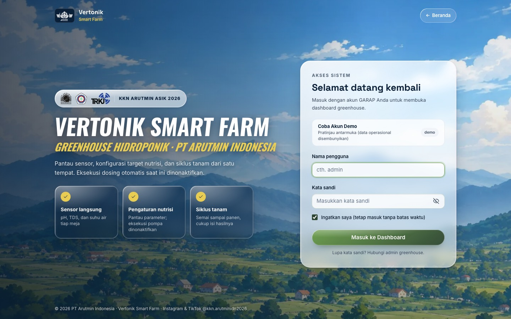

| Butir | Uraian |
|---|---|
| Fungsi | Memastikan hanya pengguna terdaftar yang membuka GARAP |
| Persyaratan | Akun dibuat admin; komputer/HP tersambung ke jaringan greenhouse |

**Langkah login**

1. Buka alamat website di browser.
2. Isi **Nama pengguna** dan **Kata sandi**.
3. Centang **Ingatkan saya** hanya di perangkat pribadi.
4. Tekan **Masuk ke Dashboard**.

**Tombol dan menu**

| Elemen | Fungsi |
|---|---|
| Coba Akun Demo | Mengisi nama pengguna demo untuk pratinjau baca-saja |
| Ingatkan saya | Sesi tetap aktif tanpa batas waktu di perangkat itu |
| Lupa kata sandi? | Hubungi admin greenhouse (tidak ada reset mandiri) |

**Logout:** tekan ikon keluar di bagian bawah menu kiri, lalu konfirmasi.

**Hasil yang diharapkan:** layar Dashboard terbuka.

| Masalah | Penyebab | Cara mengatasi |
|---|---|---|
| "Nama pengguna atau kata sandi salah" | Salah ketik | Periksa huruf besar/kecil |
| Ditolak sementara | Batas 10 percobaan per menit | Tunggu 1 menit |
| Halaman tidak terbuka | Tidak satu jaringan dengan Pi, atau Pi mati | Lihat SOP-02 Bab 5 |

---

## 3. Tata Letak Layar

- **Menu kiri (rail):** ikon kelompok menu PANTAU, KENDALI, DATA, SISTEM, SIKLUS TANAM, MASTER DATA; ikon Tentang Kami dan Keluar di bawah.
- **Bilah atas:** judul halaman, jam, tombol tema terang/gelap, nama pengguna.
- **Menu bawah (pil):** submenu dari kelompok yang sedang dibuka.
- Di ponsel, menu kiri berubah menjadi tombol menu.

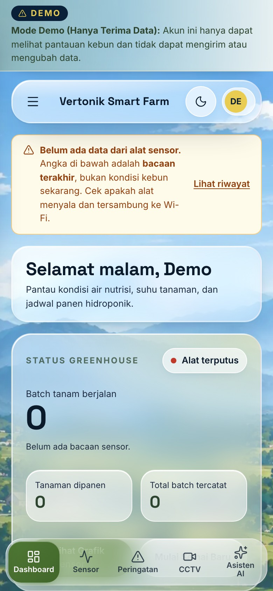

---

## 4. Dashboard

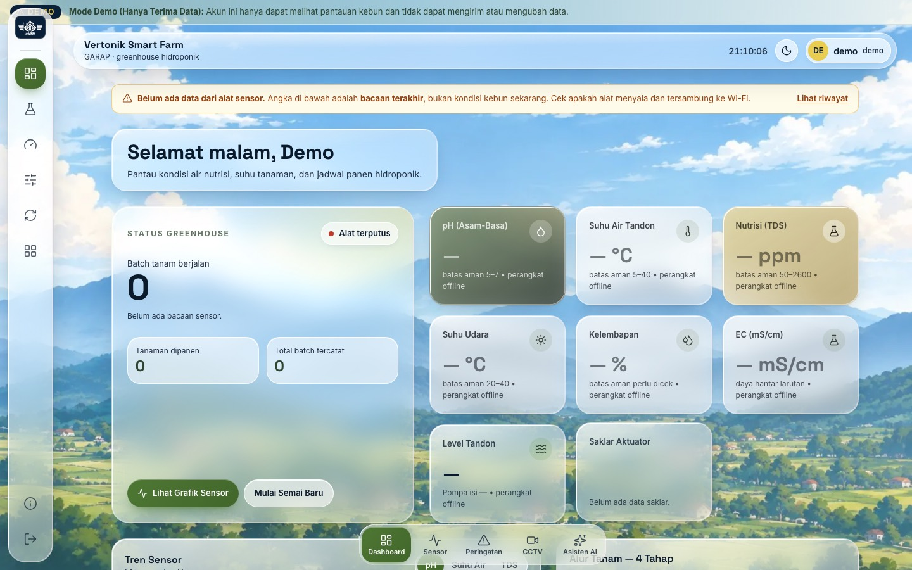

| Butir | Uraian |
|---|---|
| Fungsi | Ringkasan kondisi greenhouse dalam satu layar |
| Tujuan | Operator tahu dalam beberapa detik apakah kondisi aman |
| Persyaratan | Login |

**Isi layar**

| Bagian | Arti |
|---|---|
| Pita kuning "Belum ada data dari alat sensor" | Angka yang tampil adalah **bacaan terakhir**, bukan kondisi sekarang. Periksa alat. |
| Status Greenhouse | Jumlah batch berjalan, tanaman dipanen, total batch; label **Alat terputus / tersambung** |
| Kartu pH, Suhu Air Tandon, Nutrisi (TDS), Suhu Udara, Kelembapan, EC | Nilai terakhir dan batas aman |
| Level Tandon | Status pelampung dan pompa isi |
| Saklar Aktuator | Ringkasan saklar izin (klik untuk membuka Saklar) |
| Tren Sensor, Alur Tanam 4 Tahap | Grafik singkat dan ringkasan tahap |

| Tombol | Fungsi |
|---|---|
| Lihat Grafik Sensor | Membuka halaman Sensor |
| Mulai Semai Baru | Membuka formulir semai (admin) |
| Lihat riwayat | Membuka riwayat bacaan |

**Contoh:** pagi hari operator membuka Dashboard, melihat label **Alat tersambung**, pH 6,1 dalam batas 5–7, TDS dalam batas. Kondisi normal.

| Masalah | Cara mengatasi |
|---|---|
| Semua kartu "—" dan "perangkat offline" | Periksa panel (LCD, lampu) sesuai SOP-02 Bab 5 |
| Angka tidak berubah lama | Bacaan basi (>120 detik). Jangan ambil keputusan dari angka itu. |

---

## 5. Sensor (Monitoring)

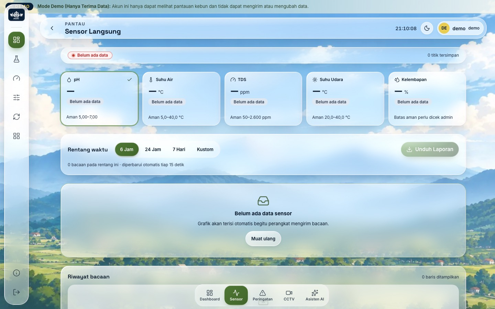

| Butir | Uraian |
|---|---|
| Fungsi | Grafik dan riwayat bacaan pH, suhu air, TDS, suhu udara, kelembapan |
| Persyaratan | Perangkat mengirim data |

**Langkah**

1. Buka **PANTAU → Sensor**.
2. Pilih **Rentang waktu**: 6 Jam, 24 Jam, 7 Hari, atau Kustom.
3. Baca kartu nilai (dengan batas aman) dan grafik.
4. Tekan **Unduh Laporan** untuk berkas Excel (`.xlsx`) berisi sheet Ringkasan dan Data; sel di luar ambang diberi warna.

Halaman diperbarui otomatis tiap **15 detik**.

| Masalah | Cara mengatasi |
|---|---|
| "Belum ada data sensor" | Alat belum mengirim. Cek koneksi alat. |
| Kelembapan "Batas aman perlu dicek admin" | Ambang kelembapan belum diatur benar di Master Data → Ambang Sensor |

---

## 6. Peringatan (Notifikasi)

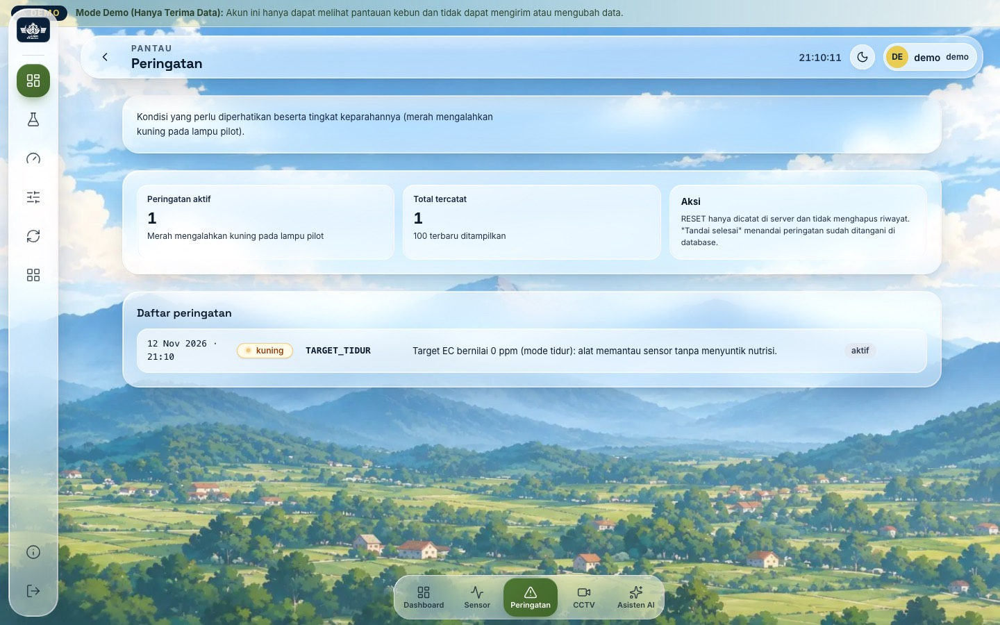

| Butir | Uraian |
|---|---|
| Fungsi | Menampilkan kondisi yang perlu diperhatikan beserta tingkat keparahan (merah, kuning) |
| Tujuan | Operator menanggapi kondisi tidak normal |

**Langkah**

1. Buka **PANTAU → Peringatan**.
2. Baca daftar: waktu, warna tingkat, kode, penjelasan, status (aktif/selesai).
3. Lakukan tindakan sesuai SOP-02.
4. **Admin** menekan **Tandai selesai** setelah penyebab ditangani. Tombol **RESET** hanya dicatat di server dan tidak menghapus riwayat.

**Contoh peringatan yang tampil:** `TARGET_TIDUR` (kuning) — target EC 0 ppm, alat memantau tanpa menyuntik nutrisi.

Notifikasi di **aplikasi mobile** memeriksa peringatan baru tiap 60 detik dan menampilkan paling banyak 3 peringatan baru per pemeriksaan.

---

## 7. Kebun Saya (Pengelolaan Tanaman)

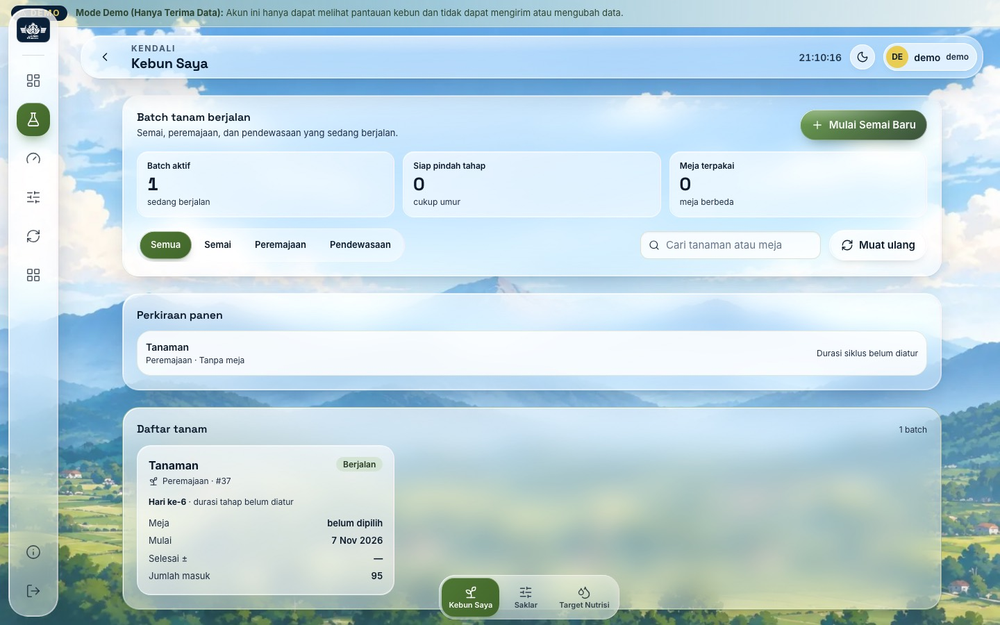

| Butir | Uraian |
|---|---|
| Fungsi | Daftar batch yang sedang berjalan, perkiraan panen, target nutrisi harian |
| Persyaratan | Jenis tanaman dan meja sudah ada di Master Data |

**Langkah memulai semai (admin; input jumlah bibit)**

1. Tekan **Mulai Semai Baru**.
2. Pilih **Tanaman** dan **Meja tanam**.
3. Isi **Jumlah benih** (tombol − / +).
4. Isi **Tanggal mulai semai** dan **Keterangan (opsional)**.
5. Simpan. Muncul pesan berhasil dan batch tampil di daftar.

| Elemen | Fungsi |
|---|---|
| Filter Semua / Semai / Peremajaan / Pendewasaan | Menyaring batch |
| Cari tanam aktif | Mencari menurut nama |
| Kartu batch | Tahap, hari ke-, meja, tanggal mulai, perkiraan selesai, jumlah masuk |
| Target nutrisi harian | Kurva ppm awal → target per tanaman |

| Masalah | Cara mengatasi |
|---|---|
| "Durasi siklus belum diatur" | Admin mengisi durasi tahap pada data tanaman |
| "Meja belum dipilih" | Pilih meja saat semai berikutnya; meja batch lama [PERLU VERIFIKASI] cara mengubahnya |

---

## 8. Siklus Tanam dan Konfirmasi Tahap Pertumbuhan

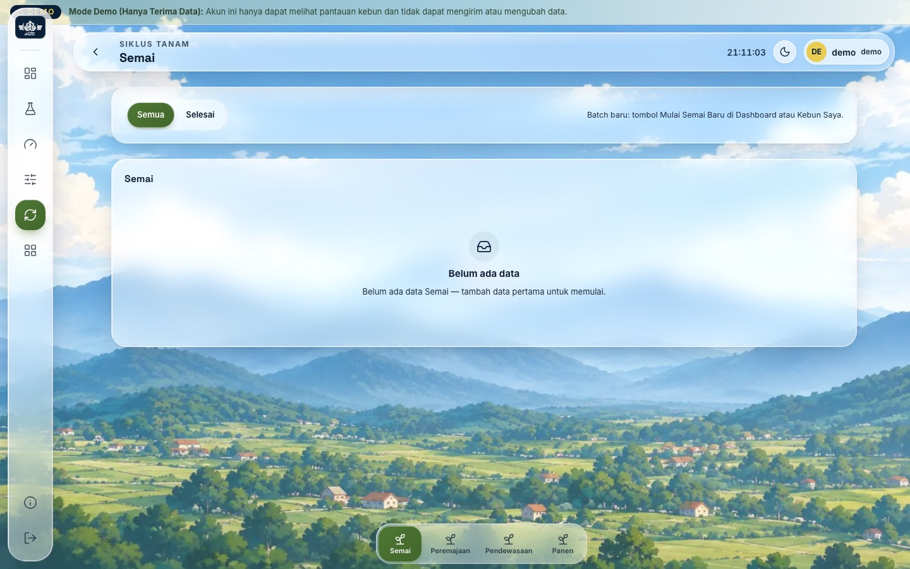

Menu **SIKLUS TANAM**: Semai (1) → Peremajaan (2) → Pendewasaan (3) → Panen (4).

| Butir | Uraian |
|---|---|
| Fungsi | Mencatat dan menutup tiap tahap |
| Konfirmasi tahap yang tersedia | Operator mengisi **jumlah tanaman yang berhasil**; server menghitung yang gagal dan **otomatis membuat tahap berikutnya** |

**Langkah menyelesaikan tahap**

1. Buka halaman tahap (mis. **Semai**).
2. Pada baris batch yang berjalan, tekan aksi selesaikan.
3. Isi **jumlah berhasil** (tidak boleh melebihi jumlah masuk). Sistem menampilkan jumlah gagal.
4. Simpan. Batch tahap berikutnya dibuat berisi tanaman yang berhasil.
5. Bila berhasil = 0, tahap tercatat **gagal**.

> [!NOTE]
> Konfirmasi peremajaan **H+4 (96 jam)** dengan batas jawab **24 jam**, konfirmasi tandon siap, dan konfirmasi jumlah benih versi baru **sudah ada di server tetapi belum ada tombolnya di website**. Lihat Bab 18.

---

## 9. Target Nutrisi (Preset, Target, Parameter)

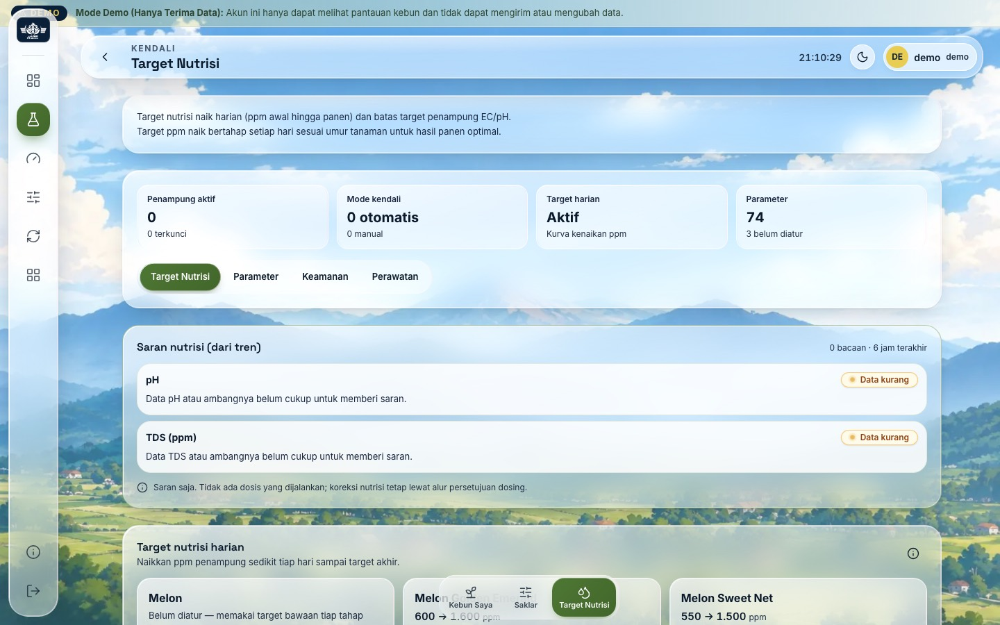

| Butir | Uraian |
|---|---|
| Fungsi | Mengatur target ppm naik harian per tanaman, batas target penampung EC/pH, parameter dosing dan waktu, aturan keamanan (fail-safe), jadwal perawatan |
| Hak | Admin mengubah; demo melihat |
| Penting | **Pengaturan saja.** Tidak menjalankan pompa. |

**Tab**

| Tab | Isi |
|---|---|
| Target Nutrisi | Kartu **Saran nutrisi (dari tren)** — saran teks, "Tidak ada dosis yang dijalankan"; **Target nutrisi harian** (ppm awal → target, jumlah hari, kenaikan per hari); **Target penampung** |
| Parameter | Parameter dosing dan waktu operasi; yang kosong ditandai **belum diatur** |
| Keamanan | Aturan fail-safe |
| Perawatan | Jadwal perawatan |

**Contoh pengaturan target awal:** Melon Golden Emerald 600 → 1.600 ppm dalam 45 hari = +22,2 ppm per hari.

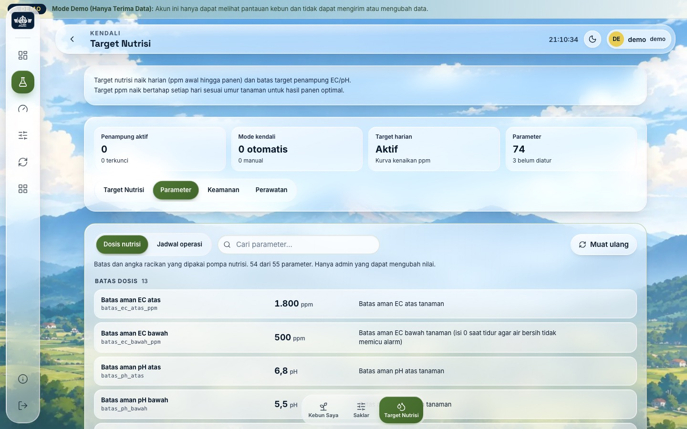

> [!IMPORTANT]
> Parameter keselamatan yang tidak berstatus **SIAP** (nilai sah dan tervalidasi) membuat fitur yang memakainya ditolak. **Jangan mengisi angka tebakan** untuk menghilangkan tanda "belum diatur".

**Target tiap penampung (pemilihan preset):** setiap penampung memakai mode **Otomatis** (target EC/pH diambil dari preset yang cocok dengan tanaman, tahap, dan umur batch yang berjalan) atau **Target manual** (admin mengisi sendiri). Tombol **Sinkronkan sekarang** menghitung ulang target semua penampung Otomatis dari preset aktif. Hasilnya **target** saja, bukan perintah pompa.

**Pengelolaan template preset:** formulir "Tambah preset nutrisi" (komponen `PresetNutrisi`) ada di kode tetapi **tidak dipasang** di halaman mana pun saat audit. Preset bervesi untuk siklus baru (`/api/preset`) hanya tersedia lewat API. Status: BELUM DIIMPLEMENTASIKAN di antarmuka.

---

## 10. Saklar

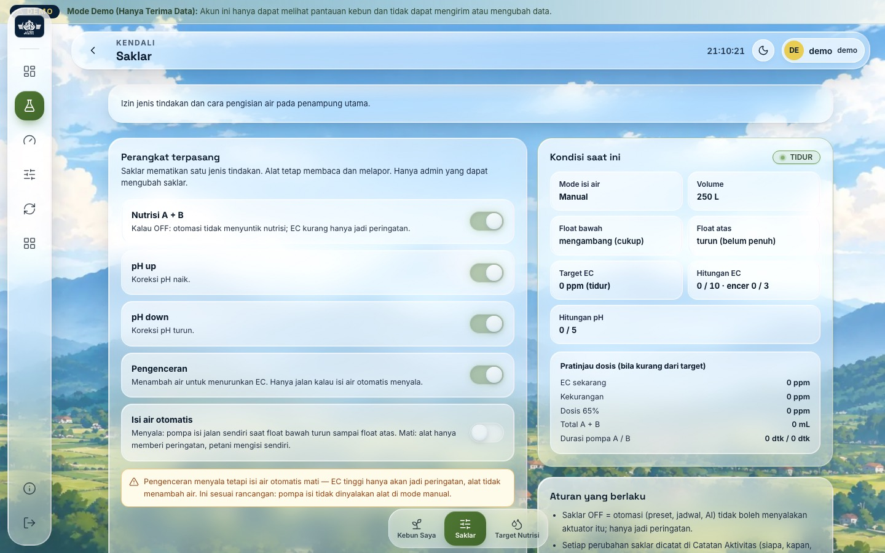

| Butir | Uraian |
|---|---|
| Fungsi | Izin per jenis tindakan: Nutrisi A + B, pH up, pH down, Pengenceran, Isi air otomatis |
| Hak | Hanya admin |
| Arti OFF | Otomasi (preset, jadwal, AI) tidak boleh menyalakan aktuator itu; hanya jadi peringatan |

Panel **Kondisi saat ini** menampilkan mode isi air, volume, status pelampung bawah/atas, target EC, hitungan koreksi, dan **Pratinjau dosis** (perhitungan saja).

> [!WARNING]
> Saklar **ON tidak berarti dosing berjalan.** Eksekusi dosing tetap diblokir oleh gerbang server. Setiap perubahan saklar dicatat di Catatan Aktivitas.

---

## 11. Kalibrasi

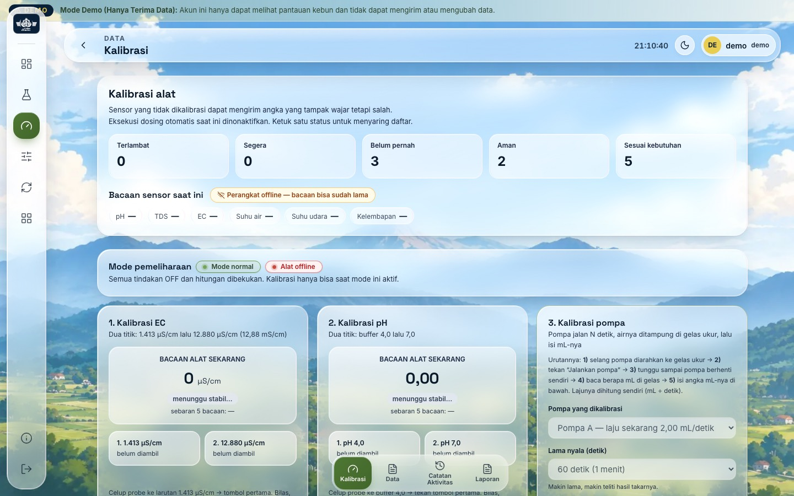

| Butir | Uraian |
|---|---|
| Fungsi | Status jadwal kalibrasi (Terlambat, Segera, Belum pernah, Aman), kalibrasi EC dua titik (1.413 dan 12.880 µS/cm), pH dua titik (buffer 4,0 dan 7,0), kalibrasi laju pompa |
| Syarat | **Mode pemeliharaan** aktif; alat online |
| Pelaksana | Teknisi bersama admin |

**Langkah kalibrasi pH (ringkas)** — rinci di SOP-02 Bab 3:

1. Aktifkan **Mode pemeliharaan**.
2. Celup probe ke buffer **4,0**, tunggu "stabil", tekan tombol titik 1.
3. Bilas probe dengan air suling, celup ke buffer **7,0**, tunggu stabil, tekan tombol titik 2.
4. Catat hasil, kembalikan ke mode normal.

> [!CAUTION]
> Menurut kode server (commit `0383c55`): kalibrasi **pH** dua titik dikirim ke ESP32 sebagai tegangan probe (`ph_v7`/`ph_v4`) bila alat melaporkan `ph_volt`; bila belum, server menjawab "BELUM dikirim ke alat". Kalibrasi **EC** dua titik **hanya tersimpan di server**, belum dikirim ke ESP32, walau teks di layar menyebut alat langsung mengirim. Status: **BELUM TERVERIFIKASI** di perangkat. Bandingkan bacaan dengan alat ukur pembanding setelah kalibrasi.

**Kalibrasi pompa:** jalankan pompa N detik ke gelas ukur, isi mL hasilnya, laju dihitung otomatis. Perintah dikirim ke alat (commit `0383c55`), tetapi **dikunci bawaan**: server menolak bila `UJI_POMPA_DIIZINKAN` belum diaktifkan admin server atau mode pemeliharaan tidak aktif. Uji selalu dengan **air bersih**.

---

## 12. Data, Laporan, dan Riwayat (Riwayat Data)

| Halaman | Fungsi | Langkah utama |
|---|---|---|
| **Data** (`/data`) | Takaran larutan hasil penakaran nyata (uji lab), dipisah tanaman dan buah | Lihat tabel; admin menambah data |
| **Laporan** (`/laporan`) | Matriks bulanan: jumlah semai, peremajaan, pendewasaan, panen, rata-rata pH | Pilih rentang (Semua, 6 Bulan, 12 Bulan, Kustom) → **Terapkan** → **Unduh Laporan** |
| Ekspor CSV (di Laporan) | Data sensor, Peringatan, Panen | Pilih jenis, tanggal Dari/Sampai → ekspor |
| **Catatan Aktivitas** (`/audit`) | Jejak setiap tambah, ubah, hapus, dan masuk | Klik baris untuk detail sebelum/sesudah |

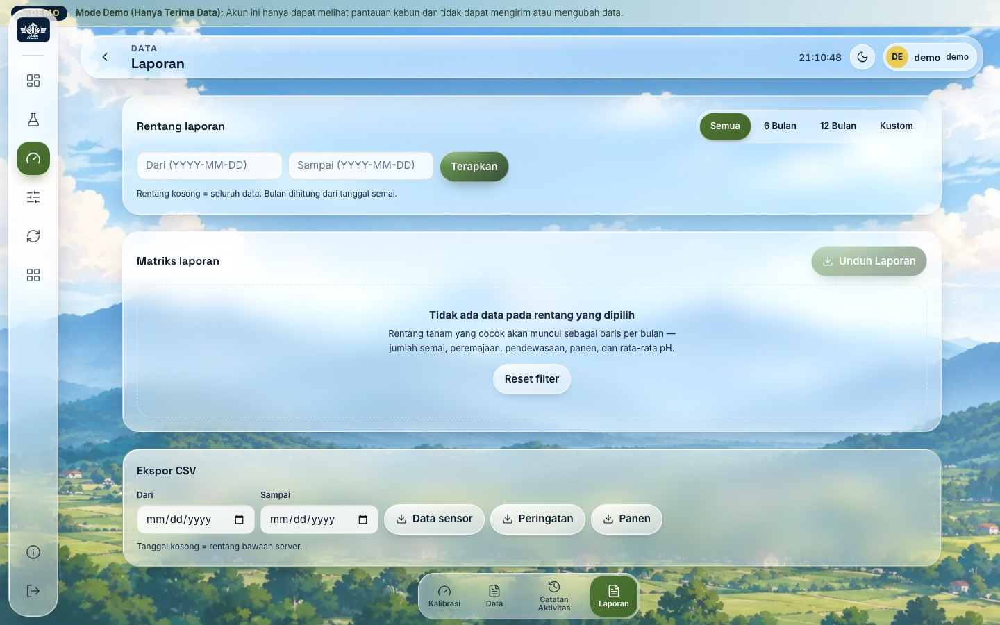
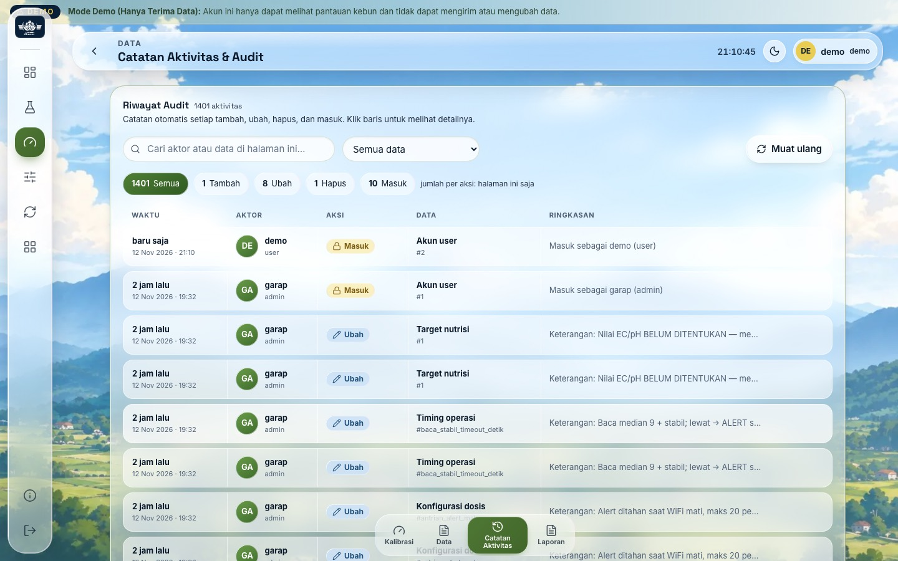

---

## 13. Master Data (Tanaman, Meja/Tandon, Ambang)

| Halaman | Fungsi | Catatan |
|---|---|---|
| Jenis Tanaman | Tanaman yang ditanam beserta target awal/akhir nutrisi | Prasyarat semai |
| Meja Tanaman | Meja hidroponik, jumlah lubang, spesifikasi instalasi | Pengelolaan **tandon/penampung** dilakukan lewat data meja (ID meja dipakai firmware `ID_MEJA`) |
| Ambang Sensor | Batas aman tiap sensor; di luar rentang = tidak normal | Nilai saat audit (data pengembangan): pH 5–7, suhu air 5–40 °C, TDS 50–2.600 ppm, suhu udara 20–40 °C, kelembapan **100–100 %** (perlu diperbaiki admin) |

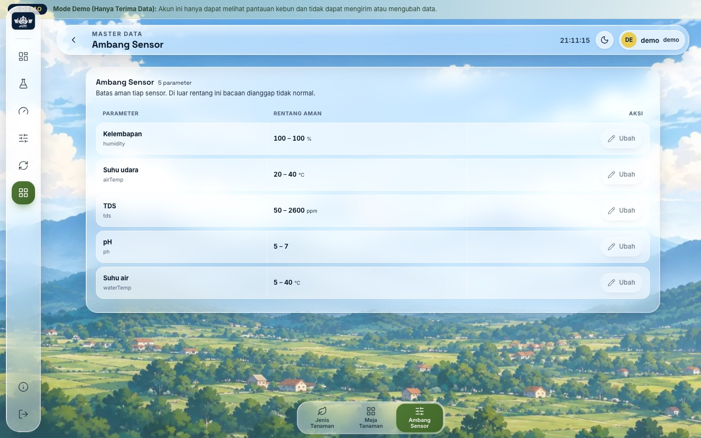

> [!NOTE]
> Ambang sensor (batas peringatan) berbeda dengan **batas kewajaran** di server (pH 3–9, TDS 50–2.500 ppm, suhu air 5–45 °C) dan **batas fisik** (bacaan di luar pH 0–14, TDS 0–5.000 ppm ditolak dan tidak disimpan).

---

## 14. Sistem: Pengaturan Alat, Pemulihan Papan, Koneksi Alat

| Halaman | Fungsi | Status |
|---|---|---|
| Pengaturan Alat | Volume efektif penampung, jumlah talang, debit, waktu kerja, batas aman, laju pompa (hanya-baca; diubah dari Kalibrasi) | Pengaturan tersimpan di server |
| Pemulihan Papan | Menyiapkan paket parameter + kalibrasi untuk papan ESP32 pengganti | SEDANG DIKEMBANGKAN — paket **belum dikirim** ke papan |
| Koneksi Alat | Status broker, ID alat `aktuator-01`, kontrak topik, uji kirim pesan, jejak perintah | Tersedia |

> [!NOTE]
> Halaman Koneksi Alat menampilkan contoh topik `hidro/…` dan perintah `{"cmd":"dosing",…}` dari rancangan v4.1. Firmware gabungan yang aktif memakai topik **`garap/aktuator-01/…`** dan **tidak menerima** perintah dosing tanpa gerbang server. Contoh itu **bukan instruksi** untuk dijalankan.

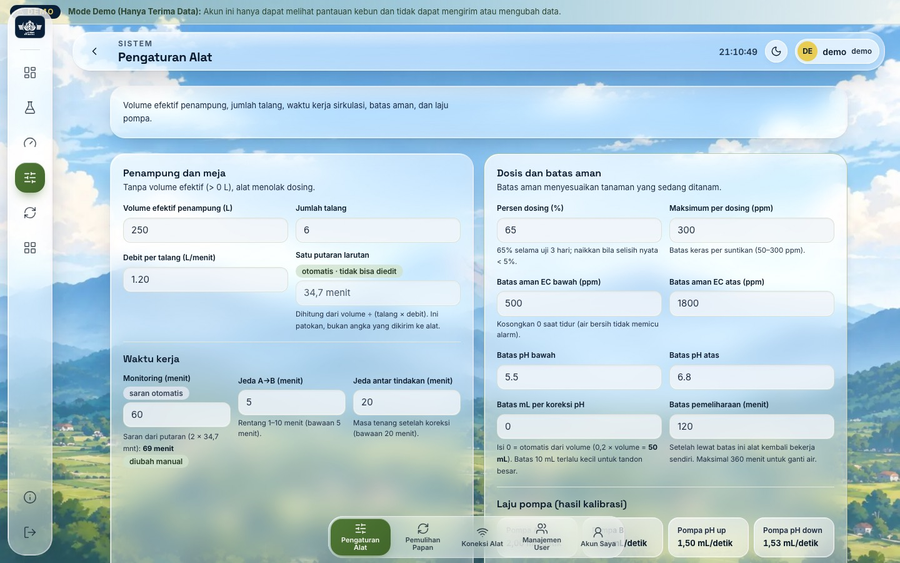
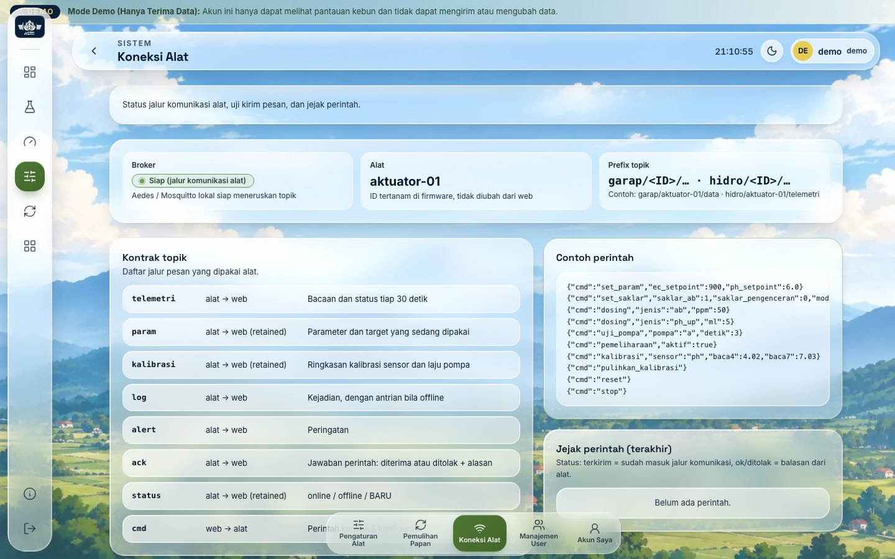

---

## 15. Manajemen User dan Akun Saya

**Manajemen User (admin):** cari username/email, filter level (Admin, User, Petani), **Tambah User**, **Ubah**, **Hapus**.

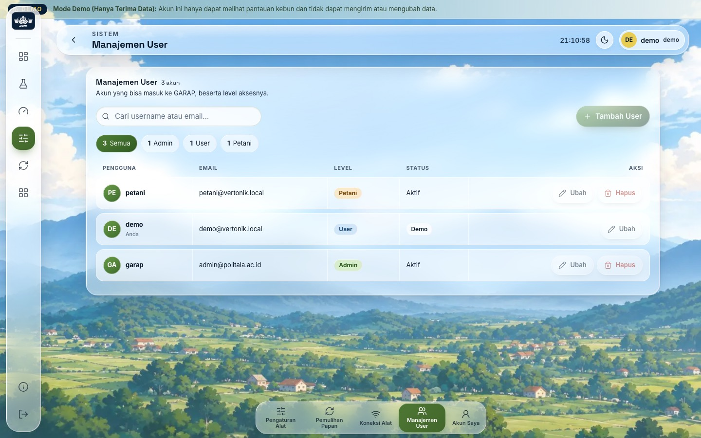

**Akun Saya (semua):** lihat profil dan hak akses, **Ubah profil**, **Ganti password**, **Keluar**, pilihan **Tampilan kaca** (Jernih, Standar, Pekat — pilih Pekat bila teks sulit dibaca).

---

## 16. CCTV dan Asisten AI

| Fitur | Fungsi | Batasan |
|---|---|---|
| CCTV | Melihat gambar kamera greenhouse | Perlu kamera terdaftar |
| Asisten AI | Tanya-jawab dan saran teks berbasis data sensor | **Tidak bisa menyalakan pompa.** Bila sensor basi atau tidak wajar, AI menyarankan periksa alat. Batas tunggu jawaban sekitar 60 detik. |

---

## 17. Tombol STOP Pompa

Tombol **STOP** mengirim perintah berhenti ke antrean. Server menjawab "Pompa BELUM dipastikan mati: tunggu konfirmasi aktuator, dan gunakan tombol darurat fisik bila perlu."

1. Tekan **STOP** dan konfirmasi.
2. Pastikan di panel: lampu biru padam, LCD tidak lagi menunjukkan "DOSING…/MENGISI AIR…".
3. Bila pompa masih berjalan → tekan **E-STOP fisik**.

---

## 18. Fitur yang Belum Tersedia di Website

| Fitur | Status | Keterangan |
|---|---|---|
| Konfirmasi tandon siap, konfirmasi peremajaan H+4 (batas 24 jam), konfirmasi jumlah benih versi siklus baru | BELUM DIIMPLEMENTASIKAN di antarmuka | API backend `/api/siklus`, `/api/konfirmasi` ada; penjadwal mati secara bawaan |
| Persetujuan dosing (ajukan, setujui, tolak, cabut) | BELUM DIIMPLEMENTASIKAN di antarmuka | API `/api/dosing/siklus` ada |
| Eksekusi dosing | **BELUM DIIZINKAN** | `EKSEKUSI_DIIZINKAN = false` |
| Kontrol air (isi, stop, ganti mode) | TIDAK AKTIF | Server `503 kontrol_air_nonaktif`; rute lama dialihkan ke Dashboard |

---

## 19. Tabel Masalah Umum

| Gejala | Kemungkinan penyebab | Tindakan |
|---|---|---|
| Halaman putih / tidak memuat | Server Pi mati atau jaringan beda | Cek Wi-Fi, hubungi admin (SOP-02 Bab 5) |
| Pesan 403 saat menyimpan | Akun demo atau hak tidak cukup | Gunakan akun yang berwenang |
| Pesan 423 | Fitur dikunci keselamatan | Normal. Jangan dicoba ulang. |
| Pesan 503 pada kontrol air | Fitur nonaktif | Normal |
| Angka sensor "—" | Alat offline | SOP-02 Bab 5 |
| Data sensor aneh (mis. pH sangat tinggi) | Probe lepas atau belum dikalibrasi | SOP-02 Bab 6 |
