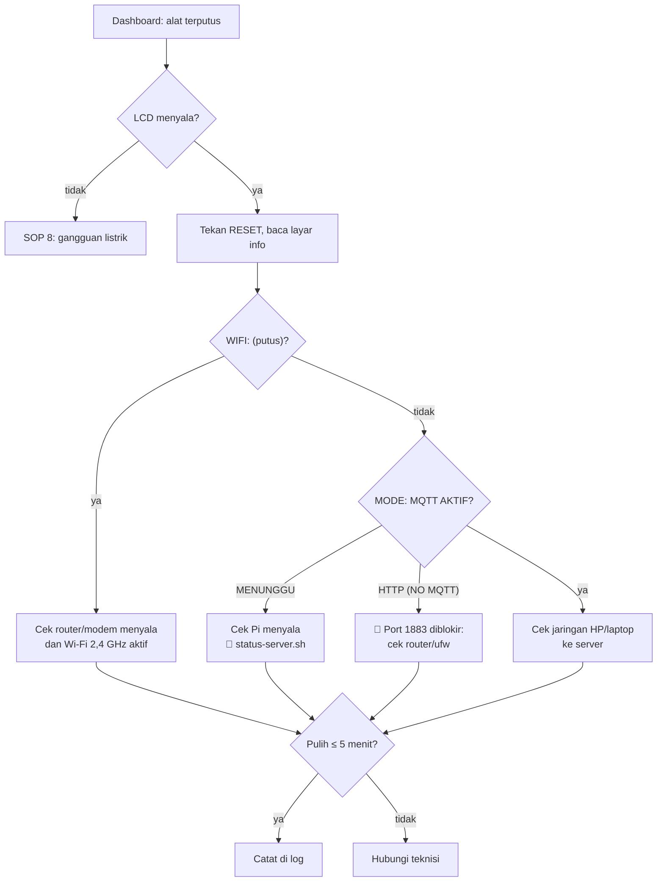

# STANDAR OPERASIONAL PROSEDUR (SOP) PEMELIHARAAN DAN PENANGANAN GANGGUAN GARAP

| Atribut | Isi |
|---|---|
| Nomor dokumen | GARAP-SOP-02 |
| Versi | 1.0 |
| Tanggal berlaku | 12 November 2026 (setelah disahkan) |
| Acuan | Juknis IoT GARAP-JUKNIS-02, Juknis Instalasi GARAP-JUKNIS-03, SOP Pengoperasian GARAP-SOP-01 |
| Disahkan | [PERLU VERIFIKASI] |

> ⚠️ **Lingkungan greenhouse lembap: listrik dan cairan berdekatan.** Pekerjaan di dalam panel hanya oleh teknisi, dengan daya dimatikan. Tangan kering. Jangan menyemprot air ke panel, Pi, atau catu daya.
>
> ⛔ **Dosing otomatis BELUM DIIZINKAN.** Tidak ada prosedur di dokumen ini yang menjalankan dosis ke tandon tanaman. Uji pompa selalu dengan air bersih ke gelas ukur.

| Kode | Judul | Pelaksana |
|---|---|---|
| SOP 1 | Pemeliharaan berkala perangkat | Teknisi, operator |
| SOP 2 | Pembersihan dan perawatan probe | Teknisi |
| SOP 3 | Kalibrasi sensor dan laju pompa | Teknisi + admin |
| SOP 4 | Cadangan data server | Admin |
| SOP 5 | Penanganan kehilangan koneksi | Operator → teknisi |
| SOP 6 | Penanganan pembacaan sensor tidak normal | Operator → teknisi |
| SOP 7 | Penanganan gangguan pompa | Operator → teknisi |
| SOP 8 | Penanganan gangguan listrik | Operator → teknisi |

**Penanda:** 🔧 = khusus teknisi.

---

## SOP 1. Pemeliharaan Berkala Perangkat

| Unsur | Isi |
|---|---|
| Tujuan | Mencegah kerusakan dan menjaga ketepatan data |
| Ruang lingkup | Panel kontrol, sensor, pompa, selang, Raspberry Pi |
| Penanggung jawab | Teknisi (operator membantu pemeriksaan visual) |
| Peralatan | Multimeter, obeng, lap kering, sikat lembut, air suling, larutan standar, sarung tangan, kacamata, buku log |

**Persiapan:** beri tahu admin; pastikan tidak ada pengujian lain berjalan.

**Langkah kerja (daftar periksa)**

| Frekuensi | Kegiatan | ✓ |
|---|---|---|
| Harian | Cek lampu, LCD, kebocoran, level tandon (SOP-01 SOP 1) | ☐ |
| Mingguan | Cek selang pompa (retak, tertekuk, bocor) | ☐ |
| Mingguan | Cek konektor sensor dan terminal dari korosi/lembap | ☐ |
| Mingguan | Bersihkan probe (SOP 2) | ☐ |
| Bulanan 🔧 | Kalibrasi pH dan EC (SOP 3) | ☐ |
| Bulanan 🔧 | Uji E-STOP, pelampung bawah/atas (Juknis IoT 10.1) | ☐ |
| Bulanan 🔧 | Cek relay (bunyi klik, tidak lengket), cek sekring | ☐ |
| Bulanan | Cadangan basis data (SOP 4) | ☐ |
| 3 bulanan 🔧 | Kalibrasi ulang laju pompa dengan air (SOP 3.3) | ☐ |
| 3 bulanan 🔧 | Cek suhu Pi (< 70 °C), ruang SD card, pembaruan keamanan | ☐ |

| Kondisi normal | Kondisi tidak normal |
|---|---|
| Semua butir lulus | Korosi, kabel rusak, relay lengket, E-STOP tidak memutus → hentikan pemakaian pompa, perbaiki dulu |

**Dokumentasi:** Lampiran A (log pemeliharaan).

---

## SOP 2. Pembersihan dan Perawatan Probe

| Unsur | Isi |
|---|---|
| Tujuan | Probe pH/EC bersih agar bacaan tepat |
| Penanggung jawab | 🔧 Teknisi |
| Peralatan | Air suling, wadah bersih, tisu lembut, cairan penyimpanan probe pH [PERLU VERIFIKASI jenisnya sesuai pabrikan] |

**Langkah kerja**

1. Beri tahu operator bahwa bacaan akan terganggu beberapa menit.
2. Angkat probe dari tandon.
3. Bilas dengan air suling. Jangan menggosok bola kaca probe pH; tepuk lembut dengan tisu.
4. Bersihkan endapan pada probe EC dengan sikat lembut.
5. Periksa kabel probe dari retak.
6. Kembalikan probe ke tandon, tunggu bacaan stabil.
7. Lakukan banding singkat (SOP-01 SOP 4).

**Kondisi tidak normal:** bola kaca pH retak, kabel terkelupas, bacaan tetap melompat setelah dibersihkan → ganti probe.

---

## SOP 3. Kalibrasi Sensor dan Laju Pompa

| Unsur | Isi |
|---|---|
| Tujuan | Menyesuaikan sensor dan pompa dengan nilai acuan |
| Penanggung jawab | 🔧 Teknisi; admin mencatat di web |
| Peralatan | Buffer pH 4,0 dan 7,0; larutan EC 1.413 µS/cm dan 12.880 µS/cm; air suling; gelas ukur; air bersih |

> ⚠️ **Status fitur.** Menurut kode server (commit `0383c55`, 12 Nov 2026): kalibrasi **pH** dikirim ke ESP32 sebagai tegangan probe bila alat melaporkan `ph_volt` (firmware v0.6 perlu di-flash); kalibrasi **EC belum dikirim** ke ESP32 (hanya tersimpan di server). Uji/kalibrasi pompa dari aplikasi dikunci bawaan (`UJI_POMPA_DIIZINKAN`), hanya admin, wajib mode pemeliharaan. Semua jalur ini **belum diuji di perangkat**. Setelah kalibrasi, **selalu** bandingkan dengan alat ukur pembanding. Bila belum sesuai, kalibrasi tidak dianggap berhasil.

### 3.1 Kalibrasi pH (dua titik)

1. Website → **Kalibrasi** → aktifkan **Mode pemeliharaan** (semua tindakan OFF, hitungan dibekukan).
2. Bilas probe dengan air suling.
3. Celup ke buffer **4,0**. Tunggu tulisan stabil (sebaran 5 bacaan kecil). Tekan tombol titik 1.
4. Bilas, celup ke buffer **7,0**. Tunggu stabil. Tekan tombol titik 2.
5. Kembalikan probe ke tandon, matikan mode pemeliharaan.
6. Banding dengan pH meter: selisih ≤ 0,1.

### 3.2 Kalibrasi EC (dua titik)

1. Mode pemeliharaan aktif.
2. Celup probe ke larutan **1.413 µS/cm**, tunggu stabil, tekan tombol titik 1.
3. Bilas, celup ke **12.880 µS/cm**, tunggu stabil, tekan tombol titik 2.
4. Kembalikan probe, matikan mode pemeliharaan.
5. Banding: selisih ≤ 5 %.

Bila hasil buruk, gunakan pilihan **kembalikan kalibrasi sebelumnya** (server menyimpan konstanta lama).

### 3.3 Kalibrasi laju pompa 🔧 (hanya bila fitur sudah diizinkan admin server)

1. Isi wadah dengan **air bersih**. Selang keluaran ke **gelas ukur**. Satu orang berjaga di E-STOP.
2. Isi selang sampai penuh (jalankan sebentar, buang airnya).
3. Jalankan pompa selama N detik (maks 120 detik).
4. Baca mL di gelas ukur, isi ke kolom. Laju = mL ÷ detik.
5. Ulangi 3 kali; hasil berselisih ≤ 5 %. Simpan rata-rata.
6. Ulangi untuk pompa A, B, pH Up, pH Down, isi air.

Sebelum laju tersimpan, firmware menolak perintah berbasis mL (`belum_dikalibrasi`). Itu disengaja.

**Dokumentasi:** Riwayat kalibrasi di web + Lampiran B.

---

## SOP 4. Cadangan Data Server

| Unsur | Isi |
|---|---|
| Tujuan | Data tidak hilang bila SD card/Pi rusak |
| Penanggung jawab | Admin |
| Peralatan | Akses SSH Pi, media simpan eksternal |

**Langkah kerja:** ikuti `docs/BACKUP_RESTORE_PI.md` bagian 1.A: dump basis data ke folder cadangan, periksa berkas tidak kosong dan berisi SQL, salin ke media di luar Pi, catat tanggal. Lakukan minimal bulanan dan sebelum pembaruan sistem.

**Kondisi tidak normal:** berkas cadangan 0 byte atau gagal → ulangi; laporkan ke pengelola.

---

## SOP 5. Penanganan Kehilangan Koneksi

| Unsur | Isi |
|---|---|
| Tujuan | Memulihkan aliran data dari perangkat ke server dan aplikasi |
| Penanggung jawab | Operator (langkah 1–5), teknisi (langkah 6–9) |

**Gejala:** dashboard "Alat terputus", pita "Belum ada data dari alat sensor", LCD `WIFI MATI` / `TUNGGU SERVER...` / `HTTP SENSOR ONLY`.

**Keamanan bawaan:** bila detak server hilang lebih dari 30 detik, ESP32 **mematikan semua pompa** sendiri. Kehilangan koneksi tidak membuat pompa jalan liar.

**Langkah kerja**

1. Periksa apakah HP/laptop Anda sendiri tersambung ke jaringan greenhouse.
2. Lihat LCD dan lampu panel.
3. Tekan **RESET** sekali; catat isi layar (WIFI, ESP, SRV, MODE).
4. Periksa router/modem menyala. Bila mati, nyalakan dan tunggu 3 menit.
5. Periksa Raspberry Pi menyala (lampu daya).
6. 🔧 Jalankan `status-server.sh`; restart layanan yang mati (`sudo systemctl restart vertonik-api`).
7. 🔧 Bila IP Pi berubah: Serial `server <IP>` atau perbaiki reservasi DHCP.
8. 🔧 Bila Wi-Fi berganti: Serial `wifi SSID|SANDI`.
9. 🔧 Bila client isolation: gunakan hotspot Pi (`Vertoniksmartfarm`).

| Kondisi normal setelah penanganan | Masih tidak normal |
|---|---|
| LCD `MODE: MQTT AKTIF`, dashboard tersambung | Hubungi teknisi; selama itu ukur manual dengan alat pembanding tiap 4 jam |

**Dokumentasi:** Lampiran C (log gangguan): waktu mulai, waktu pulih, penyebab.

---

## SOP 6. Penanganan Pembacaan Sensor Tidak Normal

| Unsur | Isi |
|---|---|
| Tujuan | Membedakan masalah larutan dengan masalah sensor |
| Penanggung jawab | Operator → teknisi |
| Peralatan | Alat ukur pembanding |

**Gejala:** nilai di luar ambang, nilai melompat-lompat, LCD `pH --.--` / `EC ----`, peringatan, atau AI menyarankan "Periksa alat/probe sensor".

**Langkah kerja**

1. Pastikan bacaan **segar** (bukan "bacaan terakhir").
2. Ukur sampel tandon dengan **alat pembanding**.
3. **Bila pembanding juga menunjukkan nilai tidak normal** → masalah larutan: lapor admin, tangani manual sesuai SOP-01 SOP 5. Jangan menambah larutan dalam jumlah besar sekaligus.
4. **Bila pembanding normal tetapi sistem tidak** → masalah sensor:
   1. Cek probe terendam dan konektor terpasang.
   2. Bersihkan probe (SOP 2).
   3. Bila masih salah → kalibrasi (SOP 3).
   4. Bila masih salah atau `--.--` → 🔧 cek ADS1115/kabel; ganti probe.
5. Jangan mengambil keputusan nutrisi dari angka sensor yang dicurigai salah.

| Batas | Arti |
|---|---|
| pH di luar 3–9, TDS di luar 50–2.500 ppm, suhu air di luar 5–45 °C | Tidak wajar — kemungkinan probe lepas |
| pH di luar 0–14, TDS di luar 0–5.000 ppm | Mustahil — ditolak server |
| 3 bacaan mustahil berturut | Dianggap sensor rusak |

**Dokumentasi:** Lampiran B (banding) dan Lampiran C.

---

## SOP 7. Penanganan Gangguan Pompa

| Unsur | Isi |
|---|---|
| Tujuan | Mengamankan pompa yang tidak bekerja sebagaimana mestinya |
| Penanggung jawab | Operator (tindakan segera) → 🔧 teknisi |

**Jenis gangguan dan tindakan**

| Gejala | Tindakan segera | Tindak lanjut 🔧 |
|---|---|---|
| Pompa berjalan **tanpa ada uji teknisi** (lampu biru, LCD `DOSING…`) | **Tekan E-STOP** | Cek riwayat perintah di Koneksi Alat; cek relay lengket |
| Pompa tidak berhenti setelah STOP aplikasi | **Tekan E-STOP** | Cek relay dan wiring |
| Pompa tetap jalan saat daya ESP32 dicabut | E-STOP, matikan daya 12 V | Wiring relay salah — **perangkat tidak boleh dipakai** sampai diperbaiki |
| Pompa yang salah berputar saat uji | E-STOP | Kabel relay tertukar; perbaiki kabel |
| Pompa tidak berputar saat uji | Hentikan uji | Cek alasan: `estop`, `belum_dikalibrasi`, `air_kurang_float_bawah`, `server_hilang`, `sibuk`; cek sekring/daya 12 V |
| Selang bocor | Matikan daya panel bila bocor dekat listrik | Ganti selang |
| Pompa isi tidak berhenti saat penuh | E-STOP | Cek pelampung atas |

**Dokumentasi:** Lampiran C; foto kerusakan.

---

## SOP 8. Penanganan Gangguan Listrik

| Unsur | Isi |
|---|---|
| Tujuan | Keselamatan orang dan perangkat saat listrik padam/tidak stabil |
| Penanggung jawab | Operator → 🔧 teknisi |

**Langkah kerja — listrik padam**

1. Jangan menyentuh panel dalam keadaan gelap/basah.
2. Saat padam, ESP32 dan pompa mati; relay lepas. Sirkulasi tanaman juga berhenti — pantau kondisi tanaman (akar NFT bisa kering).
3. Bila padam lama, pastikan pompa sirkulasi mendapat daya cadangan [PERLU VERIFIKASI ketersediaan UPS/genset].
4. Saat listrik kembali: nyalakan **Pi lebih dulu**, tunggu 2 menit, baru panel (Juknis IoT Bab 6).
5. Periksa LCD dan dashboard sampai normal.

**Langkah kerja — korsleting, percikan, bau terbakar, sekring putus berulang**

1. **Tekan E-STOP.** Matikan daya utama dari tempat kering bila aman.
2. Jauhkan orang dari area. Jangan siram air ke panel listrik.
3. 🔧 Teknisi memeriksa dengan daya mati: kelembapan di panel, kabel terkelupas, terminal korosi.
4. Perangkat baru dinyalakan setelah penyebab diperbaiki dan uji Juknis IoT 10.1 lulus.

**Langkah kerja — Pi mati mendadak**

1. 🔧 Setelah menyala, jalankan `status-server.sh`.
2. 🔧 Periksa basis data dan cadangan terakhir.
3. Pertimbangkan UPS kecil untuk Pi [PERLU VERIFIKASI].

**Dokumentasi:** Lampiran C.

---

## Lampiran

### Lampiran A — Log Pemeliharaan

| Tanggal | Teknisi | Kegiatan | Temuan | Tindakan | Paraf |
|---|---|---|---|---|---|
| | | | | | |

### Lampiran B — Log Kalibrasi

| Tanggal | Teknisi | Sensor/pompa | Larutan acuan | Nilai sebelum | Nilai sesudah | Banding alat | Lulus (Y/T) |
|---|---|---|---|---|---|---|---|
| | | | | | | | |

### Lampiran C — Log Gangguan

| Mulai | Pulih | Gejala | Penyebab | Tindakan | Petugas | Ditutup |
|---|---|---|---|---|---|---|
| | | | | | | |
