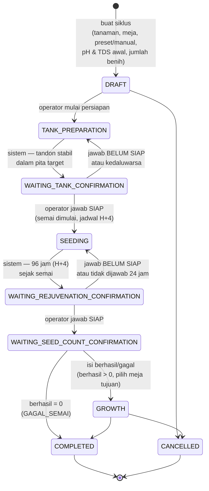
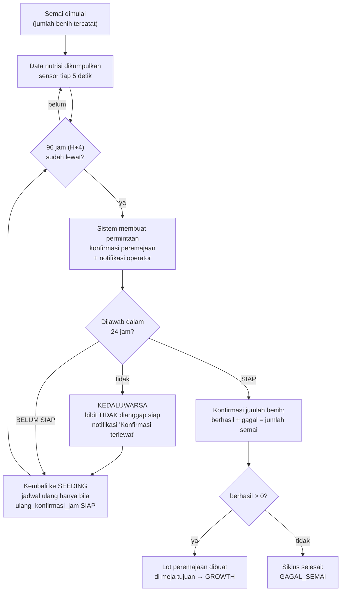
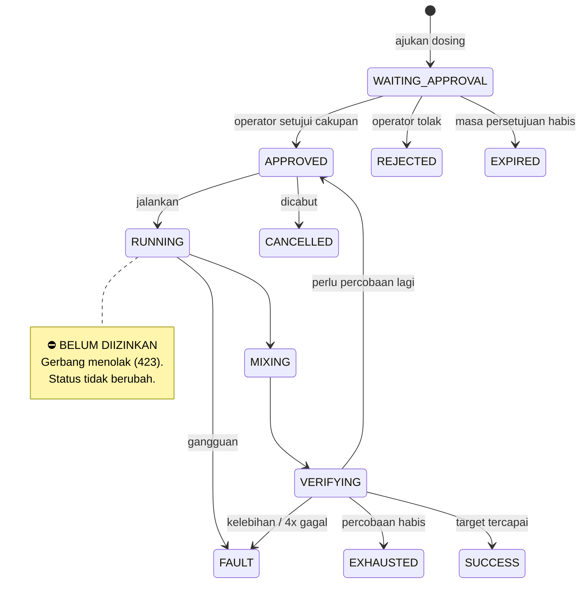

# STANDAR OPERASIONAL PROSEDUR (SOP) PENGOPERASIAN SISTEM GARAP

| Atribut | Isi |
|---|---|
| Nomor dokumen | GARAP-SOP-01 |
| Versi | 1.0 |
| Tanggal berlaku | 12 November 2026 (setelah disahkan) |
| Acuan | Juknas GARAP-JUKNAS-01, Juknis Website GARAP-JUKNIS-01, Juknis IoT GARAP-JUKNIS-02 |
| Disusun | Tim Dokumentasi GARAP |
| Disahkan | [PERLU VERIFIKASI] |

> ⛔ **DOSING OTOMATIS: BELUM DIIZINKAN.** Persetujuan dosing dan eksekusi dosing adalah dua hal berbeda. Persetujuan = operator mengizinkan cakupan dosis di aplikasi. Eksekusi = pompa benar-benar menyuntik larutan. Saat ini **eksekusi diblokir oleh server**, dan antarmuka persetujuan pun belum tersedia. Nutrisi diberikan **manual** sesuai SOP 5.

**Daftar SOP dalam dokumen ini**

| Kode | Judul |
|---|---|
| SOP 1 | Pemeriksaan sebelum pengoperasian (harian) |
| SOP 2 | Pengoperasian normal dan pemantauan |
| SOP 3 | Pencatatan tahap tanam (semai sampai panen) |
| SOP 4 | Pemeriksaan kualitas data |
| SOP 5 | Pemberian nutrisi dan koreksi pH manual |
| SOP 6 | Alur operasional siklus dan dosing (rujukan, belum aktif) |
| SOP 7 | Penghentian darurat |

---

## SOP 1. Pemeriksaan Sebelum Pengoperasian (Harian)

| Unsur | Isi |
|---|---|
| Tujuan | Memastikan perangkat, tandon, dan data dalam keadaan aman sebelum kerja harian |
| Ruang lingkup | Panel kontrol, tandon, meja hidroponik, website/aplikasi |
| Penanggung jawab | Operator greenhouse |
| Peralatan | HP/laptop dengan akun GARAP, senter, lap kering, buku log, alat ukur pH/EC pembanding (bila tersedia) |

**Persiapan**

1. Pakai alas kaki tertutup dan pastikan tangan kering.
2. Bawa HP yang sudah login ke aplikasi GARAP.

**Langkah kerja**

1. Lihat sekeliling panel: tidak ada genangan, bau terbakar, atau kabel terkelupas.
2. Pastikan tombol **E-STOP** tidak tertekan dan mudah dijangkau.
3. Baca **LCD** baris 4: harus `PENAMPUNG CUKUP` atau `PENAMPUNG PENUH`.
4. Lihat **lampu pilot**: hijau saja = normal.
5. Periksa level tandon secara visual dan cek kebocoran selang/sambungan.
6. Periksa aliran air di meja NFT/DFT (pompa sirkulasi berjalan, talang mengalir).
7. Buka **Dashboard**: label **Alat tersambung**, tidak ada pita kuning "Belum ada data".
8. Buka **Peringatan**: catat peringatan aktif.
9. Isi buku log (Lampiran A).

| Kondisi normal | Kondisi tidak normal |
|---|---|
| Lampu hijau saja; LCD `PENAMPUNG CUKUP`; dashboard tersambung; nilai dalam ambang | Lampu merah; LCD `E-STOP AKTIF!`, `WIFI MATI`, `TUNGGU SERVER...`, `PENAMPUNG KURANG`; dashboard offline; peringatan merah |

**Tindakan bila tidak normal:** ikuti SOP-02 sesuai gejala. Jangan menyalakan atau menguji pompa.

**Tindakan darurat:** ada asap, percikan, bau terbakar, atau air mengenai panel → **tekan E-STOP**, jauhi panel, matikan daya utama dari luar area basah bila aman, hubungi teknisi.

**Dokumentasi:** isi Lampiran A (tanggal, jam, nama, status lampu, LCD, peringatan, tindakan).

---

## SOP 2. Pengoperasian Normal dan Pemantauan

| Unsur | Isi |
|---|---|
| Tujuan | Memantau kondisi larutan dan udara sepanjang hari |
| Penanggung jawab | Operator; admin memantau |
| Peralatan | Aplikasi mobile/website |

**Langkah kerja**

1. Aktifkan notifikasi aplikasi mobile. Aplikasi memeriksa peringatan baru tiap 60 detik.
2. Buka **Dashboard** minimal 3 kali sehari (pagi, siang, sore) dan saat ada notifikasi.
3. Bandingkan nilai dengan batas aman di kartu (pH, suhu air, TDS, suhu udara, kelembapan).
4. Bila ada peringatan: baca kode dan penjelasannya, lakukan tindakan sesuai SOP-02, catat di log.
5. Admin menandai peringatan **selesai** setelah penyebabnya ditangani.
6. Akhir hari: unduh atau periksa ringkasan di **Sensor** bila diminta pengelola.

| Kondisi normal | Kondisi tidak normal |
|---|---|
| Nilai dalam ambang; data diperbarui (tidak basi) | Nilai di luar ambang; tanda "bacaan terakhir"/offline; peringatan merah/kuning |

**Dokumentasi:** catatan peringatan dan tindakan di buku log; peringatan yang ditangani tercatat di sistem.

---

## SOP 3. Pencatatan Tahap Tanam (Semai sampai Panen)

| Unsur | Isi |
|---|---|
| Tujuan | Data tanam lengkap dan benar sebagai dasar laporan dan prediksi panen |
| Penanggung jawab | Operator (mobile) dan admin (web) |
| Peralatan | Aplikasi; data benih |

**Persiapan:** jenis tanaman dan meja sudah ada di Master Data. Target nutrisi harian tanaman sudah diatur admin.

**Langkah kerja**

1. **Mulai semai:** Kebun Saya → **Mulai Semai Baru** → pilih Tanaman, Meja tanam, isi **Jumlah benih**, Tanggal mulai, Keterangan → simpan.
2. Pantau kartu batch (hari ke-, perkiraan selesai).
3. Saat tahap selesai, hitung tanaman yang **berhasil**.
4. **Selesaikan tahap:** isi jumlah berhasil. Sistem menghitung yang gagal dan membuat tahap berikutnya (Semai → Peremajaan → Pendewasaan → Panen).
5. Bila semua gagal, isi 0. Tahap tercatat gagal.
6. Saat panen, catat hasil panen di tahap Panen.

| Kondisi normal | Kondisi tidak normal |
|---|---|
| Jumlah berhasil + gagal = jumlah masuk; tahap berikutnya muncul | Jumlah berhasil melebihi jumlah masuk (ditolak); tahap berikutnya tidak muncul |

**Dokumentasi:** foto bibit (opsional), catatan jumlah di buku log; data tersimpan otomatis di Catatan Aktivitas.

---

## SOP 4. Pemeriksaan Kualitas Data

| Unsur | Isi |
|---|---|
| Tujuan | Memastikan angka di layar dapat dipercaya sebelum dipakai mengambil keputusan |
| Penanggung jawab | Operator (harian), teknisi (mingguan) |
| Peralatan | Alat ukur pH dan EC pembanding, termometer |

**Langkah kerja**

1. Pastikan bacaan **segar**: tidak ada tanda "bacaan terakhir" atau "perangkat offline" (server menandai basi bila lebih dari 120 detik).
2. Bandingkan angka **LCD** dengan **website**. Harus sama (selisih pembulatan saja).
3. Ambil sampel air tandon, ukur dengan alat pembanding.
4. Hitung selisih: pH ≤ 0,1; EC ≤ 5 %; suhu air ≤ 0,5 °C.
5. Periksa riwayat Sensor 24 jam: tidak ada lonjakan tiba-tiba yang tidak masuk akal, tidak ada celah data lebih dari 2 menit.

| Kondisi normal | Kondisi tidak normal |
|---|---|
| Selisih dalam batas; grafik halus | Selisih melebihi batas → kalibrasi (SOP-02 Bab 3); lonjakan/angka mustahil → SOP-02 Bab 6; celah data → SOP-02 Bab 5 |

**Dokumentasi:** Lampiran B (lembar banding sensor).

---

## SOP 5. Pemberian Nutrisi dan Koreksi pH Manual

| Unsur | Isi |
|---|---|
| Tujuan | Menjaga larutan pada target selama dosing otomatis belum diizinkan |
| Penanggung jawab | Operator; disetujui pengawas/admin |
| Peralatan | Nutrisi A dan B, pH Up/pH Down, gelas ukur, pengaduk, sarung tangan, kacamata pelindung, alat ukur pembanding |

> ⚠️ Larutan pH dan nutrisi pekat bersifat korosif/iritan. Gunakan sarung tangan dan kacamata. Jangan mencampur pH Up dengan pH Down secara langsung. Jangan memakai bahan dapur (cuka, soda kue) sebagai pengganti.

**Persiapan**

1. Baca target di **Target Nutrisi** (target harian ppm dan batas pH penampung).
2. Pastikan bacaan sensor segar dan sudah dibandingkan dengan alat pembanding (SOP 4).
3. Volume tandon diketahui. Volume aktual tandon: [PERLU VERIFIKASI] (rencana 3.000 L; data pengembangan 250 L).

**Langkah kerja**

1. Hitung kebutuhan sesuai **takaran yang ditetapkan pengelola/agronom** dan data **Data (uji lab)**. Dokumen ini tidak menetapkan takaran. [PERLU VERIFIKASI: tabel takaran resmi]
2. Tuang nutrisi **A** sedikit demi sedikit, aduk/biarkan sirkulasi. Tunggu jeda, lalu tuang **B**. Jangan mencampur A dan B pekat langsung.
3. Tunggu larutan tercampur (sirkulasi beberapa menit), lalu ukur ulang.
4. Koreksi pH dengan jumlah kecil, tunggu tercampur, ukur ulang. Ulangi sampai dalam batas.
5. Catat jumlah yang ditambahkan, nilai sebelum dan sesudah.

| Kondisi normal | Kondisi tidak normal |
|---|---|
| Nilai mendekati target secara bertahap | Nilai melonjak/turun jauh melebihi perkiraan → hentikan penambahan, ukur ulang dengan alat pembanding, lapor admin |

**Dokumentasi:** Lampiran C (log pemberian nutrisi manual).

---

## SOP 6. Alur Operasional Siklus dan Dosing (Rujukan — Belum Aktif)

> ⛔ **BELUM DIIZINKAN.** Bab ini menjelaskan alur yang **sudah dibangun di server** agar pengelola memahami rancangannya. Antarmuka (tombol) belum tersedia di website dan mobile, penjadwal mati secara bawaan, dan **eksekusi dosis selalu ditolak**. Operator **tidak** menjalankan bab ini.

### 6.1 Perbedaan persetujuan dan eksekusi

| | Persetujuan dosing | Eksekusi dosing |
|---|---|---|
| Arti | Operator menyetujui cakupan dosis (larutan, jumlah maksimal, masa berlaku) | Pompa menyuntik larutan ke tandon |
| Di mana | API `/api/dosing/siklus/:id/setujui` | API `/api/dosing/siklus/:id/jalankan` |
| Status kode | Ada di server; **belum ada tombol** | **Diblokir**: selalu `423 eksekusi_diblokir` karena `EKSEKUSI_DIIZINKAN = false` |
| Status operasional | BELUM DIIMPLEMENTASIKAN di antarmuka | **BELUM DIIZINKAN** |

### 6.2 Alur siklus budidaya (server)

### 6.3 Konfirmasi peremajaan H+4 dan masa tunggu 24 jam

| Parameter (tabel `timing_operasi`) | Nilai di migrasi | Status |
|---|---|---|
| `konfirmasi_peremajaan_jam_ke` | 96 jam (H+4) | Keputusan pengguna; dipakai hanya bila SIAP |
| `konfirmasi_peremajaan_batas_jam` | 24 jam | Keputusan pengguna; dipakai hanya bila SIAP |
| `konfirmasi_tandon_jam` | NULL (belum diputuskan) | [PERLU VERIFIKASI] |
| `pengingat_konfirmasi_jam` | NULL (belum diputuskan) | [PERLU VERIFIKASI] |
| `ulang_konfirmasi_jam` | — | Bila tidak SIAP, tidak ada jadwal ulang otomatis; admin meminta konfirmasi lagi |

**Penyesuaian setelah konfirmasi:** hasil konfirmasi **mengubah status siklus** (lanjut, ulang, atau selesai) dan membuat lot di meja tujuan. Kode tidak mengubah target nutrisi secara otomatis berdasarkan jawaban operator. Target tetap dari preset versi yang dibekukan saat siklus dibuat, atau target manual.

### 6.4 Alur persetujuan dosing (server)

**Syarat gerbang dosis (semua wajib, ditambah gerbang utama yang masih tertutup):**

| Syarat | Alasan penolakan bila gagal |
|---|---|
| Preset ada dan **TERVALIDASI** | `preset_tidak_ada`, `preset_belum_tervalidasi` |
| `batas_operasi` (TDS min/max, pH min/max) diisi dan sah | `batas_operasi_belum_ada`, `batas_operasi_tidak_sah` |
| Bacaan ada, lengkap, segar (≤ 120 detik) | `bacaan_tidak_ada`, `bacaan_tidak_lengkap`, `sensor_basi` |
| Bacaan wajar dan dalam batas operasi | `bacaan_tidak_wajar`, `di_luar_batas_operasi` |
| Tiga bacaan terakhir tidak mustahil | `sensor_rusak_3x` → penampung wajib dikunci |
| **Gerbang utama** | `eksekusi_dosis_diblokir` (selalu, selama `EKSEKUSI_DIIZINKAN = false`) |

### 6.5 Penanganan kenaikan/penurunan parameter tidak normal

| Kejadian | Respons sistem (sesuai kode) | Tindakan operator |
|---|---|---|
| Bacaan mustahil (mis. pH 99) | Ditolak, tidak disimpan | Periksa probe (SOP-02 Bab 6) |
| Bacaan tidak wajar (pH di luar 3–9, TDS di luar 50–2.500) | Disimpan, ditandai; gerbang menolak; AI menyarankan periksa alat | Periksa probe, banding alat ukur |
| 3 bacaan mustahil berturut | Gerbang `sensor_rusak_3x`, penampung wajib dikunci | Ganti/perbaiki probe; admin membuka kunci setelah diperiksa |
| Nilai di luar ambang sensor | Peringatan di web/mobile | SOP-02 Bab 6 |
| EC turun ≥ 200 ppm dan ≥ 30 % dalam 10 menit | Dicurigai air dikuras/diganti (aturan v4.1) | Konfirmasi apakah ada penggantian air |
| Hasil dosis kelebihan / 4 percobaan gagal | Siklus dosing FAULT + penampung dikunci | (Berlaku setelah dosing diizinkan) |

### 6.6 Notifikasi kepada operator (server)

| Kejadian | Judul notifikasi |
|---|---|
| Tandon stabil dalam pita target | "Konfirmasi tandon siap" |
| Permintaan konfirmasi belum dijawab | "Pengingat konfirmasi" (bila `pengingat_konfirmasi_jam` SIAP) |
| Konfirmasi tidak dijawab sampai batas | "Konfirmasi terlewat" — bibit TIDAK dianggap siap |

Notifikasi siklus ini belum tampil di antarmuka karena fiturnya belum dipasang. Peringatan sensor biasa tampil di halaman Peringatan dan notifikasi mobile.

---

## SOP 7. Penghentian Darurat

| Unsur | Isi |
|---|---|
| Tujuan | Menghentikan semua pompa secepatnya saat bahaya |
| Penanggung jawab | Siapa pun yang melihat bahaya |
| Peralatan | Tombol E-STOP di panel |

**Langkah kerja**

1. **Tekan tombol E-STOP** (tombol jamur merah).
2. Pastikan lampu **merah saja** menyala dan LCD `E-STOP AKTIF!`.
3. Bila ada asap/api/air di panel: jauhi panel, matikan daya utama dari tempat kering bila aman, gunakan APAR jenis yang sesuai untuk listrik [PERLU VERIFIKASI ketersediaan APAR].
4. Hubungi teknisi dan admin.
5. Jangan melepas E-STOP sebelum teknisi memeriksa penyebabnya.
6. Pemulihan: Juknis IoT Bab 13.

> Tombol **STOP** di aplikasi hanya mengantre perintah dan tidak menjamin pompa berhenti seketika. Dalam darurat, gunakan **E-STOP fisik**.

**Dokumentasi:** laporan kejadian (Lampiran D).

---

## Lampiran

### Lampiran A — Log Pemeriksaan Harian

| Tanggal | Jam | Petugas | Lampu | LCD baris 4 | Dashboard tersambung (Y/T) | Peringatan aktif | Tindakan | Paraf |
|---|---|---|---|---|---|---|---|---|
| | | | | | | | | |

### Lampiran B — Lembar Banding Sensor

| Tanggal | Petugas | pH sistem | pH pembanding | Selisih | EC sistem | EC pembanding | Selisih % | Suhu air sistem | Pembanding | Lulus (Y/T) |
|---|---|---|---|---|---|---|---|---|---|---|
| | | | | | | | | | | |

### Lampiran C — Log Pemberian Nutrisi Manual

| Tanggal/jam | Petugas | Penampung | TDS sebelum | pH sebelum | A (mL) | B (mL) | pH Up/Down (mL) | TDS sesudah | pH sesudah | Disetujui |
|---|---|---|---|---|---|---|---|---|---|---|
| | | | | | | | | | | |

### Lampiran D — Laporan Kejadian

| Tanggal/jam | Pelapor | Kejadian | Tindakan segera | Penyebab | Perbaikan | Ditutup oleh |
|---|---|---|---|---|---|---|
| | | | | | | |
