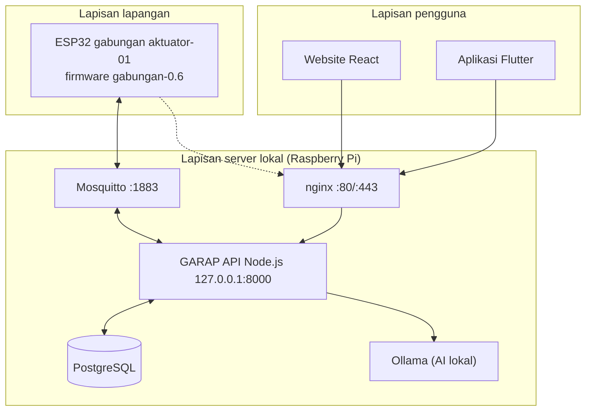
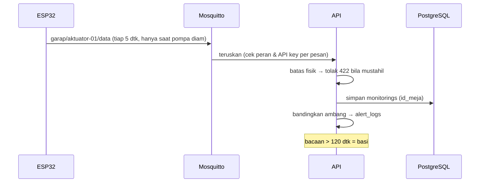
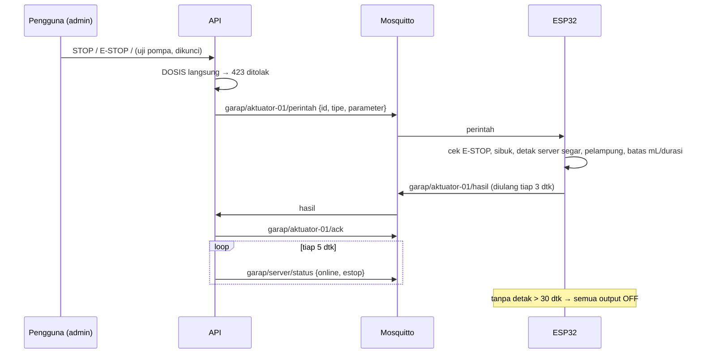

# Arsitektur Sistem GARAP

| Atribut | Isi |
|---|---|
| Nomor dokumen | GARAP-REF-01 |
| Versi | 1.0 |
| Tanggal | 12 November 2026 |

## 1. Gambaran Lapisan

## 2. Aliran Data Sensor

## 3. Aliran Perintah ke Aktuator

Tipe perintah yang diterima firmware gabungan: `DOSIS`, `ISI_AIR`, `UJI_POMPA`, `KALIBRASI`, `BALIK_KALIBRASI`, `STOP`, `STOP_DARURAT`. `BILAS` dan `SAMPLING` ditolak (`tipe_tak_dikenal`). Server tidak mengirim `DOSIS` karena gerbang dosis tertutup.

## 4. Lapisan Pengaman

| Lapis | Lokasi | Pengaman |
|---|---|---|
| 1 | Tombol E-STOP fisik | Memutus bus 12 V aktuator |
| 2 | Firmware | Fail-safe 30 dtk, batas mL/suntikan & per jam, batas durasi, satu pekerjaan, watchdog, output OFF saat boot, pelampung |
| 3 | Broker | Tanpa anonim, ACL per perangkat |
| 4 | Backend | Batas fisik & kewajaran sensor, saklar izin, gerbang dosis (`EKSEKUSI_DIIZINKAN = false`), parameter wajib SIAP, kunci penampung, audit |
| 5 | Antarmuka | Peran admin/petani/demo, konfirmasi aksi, demo baca-saja |
| 6 | AI | Hanya teks; tidak punya jalur ke aktuator; penyaring pesan & keluaran |

## 5. Model Data Utama (ringkas)

| Tabel | Isi |
|---|---|
| `monitorings` | Bacaan sensor (ph, tds, waterTemp, airTemp, humidity, id_meja) |
| `alert_logs` | Peringatan |
| `mejas`, `tanamen` | Meja/penampung dan jenis tanaman |
| `semais` dan tabel tahap | Model tahap yang dipakai antarmuka |
| `siklus_budidaya`, `siklus_lot`, `siklus_transisi`, `permintaan_konfirmasi` | Siklus budidaya baru (API saja) |
| `dosing_events`, `persetujuan_dosing`, `dosing_rounds`, `dosing_transisi` | Alur persetujuan dosing (API saja) |
| `preset_nutrisi`, `preset_versi` | Preset bervesi |
| `konfigurasi_dosis`, `timing_operasi` | Parameter dengan status validasi |
| `saklar_aktuator` | Saklar izin |
| `perintah_aktuator` | Antrean perintah ke ESP32 |
| `kalibrasi_sensor`, `kalibrasi_log` | Kalibrasi |
| `audit_logs`, `users` | Audit dan akun |

Sumber: `backend-nodejs/src/*`, migrasi `backend-nodejs/database/migrations/`.
