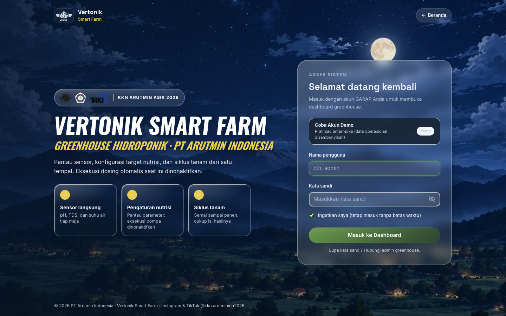
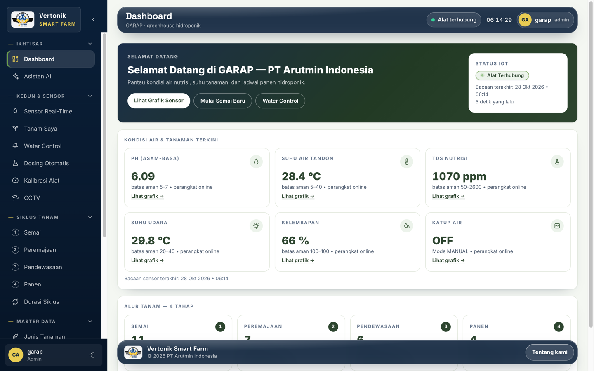
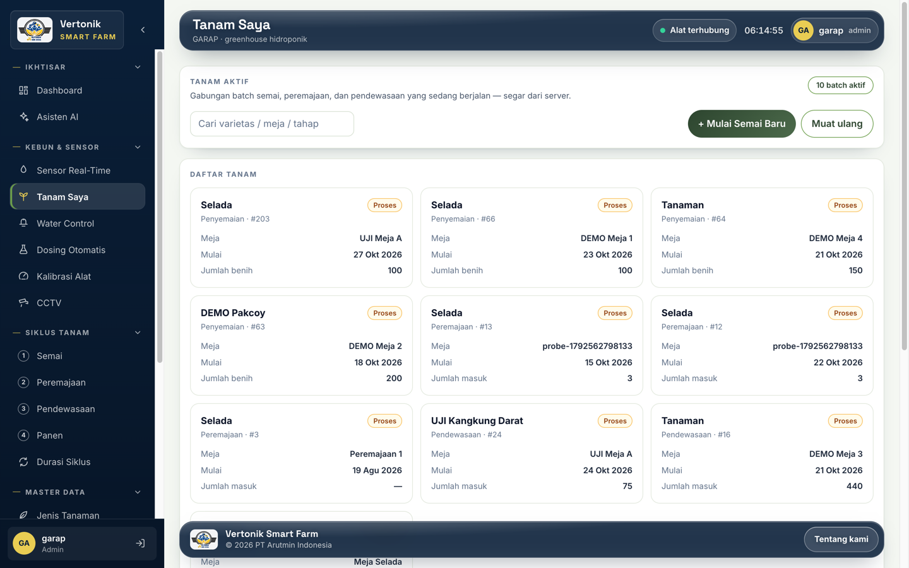

# Infografis 03 — Cara Mengoperasikan Website GARAP

| Item | Isi |
|---|---|
| **Judul** | Cara Mengoperasikan Website GARAP |
| **Subjudul** | Delapan langkah dari login sampai memeriksa riwayat aktivitas. |
| **Tujuan komunikasi** | Operator dan admin dapat memakai website untuk pemantauan harian tanpa membaca manual panjang. |
| **Target pembaca** | Operator, Administrator, Pengelola greenhouse |
| **Ukuran desain** | Poster panjang lebar **1200 px**, tinggi mengikuti isi (±2.100–3.050 px). Cetak: **A3 potret, 2 halaman** (lebar kanvas = lebar A3). Alternatif media sosial: carousel 1080 × 1350 px, satu seksi per slide. |
| **Preview HTML** | `03-HTML-PREVIEW/infographic-03.html` |

## 1. Struktur layout

Header navy → baris 2 kolom: screenshot login (kiri) + kartu alamat akses (kanan) → 8 langkah bernomor dalam grid 2 kolom → 2 screenshot berdampingan (Dashboard, Kebun Saya) → tabel hak akses peran → footer.

## 2. Urutan informasi

1. dua
2. Delapan langkah penggunaan harian
3. dua
4. Siapa boleh membuka apa

## 3. Konten final (siap salin ke Canva)

**Header (navy):** eyebrow `INFOGRAFIS 03 · GARAP · Vertonik Smart Farm`
**Judul:** Cara Mengoperasikan Website GARAP
**Subjudul:** Delapan langkah dari login sampai memeriksa riwayat aktivitas.
**Label pembaca:** Operator · Administrator · Pengelola greenhouse

_Halaman login (diambil 12 Nov 2026). Isi nama pengguna & kata sandi, lalu tekan **Masuk ke Dashboard**._

- **Alamat website**
  - Wi-Fi greenhouse: `http://vertonik.local` atau `http://<IP-Pi>`
  - Hotspot Pi `Vertoniksmartfarm`: `http://10.42.0.1`  
  _ikon: globe.svg_
- **Tiga jenis akun**
  - **Admin** — akses penuh
  - **Petani** — pantau & Kebun Saya
  - **Demo** — lihat saja, tidak bisa mengubah  
  _ikon: user-round.svg_

### 2. [Langkah demi langkah] Delapan langkah penggunaan harian

1. **Login** — Buka alamat website, isi nama pengguna dan kata sandi. [tombol: Masuk ke Dashboard]
2. **Buka Dashboard** — Lihat status alat (terhubung/terputus), kartu sensor dengan batas aman, dan ringkasan 4 tahap tanam.
3. **Pilih grup menu PANTAU** — Rail kiri berisi grup; submenu muncul sebagai pil di bawah: Dashboard, Sensor, Peringatan, CCTV, Asisten AI.
4. **Lihat data sensor** — Menu **Sensor**: grafik & tabel riwayat 6 Jam / 24 Jam / 7 Hari / Kustom, bisa diekspor CSV.
5. **Kelola data tanaman** — Menu **Kebun Saya**: kartu batch, estimasi panen, dan tombol **Mulai semai baru**.
6. **Kelola tandon (Admin)** — **Meja Tanaman** untuk data meja/penampung; **Target Nutrisi** untuk target per penampung.
7. **Periksa Peringatan** — Merah = kritis, kuning = waspada, info. Cek kondisi fisik tandon dulu sebelum **Tandai selesai**.
8. **Lihat riwayat aktivitas (Admin)** — Menu **Catatan Aktivitas**: siapa mengubah apa, kapan, dan dari rute mana.

_Dashboard: kartu sensor + batas aman (28 Okt 2026; tata letak menu kini berbeda)._

_Kebun Saya: batch tanaman dan estimasi panen (28 Okt 2026)._

### 4. [Hak akses] Siapa boleh membuka apa

| Grup menu | Admin | Petani | Demo |
|---|---|---|---|
| PANTAU — Dashboard, Sensor, Peringatan, CCTV, Asisten AI | Ya | Ya | Ya |
| KENDALI — Kebun Saya | Ya | Ya | Ya (baca) |
| KENDALI — Saklar, Target Nutrisi | Ya | Tidak | Baca saja |
| DATA — Kalibrasi, Data, Catatan Aktivitas, Laporan | Ya | Tidak | Baca saja |
| SISTEM — Pengaturan Alat, Pemulihan Papan, Koneksi Alat, Manajemen User | Ya | Tidak | Baca saja |
| SIKLUS TANAM & MASTER DATA | Ya | Tidak | Baca saja |
| Akun Saya | Ya | Ya | Ya |

**Footer (navy):** Sumber data · `react-web-app/src/layouts/AppShell.tsx` (menu), `react-web-app/src/router.tsx` (hak akses), Modul Juknas Bab III–IV. Screenshot login: 12 Nov 2026; screenshot dashboard/sensor/tanam: 28 Okt 2026. — Versi 1.0 · 12 Nov 2026

## 4. Arahan ilustrasi

Pakai screenshot asli dari `04-ASSETS/screenshots/`. Jangan menggambar ulang UI. Screenshot dashboard/tanam bertanggal 28 Okt 2026: navigasi samping lama sudah diganti rail grup (PANTAU, KENDALI, DATA, SISTEM, SIKLUS TANAM, MASTER DATA) — potong bagian sidebar bila ingin aman, atau ambil ulang screenshot setelah login.

## 5. Warna yang digunakan

- Header & footer: navy `#0A1F38` → `#071527`; eyebrow emas `#E9CD53`.
- Latar isi: `#F4F7F2`; kartu putih `#FFFFFF`, border `#E2E8DD`, radius 20 px.
- Lingkar ikon: mint `#CFE2CE` + ikon forest `#2D452F`; nomor langkah forest `#2D452F`.
- Teks: tinta `#0B1A2B`, sekunder abu `#4F6075`.
- Status: sukses moss `#6B9D4A`, peringatan amber `#E0A42B`, bahaya merah `#C0392B`.

## 6. Tipografi

- Judul: Space Grotesk Bold 56 px (cetak A3 ±40 pt), putih.
- Subjudul: Inter Regular 22 px, putih 78%.
- Judul seksi: Space Grotesk Bold 28 px; eyebrow Inter Bold 13 px kapital, spasi huruf 14%.
- Judul kartu: Space Grotesk/Inter SemiBold 19 px; isi Inter 15–16 px abu `#4F6075`.
- Kode/topik: monospace 14 px dalam kotak `#F4F7F2`.

## 7. Catatan desain

- Nama menu ditulis persis seperti di layar: Dashboard, Sensor, Peringatan, Kebun Saya, Meja Tanaman, Catatan Aktivitas.
- "Notifikasi" di website bernama **Peringatan**; "riwayat aktivitas" bernama **Catatan Aktivitas**; "tandon" dikelola di **Meja Tanaman** dan **Target Nutrisi**.
- Langkah 6 dan 8 hanya untuk Admin (Demo = baca-saja).
- Ikuti `01-DESIGN-SYSTEM/GARAP_Design_Reference.md`; ikon SVG ada di `04-ASSETS/icons/`.

## 8. Peringatan keselamatan

- Jangan membagikan kata sandi. Kata sandi minimal 8 karakter (Akun Saya).
- Tombol merah **STOP pompa** (halaman Kalibrasi) hanya untuk keadaan darurat; E-STOP fisik tetap pemutus utama.
