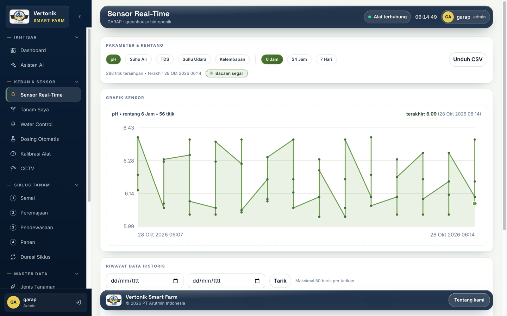

# Infografis 05 — Sistem Monitoring Hidroponik

| Item | Isi |
|---|---|
| **Judul** | Sistem Monitoring Hidroponik |
| **Subjudul** | Lima besaran yang dipantau GARAP, perjalanan datanya, dan cara membaca statusnya. |
| **Tujuan komunikasi** | Operator memahami arti setiap angka sensor dan kapan harus bertindak. |
| **Target pembaca** | Operator, Pengelola greenhouse |
| **Ukuran desain** | Poster panjang lebar **1200 px**, tinggi mengikuti isi (±2.100–3.050 px). Cetak: **A3 potret, 2 halaman** (lebar kanvas = lebar A3). Alternatif media sosial: carousel 1080 × 1350 px, satu seksi per slide. |
| **Preview HTML** | `03-HTML-PREVIEW/infographic-05.html` |

## 1. Struktur layout

Header → grid 5 kartu sensor (ikon, satuan, alat ukur) → alur data 5 blok horizontal → 3 kartu status (Normal / Di luar ambang / Usang) → tabel batas kewajaran → screenshot halaman Sensor → info → footer.

## 2. Urutan informasi

1. Lima besaran utama + level tandon
2. Dari probe ke layar
3. Tiga kondisi yang perlu dikenali
4. Angka di luar ini = probe bermasalah, bukan tanaman
5. Halaman Sensor
6. Batas aman tiap tanaman diatur admin

## 3. Konten final (siap salin ke Canva)

**Header (navy):** eyebrow `INFOGRAFIS 05 · GARAP · Vertonik Smart Farm`
**Judul:** Sistem Monitoring Hidroponik
**Subjudul:** Lima besaran yang dipantau GARAP, perjalanan datanya, dan cara membaca statusnya.
**Label pembaca:** Operator · Pengelola greenhouse

### 1. [Yang dipantau] Lima besaran utama + level tandon

- **pH air nutrisi** — Satuan pH. Probe pH via ADS1115 kanal A0.  
  _ikon: droplet.svg_
- **EC / TDS nutrisi** — TDS dalam **ppm**, EC dalam **mS/cm**. Probe EC via ADS1115 kanal A1.  
  _ikon: flask-conical.svg_
- **Suhu air tandon** — Satuan **°C**. Probe tahan air DS18B20.  
  _ikon: thermometer.svg_
- **Suhu udara** — Satuan **°C**. Sensor SHT31.  
  _ikon: sun.svg_
- **Kelembapan udara** — Satuan **% RH**. Sensor SHT31 yang sama.  
  _ikon: droplets.svg_
- **Level tandon** — Pelampung bawah & atas: KURANG / CUKUP / PENUH.  
  _ikon: container.svg_

### 2. [Alur data] Dari probe ke layar

**Sensor** (Probe di tandon & udara greenhouse.) → **ESP32** (Membaca & mengirim tiap 5 detik. Bacaan gagal tidak diganti angka palsu.) → **MQTT** (Topik `garap/aktuator-01/data` ke Raspberry Pi.) → **Backend + DB** (Diperiksa kewajarannya, disimpan di PostgreSQL.) → **Dashboard** (Kartu sensor, grafik, peringatan.)

### 3. [Membaca status] Tiga kondisi yang perlu dikenali

- **Di dalam batas aman** _(Normal)_ — Angka berada di rentang **Ambang Sensor**. Tidak perlu tindakan.  
  _ikon: circle-check.svg_
- **Di luar ambang** _(Waspada)_ — Muncul di menu **Peringatan** (kuning waspada / merah kritis). Periksa tandon lalu lapor.  
  _ikon: triangle-alert.svg_
- **Data tidak baru** _(Usang)_ — Alat offline → yang tampil bacaan terakhir. Backend menandai sensor basi bila > **120 detik** tanpa data.  
  _ikon: clock.svg_

### 4. [Batas kewajaran] Angka di luar ini = probe bermasalah, bukan tanaman

Dipakai sistem untuk mendeteksi probe lepas atau kabel putus. Bukan target budidaya.

| Besaran | Rentang wajar | Jika di luar |
|---|---|---|
| pH | 3 – 9 | Dianggap bacaan mustahil; dosing ditahan. |
| TDS | 50 – 2.500 ppm | Dianggap bacaan mustahil; dosing ditahan. |
| Suhu air | 5 – 45 °C | Dianggap bacaan mustahil; dosing ditahan. |

### 5. [Di website] Halaman Sensor

_Grafik riwayat dengan pilihan rentang 6 Jam / 24 Jam / 7 Hari / Kustom dan ekspor CSV (tangkapan 28 Okt 2026)._

> **ℹ️ Batas aman tiap tanaman diatur admin**
> Nilai min–maks aman per parameter ada di menu **Ambang Sensor**. Infografis ini sengaja tidak mencantumkan angka target agar tidak menggantikan pengaturan di sistem.

**Footer (navy):** Sumber data · `backend-nodejs/src/sanitySensor.js` (batas kewajaran, sensor basi 120 dtk), `deploy-pi/firmware/gabungan/gabungan.ino` (sensor & interval 5 dtk), Modul Juknas Bab I.4 & IV. — Versi 1.0 · 12 Nov 2026

## 4. Arahan ilustrasi

Ikon lucide per sensor: droplet (pH), flask-conical (EC/TDS), thermometer (suhu air), sun (suhu udara), droplets (kelembapan). Screenshot halaman Sensor dari `04-ASSETS/screenshots/04-sensor-realtime.png`.

## 5. Warna yang digunakan

- Header & footer: navy `#0A1F38` → `#071527`; eyebrow emas `#E9CD53`.
- Latar isi: `#F4F7F2`; kartu putih `#FFFFFF`, border `#E2E8DD`, radius 20 px.
- Lingkar ikon: mint `#CFE2CE` + ikon forest `#2D452F`; nomor langkah forest `#2D452F`.
- Teks: tinta `#0B1A2B`, sekunder abu `#4F6075`.
- Status: sukses moss `#6B9D4A`, peringatan amber `#E0A42B`, bahaya merah `#C0392B`.

## 6. Tipografi

- Judul: Space Grotesk Bold 56 px (cetak A3 ±40 pt), putih.
- Subjudul: Inter Regular 22 px, putih 78%.
- Judul seksi: Space Grotesk Bold 28 px; eyebrow Inter Bold 13 px kapital, spasi huruf 14%.
- Judul kartu: Space Grotesk/Inter SemiBold 19 px; isi Inter 15–16 px abu `#4F6075`.
- Kode/topik: monospace 14 px dalam kotak `#F4F7F2`.

## 7. Catatan desain

- **Tidak ada angka target tanaman** di infografis ini: batas aman diatur admin per meja di menu **Ambang Sensor** dan dapat berbeda per tanaman.
- Tabel "batas kewajaran" bukan target tanaman — hanya deteksi probe lepas/kabel putus. Sumber kode menyebut nilainya belum dicocokkan dengan spesifikasi probe.
- Website menampilkan nutrisi sebagai TDS (ppm); EC (mS/cm) dibaca dari probe yang sama.
- Ikuti `01-DESIGN-SYSTEM/GARAP_Design_Reference.md`; ikon SVG ada di `04-ASSETS/icons/`.

## 8. Peringatan keselamatan

- Bacaan aneh (mis. pH melonjak) → periksa fisik tandon dulu, jangan langsung menambah nutrisi atau pH manual.
