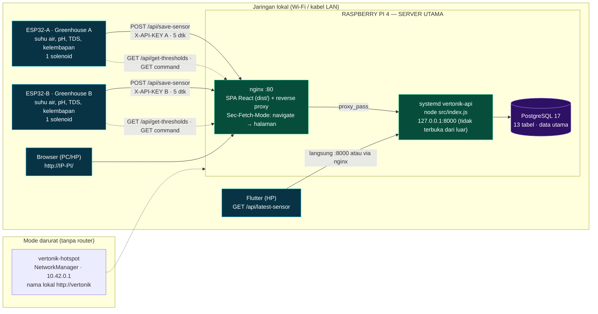
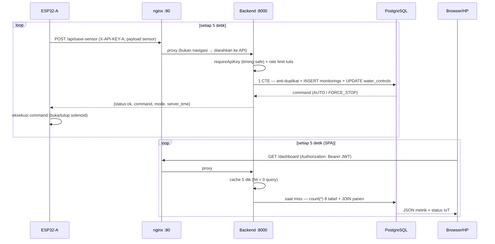

# ARSITEKTUR — Raspberry Pi Server Utama + 2 ESP32

Rancangan sistem **lokal, tanpa cloud**: satu Raspberry Pi menjalankan seluruh backend,
dua ESP32 mengirim data sensor. Dokumen ini melengkapi `docs/KONTRAK_API.md` dan
`deploy-pi/PANDUAN.md`.

> Status: **rancangan** — bagian bertanda `USULAN` belum dijalankan/diubah di kode.
> Fakta yang ada saat ini: firmware ESP32 **tidak ada di repo ini**, backend masih memakai
> **1 kunci API** dan **1 aliran data** (tanpa kolom device).

---

## 1. Topologi



**Prinsip:** backend & database **tidak pernah terbuka langsung** ke jaringan — semua lewat
nginx (atau proxy Vite saat development). ESP32 hanya bicara ke `:80`.

---

## 2. Pembagian perangkat

| | ESP32-A (usulan) | ESP32-B (usulan) |
|---|---|---|
| Nama/logic | `esp32-a` — Greenhouse A | `esp32-b` — Greenhouse B |
| Sensor | suhu air, pH, TDS, suhu udara, kelembapan, level tandon | sama |
| Aktuator | 1 solenoid (katup isi/stop) | 1 solenoid |
| Endpoint kirim | `POST /api/save-sensor` | sama |
| Endpoint baca | `GET /api/get-thresholds`, balasan `command` dari save-sensor | sama |
| Interval kirim | 5 detik (realtime) — atau 5 menit bila hanya butuh grafik 24 jam | sama |
| API key | `ESP32_KEY_A` | `ESP32_KEY_B` |
| IP | DHCP reservation di router (mis. `192.168.1.51`) | `192.168.1.52` |

Catatan interval: `GET /monitoring/chart-data` mengambil **288 baris terakhir**
≈ 24 jam bila kirim tiap 5 menit. Kirim tiap 5 detik = ±17 ribu baris/hari — masih ringan
untuk index `monitorings(created_at DESC)` (0,7 ms @ 100k baris), tapi pilih sesuai kebutuhan.

---

## 3. Satu siklus data (kirim → tampil)



**Perilaku saat Pi mati / jaringan putus:**
1. ESP32 mencoba kirim → gagal → **antre lokal** (LittleFS/SD, mis. 500 baris terakhir).
2. LED status: merah = server tak terjangkau, hijau = tersambung.
3. Saat koneksi pulih → kirim ulang (server membuang duplikat otomatis lewat CTE anti-duplikat).
4. Dashboard menampilkan `iotStatus.online=false` + `seconds_ago` setelah **120 detik** tanpa data.

---

## 4. Gap menuju 2 perangkat (fakta vs usulan)

| # | Kondisi sekarang | Akibat untuk 2 ESP32 | Usulan perubahan |
|---|---|---|---|
| 1 | `monitorings` **tidak punya `device_id`** | Data greenhouse A & B tercampur jadi satu grafik | tambah kolom + FK ke tabel `devices` |
| 2 | 1 kunci `ESP32_API_KEY` di `.env` | Kunci sama untuk semua perangkat, tak bisa ditarik per device | `ESP32_KEY_A` / `ESP32_KEY_B`, validasi ke tabel `devices` |
| 3 | `sensor_thresholds` unik per `sensor` (global) | Ambang A = ambang B | unique jadi `(sensor, device_id)` |
| 4 | `water_controls` **1 baris dominan** | Perintah katup A & B saling menimpa | tambah `device_id` (unique) — 1 baris per perangkat |
| 5 | `GET /api/latest-sensor` selalu baris terakhir **semua** data | SPA tak bisa memilih greenhouse | parameter opsional `?device=esp32-a` |

### Migrasi database (USULAN — belum dijalankan)

```sql
-- 1. identitas perangkat
CREATE TABLE devices (
  id        bigint GENERATED BY DEFAULT AS IDENTITY PRIMARY KEY,
  kode      varchar(20)  NOT NULL UNIQUE,   -- esp32-a / esp32-b
  nama      varchar(50)  NOT NULL,
  lokasi    varchar(100),
  aktif     boolean      NOT NULL DEFAULT true,
  created_at timestamp   NOT NULL DEFAULT now(),
  updated_at timestamp
);
INSERT INTO devices (kode, nama, lokasi) VALUES
  ('esp32-a', 'Greenhouse A', 'Barat'),
  ('esp32-b', 'Greenhouse B', 'Timur');

-- 2. sensor & alert → punya pemilik
ALTER TABLE monitorings ADD COLUMN device_id bigint REFERENCES devices(id) ON DELETE SET NULL;
ALTER TABLE alert_logs  ADD COLUMN device_id bigint REFERENCES devices(id) ON DELETE SET NULL;
CREATE INDEX idx_monitorings_device ON monitorings(device_id, created_at DESC);

-- 3. ambang per perangkat (data lama diwariskan ke A, lalu disalin ke B)
ALTER TABLE sensor_thresholds ADD COLUMN device_id bigint REFERENCES devices(id) ON DELETE CASCADE;
ALTER TABLE sensor_thresholds DROP CONSTRAINT sensor_thresholds_sensor_unique;
ALTER TABLE sensor_thresholds ADD CONSTRAINT sensor_thresholds_sensor_device_unique
      UNIQUE (sensor, device_id);
UPDATE sensor_thresholds SET device_id = (SELECT id FROM devices WHERE kode='esp32-a');
INSERT INTO sensor_thresholds (sensor, min, max, device_id, updated_at)
SELECT s.sensor, s.min, s.max, d.id, now()
FROM sensor_thresholds s CROSS JOIN devices d
WHERE s.device_id = (SELECT id FROM devices WHERE kode='esp32-a') AND d.kode='esp32-b';

-- 4. state katup per perangkat
ALTER TABLE water_controls ADD COLUMN device_id bigint REFERENCES devices(id) ON DELETE CASCADE;
ALTER TABLE water_controls ADD CONSTRAINT water_controls_device_unique UNIQUE (device_id);
UPDATE water_controls SET device_id = (SELECT id FROM devices WHERE kode='esp32-a');
INSERT INTO water_controls (command, mode, valve_state, device_id, updated_at)
SELECT command, mode, valve_state, id, now() FROM devices WHERE kode='esp32-b';
```

### Perubahan kode backend (USULAN)

| File | Perubahan |
|---|---|
| `src/config.js` | baca `ESP32_KEY_A`, `ESP32_KEY_B` (fallback `ESP32_API_KEY`) |
| `src/auth.js` | `requireApiKey` → cocokkan ke salah satu kunci, isi `req.device = {id, kode}` |
| `src/routes/monitoring.js` | `save-sensor`: tulis `req.device.id` (atau field opsional `device` bila key bersama) · `latest-sensor` & `get-thresholds`: dukung `?device=` |
| `src/routes/watercontrol.js` | filter `device_id` (default = perangkat pertama) |
| `src/routes/dashboard.js` | agregat lintas perangkat + ringkasan per device |

**Aturan kompatibilitas:** semua tambahan bersifat **opsional/bernilai default** — firmware
lama tetap jalan tanpa diubah (kontrak fixed dipertahankan).

---

## 5. Keamanan (lapisan yang sudah & yang ditambahkan)

| Lapisan | Sudah ada | Untuk 2 ESP32 |
|---|---|---|
| Jaringan | backend bind `127.0.0.1`; hanya nginx :80 yang terbuka | IP perangkat di DHCP reservation; Pi jangan port-forward ke internet |
| Identitas perangkat | 1 kunci bersama, `timingSafeEqual` | **1 kunci per perangkat** → kunci bisa ditarik/diganti tanpa mematikan yang lain |
| Rate limit | GET 300 · tulis 60 · login 10 per menit/IP | tambah: `POST /api/save-sensor` minimal 12 dtk/kirim (cegah flood) |
| Data | SQL 100% parameterized; `wa_settings.api_key` AES-256 | `devices.api_key` tidak pernah ikut di response mana pun |
| Transport | HTTP lokal; `HTTPS=1` (self-signed) opsional | Wi-Fi terpisah (SSID khusus greenhouse) atau WPA2 + kunci |
| Backup | `pg_dump` (lihat `deploy-pi/PANDUAN.md`) | backup harian ke kartu SD / flash, simpan juga `.env` |

---

## 6. Pemasangan & pemeliharaan di Pi

Rujukan lengkap: **`deploy-pi/PANDUAN.md`** (headless, dari nol). Ringkasan:

```bash
# dari Mac — buat paket deploy
./scripts/siapkan-paket-pi.sh          # → vertonik-pi-YYYYMMDD.zip
scp vertonik-pi-YYYYMMDD.zip pi@<ip>:
# di Pi (sekali jalan)
unzip vertonik-pi-*.zip && cd vertonik-pi && ./setup-pi.sh

# update setelah ada perubahan kode (tanpa .env tertimpa)
./scripts/pi update                     # build → rsync → restart service

# cek kesehatan
systemctl status vertonik-api
journalctl -u vertonik-api -n 50
curl -s http://127.0.0.1:8000/                      # harus JSON info
curl -s -H "X-API-KEY: *** ESP32_KEY_A" http://127.0.0.1:8000/api/get-thresholds
psql "$DATABASE_URL" -c "SELECT count(*), max(created_at) FROM monitorings"
```

**Checklist verifikasi 2 ESP32:**
1. `SELECT count(*) FROM monitorings GROUP BY device_id` → dua baris (masing-masing tumbuh).
2. `GET /api/latest-sensor?device=esp32-a` dan `?device=esp32-b` → data berbeda.
3. Ubah ambang di `esp32-b` → `get-thresholds?device=esp32-b` berubah, `esp32-a` tidak.
4. Perintah katup A tidak mengubah `water_controls` milik B.
5. Cabut salah satu ESP32 → hanya dia yang `is_online=false`; dashboard lain tetap hijau.

---

## 7. Urutan implementasi (disarankan)

1. **Perbaiki kontrak yang belum terpenuhi** dulu: primary key di `GET` daftar
   (`docs/ANALISIS_BACKEND.md` §6.2) — penghalang frontend.
2. Kunci per perangkat di `.env` (`ESP32_KEY_A/B`) — perubahan kecil, tanpa migrasi DB.
3. Migrasi `devices` + kolom `device_id` (SQL §4) + perubahan kode §4.
4. Firmware ESP32: tambah field `device` / header key perangkat, antrean offline, LED status.
5. Uji: `bash backend-nodejs/scripts/smoke-test.sh` + checklist §6.
6. Deploy Pi: `./scripts/pi update`.

Terkait: `docs/KONTRAK_API.md` · `docs/openapi.yaml` · `docs/JALUR_BACKEND_DAN_DB.md` ·
`deploy-pi/PANDUAN.md` · `backend-nodejs/docs/RANCANGAN_BACKEND.md`.
