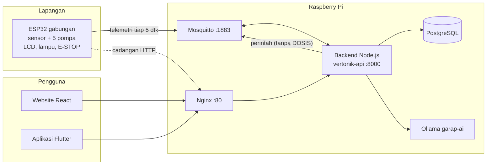

# Audit Sistem GARAP — Tahap 1 (Bahan Dokumentasi)

Tanggal: 12 November 2026
Tujuan: memetakan sistem GARAP yang sebenarnya (menurut kode) sebagai dasar Juknas, Juknis, SOP, dan poster, serta mendaftar celah pada dokumen yang sudah ada.
Metode: skill `understand-anything:understand-domain` (scan ringan + analisis domain), lalu pemeriksaan silang manual ke kode.
Sifat: **baca-saja**. Tidak ada source code, firmware, database, atau konfigurasi MQTT yang diubah. Satu-satunya keluaran mesin adalah `.ua/domain-graph.json`.

---

## 1. Ringkasan

- Sistem terdiri dari **7 domain bisnis, 24 alur, 109 langkah** (lihat bagian 3).
- **Eksekusi dosing benar-benar diblokir, dengan 4 lapis** (bagian 4). Semua dokumen dan poster harus menyebut dosing sebagai "alur persetujuan sudah ada, eksekusi diblokir".
- **Dokumen yang ada belum bisa dipakai apa adanya.** Modul Juknas/Juknis v1.0 mengacu ke firmware `gabungan-0.6` yang **belum di-commit**, dan beberapa klaimnya (kalibrasi dari web langsung ke ESP32, uji pompa dari web) bergantung pada kode backend yang **masih dikerjakan dan belum di-commit**.
- **Keputusan dibutuhkan sebelum Tahap 3:** dokumentasi mengikuti kondisi kode yang mana (bagian 6).

## 2. Arsitektur yang terverifikasi

| Komponen | Lokasi kode | Catatan |
|---|---|---|
| Backend | `backend-nodejs/` (repo git terpisah, di-ignore repo induk) | 32 berkas rute, mount di `src/index.js:169-194` |
| Web | `react-web-app/src/` | Rute di `router.tsx`; beberapa rute lama hanya pengalihan |
| Mobile | `flutter_mobile_app/lib/pages/` | 16 halaman |
| Firmware | `deploy-pi/firmware/gabungan/gabungan.ino` | Commit: `gabungan-0.4`; working tree: `gabungan-0.6` (belum di-commit) |
| Server Pi | `deploy-pi/{mosquitto,nginx,systemd,ollama}` | Pi tidak terjangkau saat audit 11 Nov; perilaku nyata belum diuji |

## 3. Peta domain

| Domain | Alur utama | Relevan untuk |
|---|---|---|
| Monitoring Sensor & Peringatan | kirim bacaan sensor (MQTT `garap/<kode>/data` atau HTTP `/api/device/v1/sensor`), pantau realtime, kelola peringatan | Juknis Website, Juknis IoT, Poster Alur Monitoring |
| Dosing Nutrisi (Alur Persetujuan) | ajukan → setujui/tolak/cabut, eksekusi (diblokir), sinkron target nutrisi | Poster Alur Persetujuan Dosing, SOP Operasi |
| Kendali Aktuator & Keselamatan | antrean perintah, E-STOP, saklar izin & mode (isi air, pemeliharaan), kontrol air (nonaktif) | Juknis IoT, Poster Keselamatan, SOP |
| Kalibrasi & Uji Lab | kalibrasi pH/EC 2 titik, kalibrasi laju pompa, uji lab larutan & panen | SOP Pemeliharaan, Juknis IoT |
| Siklus Budidaya & Tanam | siklus bertahap (DRAFT → persiapan tandon → semai → peremajaan → hitung bibit → pertumbuhan → selesai), tanam per tahap, penugasan petani, prediksi panen | Juknas, Juknis Website |
| Asisten AI & Laporan | chat AI (Ollama + pengaman `aiGuard`), langkah selanjutnya, laporan & ekspor | Juknis Website |
| Akses Pengguna & Audit | login (JWT, cookie sesi), peran admin/petani/demo, `demoGuard`, kunci API perangkat, jejak audit | Juknas (peran), SOP |

State machine dosing: `WAITING_APPROVAL → APPROVED → RUNNING → MIXING → VERIFYING → SUCCESS / EXHAUSTED / FAULT`. Hanya tahap sampai `APPROVED` yang berjalan; transisi ke `RUNNING` selalu ditolak.

## 4. Status dosing — mekanisme blokir (terverifikasi)

| Lapis | Lokasi | Perilaku |
|---|---|---|
| 1. Bendera gerbang | `backend-nodejs/src/gerbangDosis.js:21` | `const EKSEKUSI_DIIZINKAN = false;` → `evaluasiGerbang` selalu menambah alasan `eksekusi_dosis_diblokir` (baris 74) |
| 2. Endpoint jalankan | `backend-nodejs/src/dosingSiklus.js:361-366` | `POST /api/dosing/siklus/:id/jalankan` → 423 `eksekusi_diblokir`, status tidak berubah. Bila bendera dibalik pun → 501 `eksekusi_belum_ada` (jalur eksekusi belum dibuat) |
| 3. Antrean kirim | `backend-nodejs/src/aktuator.js:29` | `TIPE_DIKIRIM` = semua tipe kecuali `DOSIS`; dipakai jalur HTTP dan jembatan MQTT → `DOSIS` tidak pernah sampai ke ESP32 |
| 4. Rute langsung | `backend-nodejs/src/routes/aktuator.js:53-61` | `POST /api/aktuator/perintah` dengan `tipe: DOSIS` → 423 `butuh_alur_persetujuan` |

Catatan keselamatan untuk dokumen: firmware masih punya penangan `DOSIS` sendiri (dengan batas mL per suntik, per jam, dan durasi). Yang menahannya hanya server. Karena itu dokumen **tidak boleh** mengajarkan cara mengirim perintah dosis langsung ke ESP32 (Serial/MQTT manual).

## 5. Celah dokumen yang sudah ada

Dokumen yang diperiksa: `docs/juknas-juknis/MODUL_JUKNAS_JUKNIS_VERTONIK_GARAP.md` (v1.0), `docs/PANDUAN_UJI_ALAT_HARDWARE.md`, `docs/LAPORAN_AUDIT_2026-11-11.md`, poster 1 & 2 di `docs/juknas-juknis/`.

| # | Temuan | Dokumen | Fakta di kode | Tingkat |
|---|---|---|---|---|
| G1 | Versi firmware berbeda: Modul `gabungan-0.6`, Panduan Uji `gabungan-0.4` | Modul, Panduan Uji | Commit `0.4`; `0.6` hanya di working tree (`gabungan.ino:41`, +316/−57 baris belum di-commit) | Tinggi |
| G2 | Modul: kalibrasi EC/pH dari web "otomatis dikirim ke NVS ESP32"; Panduan Uji (koreksi 12 Nov): backend belum mengirim perintah kalibrasi | Modul §6.1 vs Panduan Uji | Pengiriman `UJI_POMPA`/`KALIBRASI` sedang ditambahkan di backend (`aktuator.js`, `config.js`, `routes/iotV41.js`, belum di-commit) dan dikunci `UJI_POMPA_DIIZINKAN` (bawaan mati, `config.js:31`) | Tinggi |
| G3 | Tombol RESET GPIO 19: Modul "berfungsi", Panduan Uji "belum dibaca firmware" | Modul §5.1, Panduan Uji Tahap 4 | Dipakai di firmware `0.6` (`gabungan.ino:99, 675`), tidak di `0.4` | Sedang |
| G4 | Modul tidak menyebut status dosing diblokir sama sekali; §4.2 menulis "Saran dosis" dan §1.2 "perintah dosis otomatis" seolah aktif | Modul | 4 lapis blokir (bagian 4) | Tinggi (keselamatan) |
| G5 | Kontrol air (`/watercontrol`) tidak dijelaskan sebagai nonaktif | Modul | Rute fill/stop/setMode selalu 503 (`routes/watercontrol.js:16`); halaman web dialihkan ke dashboard, tetapi halaman Flutter `watercontrol_page.dart` masih ada | Sedang |
| G6 | Siklus budidaya baru (DRAFT → persiapan tandon → … → selesai) tidak dibahas; Modul hanya memuat alur 4 tahap lama | Modul §4.4 | `siklusBudidaya.js`, rute `/api/siklus`, `/api/konfirmasi`, `/api/lot`, `/api/penugasan` | Sedang |
| G7 | Halaman Nutrisi Manual dihapus (web & mobile, belum di-commit); `/dosing-manual` kini mengalihkan ke `/dosing` | — | `router.tsx:69`; commit backend `2c1110b` "hapus dosing manual" | Rendah (pastikan tidak disebut di dokumen baru) |
| G8 | Aplikasi mobile tidak punya Juknis sendiri | Modul | 16 halaman Flutter | Sedang (keputusan cakupan) |
| G10 | Rute web di Modul akurat; rute yang tidak disebut (`/watercontrol`, `/ujilab`, `/air`, `/pompa`, `/kuras-air`, `/dosing-manual`) hanya pengalihan | Modul §4 | `router.tsx:69-75` | Info |

## 6. Keputusan yang dibutuhkan sebelum Tahap 3

1. **Baseline dokumentasi — DIPUTUSKAN 12 Nov 2026: (b) working tree, firmware `gabungan-0.6`.** Fitur yang belum di-commit ditulis dengan catatan "berlaku setelah rilis". Pilihan semula:
   - (a) mengikuti kode **yang sudah di-commit** (firmware `0.4`, kalibrasi web belum sampai ESP32), atau
   - (b) mengikuti **working tree** (firmware `0.6`, uji pompa & kalibrasi lewat backend) dengan catatan "berlaku setelah rilis", atau
   - (c) menunggu perubahan itu di-commit dulu.
2. **Cakupan mobile:** apakah Juknis Pengoperasian Website juga mencakup aplikasi Flutter, atau dibuat terpisah.
3. **Penanganan dokumen lama:** Modul v1.0 direvisi menjadi v2.0, atau dipecah menjadi dokumen-dokumen baru (Juknas, Juknis Website, Juknis IoT, SOP Operasi, SOP Pemeliharaan) sesuai rencana.

## 7. Catatan teknis audit

- Knowledge graph lama (`.ua/knowledge-graph.json`) sudah basi: 328 berkas berubah sejak dibuat. Analisis domain memakai scan baru.
- Scanner otomatis melewati `backend-nodejs/` (di-ignore git), Dart, dan firmware; bagian itu dibaca manual oleh analis domain.
- Folder `.ua/` **tidak di-ignore** dan sebagian isinya (`.ua/.trash-*`) sudah ter-commit. `domain-graph.json` baru akan muncul sebagai berkas belum terlacak.
- Berkas rahasia (`deploy-pi/KREDENSIAL-LOKAL.txt`, `*.lokal`, `rahasia.h`, `.env`) tidak dibuka.
- Belum dibaca rinci: halaman Flutter & React di luar nama berkas, `PANDUAN_MQTT.md`, `PANDUAN_SERVER_PI.md`, rute CCTV/master/publik. Bagian ini dibaca di Tahap 2.
