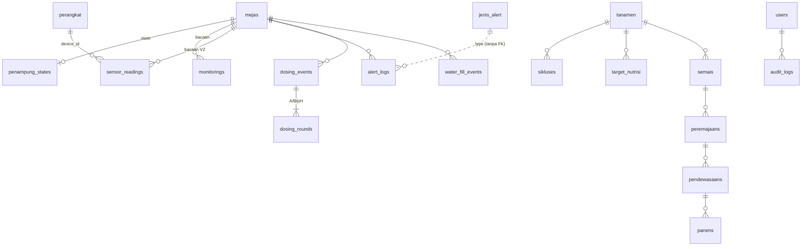

# Database GARAP — peta, aturan, dan cara mengembangkan

> Berlaku sejak migrasi `2026-10-22_02_rapikan_skema.sql`. Dasar rancangan: *Perancangan Sistem IoT Hidroponik — FINAL* (4 meja: 3 NFT + 1 DFT, satu ESP32).

## 1. Cara kerja sehari-hari

```bash
cd backend-nodejs
npm run migrate:status     # file mana yang sudah/belum jalan
npm run migrate            # jalankan yang belum
npm run db:seed-fake       # isi data palsu untuk debugging (hapus: database/hapus_fake.sql)
```

Database lama yang sudah berisi semua migrasi sampai 2026-10-19: cukup `npm run migrate`. Semua file migrasi idempoten, jadi aman dijalankan ulang; riwayatnya tercatat di tabel `schema_migrations`.

## 2. Menambah perubahan skema

1. Buat file baru `database/migrations/YYYY-MM-DD_NN_judul.sql` (NN = urutan di hari yang sama).
2. Bungkus dengan `BEGIN; … COMMIT;` dan tulis idempoten: `IF NOT EXISTS`, `ON CONFLICT DO NOTHING`, cek `pg_constraint` sebelum `ADD CONSTRAINT`.
3. **Jangan ubah file yang sudah jalan** — runner menolak bila checksum berubah. Koreksi = file baru.
4. Hapus data/kolom hanya lewat migrasi terpisah yang disetujui, setelah backend tidak memakainya.
5. Jalankan `npm run migrate` lalu `npm test`.

## 3. Konvensi

| Hal | Aturan |
|---|---|
| Nama | Bahasa Indonesia, `snake_case`, tabel baru **bentuk tunggal** (`perangkat`, `jenis_alert`). Tabel warisan Laravel (`mejas`, `tanamen`, `sikluses`, …) dibiarkan agar API tidak pecah. |
| Kunci utama | `bigserial id` untuk tabel baru; katalog berkode memakai `kode varchar` sebagai PK. |
| Waktu | `created_at`, `updated_at` (`timestamp(0)`), `updated_at` diisi otomatis oleh trigger `set_updated_at()`. |
| Pilihan tetap | `CHECK (kolom IN (...))`, bukan teks bebas. |
| Relasi | Selalu `FOREIGN KEY` + indeks di kolom FK. `ON DELETE` dipilih sadar: `CASCADE` untuk data turunan, `RESTRICT` untuk riwayat, `SET NULL` untuk rujukan opsional. |
| Data demo | Kolom `expires_at` → dihapus otomatis ±1 jam (akun demo). |
| Kamus | Setiap tabel baru wajib `COMMENT ON TABLE`. Lihat dengan `\d+ nama_tabel`. |

## 4. Peta domain

| Domain | Tabel | Dipakai backend? |
|---|---|---|
| Akun & audit | `users`, `audit_logs` | ya |
| Master budidaya | `mejas`, `tanamen`, `sikluses`, `target_nutrisi` | ya |
| Siklus tanam | `semais` → `peremajaans` → `pendewasaans` → `panens` | ya |
| Bacaan sensor (aktif) | `monitorings`, `sensor_thresholds` | ya |
| Bacaan sensor (V2, siap pakai) | `sensor_readings` (partisi bulanan), `sensor_readings_latest`, `sensor_readings_hourly`, `sensor_overrides` | belum |
| Kontrol air & dosing | `water_controls`, `penampung_states`, `dosing_events` → `dosing_rounds`, `water_fill_events` | sebagian |
| Konfigurasi alat | `konfigurasi_dosis`, `timing_operasi`, `aturan_fail_safe`, `jadwal_perawatan`, `kalibrasi_sensor`, `mapping_channel_esp32` | ya |
| Perangkat & kamera | `perangkat` *(baru)*, `cctv_kameras` | `cctv_kameras` ya |
| Notifikasi | `alert_logs`, `jenis_alert` *(baru)*, `wa_settings` | `alert_logs` ya |
| Laporan | `report_logs` | belum |
| Sisa Laravel | skema `legacy.*` (cache, jobs, sessions, …) | tidak |

### View siap pakai (untuk endpoint/laporan baru)

| View | Isi |
|---|---|
| `v_status_penampung` | satu baris per meja: LOCK, pemeliharaan, jatah dosing hari ini, target, bacaan terakhir, jumlah alert terbuka |
| `v_bacaan_terbaru` | bacaan sensor terakhir per meja |
| `v_alert_terbuka` | alert belum dibaca + nama jenis + nama meja |
| `v_tanam_berjalan` | batch semai/peremajaan/pendewasaan yang masih berjalan |
| `v_bacaan_efektif`, `v_dosing_harian` | dari skema V2 |

## 5. Relasi inti



## 6. Langkah pengembangan berikutnya (urut)

1. **Pindahkan bacaan ke `sensor_readings`** — backend menulis ke `sensor_readings` + `sensor_readings_latest` (per meja, per `device_id`), `monitorings` jadi arsip. Skrip `backfill_monitorings_ke_readings.sql` sudah ada.
2. **Kunci per perangkat** — isi `perangkat.api_key_hash`, backend mencocokkan `X-DEVICE-ID` + kunci, lalu memperbarui `terakhir_terlihat`.
3. **Alert dari katalog** — cooldown, severity, dan LOCK dibaca dari `jenis_alert` (menggantikan angka tetap di `monitoring.js`).
4. **Catat dosing & isi air** — firmware/endpoint menulis `dosing_events`/`dosing_rounds` dan `water_fill_events`; counter harian di `penampung_states` dihitung dari sana.
5. **Halaman Penampung** — endpoint dari `v_status_penampung` + reset LOCK & mode pemeliharaan (Aturan 9, 11, 13).
6. Setelah 1–5 stabil: migrasi terpisah untuk membuang kolom usang (`water_level`) dan skema `legacy`.
