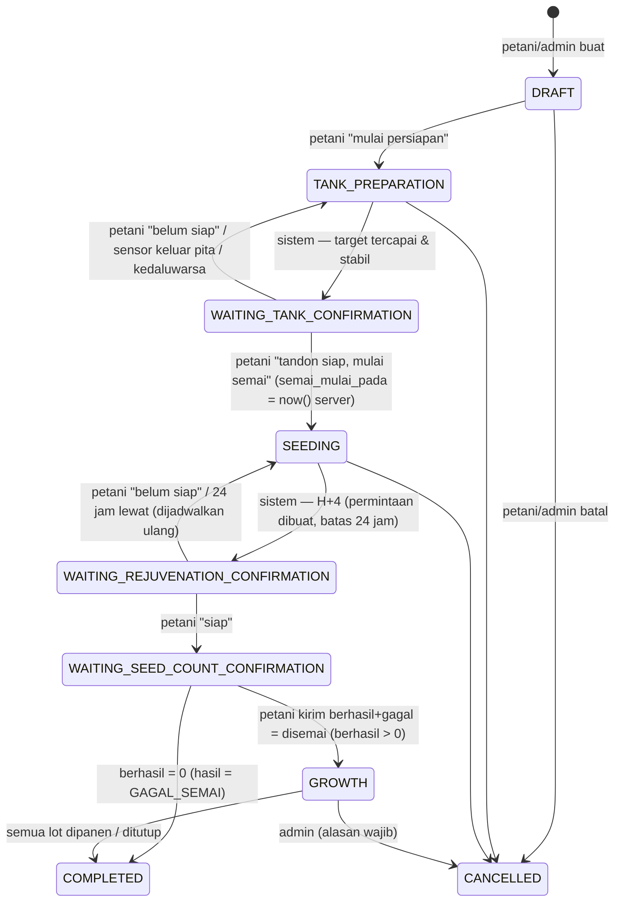
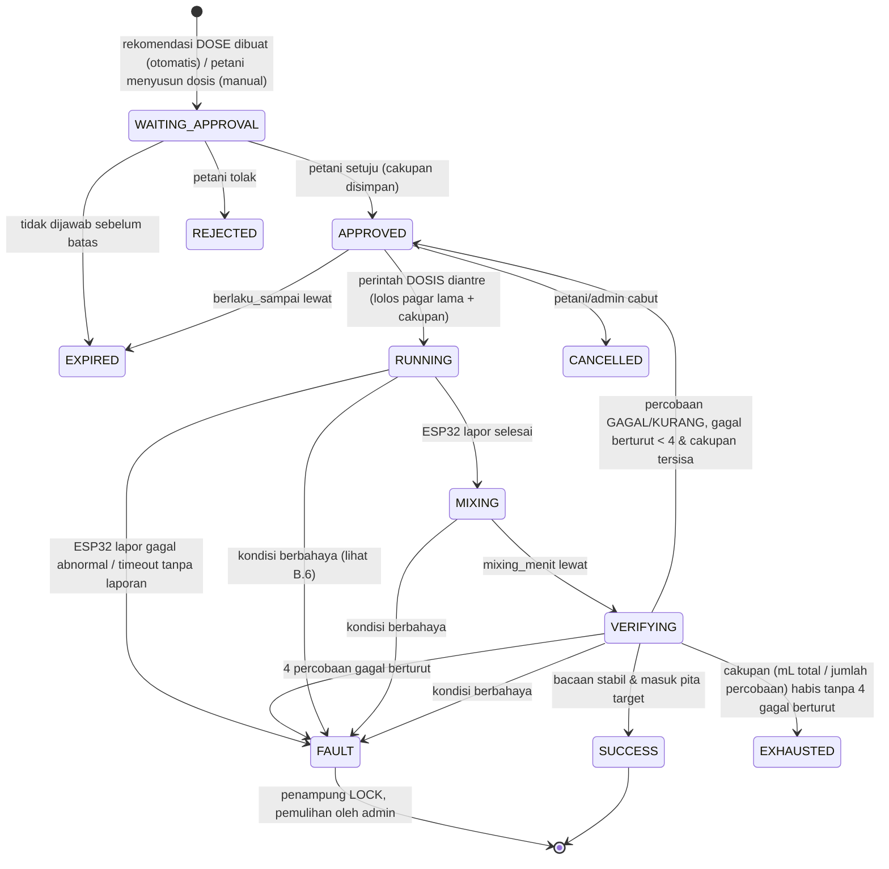
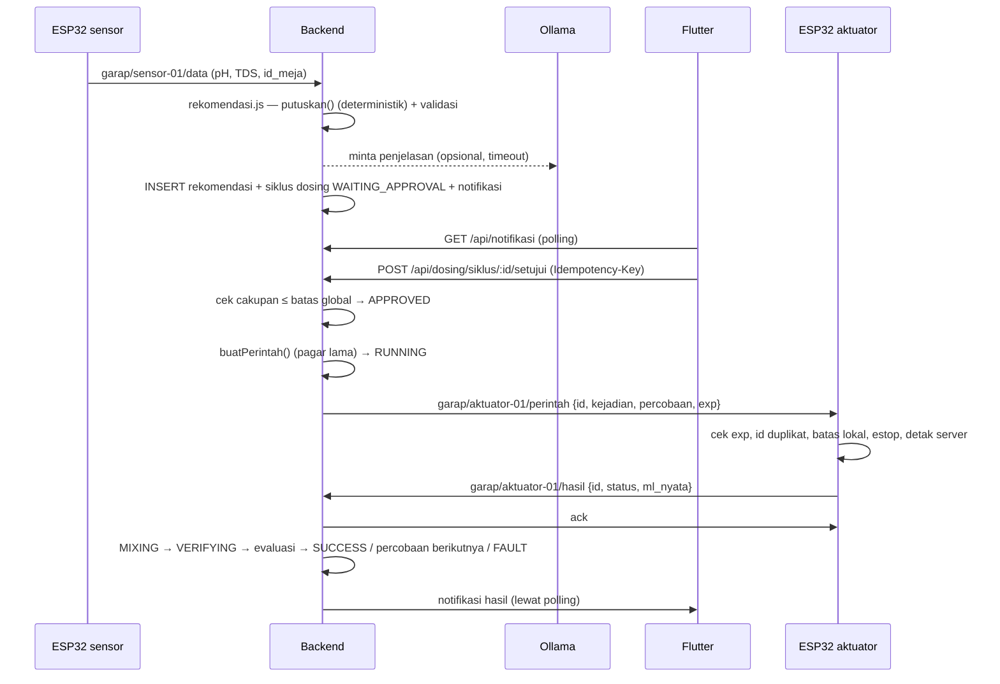

# Desain Fase 2 — Siklus budidaya, persetujuan dosing, AI, MQTT

Tanggal: 28 Okt 2026 · Dasar: `docs/AUDIT_FASE1_SPESIFIKASI.md` + keputusan pengguna · Status: **RANCANGAN, belum disetujui**.
Dokumen ini tidak mengubah kode, firmware, maupun DB.

Data aktual yang dipakai sebagai dasar desain (dibaca 28 Okt 2026):

| Data | Jumlah baris |
|---|---|
| `semais` | 11 (proses 4, selesai 6, gagal 1) |
| `peremajaans` | 7 |
| `pendewasaans` | 6 |
| `panens` | 4 |
| `sikluses` | templat durasi per tanaman |
| `dosing_events` / `dosing_rounds` / `perintah_aktuator` | 0 |
| `alert_logs` | 66 |

Ada **2 semai yang bercabang ke lebih dari 1 peremajaan**, jadi model baru wajib mendukung cabang.

---

## 1. Ringkasan arsitektur yang diusulkan

Tidak ada teknologi baru, kecuali paket Flutter `flutter_local_notifications`.

```
ESP32 sensor ──MQTT──┐                         ┌── Web React (admin/petani)
ESP32 aktuator ◄─MQTT┤  Mosquitto (Pi, ACL)    │
                     └── mqttJembatan.js ── Express API ── PostgreSQL
                                              │      │
                         penjadwal (setInterval, proses Node yang sama)
                           ├ siklusBudidaya: konfirmasi H+4, kedaluwarsa, pengingat
                           ├ pengendaliDosing: percobaan, mixing, verifikasi, FAULT
                           └ presetDosing (sudah ada): sinkron target
                                              │
                         rekomendasi.js (rumus deterministik) → aiPenjelas.js (Ollama, hanya teks)
                                              │
                                     Flutter (polling /api/notifikasi + notifikasi lokal)
```

Modul baru di backend:

| Modul | Tugas |
|---|---|
| `src/siklusBudidaya.js` | state machine budidaya + penjadwal konfirmasi |
| `src/pengendaliDosing.js` | state machine siklus dosing; **menggantikan** loop di `otomasi.js`. Fungsi murni `putuskan()` dan `bacaanMustahil()` dipakai ulang. |
| `src/rekomendasi.js` | membungkus `putuskan()`, menyimpan rekomendasi terstruktur |
| `src/aiPenjelas.js` | meminta Ollama mengisi `penjelasan`, memakai fallback dan pengaman `aiGuard.js` yang sudah ada |
| `src/notifikasi.js` | tulis/baca tabel notifikasi |

Yang **dipertahankan tanpa perubahan perilaku**:
- `aktuator.buatPerintah()` beserta semua pagarnya (mL per suntikan, volume harian, 8 kejadian per hari, LOCK, mode pemeliharaan, E-STOP, TTL, antrean 10);
- `kunciPenampung` / `bukaKunci`;
- jembatan MQTT dan ACL;
- fail-safe firmware.

Pagar baru (persetujuan) **ditambahkan di depan** pagar lama dan tidak menggantikannya.

Konsep yang **dipisah tegas**:

| Konsep | Tempat | Nilai |
|---|---|---|
| Status budidaya | `siklus_budidaya.status` | lihat bagian A |
| Mode operasi dosing per penampung | `penampung_states.mode_operasi` (baru) | `OTOMATIS` / `MANUAL` |
| Sumber target (sudah ada) | `penampung_states.target_mode` | `otomatis` (preset) / `manual` |
| Status dosing penampung | turunan dari siklus dosing aktif + LOCK | SLEEP … FAULT |

---

## 2. Diagram alur

### 2.1 Budidaya



### 2.2 Siklus dosing (satu persetujuan)



Status penampung saat tidak ada siklus dosing aktif dan tidak LOCK adalah **SLEEP**. Status ini tidak disimpan sebagai baris, melainkan diturunkan oleh query.

### 2.3 Urutan persetujuan → pompa



---

## 3. Tabel state machine

### A. Budidaya

| Dari | Ke | Aktor | Syarat | Efek |
|---|---|---|---|---|
| — | DRAFT | petani, admin | tanaman ada; preset (versi aktif) **atau** target manual lengkap; pH & TDS aktual (angka, rentang sanity); `jumlah_benih` bulat > 0; `hari_capai` 1–365 | snapshot target disimpan di siklus |
| DRAFT | TANK_PREPARATION | petani, admin | penampung tidak sedang dipakai siklus aktif lain; penampung tidak LOCK | target penampung disetel dari snapshot; rekomendasi dosing boleh dibuat (tetap butuh persetujuan) |
| TANK_PREPARATION | WAITING_TANK_CONFIRMATION | sistem | bacaan valid dalam pita target selama jendela stabil (`stabil_menit`, `stabil_n_bacaan` — **nilai terbuka, J.2**); tidak ada siklus dosing aktif | permintaan konfirmasi `TANK_READY` + notifikasi |
| WAITING_TANK_CONFIRMATION | SEEDING | petani, admin | permintaan masih PENDING; bacaan terakhir masih dalam pita | `semai_mulai_pada = now()` (timestamptz server); jadwal konfirmasi peremajaan = `semai_mulai_pada + 96 jam` |
| WAITING_TANK_CONFIRMATION | TANK_PREPARATION | petani / sistem | jawaban "belum siap", bacaan keluar pita, atau permintaan kedaluwarsa (batas = J.2) | permintaan ditutup (ANSWERED_NOT_READY / EXPIRED) |
| SEEDING | WAITING_REJUVENATION_CONFIRMATION | sistem (penjadwal) | `now() ≥ jadwal_konfirmasi_berikut` | permintaan `REJUVENATION` PENDING, `kedaluwarsa_pada = dibuat + 24 jam`, notifikasi |
| WAITING_REJUVENATION_CONFIRMATION | WAITING_SEED_COUNT_CONFIRMATION | petani, admin | permintaan PENDING belum kedaluwarsa | permintaan ANSWERED_READY |
| WAITING_REJUVENATION_CONFIRMATION | SEEDING | petani | jawaban "belum siap" | permintaan ANSWERED_NOT_READY; jadwal berikut = jawab + `ulang_konfirmasi_jam` (**J.3**); **`semai_mulai_pada` tidak diubah** |
| WAITING_REJUVENATION_CONFIRMATION | SEEDING | sistem | `now() ≥ kedaluwarsa_pada` | permintaan EXPIRED; notifikasi "terlewat"; jadwal berikut = kedaluwarsa + `ulang_konfirmasi_jam`; tanaman **tidak** dianggap siap |
| WAITING_SEED_COUNT_CONFIRMATION | GROWTH | petani, admin | `berhasil + gagal = jumlah_benih` (422 bila tidak), berhasil > 0, `id_meja` tujuan valid | lot PEREMAJAAN dibuat (`jumlah_masuk = berhasil`); kurva naik harian dihitung dari `mulai_pada` lot ini |
| WAITING_SEED_COUNT_CONFIRMATION | COMPLETED | petani, admin | berhasil = 0 dan gagal = jumlah | `hasil = GAGAL_SEMAI` |
| GROWTH | GROWTH | petani, admin | lot PEREMAJAAN ditutup (berhasil+gagal = masuk) → lot PENDEWASAAN; lot PENDEWASAAN → PANEN | event `TAHAP_LOT` dicatat; cabang (1 lot → beberapa lot di meja lain) diizinkan |
| GROWTH | COMPLETED | sistem | semua lot berstatus selesai/gagal | `selesai_pada` |
| * (kecuali COMPLETED) | CANCELLED | admin; petani hanya dari DRAFT/TANK_PREPARATION | alasan ≥ 5 karakter | siklus dosing aktif penampung itu ikut dibatalkan (B.7) |

Aturan umum:
- Semua transisi lewat **satu fungsi** `transisi(siklusId, ke, aktor, data)` di dalam transaksi.
- Fungsi itu memakai `SELECT … FOR UPDATE` pada siklus, memeriksa tabel transisi di atas (bila tidak ada → 409 `transisi_tidak_sah`), lalu INSERT ke `siklus_transisi` dan ke `audit_logs`.
- Penolakan: jawaban "belum siap" **bukan** galat. Statusnya kembali, dan permintaan baru dijadwalkan.
- Timeout: penjadwal berjalan tiap 60 dtk.
  - Query-nya `UPDATE … WHERE status='PENDING' AND kedaluwarsa_pada <= now() RETURNING`, jadi idempoten dan aman bila penjadwal berjalan dua kali.
  - Hanya satu permintaan PENDING per (siklus, jenis), dijamin oleh unique index parsial.
- Pengingat: satu notifikasi saat permintaan dibuat, satu pengingat pada `pengingat_pada` (**J.3**), dan satu saat kedaluwarsa. Kolom `pengingat_terkirim` mencegah pengingat terkirim ganda.
- Waktu: semua `timestamptz` (UTC di DB) dan ditampilkan dalam WITA. H+4 = +96 jam dari `semai_mulai_pada`, bukan "hari kalender ke-4" (**J.4** bila ingin per tanggal).

### B. Dosing

**B.1 Mode vs status.**
- `mode_operasi`:
  - `OTOMATIS`: sistem *membuat permintaan* sendiri;
  - `MANUAL`: hanya petani yang menyusun dosis.
- Kedua mode **wajib persetujuan** dan melewati pagar yang sama.
- Status dosing penampung dihitung sebagai berikut:
  - `status_lock = true` → **FAULT**;
  - ada siklus dosing aktif → status siklus itu;
  - selain itu → **SLEEP**.

**B.2 Status siklus dosing** (`dosing_events.status`, kolom baru):

| Status | Arti | Pompa boleh? |
|---|---|---|
| WAITING_APPROVAL | rekomendasi menunggu petani | tidak |
| APPROVED | dalam cakupan, menunggu percobaan berikut | tidak, hingga perintah diantre |
| RUNNING | perintah DOSIS diantre/terkirim | ya, oleh ESP32, dalam batas lokal |
| MIXING | menunggu `mixing_menit` (sudah ada di `timing_operasi`, 15) | tidak |
| VERIFYING | mengumpulkan bacaan stabil (`median_pembacaan_n`, `baca_stabil_timeout_detik`, sudah ada) | tidak |
| SUCCESS | target tercapai | — (akhir) |
| EXHAUSTED | cakupan habis tanpa 4 gagal berturut | — (akhir, butuh persetujuan baru) |
| REJECTED / EXPIRED / CANCELLED | ditolak / tak dijawab / dicabut | — (akhir) |
| FAULT | 4 gagal berturut atau kondisi berbahaya | — (akhir, penampung LOCK) |

"FAILED" adalah **hasil per percobaan** (`dosing_rounds.hasil`), bukan status siklus. Satu kegagalan tidak mengakhiri siklus.

**B.3 Persetujuan satu siklus** (`persetujuan_dosing`, satu baris per siklus dosing). Isi cakupannya:

| Field | Aturan |
|---|---|
| `target_ec_ppm`, `target_ph` | snapshot target saat disetujui; berubah target → siklus baru |
| `pompa_diizinkan` | subset dari `{AB, PH_UP, PH_DOWN}` |
| `maks_ml_per_percobaan` | ≤ `konfigurasi_dosis.maks_ml_per_suntikan` (AB) / `maks_ml_ph_per_suntikan` (pH) |
| `maks_ml_total` | ≤ sisa jatah harian saat disetujui |
| `maks_percobaan` | 1–4 (tidak boleh > `maks_gagal_berturut`) |
| `berlaku_sampai` | ≤ `now() + maks_masa_persetujuan_menit` (**J.2**) |
| `kondisi_henti` | daftar tetap (B.6), disimpan apa adanya agar terlacak |

- Persetujuan **tidak** bisa dipakai siklus lain (FK 1:1), tidak bisa diperpanjang, dan tidak berlaku untuk target yang berbeda.
- Persetujuan hanya bisa **dicabut**.
- Angka cakupan tidak boleh melebihi batas global yang sudah ada. Bila melebihi → 422. Desain ini tidak menetapkan angka agronomis baru.

**B.4 Evaluasi percobaan.** Langkah:
1. Catat sensor sebelum (median `n` bacaan valid terakhir).
2. Kirim perintah.
3. Terima `ml_nyata` + durasi dari ESP32.
4. Tunggu `mixing_menit`.
5. Kumpulkan `median_pembacaan_n` bacaan valid dalam `baca_stabil_timeout_detik`; bila tidak cukup atau tidak stabil → FAULT (sensor).
6. Hitung `delta_harapan` (ppm) dari rumus dosis yang sama, lalu `progres = (sesudah − sebelum) / delta_harapan`.

Hasil percobaan:
- `OK`: masuk pita target → siklus SUCCESS.
- `KURANG`: progres ≥ `min_progres_persen` (**J.2**) tetapi belum masuk pita → bukan kegagalan; hitungan gagal berturut direset; boleh lanjut bila cakupan tersisa.
- `GAGAL`: progres < `min_progres_persen`, atau arah salah → hitungan gagal berturut +1.
- `KELEBIHAN`: melewati target melebihi `maks_lampau_persen` (**J.2**) → FAULT seketika (indikasi kebocoran pompa atau sensor salah).

**B.5 Empat gagal berturut.** `gagal_berturut ≥ konfigurasi_dosis.maks_gagal_berturut` (baris baru, nilai **4**) → `kunciPenampung()` (yang sudah ada) dengan `type='retry_habis'`, siklus FAULT, notifikasi kritis. Nilai `maks_suntikan_per_kejadian` (5) tetap ada sebagai pagar lama, dan cakupan dibatasi ≤ 4 sehingga pagar 4 tercapai lebih dulu.

**B.6 Henti seketika** (tanpa menunggu 4). Siklus FAULT, antre `STOP`, panggil `kunciPenampung`, kirim notifikasi kritis. Pemicunya:
- bacaan mustahil (`bacaanMustahil`, sudah ada) atau sensor basi > `SENSOR_BASI_DETIK`;
- bacaan di luar batas aman `sensor_thresholds.sanity_min/max`;
- ESP32 melaporkan `gagal` dengan alasan abnormal (`melebihi_durasi_maks`, `batas_jam_*`, `estop`, `server_hilang` saat RUNNING), atau RUNNING > 90 dtk tanpa laporan (sudah ada: `timeout_tanpa_laporan`);
- perintah ditolak validasi (backend atau ESP32);
- E-STOP aktif;
- perangkat aktuator tidak terlihat > 90 dtk saat RUNNING/MIXING;
- hasil `KELEBIHAN`.

Persetujuan kedaluwarsa, dicabut, atau siklus budidaya dibatalkan → **CANCELLED**, bukan FAULT dan tanpa LOCK. Perintah `menunggu` dibatalkan. Bila status RUNNING, kirim `STOP`. Firmware tetap mematikan pompa sendiri saat durasi habis.

**B.7 Pemulihan FAULT.**
- Hanya admin (`POST /api/aktuator/penampung/:id/buka-kunci`, sudah ada), dengan tambahan wajib `catatan_pemeriksaan` (≥ 10 karakter).
- Hasilnya dicatat di `anomali` (penanganan) dan di `audit_logs`.
- Setelah dibuka → SLEEP. Tidak ada siklus yang dilanjutkan otomatis; butuh rekomendasi dan persetujuan baru.

**B.8 Perintah ganda dan kedaluwarsa.**
- Server:
  - `perintah_aktuator` diberi kolom baru `id_percobaan` UNIQUE, sehingga satu percobaan menghasilkan maksimal satu DOSIS;
  - POST persetujuan/dosis memakai `Idempotency-Key` (UNIQUE);
  - `ambilPerintah` sudah atomik (`FOR UPDATE SKIP LOCKED`); perintah tidak pernah dikirim ulang.
- ESP32 (v0.3):
  - cincin ID yang sudah ada **disimpan juga di NVS** (id terakhir yang dijalankan), sehingga reboot tidak membuat perintah lama jalan lagi;
  - menolak perintah dengan `id ≤ id_terakhir_dijalankan`;
  - menolak perintah bila `exp` lewat atau jam belum tersinkron.

---

## 4. Rancangan database

Semua lewat file migrasi di `database/migrations/` dan hanya **menambah**: tanpa DROP, tanpa RENAME kolom lama. Nama mengikuti gaya repo (bahasa Indonesia, snake_case).

### 4.1 Tabel baru

**`preset_nutrisi`**: identitas preset.

| Kolom | Isi |
|---|---|
| `id` | bigserial PK |
| `id_tanaman` | FK `tanamen` RESTRICT |
| `nama` | |
| `aktif_versi_id` | FK `preset_versi`, nullable |
| `dibuat_pada` | |
| `dibuat_oleh` | FK `users` |

**`preset_versi`**: **immutable** (tidak ada UPDATE/DELETE dari API).

| Kolom | Isi |
|---|---|
| `id` | |
| `id_preset` | FK |
| `versi` | int, UNIQUE(`id_preset`, `versi`) |
| `parameter` | jsonb, divalidasi zod. Isinya: per tahap `{SEMAI, PEREMAJAAN, PENDEWASAAN}` → `ec_min_ppm`, `ec_max_ppm`, `ph_min`, `ph_max`; `naik_harian {ppm_awal, ppm_target, hari_capai}`; `toleransi`; `kontrol {maks_ml_per_percobaan, maks_ml_per_siklus, mixing_menit, min_progres_persen, maks_lampau_persen}` — semua nullable |
| `status_validasi` | `BELUM_TERVALIDASI` \| `TERVALIDASI` |
| `divalidasi_oleh` | |
| `catatan` | |
| `sumber` | |
| `dibuat_pada` | |
| `dibuat_oleh` | |

Preset dengan `status_validasi = BELUM_TERVALIDASI` boleh dipakai, tetapi UI menampilkan label peringatan.

**`siklus_budidaya`**

| Kolom | Isi |
|---|---|
| `id` | |
| `id_tanaman` | FK RESTRICT |
| `id_meja_semai` | FK `mejas`, penampung persiapan/semai |
| `id_preset_versi` | FK, nullable |
| `mode_target` | `PRESET` \| `MANUAL` |
| `target` | jsonb snapshot target saat dibuat |
| `ph_awal`, `tds_awal_ppm` | |
| `jumlah_benih` | int > 0 |
| `benih_berhasil`, `benih_gagal` | nullable; CHECK keduanya null **atau** `berhasil + gagal = jumlah_benih` |
| `status` | CHECK daftar A |
| `hasil` | `PANEN`, `GAGAL_SEMAI`, `DIBATALKAN`, null |
| `semai_mulai_pada` | timestamptz |
| `waktu_presisi` | `DETIK` \| `TANGGAL` (data migrasi) |
| `jadwal_konfirmasi_berikut` | timestamptz |
| `dibuat_pada`, `dibuat_oleh` | |
| `selesai_pada` | |
| `expires_at` | demo, sama seperti tabel lama |
| `asal` | `BARU` \| `MIGRASI` |
| `legacy_semai_id` | UNIQUE, nullable |

**`siklus_lot`**: kelompok tanaman per meja per tahap. Menggantikan peremajaan, pendewasaan, dan panen.

| Kolom | Isi |
|---|---|
| `id` | |
| `id_siklus` | FK CASCADE? **Tidak**: RESTRICT |
| `id_lot_induk` | FK self, nullable (cabang) |
| `tahap` | `PEREMAJAAN` \| `PENDEWASAAN` \| `PANEN` |
| `id_meja` | FK |
| `jumlah_masuk` | |
| `berhasil`, `gagal` | CHECK null atau `berhasil + gagal = jumlah_masuk` |
| `status` | `PROSES` \| `SELESAI` \| `GAGAL` |
| `mulai_pada`, `selesai_pada` | |
| `keterangan` | |
| `waktu_presisi` | |
| `legacy_tabel`, `legacy_id` | UNIQUE(`legacy_tabel`, `legacy_id`) |

**`siklus_transisi`**: append-only.

| Kolom | Isi |
|---|---|
| `id` | |
| `id_siklus` | FK |
| `dari`, `ke` | |
| `aktor_tipe` | `user` \| `system` |
| `aktor_user_id` | |
| `alasan` | |
| `data` | jsonb |
| `terjadi_pada` | |

**`permintaan_konfirmasi`**

| Kolom | Isi |
|---|---|
| `id` | |
| `id_siklus` | FK |
| `jenis` | `TANK_READY` \| `REJUVENATION` |
| `percobaan_ke` | int |
| `dibuat_pada` | |
| `kedaluwarsa_pada` | |
| `pengingat_pada` | |
| `pengingat_terkirim` | bool |
| `status` | `PENDING` \| `ANSWERED_READY` \| `ANSWERED_NOT_READY` \| `EXPIRED` \| `CANCELLED` |
| `dijawab_oleh`, `dijawab_pada` | |
| `idempotency_key` | UNIQUE |

UNIQUE parsial (`id_siklus`, `jenis`) WHERE `status = 'PENDING'`.

**`rekomendasi_dosing`**: append-only.

| Kolom | Isi |
|---|---|
| `id` | uuid |
| `id_meja` | |
| `id_siklus_budidaya` | nullable |
| `input` | jsonb: snapshot sensor, target, cfg, riwayat ringkas |
| `aksi` | `DOSE` \| `WAIT` |
| `pompa` | |
| `estimasi_ml` | |
| `target_ec_ppm`, `target_ph` | |
| `alasan_rumus` | deterministik |
| `penjelasan_ai` | nullable |
| `ai_status` | `OK` \| `FALLBACK` \| `TIDAK_TERSEDIA` \| `DITOLAK_VALIDASI` |
| `ai_model` | |
| `valid` | bool |
| `galat_validasi` | jsonb |
| `dibuat_pada` | |

**`persetujuan_dosing`**

| Kolom | Isi |
|---|---|
| `id` | |
| `id_kejadian` | FK `dosing_events`, **UNIQUE** |
| `keputusan` | `SETUJU` \| `TOLAK` |
| `oleh` | FK `users`, NOT NULL |
| `pada` | |
| field cakupan B.3 | |
| `idempotency_key` | UNIQUE |
| `dicabut_pada`, `dicabut_oleh` | |
| `alasan_cabut` | |

Tidak ada UPDATE selain kolom pencabutan.

**`anomali`**

| Kolom | Isi |
|---|---|
| `id` | |
| `id_alert` | FK `alert_logs`, nullable |
| `id_meja` | |
| `id_kejadian` | nullable |
| `jenis` | |
| `severity` | |
| `sensor` | |
| `tindakan_keselamatan` | teks/enum: `STOP`, `LOCK`, `ESTOP`, `NONE` |
| `status_pemulihan` | `TERBUKA` \| `DITANGANI` \| `PULIH` |
| `ditangani_oleh` | |
| `catatan` | |
| `terjadi_pada`, `pulih_pada` | |

**`anomali_tindakan`**: riwayat penanganan, append-only.

**`notifikasi`**

| Kolom | Isi |
|---|---|
| `id` | bigserial; dipakai sebagai kursor polling |
| `untuk_user_id` | nullable = semua petani+admin |
| `untuk_role` | |
| `jenis` | |
| `severity` | |
| `judul`, `isi` | |
| `tautan` | jsonb `{tipe, id}` |
| `dedup_key` | UNIQUE nullable |
| `dibuat_pada` | |

**`notifikasi_baca`**: (`id_notifikasi`, `id_user`) PK, `dibaca_pada`.

### 4.2 Tabel yang diperluas

Semua tabel di bawah masih 0 baris atau hanya ditambah kolom nullable/berdefault.

| Tabel | Perubahan |
|---|---|
| `dosing_events` (= siklus dosing) | + `status` (B.2, default `'WAITING_APPROVAL'`), + `mode` (`OTOMATIS`/`MANUAL`), + `id_rekomendasi` FK, + `id_siklus_budidaya` FK, + `gagal_berturut` int, + `berlaku_sampai`. CHECK lama `ronde_total ≤ 5` **dipertahankan**. Kolom `hasil` lama tetap diisi untuk `v_dosing_harian`. |
| `dosing_rounds` (= percobaan) | + `id_perintah` FK UNIQUE, + `sensor_sebelum` jsonb, + `sensor_sesudah` jsonb, + `delta_harapan_ppm`, + `progres`, + `ml_nyata`, + `durasi_ms`, + `evaluasi` (`OK`/`KURANG`/`GAGAL`/`KELEBIHAN`), + `status` (`RUNNING`/`MIXING`/`VERIFYING`/`SELESAI`). `jenis` mendapat nilai baru `AB` (sekarang A/B terpisah) lewat CHECK baru yang memuat nilai lama + `AB`. |
| `perintah_aktuator` | + `id_kejadian` FK nullable, + `id_percobaan` FK UNIQUE nullable, + `idempotency_key` UNIQUE nullable |
| `penampung_states` | + `mode_operasi` default `'MANUAL'` (aman: tidak ada permintaan otomatis sampai diubah), + `id_siklus_budidaya_aktif` FK nullable |
| `konfigurasi_dosis` | baris baru: `maks_gagal_berturut = 4` (keputusan pengguna); `maks_masa_persetujuan_menit`, `min_progres_persen`, `maks_lampau_persen`, `stabil_menit`, `stabil_n_bacaan` diisi **NULL** = fitur menolak berjalan (422 "belum dikonfigurasi") sampai diisi (J.2) |
| `timing_operasi` | baris baru `ulang_konfirmasi_jam`, `pengingat_konfirmasi_jam` (NULL sampai diputuskan, J.3) |
| `audit_logs` | CHECK `aksi` diperluas: `approve`, `reject`, `revoke`, `transition`, `confirm` |

### 4.3 Indeks

- `siklus_budidaya(status) WHERE status NOT IN ('COMPLETED','CANCELLED')`
- `siklus_budidaya(jadwal_konfirmasi_berikut) WHERE status='SEEDING'`
- `permintaan_konfirmasi(kedaluwarsa_pada) WHERE status='PENDING'`
- `dosing_events(id_meja) WHERE status IN ('WAITING_APPROVAL','APPROVED','RUNNING','MIXING','VERIFYING')` **UNIQUE**: maksimal satu siklus dosing aktif per penampung
- `siklus_budidaya(id_meja_semai) WHERE status IN ('TANK_PREPARATION','WAITING_TANK_CONFIRMATION','SEEDING','WAITING_REJUVENATION_CONFIRMATION','WAITING_SEED_COUNT_CONFIRMATION')` **UNIQUE**: satu siklus persiapan/semai per penampung
- `notifikasi(id)` (PK) + `notifikasi(untuk_user_id, id)`
- `rekomendasi_dosing(id_meja, dibuat_pada DESC)`
- `siklus_lot(id_siklus)`, `siklus_lot(id_meja) WHERE status='PROSES'`

### 4.4 Aturan transaksi

Satu transaksi per kelompok operasi berikut:
- (a) transisi budidaya + `siklus_transisi` + notifikasi;
- (b) persetujuan + perubahan status siklus dosing + audit;
- (c) pembuatan percobaan + `buatPerintah()`: `buatPerintah` diubah agar **bisa menerima client transaksi pemanggil**, dan perilaku pagarnya tidak berubah;
- (d) evaluasi percobaan + FAULT.

`kunciPenampung` tetap berjalan di transaksi terpisah setelah rollback, seperti sekarang. Urutan penguncian baris tetap: `penampung_states` → `dosing_events` → `perintah_aktuator`, untuk mencegah deadlock.

### 4.5 Audit log

Memakai `req.audit` / `audit.js` yang sudah ada untuk:
- buat/ubah preset (versi baru);
- semua transisi budidaya;
- persetujuan, penolakan, pencabutan;
- dosis manual;
- buka kunci;
- ubah `mode_operasi`.

Aksi sistem memakai `actor_tipe='system'`.

### 4.6 Pemetaan tahap lama → model baru

| Lama | Baru |
|---|---|
| `semais` (1 baris) | `siklus_budidaya` (1 baris, `legacy_semai_id`) |
| `semais.jumlah_benih / benih_berhasil / benih_gagal` | kolom sama di `siklus_budidaya` |
| `semais.tgl_awal_semai` (date) | `semai_mulai_pada` = tanggal 00:00 WITA, `waktu_presisi='TANGGAL'` |
| `semais.tgl_akhir_semai` | `siklus_transisi` (SEEDING→GROWTH) `terjadi_pada` |
| `semais.id_siklus` → `sikluses` | durasi templat → `preset_versi.parameter.durasi_hari` (data `sikluses` disalin, tabel lama dibiarkan) |
| `semais.status` proses/selesai/gagal | lihat D.2 |
| `peremajaans` | `siklus_lot` tahap PEREMAJAAN (`legacy_tabel='peremajaans'`), induk null |
| `pendewasaans` | `siklus_lot` tahap PENDEWASAAN, `id_lot_induk` = lot peremajaannya |
| `panens` | `siklus_lot` tahap PANEN, `id_lot_induk` = lot pendewasaannya; `panen_berhasil/gagal` → `berhasil/gagal` |
| `jumlah_masuk`, `tanaman_berhasil/gagal`, `keterangan`, `id_meja`, `expires_at` | kolom padanan |
| `tanamen.ppm_awal/ppm_target/hari_capai` | `preset_versi.parameter.naik_harian` (versi 1) |
| `target_nutrisi` (aktif) | `preset_versi` versi 1 per tanaman; status `BELUM_TERVALIDASI` (sumber sekarang "preset dosing (web)") |
| `target_nutrisi` (menunggu_konfirmasi, tanpa tanaman) | tidak dimigrasi (placeholder kosong); tetap di tabel lama |

---

## 5. Kontrak API

Semua kontrak berlaku umum:
- Bearer JWT;
- galat validasi memakai format `{message, errors:{field:[...]}}` (yang sudah ada);
- `demo` mendapat 403 untuk tulis (`demoGuard`);
- petani = role `petani`, admin = `admin`.

Kode status:

| Kode | Arti |
|---|---|
| 409 `{message, kode:'transisi_tidak_sah', status_sekarang}` | konflik status |
| 410 | permintaan/persetujuan kedaluwarsa |
| 423 | LOCK/E-STOP |
| 422 | validasi |

Idempotensi: header `Idempotency-Key` (UUID) **wajib** pada endpoint bertanda ★.
- Kunci yang sama + body yang sama → balasan pertama diulang (200/201).
- Kunci yang sama + body berbeda → 422.

### 5.1 Preset

| Method & path | Akses | Catatan |
|---|---|---|
| GET `/api/preset` | semua login | daftar + versi aktif + `status_validasi` |
| GET `/api/preset/:id/versi` | semua login | riwayat versi |
| POST `/api/preset` | admin | buat preset + versi 1 |
| POST `/api/preset/:id/versi` | admin | versi baru (tidak pernah UPDATE); body `{parameter, catatan}`; validasi: ph 0–14, ppm 0–5000, min ≤ max, kontrol ≤ batas global |
| POST `/api/preset/:id/versi/:v/aktifkan` | admin | ubah `aktif_versi_id`; siklus berjalan **tetap** memakai snapshot-nya |
| POST `/api/preset/:id/versi/:v/validasi` | admin | tandai TERVALIDASI (catatan wajib) |

Endpoint lama `/api/dosing/preset*` dan `/api/dosing/naik-harian*` menjadi adaptor ke tabel baru selama masa transisi (D.3).

### 5.2 Siklus budidaya

| Method & path | Akses | Body / balasan |
|---|---|---|
| GET `/api/siklus?status=&tanaman=&meja=` | semua login | daftar + ringkasan lot + konfirmasi PENDING |
| GET `/api/siklus/:id` | semua login | detail + `transisi[]` + `lot[]` + `konfirmasi[]` |
| POST `/api/siklus` ★ | petani, admin | `{id_tanaman, id_meja, mode_target:'PRESET'\|'MANUAL', id_preset_versi?, target?{ec_min_ppm,ec_max_ppm,ph_min,ph_max,ppm_awal,ppm_target,hari_capai}, ph_aktual, tds_aktual_ppm, jumlah_benih}` → 201 DRAFT |
| POST `/api/siklus/:id/transisi` ★ | sesuai tabel A | `{ke, alasan?}` → 200 / 409 |
| POST `/api/konfirmasi/:id/jawab` ★ | petani, admin | `{jawaban:'SIAP'\|'BELUM_SIAP'}` → 200; 410 bila EXPIRED; 409 bila sudah dijawab (balasan memuat jawaban sebelumnya) |
| POST `/api/siklus/:id/benih` ★ | petani, admin | `{jumlah_benih, berhasil, gagal, id_meja_tujuan}` → 422 bila `berhasil + gagal ≠ jumlah_benih` atau `jumlah_benih` ≠ nilai tersimpan |
| POST `/api/lot/:id/selesai` ★ | petani, admin | `{berhasil, gagal, tujuan:[{id_meja, jumlah}]?}` → lot berikut (cabang bila >1 tujuan); 422 bila jumlah tidak cocok |
| POST `/api/siklus/:id/batal` ★ | admin (petani: DRAFT/TANK_PREPARATION) | `{alasan}` |

### 5.3 Dosing

| Method & path | Akses | Catatan |
|---|---|---|
| GET `/api/dosing/status` | semua login | per penampung: `mode_operasi`, `status_dosing`, siklus aktif, persetujuan, sisa cakupan, LOCK |
| PUT `/api/dosing/penampung/:id/mode` | admin | `{mode_operasi}`; audit |
| GET `/api/dosing/siklus?meja=&status=&dari=&sampai=` | semua login | riwayat siklus + percobaan + rekomendasi + persetujuan |
| GET `/api/dosing/siklus/:id` | semua login | detail lengkap |
| POST `/api/dosing/siklus/:id/setujui` ★ | petani, admin | `{cakupan:{pompa_diizinkan, maks_ml_per_percobaan, maks_ml_total, maks_percobaan, berlaku_menit}}` → 200 APPROVED. 409 bila bukan WAITING_APPROVAL; 410 bila rekomendasi kedaluwarsa; 422 bila melebihi batas global; 423 bila LOCK/E-STOP |
| POST `/api/dosing/siklus/:id/tolak` ★ | petani, admin | `{alasan?}` |
| POST `/api/dosing/siklus/:id/cabut` ★ | petani, admin | `{alasan}` → CANCELLED + STOP bila RUNNING |
| POST `/api/dosing/manual` ★ | petani, admin | `{id_meja, larutan, ml, konfirmasi:true}` → siklus MANUAL yang langsung disetujui oleh pengirim (cakupan = 1 percobaan, ml tersebut); tetap lewat semua pagar |
| POST `/api/aktuator/penampung/:id/buka-kunci` | admin | **diperluas** `{catatan_pemeriksaan}` wajib |

### 5.4 Rekomendasi, anomali, notifikasi, perangkat

| Method & path | Akses |
|---|---|
| GET `/api/rekomendasi?meja=` | semua login |
| GET `/api/anomali?status=&severity=&meja=` | semua login |
| POST `/api/anomali/:id/tindakan` ★ `{status_pemulihan, catatan}` | petani (DITANGANI), admin (PULIH) |
| GET `/api/notifikasi?setelah=<id>&batas=50` → `{data:[...], kursor}` | semua login (role-filtered) |
| POST `/api/notifikasi/baca` `{ids:[...]}` | semua login |
| GET `/api/perangkat` (memperluas `perangkat` yang ada: firmware, rssi, terakhir terlihat, kalibrasi terakhir) | admin, petani (baca) |

Timeout: semua endpoint tulis selesai < 2 dtk. Penjelasan AI **tidak** pernah ditunggu di request persetujuan; penjelasan diisi asinkron.

---

## 6. Kontrak MQTT

Topik **tidak berubah**: `garap/<kode>/{data,status,perintah,hasil,ack}`, `garap/server/status`. ACL tetap. Semua perubahan bersifat **aditif** (field baru), sehingga firmware v0.2 mengabaikan field yang tidak dikenalnya.

| Topik | Arah | Payload v2 (field baru **tebal**) | QoS / retain |
|---|---|---|---|
| `garap/server/status` | server → semua | `{online, estop, t, **ts** (epoch detik)}` | 0 / retained, tiap 5 dtk |
| `garap/aktuator-01/perintah` | server → ESP32 | `{id, tipe, parameter, **v:2**, **kejadian** (id siklus dosing\|null), **percobaan** (id\|null), **exp** (epoch detik), **ttl_s**}` | 1 / tidak |
| `garap/aktuator-01/hasil` | ESP32 → server | `{id, status:'selesai'\|'gagal', hasil:{alasan, ml_nyata, firmware, **durasi_ms**, **kejadian**, **percobaan**}}` | 1, diulang tiap 3 dtk sampai ack |
| `garap/aktuator-01/ack` | server → ESP32 | `{id}` (dikirim juga untuk hasil duplikat/404, seperti sekarang) | 1 |
| `garap/sensor-01/data` | ESP32 → server | sama; `id_meja` **wajib** (F4: firmware harus diisi ID_MEJA > 0) | 1 |
| `garap/<kode>/status` | ESP32 → server | `{online, firmware, rssi, uptime, estop, **jam_sinkron**:bool, **id_terakhir**}` | 1 / retained, LWT |

Aturan firmware v0.3 (aktuator):
1. **Jam**: setiap `garap/server/status` dengan `ts` → simpan `offset = ts − millis()/1000`. Sebelum ada sinkron, `jam_sinkron = false` dan semua perintah berisiko ditolak (`alasan:"jam_belum_sinkron"`). Tidak butuh NTP/internet.
2. **Kedaluwarsa**: perintah ditolak bila `perkiraan_epoch > exp`, atau bila `exp − perkiraan_epoch > 600` (TTL maks server). Alasan dilaporkan sebagai `kedaluwarsa`.
3. **Duplikat**: cincin ID (sudah ada) + `id_terakhir_dijalankan` di NVS (Preferences). `id ≤ id_terakhir` → laporkan `duplikat` tanpa menjalankan pompa.
4. **Keselamatan lokal** dipertahankan: fail-safe 30 dtk, E-STOP fisik, batas mL per suntikan dan per jam, durasi maks per output.
5. **Putus koneksi**: tidak menjalankan perintah baru; pompa yang sedang jalan dihentikan oleh fail-safe; hasil disimpan dalam antrean laporan (sudah ada) dan dikirim saat tersambung lagi. PubSubClient memakai *clean session*, jadi broker tidak mengirim ulang perintah lama, dan aturan 2 menjadi pengaman kedua.

Kompatibilitas:
- Server mencatat `perangkat.versi_firmware`.
- Saklar baru `konfigurasi_dosis.wajib_firmware_v03` (default 0 selama transisi). Bila 1, `ambilPerintah` **tidak mengirim** DOSIS ke aktuator dengan firmware < 0.3, lalu siklus FAULT dengan alasan `firmware_usang`.
- Server v2 tetap bekerja dengan firmware v0.2 (field tambahan diabaikan), tetapi tanpa pemeriksaan `exp` di sisi perangkat. Risiko ini dicatat di J.

---

## 7. AI lokal

**Pemisahan**:
1. `rekomendasi.js` memakai `putuskan()` (sudah ada, deterministik) untuk menghasilkan angka.
2. Validator zod memeriksa hasilnya.
3. Baris disimpan.
4. `aiPenjelas.js` (opsional) meminta Ollama untuk teks.

Output AI **tidak pernah** dibaca sebagai angka atau perintah.

Kontrak input ke Ollama (JSON, bahasa Indonesia):
```json
{ "tanaman": "Melon", "tahap": "PEREMAJAAN", "hari_ke": 12,
  "sensor": {"ph": 6.4, "tds_ppm": 820, "suhu_air_c": 27.1, "valid": true},
  "target": {"ec_ppm": [900, 1100], "ph": [5.8, 6.3]},
  "rekomendasi": {"aksi": "DOSE", "pompa": "AB", "estimasi_ml": 57.1, "alasan_rumus": "TDS 820 < target 1000 (±100)"},
  "riwayat_ringkas": [{"pada": "...", "ml": 50, "evaluasi": "KURANG"}] }
```
Angka di atas hanya contoh format.

Kontrak output yang diterima: `{"penjelasan": string ≤ 600 karakter, "risiko": string ≤ 300 | null}`. Output wajib lolos `aiGuard.saringKeluaran` (sudah ada).

Output ditolak (→ `ai_status='DITOLAK_VALIDASI'`, penjelasan diganti teks templat dari `alasan_rumus`) bila:
- bukan JSON;
- ada angka mL/ppm yang **berbeda** dari rekomendasi;
- menyebut bahan non-nutrisi;
- melebihi panjang.

Format rekomendasi tersimpan (padanan contoh spesifikasi):
```json
{ "recommendation_id": "uuid", "target_ec": 1000, "target_ph": 6.0, "action": "DOSE",
  "pump": "AB", "estimated_dose_ml": 57.1, "reason": "<alasan_rumus>",
  "explanation": "<penjelasan_ai|templat>", "ai_status": "OK", "requires_approval": true }
```

Validasi rekomendasi (deterministik, sebelum disimpan sebagai `valid=true`):
- `aksi ∈ {DOSE, WAIT}`;
- `pompa ∈ LARUTAN`;
- `0 < estimasi_ml ≤ batas per suntikan`;
- sensor valid dan segar;
- penampung tidak LOCK;
- siklus budidaya penampung dalam status yang membolehkan dosing (TANK_PREPARATION, SEEDING, WAITING_*, GROWTH);
- tidak ada siklus dosing aktif.

Rekomendasi tidak valid hanya disimpan sebagai riwayat dan **tidak** membuat permintaan persetujuan.

Fallback: Ollama mati, timeout 30 dtk, atau output ditolak → penjelasan templat, `ai_status='TIDAK_TERSEDIA'`/`'FALLBACK'`. **Alur persetujuan tetap berjalan normal**, karena AI tidak berada di jalur keselamatan.

Larangan: AI tidak memiliki akses ke `buatPerintah`, rute aktuator, maupun MQTT. Uji arsitektur di I memastikan `aiPenjelas.js` tidak meng-import `aktuator.js`/`mqttJembatan.js`.

---

## 8. Website dan Flutter

### 8.1 Website (React, gaya dan komponen yang ada: `StatusPenampung`, `DataLangsung`, `ModalBackdrop`, `useDialog`)

| Halaman | Isi | Status |
|---|---|---|
| Ikhtisar (`/dashboard`) | + mode operasi, status dosing, siklus aktif, persetujuan menunggu, status Pi/ESP32/MQTT, anomali terbaru, "diperbarui X dtk lalu" | perluas |
| Sensor Real-Time | + garis target, penanda validitas, riwayat kalibrasi | perluas |
| **Siklus Budidaya** (baru, menggantikan Semai/Peremajaan/Pendewasaan/Panen + Tanam Saya) | daftar dengan filter; detail: timeline transisi, lot dan cabangnya, konfirmasi | baru |
| Preset Nutrisi | daftar, detail versi, buat versi baru, label "belum tervalidasi" | ganti `PresetDosing` |
| **Persetujuan & Riwayat Dosing** (`/dosing`) | antrean persetujuan; riwayat siklus → percobaan (sebelum/sesudah, mL, durasi, evaluasi); tombol setujui/tolak/cabut dengan modal konfirmasi | perluas |
| **Anomali** (baru) | tabel filter, detail, tindakan penanganan, buka kunci (admin) | baru |
| **Perangkat & Kalibrasi** | daftar perangkat (firmware, rssi, terakhir terlihat), kalibrasi (halaman yang sudah ada) | perluas |
| Pengguna & Audit | sudah ada; + filter aksi approve/transition | perluas kecil |

### 8.2 Flutter (petani; tanpa menu admin)

Tab utama:
- Beranda (status + "perlu tindakan");
- Siklus;
- Persetujuan;
- Notifikasi;
- Profil.

Alur siklus baru:
1. Pilih tanaman.
2. Pilih preset (dengan label validasi) atau isi manual.
3. Isi pH/TDS aktual, target, `hari_capai`, jumlah benih.
4. Simpan (DRAFT), lalu "Mulai persiapan tandon".

Kartu "perlu tindakan":
- Tandon siap? (SIAP / BELUM);
- Peremajaan siap? (SIAP / BELUM) dengan hitung mundur 24 jam;
- Form benih: tiga angka, dan tombol aktif hanya bila `berhasil + gagal = jumlah`; galat inline.

Persetujuan dosing:
- kartu rekomendasi: angka, alasan, penjelasan AI, label "AI tidak tersedia" bila fallback;
- cakupan yang diusulkan (bisa diperkecil, tidak bisa melebihi);
- tombol Setujui/Tolak dengan dialog konfirmasi;
- setelah itu layar status: RUNNING → MIXING (hitung mundur) → VERIFYING → hasil.

Notifikasi:
- polling `GET /api/notifikasi?setelah=` tiap 30 dtk saat app aktif (**J.5**);
- saat app di latar belakang, memakai `workmanager` (Android, minimal 15 menit) atau background fetch (iOS, tidak dijamin);
- item baru → `flutter_local_notifications`;
- **batasan dicatat**: tanpa FCM, notifikasi saat app tertutup tidak tepat waktu.

Jaringan terputus:
- banner "Tidak terhubung ke server lokal" + waktu data terakhir;
- semua tombol tulis dinonaktifkan;
- tidak ada antrean aksi offline: persetujuan **tidak** di-cache untuk dikirim nanti, karena bisa basi.

`Idempotency-Key` dibuat sekali per tindakan dan dipakai ulang saat retry.

---

## 9. Matriks pengujian

Kerangka yang sudah ada: `node:test` + supertest + aedes + DB uji; `flutter test`; `tsc`/`vite build`. Perangkat keras **hanya disimulasikan** (`scripts/simulasi-mqtt.js`, firmware tidak bisa diuji di sini).

| # | Skenario (spesifikasi) | Jenis | Cara |
|---|---|---|---|
| U1 | tabel transisi budidaya: semua pasangan sah/tidak sah | unit | fungsi murni `bolehTransisi` |
| U2 | evaluasi percobaan OK/KURANG/GAGAL/KELEBIHAN | unit | fungsi murni `evaluasi()` |
| U3 | validasi cakupan ≤ batas global | unit | zod |
| U4 | validator output AI menolak angka asing | unit | `aiPenjelas.validasi()` |
| I1 | buat siklus melon dengan preset (S1, S2, S3) | integrasi | POST `/api/siklus` |
| I2 | benih `berhasil + gagal ≠ disemai` → 422, status tidak berubah (S4) | integrasi | |
| I3 | jadwal H+4 = `semai_mulai_pada + 96 jam`; jam dipalsukan lewat parameter `sekarang` di penjadwal (S5) | integrasi | |
| I4 | konfirmasi tidak dijawab 24 jam → EXPIRED, SEEDING, jadwal ulang, `semai_mulai_pada` tetap (S6) | integrasi | |
| I5 | jawaban BELUM_SIAP → SEEDING + jadwal ulang; jawab dua kali dengan kunci sama → balasan sama | integrasi | |
| I6 | perintah DOSIS tanpa persetujuan → ditolak; `otomasi` hanya membuat WAITING_APPROVAL (S7) | integrasi + keselamatan | |
| I7 | siklus disetujui berjalan end-to-end lewat aedes + simulator (S8) | integrasi | |
| I8 | persetujuan kedaluwarsa saat APPROVED/RUNNING → CANCELLED, perintah menunggu batal, STOP terkirim (S9) | keselamatan | |
| I9 | Ollama mati / balasan rusak → rekomendasi tetap valid, `ai_status=FALLBACK`, persetujuan tetap jalan (S10) | integrasi | stub HTTP |
| I10 | sensor mustahil saat VERIFYING → FAULT seketika + LOCK (S11, S13) | keselamatan | |
| I11 | 4 percobaan GAGAL berturut → FAULT + LOCK + notifikasi + anomali; 3 GAGAL + 1 KURANG → bukan FAULT (S12) | keselamatan | |
| I12 | MQTT putus saat RUNNING → laporan tertunda diterima setelah tersambung; tidak ada perintah dobel; siklus FAULT bila > 90 dtk (S14) | integrasi | aedes stop/start |
| I13 | hasil MQTT duplikat → ack, tidak dihitung dua kali; `id_percobaan` UNIQUE mencegah 2 DOSIS (S15) | keselamatan | |
| I14 | web & Flutter memanggil endpoint yang sama; uji kontrak memeriksa bentuk JSON (S16) | kontrak | snapshot JSON + test Flutter memakai fixture yang sama |
| I15 | versi preset baru tidak mengubah `target` snapshot siklus berjalan (S17) | integrasi | |
| I16 | E-STOP / LOCK / mode pemeliharaan tetap menolak walau ada persetujuan | regresi keselamatan | |
| I17 | satu siklus dosing aktif per penampung (unique index) — dua persetujuan paralel → 1 sukses, 1 409 | konkurensi | `Promise.all` |
| M1 | migrasi di DB salinan: jumlah baris lama = baris baru per tabel/status | migrasi | skrip paritas |
| M2 | jumlah `berhasil/gagal` per tahap lama = per lot baru; tiap `legacy_id` terpetakan tepat 1× | migrasi | |
| M3 | migrasi dijalankan 2× → tidak ada duplikat (idempoten lewat UNIQUE legacy) | migrasi | |
| M4 | DB kosong dari nol + seluruh migrasi → tes lulus | migrasi | sudah ada pola S6 |
| R1 | semua ±32 file tes lama tetap lulus; tes yang menguji otomasi langsung-dosis **diubah** (perilaku berubah sesuai keputusan 1), daftar perubahannya dicatat | regresi | |
| F1 | firmware v0.3: exp lewat, jam belum sinkron, id ≤ terakhir, reboot | simulasi | simulator diperbarui meniru aturan; **firmware asli belum teruji di hardware** |

---

## 10. Rencana migrasi

### D.1 Prinsip
- Hanya menambah. Tabel lama **tidak** di-DROP, di-RENAME, atau di-UPDATE oleh migrasi.
- Backfill idempoten: `INSERT … ON CONFLICT (legacy_tabel, legacy_id) DO NOTHING`.
- Backup `pg_dump` (skrip `scripts/backup.sh`/`restore.sh` sudah ada dan sudah diuji di S6) **sebelum** setiap langkah.

### D.2 Pemetaan status semai

| Kondisi lama | `siklus_budidaya.status` | `hasil` |
|---|---|---|
| semai `proses`, tanpa peremajaan | SEEDING (tanpa membuat konfirmasi mundur; lihat J.6) | — |
| semai selesai, ada lot PROSES | GROWTH | — |
| semua lot turunan selesai, ada panen | COMPLETED | PANEN |
| semai `gagal` / berhasil = 0 | COMPLETED | GAGAL_SEMAI |
| semai selesai, tanpa peremajaan, tanpa panen | COMPLETED | null (catatan "migrasi: tanpa lanjutan") |

Data lama tidak punya TANK_PREPARATION, jadi tidak dipalsukan: `asal='MIGRASI'`, `siklus_transisi` hanya mencatat satu baris `MIGRASI`.

### D.3 Tahapan

| Langkah | Isi | Rollback |
|---|---|---|
| M-1 | Migrasi DDL aditif (tabel/kolom/indeks baru). Aplikasi lama tetap jalan tanpa perubahan. | `DROP` objek **baru** saja (skrip `down` disiapkan, tidak dijalankan otomatis) |
| M-2 | Skrip backfill `scripts/migrasi-siklus.js --kering` (laporan saja) → `--jalan`. Menyalin semais/peremajaans/pendewasaans/panens/target_nutrisi/tanamen ke model baru. | `DELETE FROM` tabel baru `WHERE asal='MIGRASI'` |
| M-3 | Skrip paritas (M1–M3): jumlah baris per status, Σ benih/berhasil/gagal per tahap, peta `legacy_id` 1:1. **Wajib 100 % cocok** sebelum lanjut. | — |
| M-4 | Backend baru dirilis. **Penulisan** ke tabel lama dimatikan: endpoint tulis lama → 410 dengan petunjuk endpoint baru. **Pembacaan** lama (laporan, publik, dashboard, AI, presetDosing) dialihkan ke model baru. View `v_tanam_berjalan` dibuat ulang (`CREATE OR REPLACE`) dari tabel baru dengan kolom yang sama. | Rilis ulang backend lama. Data yang ditulis setelah M-4 hanya ada di tabel baru → skrip `migrasi-siklus.js --balik` menyalin baris `asal='BARU'` ke tabel lama sebisanya (cabang & konfirmasi tidak punya padanan). Karena itu jendela rollback dibatasi **≤ 7 hari** (J.7). |
| M-5 | Web dan Flutter dirilis bersamaan dengan M-4 (halaman lama dihapus dari menu). | rilis ulang versi lama |
| M-6 | Setelah stabil (J.7): tabel lama → hanya-baca lewat `REVOKE INSERT, UPDATE, DELETE`. **DROP tidak diusulkan**; hanya dengan persetujuan terpisah. | `GRANT` kembali |

### D.4 Konsumen terdampak (dari grep kode)

| Bagian | File |
|---|---|
| Backend | `routes/tanam.js`, `routes/tahap.js`, `routes/_crud.js`, `routes/_validate.js`, `routes/master.js` (siklus CSV), `routes/laporan.js`, `routes/dashboard.js`, `routes/publik.js`, `routes/ai.js` (`kumpulData` tahap), `presetDosing.js` (batch per meja, naik harian), `audit.js` (daftar tabel), `auth.js` (demo expiry tabel), `index.js`, `otomasi.js` (diganti), `aktuator.js` (parameter transaksi) |
| Tes | `tanam-alur`, `preset-dosing`, `naik-harian*`, `sinkron-harian`, `rantai-dosing`, `otomasi.test.js` |
| Skrip | `scripts/restore.sh` (daftar tabel) |
| Web | `router.tsx`, `layouts/AppShell.tsx` (menu), `pages/stagePages.tsx`, `pages/TanamSayaPage.tsx`, `pages/masterPages.tsx`, `pages/DashboardPage.tsx`, `components/PresetDosing.tsx`, `components/NaikHarian.tsx`, `lib/auth.tsx`, `lib/authContext.ts` (hak menu) |
| Flutter | `main.dart`, `pages/tanam_page.dart`, `pages/naik_harian_page.dart` |
| Firmware | `deploy-pi/firmware/*` (v0.3); **dipindah ke git dulu** (J.1) |

---

## 11. Risiko dan keputusan terbuka

### J.0 Sudah ditetapkan (tidak ditanya ulang)
1. Persetujuan wajib per siklus dosing.
2. Percobaan lanjutan boleh dalam cakupan.
3. Angka dari rumus, AI hanya menjelaskan.
4. FAULT setelah 4 gagal berturut.
5. Henti seketika untuk kondisi berbahaya.
6. Model siklus diganti total, data dimigrasi.
7. Notifikasi polling + lokal, tanpa FCM.
8. Satuan ppm.
9. Tanaman selada/seledri/kangkung/melon, fokus melon.
10. Konfirmasi H+4, batas 24 jam, dijadwalkan ulang.
11. Firmware memvalidasi perintah dan kedaluwarsa.

### Keputusan yang benar-benar belum jelas
- **J.1** Firmware ada di `deploy-pi/` yang di-gitignore. Boleh `deploy-pi/firmware/` dikeluarkan dari ignore dan masuk repo backend (tanpa `rahasia.h`)?
- **J.2** Nilai operasional yang **tidak boleh saya karang**. Sampai diisi, fitur terkait menolak berjalan:
  - `maks_masa_persetujuan_menit`;
  - batas jawab konfirmasi tandon;
  - `min_progres_persen`;
  - `maks_lampau_persen`;
  - `stabil_menit` / `stabil_n_bacaan`;
  - `maks_ml_per_siklus` untuk preset melon.
- **J.3** Interval konfirmasi ulang peremajaan setelah "belum siap"/kedaluwarsa (`ulang_konfirmasi_jam`) dan waktu pengingat dalam jendela 24 jam.
- **J.4** H+4 dihitung **96 jam** sejak mulai semai (usulan desain), atau **tanggal kalender ke-4 pukul tertentu**?
- **J.5** Interval polling Flutter saat aktif (usulan 30 dtk). Apakah notifikasi latar belakang yang tidak tepat waktu dapat diterima?
- **J.6** Untuk 4 siklus migrasi yang masih SEEDING dan sudah lewat H+4: buat satu permintaan konfirmasi baru saat rilis (usulan), atau tidak sama sekali?
- **J.7** Lama jendela rollback setelah M-4 (usulan 7 hari) dan kapan tabel lama dijadikan hanya-baca.
- **J.8** Siapa yang berhak menyetujui dosing: setiap akun `petani`, atau hanya petani yang ditugaskan ke penampung itu (butuh tabel penugasan)?
- **J.9** Nilai agronomis selada, seledri, kangkung, melon: siapa yang memvalidasi? Seledri dan kangkung belum punya preset; dibuat sebagai versi kosong `BELUM_TERVALIDASI`.
- **J.10** Isu lama yang memengaruhi desain:
  - F2: batas sanity TDS 2500 vs target melon 2400, menunggu K4;
  - F5: rumus mL/ppm tidak memperhitungkan volume tandon. Sebaiknya `rekomendasi.js` memakai `mejas.kapasitas_penampung_l`, tetapi rumus kalibrasinya belum ada;
  - F3: otomasi multi-penampung. Desain ini mendukung banyak penampung (satu siklus dosing aktif per penampung), tetapi aktuator fisik hanya satu, sehingga percobaan antar penampung **diantrikan berurutan**.

### Risiko

| Risiko | Dampak | Mitigasi |
|---|---|---|
| Regresi pagar keselamatan saat `buatPerintah` diberi parameter transaksi | pompa jalan di luar batas | tes rantai-dosing lama wajib lulus tanpa diubah; perubahan minimal (parameter opsional) |
| Ganti total model tahap | web/Flutter/laporan rusak, data hilang | aditif + paritas 100 % + rollback ≤ 7 hari + backup |
| Firmware v0.2 di lapangan tanpa cek `exp` | perintah basi bisa jalan | clean session + TTL server ≤ 120 dtk + saklar `wajib_firmware_v03` |
| Notifikasi tanpa FCM terlambat | konfirmasi H+4 terlewat | status tidak pernah maju otomatis; konfirmasi dijadwal ulang; web juga menampilkan "perlu tindakan" |
| Jam ESP32 tanpa RTC/NTP | `exp` salah | sinkron dari `ts` heartbeat; tanpa sinkron → tolak |
| Penjadwal di proses Node tunggal | dobel bila 2 instance | Pi menjalankan 1 instance (systemd); query transisi bersyarat + `SKIP LOCKED` |
| Nilai J.2 belum diisi | fitur dosing otomatis tidak bisa dipakai | sengaja: lebih aman menolak daripada mengarang |

---

**Berhenti di sini.** Fase 3 dan perubahan file apa pun menunggu persetujuan Anda dan jawaban J.1–J.10.
