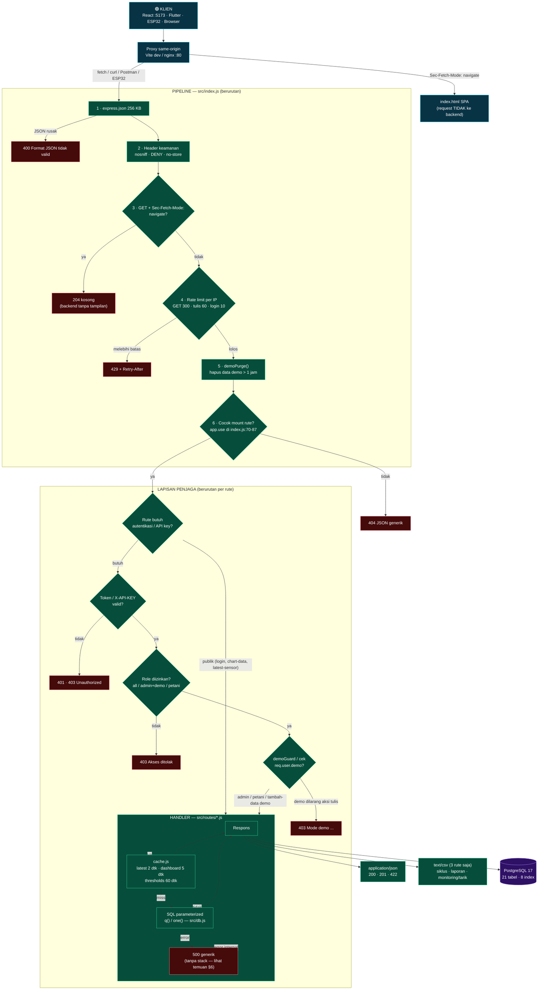
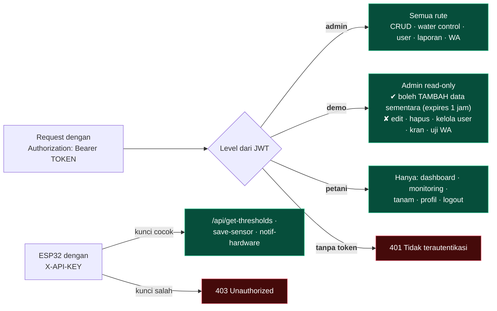
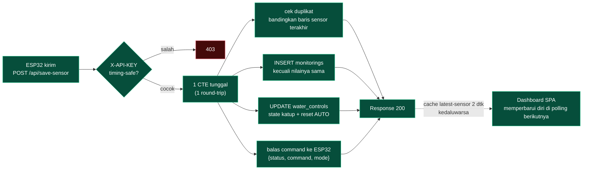

# Flowchart Backend — Jalur Satu Request

Sumber kebenaran: `backend-nodejs/src/`. Diagram ini **mermaid** — render otomatis di
GitHub/VS Code/Typora. Versi diagram statis: `docs/jalur-backend.html`.

---

## 1. Flowchart utama (pipeline → guard → handler → database)

---

## 2. Cabang role (siapa boleh apa)

---

## 3. Jalur tulis data ESP32 (satu-satunya alur multi-tabel)

---

## 4. Peta keputusan → file sumber

| Titik keputusan | File : baris |
|---|---|
| navigasi → 204 | `src/index.js:35-40` |
| rate limit 300/60/10 | `src/index.js:45-52` + `src/rateLimit.js` |
| mount & guard per grup | `src/index.js:70-87` |
| JWT / role / demo / API-key | `src/auth.js` |
| cache TTL | `src/cache.js` (`remember(key, ttl, fn)`) |
| query & pool | `src/db.js` |
| 404 / 500 generik | `src/index.js:90-101` |

Cara membaca: **setiap panah merah = respons error yang bisa muncul**, hijau = lolos.
Titik paling sering jadi sumber bug: `M6` (rute tak dikenal) dan `G4` (demo diizinkan/tidak).
