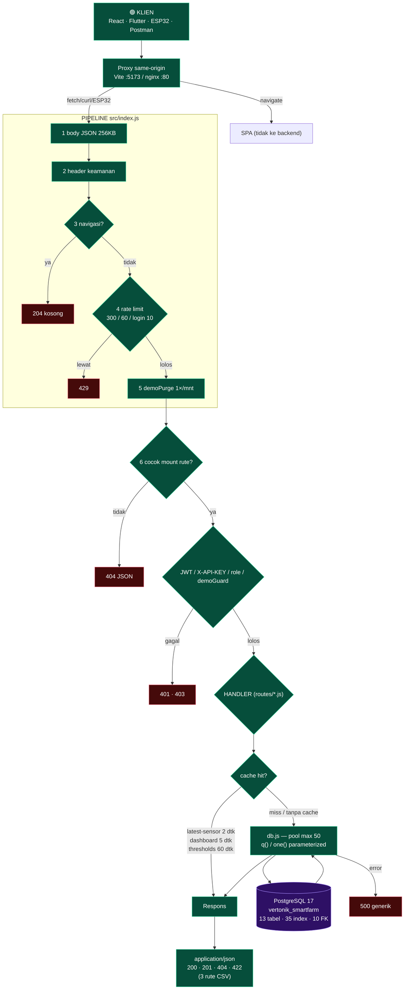
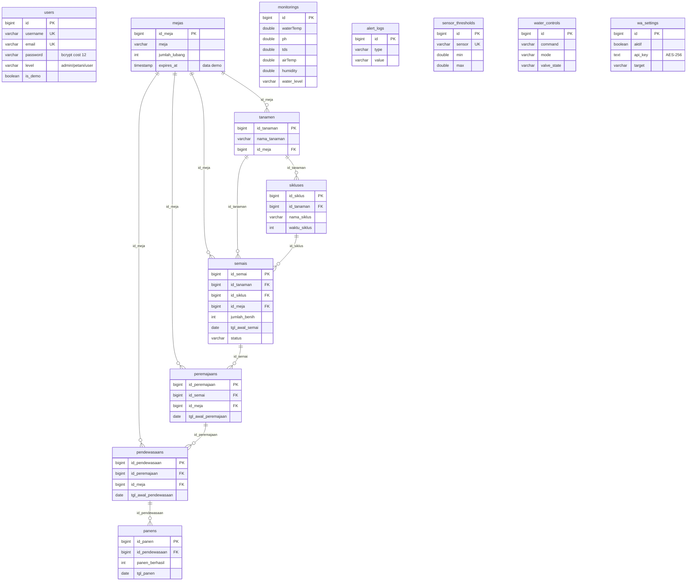
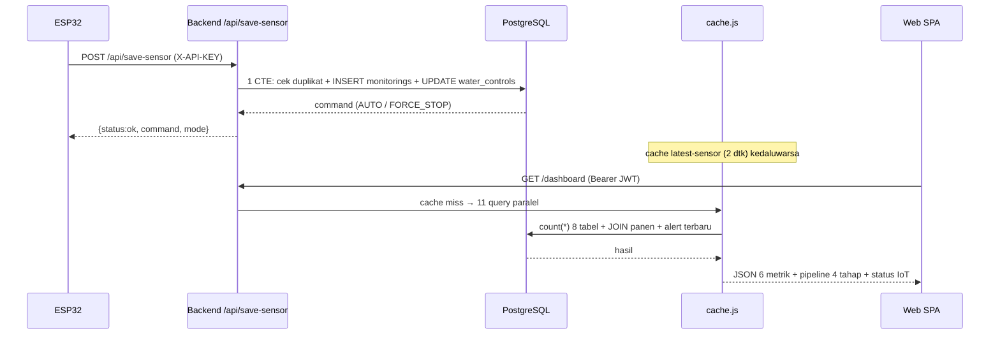
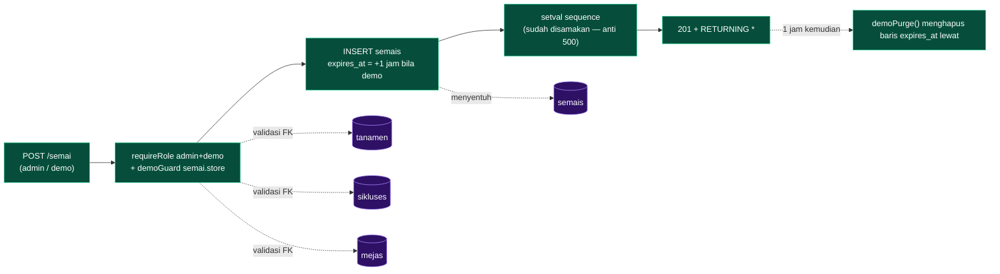

# JALUR BACKEND + JALUR DATABASE — Vertonik Smart Farm

Gabungan dua jalur: **request masuk sampai respons** dan **data sampai ke tabel mana**.
Sumber kebenaran: `backend-nodejs/src/` + query langsung ke PostgreSQL (17 Okt 2026).

Terbitan sebelumnya: `docs/JALUR_BACKEND.md` (rute & guard) · `docs/FLOWCHART_BACKEND.md`
(flowchart keputusan) · `docs/jalur-backend.html` (diagram statis).

---

## 1. Jalur lengkap: klien → pipeline → handler → PostgreSQL → respons



---

## 2. Jalur database: endpoint → tabel yang disentuh

Matriks ini dihasilkan dengan memindai kata kunci SQL (`FROM`/`INTO`/`UPDATE`/`DELETE`)
di tiap file `src/routes/*.js` — bukan perkiraan.

| Endpoint | Modul | Tabel dibaca | Tabel ditulis | Cache |
|---|---|---|---|---|
| `POST /login` | `auth.js` | `users` | — | — |
| `GET /user`, `POST/PUT/DELETE /user/:id` | `user.js` | `users` | `users` | — |
| `GET /profil`, `POST /profil/update`, `/profil/password` | `profil.js` | `users` | `users` | — |
| `GET /dashboard` | `dashboard.js` | `monitorings`, `water_controls`, `alert_logs`, `mejas`, `tanamen`, `sikluses`, `semais`, `peremajaans`, `pendewasaans`, `panens` | — | `dashboard` 5 dtk |
| `GET /monitoring/chart-data`, `/tarik`, `/tarik/csv` | `monitoring.js` | `monitorings` | — | — |
| `GET /monitoring/getReport6Jam` · `POST /saveAlert` | `monitoring.js` | `monitorings`, `alert_logs` | `alert_logs` | — |
| `POST /monitoring/saveSensor` (kompatibilitas) | `monitoring.js` | `monitorings`, `water_controls` | `monitorings`, `water_controls` | — |
| `GET /api/latest-sensor` | `monitoring.js` | `monitorings`, `water_controls`, `sensor_thresholds` | — | `latest-sensor` 2 dtk |
| `GET /api/get-thresholds` | `monitoring.js` | `sensor_thresholds` | — | `thresholds` 60 dtk |
| `POST /api/save-sensor` (**1 CTE**) | `monitoring.js` | `monitorings`, `water_controls` | `monitorings`, `water_controls` | — |
| `POST /api/notif-hardware` | `monitoring.js` | — | `alert_logs` | — |
| `GET /watercontrol`, `/watercontrol/status` | `watercontrol.js` | `water_controls` | — | — |
| `POST /watercontrol/fill\|stop\|setMode` | `watercontrol.js` | `water_controls` | `water_controls` | — |
| `GET /tanam`, `POST /tanam/mulai`, `/:tipe/:id/selesai`, `/:id/hapus` | `tanam.js` | `semais`, `peremajaans`, `pendewasaans` (+JOIN `tanamen`/`mejas`) | `semais`, `peremajaans`, `pendewasaans` | — |
| `GET/POST/PUT/DELETE /meja` | `master.js`→`_crud.js` | `mejas` | `mejas` | — |
| `/tanaman` | `master.js`→`_crud.js` | `tanamen` | `tanamen` | — |
| `/siklus` (+ `GET /siklus/csv`) | `master.js`→`_crud.js` | `sikluses`, `tanamen` | `sikluses` | — |
| `/ambang` | `master.js`→`_crud.js` | `sensor_thresholds` | `sensor_thresholds` | — |
| `/semai`, `/peremajaan`, `/pendewasaan`, `/panen` (+ `batch`, `selesai`) | `tahap.js`→`_crud.js` | `semais`, `peremajaans`, `pendewasaans`, `panens` | tabel sama | — |
| `GET /laporan` (+ `/laporan/csv`) | `laporan.js` | `semais`, `peremajaans`, `pendewasaans`, `panens`, `monitorings` | — | — |
| `GET/POST /notifikasi-wa`, `POST /uji` | `notifWa.js` | `wa_settings` | `wa_settings` (ter-enskripsi) | — |

**Yang TIDAK menyentuh database:** `GET /` · `GET /login` (info) · `GET /logout` (stateless)
· cache hit · pengecekan rate limit & guard (murni memori).

---

## 3. Skema database — 13 tabel, 10 relasi



Enam tabel **berdiri sendiri** (tanpa FK): `users`, `monitorings`, `alert_logs`,
`sensor_thresholds`, `water_controls`, `wa_settings`.

**Aturan hapus (dari database):** `panens` → `CASCADE` (hapus panen ikut menghapus baris
turunannya tidak berlaku kebalikan); semua FK lain `ON DELETE SET NULL`
(menghapus meja/tanaman tidak ikut menghapus data tahap — hanya memutus tautan).

---

## 4. Dua alur data yang paling sering dipakai

### A. ESP32 menulis → dashboard membaca



### B. Tambah data tahap (rantai FK)



---

## 5. Isi database saat ini (17 Okt 2026)

| Tabel | Baris | Catatan |
|---|---|---|
| `users` | 3 | admin · petani · demo |
| `mejas` | 5 | |
| `tanamen` | 2 | Selada, Bayam |
| `sikluses` | 6 | |
| `semais` | 2 | |
| `peremajaans` | 4 | |
| `pendewasaans` | 3 | |
| `panens` | 2 | total 22 kg |
| `monitorings` | 12 | terakhir 14 Okt → IoT `offline` |
| `alert_logs` | 51 | |
| `sensor_thresholds` | 5 | waterTemp, ph, tds, airTemp, humidity |
| `water_controls` | 1 | AUTO / MANUAL / OFF |
| `wa_settings` | 1 | api_key ter-enskripsi |

Skema + seed siap pakai ulang: `database/schema.sql` · `database/seed.sql`
(urutan: `createdb -O vertonik` → schema → seed).

---

## 6. Cara membaca sendiri (tanpa menebak)

```bash
# tabel mana yang dibaca/ditulis sebuah file route
grep -oiE "(from|into|update|delete from)[[:space:]]+TABLE" src/routes/*.js

# relasi FK langsung dari database
psql "$DATABASE_URL" -c "SELECT conname, pg_get_constraintdef(oid) FROM pg_constraint WHERE contype='f'"

# query paling lambat (butuh log)
psql "$DATABASE_URL" -c "SELECT query, calls, mean_exec_time FROM pg_stat_statements ORDER BY mean_exec_time DESC LIMIT 5"
```

Titik rawan jalur database:
1. **Sequence** vs `max(id)` — kalau beda, semua `INSERT` → 500 (`scripts/fix-sequences.sql`).
2. **Cache** menyembunyikan data segar — setelah tulis, cache baru kedaluwarsa 2–5 detik kemudian.
3. **`_crud.js` whitelist kolom** — kolom di luar daftar diam-dengan-dimap; daftar ada di `routes/master.js` & `tahap.js`.
4. **GET daftar tidak mengirim primary key** (temuan `docs/ANALISIS_BACKEND.md` §6.2) —
   menghalangi frontend memanggil `PUT/DELETE /:id`.
