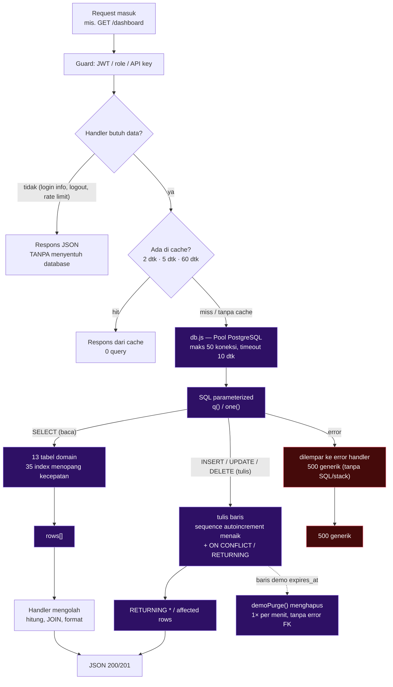

# JALUR DATABASE + RELASI (KUNCI) + DATABASE YANG DIPAKAI

Dokumen ini menjawab 3 pertanyaan: (1) database apa yang dipakai, (2) bagaimana jalur
data dari request sampai ke tabel dan sebaliknya, (3) kunci apa saja (foreign key /
primary key / unique / API key). Semua angka diambil langsung dari database live
dan file kode, **17 Okt 2026**.

---

## 1. Database apa yang dipakai

| Aspek | Nilai (hasil query langsung) |
|---|---|
| **RDBMS** | **PostgreSQL 17.11** (Homebrew, Apple Silicon / aarch64) |
| **Nama database** | `vertonik_smartfarm` |
| **Pemilik (owner)** | peran `vertonik` (bukan superuser) |
| **Koneksi** | `127.0.0.1:5432` — **lokal saja**, tidak dibuka ke jaringan |
| **Sumber konfigurasi** | `DATABASE_URL` di `backend-nodejs/.env` |
| **Ukuran** | 16 MB |
| **Tabel** | **21 total** = 13 tabel domain (dipakai Node.js) + 8 tabel sisa Laravel |
| **Foreign key** | **10** |
| **Index** | **35 (domain)** — total DB **50** = 35 domain + 15 sisa Laravel |
| **Sequence (auto increment)** | 16 |

**Satu-satunya database** — proyek ini tidak memakai MySQL, SQLite, MongoDB, maupun
database cloud. (Riwayat: proyek lama sempat memakai SQLite, lalu dipindah ke PostgreSQL
saat port ke Node.js — lihat `backend-nodejs/docs/BACKEND_ANALYSIS.md` §1.)

**8 tabel sisa Laravel yang TIDAK dipakai Node.js:**
`cache`, `cache_locks`, `failed_jobs`, `job_batches`, `jobs`, `migrations`,
`password_reset_tokens`, `sessions` — boleh diabaikan/di-drop di instalasi baru
(sudah tidak disertakan di `database/schema.sql`).

**Koneksi dari sisi kode** (`src/db.js`):

```js
new Pool({ connectionString: DATABASE_URL,
           max: 50,                  // headroom ~1000 user, query < 5 ms
           idleTimeoutMillis: 30_000,
           connectionTimeoutMillis: 10_000 })
// helper: q(sql, params) → rows[]   |   one(sql, params) → row|null
// SEMUA query memakai parameter $1,$2,... → SQL injection tertutup
```

---

## 2. Jalur database (request → tabel → respons)



### Jalur tulis (alur paling sensitif)

1. Body JSON masuk (maks 256 KB) → guard lolos.
2. Handler memfilter kolom lewat **whitelist** `routes/_crud.js` — kolom di luar daftar
   diabaikan (bukan error).
3. `INSERT ... VALUES ($1,$2)` parameterized → sequence (mis. `semais_id_semai_seq`)
   menghasilkan id baru.
4. **Bila sequence < max(id) → `duplicate key` → 500.** Ini bug yang pernah terjadi;
   pencegahannya: `scripts/fix-sequences.sql` (juga otomatis di `database/seed.sql`).
5. Balasan memakai `RETURNING *` → id baru ikut terkirim ke klien.

### Jalur baca (alur performa)

| Route | Kecepatan ditopang oleh |
|---|---|
| `/monitoring/chart-data` (288 baris) | index `idx_monitorings_created` (`created_at DESC`) — 0,69 ms @ 100k baris |
| `/dashboard` (11 query paralel) | cache 5 dtk + `count(*)` per tabel + index |
| `/api/latest-sensor` (polling ribuan klien) | cache 2 dtk → hampir 0 query |
| `/api/get-thresholds` | cache 60 dtk |
| `/laporan` (CTE per bulan) | index pada `semais(status,tgl)`, `panens(tgl)`, dll. |
| `/user`, `/meja`, `/semai`, … | index primary key |

### Pembagian siapa menulis apa

| Tabel | Ditulis oleh | Dibaca oleh |
|---|---|---|
| `monitorings` | ESP32 (`/api/save-sensor`, `/monitoring/saveSensor`) | dashboard, chart-data, latest-sensor, laporan, CSV |
| `water_controls` | ESP32 (state katup) + admin (`/watercontrol/*`) | dashboard, latest-sensor, watercontrol |
| `alert_logs` | ESP32 (`/api/notif-hardware`) + `/monitoring/saveAlert` | dashboard, getReport6Jam |
| `sensor_thresholds` | admin (`/ambang`) | ESP32 (get-thresholds), latest-sensor (deteksi anomali) |
| `semais` → `peremajaans` → `pendewasaans` → `panens` | admin/demo (`/semai`…, `/tanam/mulai`, `.../selesai`) | dashboard, tanam, laporan |
| `mejas`, `tanamen`, `sikluses` | admin (`/meja`, `/tanaman`, `/siklus`) | dropdown + semua query JOIN |
| `users` | admin (`/user`), profil (password) | login, `/user`, `/profil` |
| `wa_settings` | admin (`/notifikasi-wa`) | kirim notifikasi (api_key ter-enskripsi AES-256) |

---

## 3. Foreign key — 10 relasi (hasil query `information_schema`)

| # | Tabel anak | Kolom | → Tabel induk | ON DELETE | Arti praktis |
|---|---|---|---|---|---|
| 1 | `panens` | `id_pendewasaan` | `pendewasaans` | **CASCADE** | hapus baris pendewasaan → **baris panen-nya ikut terhapus** |
| 2 | `pendewasaans` | `id_peremajaan` | `peremajaans` | SET NULL | hapus peremajaan → pendewasaan tetap, tautannya jadi `NULL` |
| 3 | `pendewasaans` | `id_meja` | `mejas` | SET NULL | hapus meja → data pendewasaan tetap, `id_meja` jadi `NULL` |
| 4 | `peremajaans` | `id_meja` | `mejas` | SET NULL | sama seperti di atas |
| 5 | `peremajaans` | `id_semai` | `semais` | SET NULL | hapus semai → peremajaan tetap, putus tautan |
| 6 | `semais` | `id_meja` | `mejas` | SET NULL | hapus meja → semai tetap |
| 7 | `semais` | `id_tanaman` | `tanamen` | SET NULL | hapus tanaman → semai tetap |
| 8 | `semais` | `id_siklus` | `sikluses` | SET NULL | hapus siklus → semai tetap |
| 9 | `sikluses` | `id_tanaman` | `tanamen` | SET NULL | hapus tanaman → siklus tetap |
| 10 | `tanamen` | `id_meja` | `mejas` | SET NULL | hapus meja → tanaman tetap |

**Rantai lengkapnya:**

```
mejas ─┬─< tanamen ─┬─< sikluses ─┐
       │            │             ├─< semais ─< peremajaans ─< pendewasaans ─< panens
       │            └─────────────┘        │              │
       └───────────────────────────────────┴──────────────┘
                                            (semua id_meja dari mejas)
```

**Aturan hapus untuk frontend:**
- Hapus **meja/tanaman/siklus** → aman, data historis panen tetap ada
  (kolom terkait jadi `NULL`; tampilan perlu siap menampilkan `-`).
- Hapus **panen** → baris hilang permanen (punya sendiri).
- Hapus **pendewasaan** → **panen ikut hilang (CASCADE)** — tombol hapus harus
  menampilkan peringatan konfirmasi.

Diagram relasi (ERD 13 tabel) ada di `docs/JALUR_BACKEND_DAN_DB.md` bagian 3.

---

## 4. Jenis kunci di project ini (lengkap)

| Jenis | Jumlah | Detail |
|---|---|---|
| **Primary key (PK)** | 13 | satu per tabel: `users.id`, `mejas.id_meja`, `tanamen.id_tanaman`, `sikluses.id_siklus`, `semais.id_semai`, `peremajaans.id_peremajaan`, `pendewasaans.id_pendewasaan`, `panens.id_panen`, `monitorings.id`, `alert_logs.id`, `sensor_thresholds.id`, `water_controls.id`, `wa_settings.id` — semuanya `bigint` autoincrement via sequence |
| **Foreign key (FK)** | 10 | tabel di bagian §3 |
| **Unique** | 3 | `users.username` · `users.email` · `sensor_thresholds.sensor` (1 baris per sensor) |
| **Index non-unik** | 19 | 8 di antaranya kunci kecepatan: `monitorings(created_at DESC)`, `alert_logs(created_at DESC)`, `alert_logs(type,value)`, `semais(status)`, `semais(tgl_awal_semai)`, `peremajaans(tgl)`, `pendewasaans(tgl)`, `panens(tgl_panen)` |
| **API key (aplikasi)** | 1 | `ESP32_API_KEY` di `.env` — dipakai header `X-API-KEY` ESP32 (usulan 2 perangkat: `ESP32_KEY_A/B`, lihat `docs/ARSITEKTUR_PI_2ESP32.md`) |
| **Token (manusia)** | — | JWT HS256 dari `POST /login`, tanda tangan `JWT_SECRET`, berlaku 12 jam (bukan kunci database) |
| **Kunci enkripsi data** | 1 | `APP_KEY` di `.env` — mengenkripsi `wa_settings.api_key` (AES-256). **Jangan diganti** setelah produksi |

> **Catatan penting:** `GET` daftar (`/meja`, `/semai`, dst.) saat ini **tidak
> mengembalikan primary key** — padahal `PUT/DELETE /:id` membutuhkannya. Lihat
> `docs/ANALISIS_BACKEND.md` §6.2 (perbaikan di `routes/_crud.js`).

---

## 5. Instalasi, isi ulang, dan backup jalur database

```bash
cd ~/Project/Vertoniksmartfarm/backend-nodejs
DBURL=$(grep '^DATABASE_URL=' .env | cut -d= -f2-)

# mesin baru — urutan wajib
createdb -O vertonik vertonik_smartfarm      # owner = peran aplikasi (kalau tidak: permission denied)
psql "$DBURL" -f database/schema.sql         # 13 tabel + 35 index (domain) + 10 FK
psql "$DBURL" -f database/seed.sql           # 3 akun + ambang + katup + setval (idempoten)

# setiap habis import dump penuh (database/vertonik.sql)
psql "$DBURL" -f scripts/fix-sequences.sql   # cegah semua INSERT balas 500

# backup & pulihkan
pg_dump "$DBURL" > backup-$(date +%F).sql
psql "$DBURL" -f backup-2026-10-17.sql

# verifikasi jalur database
psql "$DBURL" -c "SELECT count(*) FROM pg_constraint c JOIN pg_class t ON t.oid = c.conrelid WHERE c.contype='f' AND c.connamespace = 'public'::regnamespace AND t.relname IN ('users','mejas','tanamen','sikluses','semais','peremajaans','pendewasaans','panens','monitorings','alert_logs','sensor_thresholds','water_controls','wa_settings')"   # = 10, hanya 13 tabel domain
psql "$DBURL" -c "SELECT count(*) FROM pg_indexes WHERE schemaname='public'"  # total 50 = 35 domain + 15 sisa Laravel
```

Terkait: `docs/JALUR_BACKEND_DAN_DB.md` (matriks route → tabel + ERD) ·
`docs/KONTRAK_API.md` (kontrak endpoint) · `backend-nodejs/database/DB_SCHEMA.md` ·
`backend-nodejs/scripts/fix-sequences.sql`.
