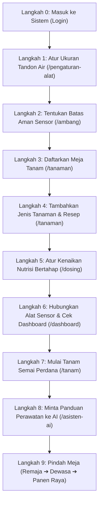

# Panduan Mandiri: Alur Menyiapkan Greenhouse Baru dari Database Kosong Sampai Panen
*Skenario Uji Coba: Greenhouse Baru Selesai Dibangun, Database Masih Kosong*

---

Selamat! Greenhouse baru Anda sudah berdiri, pipa dan tandon air sudah terpasang, dan Anda ingin memulai semuanya dari nol. 

Panduan ini adalah **peta jalan langkah demi langkah** yang bisa Anda ikuti sendiri di layar website, mulai dari saat data masih 0 (kosong) sampai bibit pertama tumbuh dan siap panen.



---

## (Opsional) Cara Mereset Database ke Kondisi Kosong Bersih

Jika Anda ingin benar-benar menguji dari kondisi nol tanpa data bekas pengujian sebelumnya, jalankan perintah ini di terminal (hanya menyisakan 3 akun login resmi: `garap`, `petani`, dan `demo`):

```bash
node backend-nodejs/scripts/reset-db-nol.js
```
*Setelah perintah selesai, seluruh tanaman, meja, grafik, dan riwayat lama terhapus bersih. Anda siap memulai dari kanvas putih!*

---

## Alur 9 Langkah Emas: Dari Nol Sampai Panen

### Langkah 0: Masuk Sebagai Pemilik (Superadmin)
1. Buka browser di laptop: `http://garap.local/login` (atau `localhost:5173/login`).
2. Masukkan nama: **`garap`**, kata sandi: **`garap123`**.
3. Centang **"Ingatkan saya di perangkat ini"** ➔ klik tombol hijau **"Masuk ke Dashboard"**.

---

### Langkah 1: Mengenalkan Fisik Greenhouse — Mengatur Tandon Air
Alamat Menu: **Pengaturan Alat** (`/pengaturan-alat`)

Greenhouse baru pasti memiliki tangki penampung air (tandon) dan pompa sirkulasi. Sistem perlu tahu kapasitasnya agar takaran air dan nutrisi tidak meluap:

1. Buka menu **Pengaturan Alat**.
2. Masukkan ukuran fisik greenhouse Anda:
   - **Volume Tandon Air:** Masukkan misal **`1000`** (artinya tandon 1.000 Liter).
   - **Laju Pompa Sirkulasi:** Masukkan misal **`50`** (pompa memutar air 50 Liter per menit).
   - **Faktor Pengadukan:** Pilih **`3`** (standar agar nutrisi teraduk rata ke seluruh meja).
3. Klik tombol kecil **`[pakai]`** di sebelah tulisan saran waktu pantau:
   - Sistem otomatis menghitung rumus fisika: $(1000 / 50) \times 3 = \mathbf{60\text{ menit}}$.
   - Artinya, setelah pupuk cair disuntikkan, sistem akan memberi jeda 60 menit agar air berputar merata sebelum membaca sensor lagi.
4. Klik tombol **"Simpan Pengaturan"**.

---

### Langkah 2: Menentukan Batas Aman Sensor Greenhouse
Alamat Menu: **Ambang Sensor** (`/ambang`)

Di greenhouse baru, Anda perlu menentukan batas aman lingkungan agar alarm bisa berbunyi jika ada bahaya:

1. Buka menu **Ambang Sensor**.
2. Anda akan melihat 5 baris parameter. Sesuaikan angkanya dengan mengklik tombol **"Ubah"**:
   - **pH Air:** Min `5.5`, Max `6.5` (agak sedikit asam lembut, kesukaan tanaman hidroponik).
   - **Nutrisi (TDS):** Min `400`, Max `2400` (rentang dari semai kecil sampai buah matang).
   - **Suhu Air:** Min `22.0`, Max `28.0` (sejuk agar akar tidak busuk).
   - **Suhu Udara:** Min `24.0`, Max `34.0` °C.
   - **Kelembapan Udara:** Min `60.0`, Max `85.0` % (ubah dari bawaan lama `100–100%`).
3. Klik **Simpan** pada setiap baris yang Anda ubah.

---

### Langkah 3: Mendaftarkan Meja Tanam Fisik
Alamat Menu: **Master Tanaman / Meja** (`/tanaman`)

Tanaman butuh wadah fisik. Di greenhouse baru, Anda biasanya memiliki beberapa meja atau talang:

1. Di menu Master Tanaman, buka tab **Meja Tanam**.
2. Klik tombol **"+ Tambah Meja"** untuk membuat 3 meja kerja:
   - **Meja 1:** Nama: *Meja Semai A*, Tipe: *Semai*, Kapasitas: *200 lubang bibit*.
   - **Meja 2:** Nama: *Meja Peremajaan 1*, Tipe: *Peremajaan*, Kapasitas: *100 netpot*.
   - **Meja 3:** Nama: *Talang NFT Dewasa*, Tipe: *Pendewasaan*, Kapasitas: *100 pohon*.
3. Klik **Simpan** untuk setiap meja. Kini kebun Anda resmi memiliki 3 lokasi tanam!

---

### Langkah 4: Menambahkan "Buku Resep" Komoditas Tanaman
Alamat Menu: **Master Tanaman** (`/tanaman`)

Sekarang tentukan tanaman apa yang akan Anda budidayakan pertama kali di greenhouse ini (contoh: *Melon Golden Emerald*):

1. Masuk ke tab **Tanaman** ➔ klik tombol hijau **"+ Tambah Tanaman"**.
2. Masukkan data resep tanaman:
   - **Nama Tanaman:** `Melon Golden Emerald`
   - **Nutrisi Awal (Fase Semai):** `400` ppm *(bibit kecil makanannya tipis saja)*.
   - **Nutrisi Akhir (Fase Buah):** `2400` ppm *(buah besar butuh makanan kental)*.
   - **Hari Pencapaian:** `60` hari *(waktu dari semai sampai panen)*.
   - **Target Hari Semai:** `12` hari.
   - **Target Hari Peremajaan:** `18` hari.
   - **Target Hari Pendewasaan:** `30` hari.
3. Klik tombol **"Simpan Tanaman"**.

---

### Langkah 5: Mengaktifkan Rampa Kenaikan Nutrisi Harian
Alamat Menu: **Pengaturan Nutrisi / Dosing** (`/dosing`)

Inilah keunggulan utama GARAP: nutrisi dinaikkan otomatis bertahap setiap hari tanpa mengagetkan akar tanaman!

1. Buka menu **Dosing** ➔ pilih tab **Target & Nutrisi**.
2. Pada pilihan komoditas, pilih **Melon Golden Emerald**.
3. Sistem secara cerdas menyusun kurva kenaikan harian:
   - Hari ke-1: **400 PPM**
   - Hari ke-2: **433 PPM**
   - Hari ke-30: **1.400 PPM**
   - Hari ke-60: **2.400 PPM**
4. Klik tombol **"Simpan Target Naik Harian"**. Sekarang sistem sudah tahu berapa takaran makanan yang harus diberikan setiap harinya!

---

### Langkah 6: Menghubungkan Alat Sensor & Memeriksa Dashboard
Alamat Menu: **Dashboard** (`/dashboard`) dan **Sensor Realtime** (`/sensor-realtime`)

1. Celupkan probe sensor pH, TDS, dan Suhu Air ke tandon air tawar greenhouse yang baru diisi.
2. Nyalakan kabel power modul ESP32 di panel kebun.
3. Buka halaman **Dashboard** di laptop Anda:
   - Dalam 5–10 detik, perhatikan kotak status di atas: Indikator akan berubah menjadi **🟢 Online (5 detik lalu)**!
   - Kartu angka sensor langsung menampilkan kondisi air tandon nyata saat itu juga (misal air tawar sumur/PDAM terbaca: pH `6.8`, TDS `120 ppm`, Suhu `25°C`).
   - Karena TDS masih 120 ppm (di bawah ambang batas minimal 400 ppm), kartu TDS akan berwarna kuning bertanda *"Di luar ambang"*—menandakan tandon siap diberi nutrisi awal!

---

### Langkah 7: Mulai Tanam Semai Perdana!
Alamat Menu: **Kebun Saya** (`/tanam`)

Hari ini benih melon mulai dibasahi dan ditaruh di baki rockwool:

1. Buka menu **Kebun Saya** (atau tab **Tanam** di aplikasi HP).
2. Klik tombol hijau besar **"+ Mulai Semai Baru"**.
3. Isi jendela pop-up:
   - **Jenis Tanaman:** Pilih *Melon Golden Emerald*.
   - **Meja Tanam:** Pilih *Meja Semai A*.
   - **Tanggal Mulai:** Pilih hari ini.
   - **Jumlah Benih:** Masukkan misal **`100`** benih.
   - **Keterangan:** Tulis *"Batch Perdana Greenhouse Baru"*.
4. Klik **"Simpan & Mulai Tanam"**.
5. **Lihat hasilnya:** Di kolom pertama (**Penyemaian**), langsung muncul sebuah kartu tanaman cantik bertuliskan *Melon Golden Emerald*, dengan hitungan **HST: 0** (Hari Setelah Tanam ke-0)!

---

### Langkah 8: Meminta Bimbingan Asisten AI di Hari Pertama
Alamat Menu: **Asisten AI** (`/asisten-ai`)

Anda tidak perlu bingung apa yang harus dikerjakan setelah menaruh benih:

1. Buka menu **Asisten AI**.
2. Klik tombol petir: **"Minta langkah selanjutnya"**.
3. AI lokal Qwen yang ada di Raspberry Pi kebun akan membaca data meja dan sensor saat ini, lalu membalas:
   > *"Halo Pengelola Kebun! Meja Semai A baru saja memulai semai Melon Golden Emerald (HST 0). Tugas Anda hari ini:*
   > *1. Pastikan baki semai terlindung dari terik matahari langsung selama 2–3 hari pertama.*
   > *2. Jaga kelembapan rockwool tetap basah lembap.*
   > *3. Target nutrisi semai adalah 400 PPM. Larutkan nutrisi AB Mix awal ke tandon semai."*

---

### Langkah 9: Simulasi Waktu Berjalan (Pindah Tahap ➔ Panen Raya!)
Alamat Menu: **Kebun Saya** (`/tanam`)

Seiring berjalannya hari, Anda cukup melakukan 3 klik sederhana:

1. **Hari ke-12 (Tumbuh Daun Sejati ke-4):**
   - Bibit semai sudah siap pindah ke meja peremajaan.
   - Buka kartu tanaman di kolom Semai ➔ klik tombol **"Pindah ke Peremajaan"** (pilih *Meja Peremajaan 1*).
   - Kartu otomatis bergeser ke kolom tengah (**Peremajaan**).
2. **Hari ke-30 (Pohon Membesar & Masuk Talang Buah):**
   - Tanaman siap dibuahkan di talang utama.
   - Klik tombol **"Pindah ke Pendewasaan"** (pilih *Talang NFT Dewasa*).
   - Kartu otomatis berpindah ke kolom ketiga (**Pendewasaan**), dan target nutrisi harian otomatis meningkat mendekati 2.000+ PPM.
3. **Hari ke-60 (Panen Raya Buah Melon Harum Manis):**
   - Buah melon sudah berjala tebal, harum, dan siap petik.
   - Klik tombol hijau **"Catat Panen"**:
     - Masukkan total timbangan: misal **`180 kg`**.
     - Kualitas buah: pilih **`Grade A Super`**.
     - Catatan: *"Panen perdana sukses besar, rasa sangat manis"*.
   - Klik **Simpan**.
4. **Selesai!** Siklus budidaya berhasil dituntaskan dengan sempurna. Riwayat panen tersimpan abadi di menu Laporan, total panen di dashboard bertambah, dan meja kebun siap digunakan untuk menanam kembali!

---

## Ringkasan Alur: Mengapa Urutan Ini Penting?

| Urutan | Apa yang Dikerjakan? | Mengapa Harus Urutan Ini Dulu? |
| :-: | :--- | :--- |
| **1 & 2** | Ukuran Tandon & Ambang Sensor | Menyiapkan "rumah dan aturan keselamatan" sebelum ada makhluk hidup di dalamnya. |
| **3 & 4** | Meja Tanam & Resep Komoditas | Menyiapkan "kamar tidur dan menu makanan" untuk tanaman yang akan datang. |
| **5** | Rampa Kenaikan Nutrisi Harian | Memprogram jadwal makanan harian dari bayi hingga dewasa. |
| **6** | Nyalakan Alat Sensor | Memastikan mata dan indera kebun sudah hidup dan membaca air. |
| **7** | Mulai Semai Bibit | Menaruh tanaman pertama ke dalam kamar yang sudah siap. |
| **8** | Tanya Asisten AI | Mengonfirmasi langkah kerja harian yang benar ke penjaga pintar. |
| **9** | Pindah Tahap & Panen | Menikmati hasil jerih payah dari semai hingga panen raya. |

---

*Dengan 9 langkah ini, siapa pun orang awam dapat mengoperasikan greenhouse pintar hidroponik secara mandiri, aman, dan tanpa rasa takut salah!*
