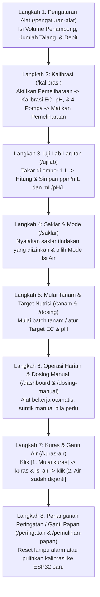

# Panduan Langkah Petani & Hasil Debugging Tombol demi Tombol (IoT Hidroponik 1 Penampung v4.1)

Dokumen ini menjelaskan **urutan kerja petani dari awal instalasi hingga panen/ganti air** (*Langkah Petani*), cara membuka setiap menu dari **ikon grup di sidebar kiri -> tab pil di header atas**, serta **hasil debugging seluruh tombol** (baik di antarmuka React maupun endpoint API backend).

---

## 1. Peta Navigasi: Sidebar Ikon Kiri -> Tab Pil Header Atas

Sesuai desain ringkas **Vertonik Liquid Glass**, sidebar kiri hanya menampilkan **7 ikon grup utama** (`72px`), sedangkan sub-menu lengkap muncul sebagai **tab pil di bagian atas halaman** saat grup diklik:

| Grup di Sidebar Kiri | Tab Pil di Header Atas | URL Rute | Fungsi Utama bagi Petani |
| :--- | :--- | :--- | :--- |
| **Ringkasan** | `Dashboard` | `/dashboard` | Pantau kondisi air (EC, pH, suhu, pelampung), grafik tren, dan kamera |
| **Sensor** | `Telemetri` · `Peringatan` · `MQTT & Diagnostik` · `CCTV` | `/monitoring` · `/peringatan` · `/mqtt-diagnostik` · `/cctv` | Pantau bacaan sensor 30 detik, riwayat alarm, dan cek jembatan MQTT |
| **Budidaya** | `Tanam` · `Siklus` | `/tanam` · `/siklus` | Mulai semai, pindah peremajaan/pendewasaan, catat panen, & kurva PPM harian |
| **Dosing** | `Dosing & Target` · `Saklar & Mode` · `Dosing Manual` · `Uji Lab` · `Pengaturan Alat` · `Log Aktivitas` | `/dosing` · `/saklar` · `/dosing-manual` · `/ujilab` · `/pengaturan-alat` · `/audit` | Pusat kendali nutrisi A+B, koreksi pH, uji lab larutan, dan volume tandon |
| **Air** | `Air & Tandon` · `Kuras & Ganti Air` | `/watercontrol` · `/kuras-air` | Pantau pelampung bawah/atas, katup solenoid, dan prosedur kuras 2-langkah |
| **Kalibrasi** | `Kalibrasi` · `Pemulihan Papan` | `/kalibrasi` · `/pemulihan-papan` | Kalibrasi EC 2-titik, pH 2-titik, laju 4 pompa (mL/detik), dan ganti ESP32 |
| **Sistem** | `Master Data` · `Pengguna` · `Laporan` · `Profil` | `/master` · `/user` · `/laporan` · `/profil` | Data master meja/tanaman, manajemen akun petani, dan unduh laporan Excel |

---

## 2. Alur Kerja Petani dari Awal sampai Panen ("Langkah Petani")

### Langkah 1 — Mengisi Ukuran Tandon & Meja (`Dosing` -> `Pengaturan Alat` / `/pengaturan-alat`)
*Dilakukan **sekali di awal instalasi** atau saat ukuran tandon/jumlah talang berubah.*
1. Klik ikon **Dosing** di sidebar kiri, lalu klik tab **`Pengaturan Alat`** di header atas.
2. Pada kartu **Penampung dan meja**:
   - Isi **Volume efektif penampung (L)** (misal: `200`). *(Wajib diisi > 0 L; jika `0 L`, alat menolak semua perintah dosing).*
   - Isi **Jumlah talang** (misal: `5`) dan **Debit per talang (L/menit)** (misal: `1,0`).
   - Kotak **Satu putaran larutan** otomatis menghitung $T_{\text{putar}} = 200 \div (5 \times 1,0) = 40\text{ menit}$.
3. Pada kartu **Waktu kerja**:
   - Muncul tombol kecil **`pakai 80 mnt`** ($2 \times T_{\text{putar}}$) di samping label **Monitoring (menit)** -> klik tombol **`pakai 80 mnt`** agar waktu tunggu sirkulasi otomatis terisi `80`.
4. Periksa **Persen dosing (%)** (`65%` disarankan selama 3 hari pertama) dan **Batas aman EC/pH**.
5. Klik tombol **`Simpan & kirim ke alat`**.

---

### Langkah 2 — Kalibrasi Sensor & Pompa (`Kalibrasi` -> `Kalibrasi` / `/kalibrasi`)
*Dilakukan **sebelum tanam dimulai**, setiap ganti selang pompa, atau saat jadwal kalibrasi jatuh tempo.*
1. Klik ikon **Kalibrasi** di sidebar kiri (tab **`Kalibrasi`**).
2. Di kartu **Mode pemeliharaan**, klik tombol **`Aktifkan pemeliharaan`** (wajib aktif agar pompa otomatis tidak menyala saat probe diangkat ke gelas larutan standar).
3. **Kalibrasi EC (2 Titik)**:
   - Celupkan probe EC ke larutan standar **1.413 µS/cm**, tunggu lencana berubah menjadi **`stabil`**, lalu klik tombol **`Ambil titik 1.413`**.
   - Bilas probe dengan air bersih/aquades, celupkan ke larutan **12.880 µS/cm**, tunggu **`stabil`**, lalu klik tombol **`Ambil titik 12.880`**. Sistem otomatis menyimpan kalibrasi dua titik.
   - *(Jika salah celup larutan, klik tombol **`Balik kalibrasi EC ke nilai sebelumnya`**).*
4. **Kalibrasi pH (2 Titik)**:
   - Celupkan probe pH ke larutan **buffer 4,0**, tunggu **`stabil`**, klik tombol **`Ambil titik pH 4,0`**.
   - Bilas probe, celupkan ke larutan **buffer 7,0**, tunggu **`stabil`**, klik tombol **`Ambil titik pH 7,0`**.
   - *(Jika salah celup buffer, klik tombol **`Balik kalibrasi pH ke nilai sebelumnya`**).*
5. **Kalibrasi Laju 4 Pompa (`Pompa A`, `Pompa B`, `Pompa pH up`, `Pompa pH down`)**:
   - Pilih pompa pada dropdown **Pompa yang dikalibrasi** dan pilih **Lama nyala (detik)** (misal `60 detik`).
   - Arahkan selang keluaran pompa ke gelas ukur, lalu klik tombol **`Jalankan pompa`**.
   - Setelah pompa berhenti, baca berapa mL cairan di gelas ukur, ketik angkanya pada kotak **Hasil di gelas ukur (mL)**, lalu klik tombol **`Simpan laju (mL ÷ detik)`**.
   - Ulangi untuk keempat pompa.
6. Setelah selesai, klik tombol **`Matikan pemeliharaan`** di bagian atas halaman.

---

### Langkah 3 — Uji Lab Larutan Pekatan (`Dosing` -> `Uji Lab` / `/ujilab`)
*Dilakukan **setiap kali membuat pekatan AB Mix baru** atau mengganti merek larutan pH Up/Down.*
1. Klik ikon **Dosing** di sidebar kiri -> klik tab **`Uji Lab`** di header atas.
2. **Uji Lab EC**:
   - Siapkan ember berisi **1 Liter** air baku, ukur PPM awalnya (misal `100 ppm`).
   - Tambahkan **5 mL** pekatan A, aduk, lalu tambahkan **5 mL** pekatan B, aduk rata, dan ukur PPM akhirnya (misal `1000 ppm`).
   - Masukkan angka tersebut ke kartu **Uji lab EC**, lalu klik tombol **`Hitung & simpan`** -> sistem menyimpan `90 ppm/mL`.
3. **Uji Lab pH**:
   - Pilih **Jenis larutan** (`pH up` atau `pH down`), isi **Volume air (L)**, **Perubahan pH yang terjadi**, dan **Larutan yang dipakai (mL)**.
   - Klik tombol **`Hitung & simpan`** -> sistem menyimpan angka $\text{mL}/\text{pH}/\text{L}$.

---

### Langkah 4 — Mengatur Saklar Izin Tindakan & Mode Pengisian Air (`Dosing` -> `Saklar & Mode` / `/saklar`)
1. Klik ikon **Dosing** -> tab **`Saklar & Mode`** di header atas.
2. Geser 5 saklar sesuai perangkat yang terpasang di kebun:
   - **`Dosing A + B`**: izinkan suntikan nutrisi A+B.
   - **`pH up`** / **`pH down`**: izinkan koreksi pH naik/turun (matikan jika tidak memakai pompa pH).
   - **`Pengenceran`**: izinkan penambahan air baku saat EC terlalu tinggi.
   - **`Isi air otomatis`**: nyalakan jika katup solenoid air baku terpasang; matikan jika petani mengisi tandon secara manual dengan selang.
3. Klik tombol **`Simpan & kirim ke alat`**.

---

### Langkah 5 — Memulai Tanam & Mengatur Target Nutrisi (`Budidaya` -> `Tanam` & `Dosing` -> `Dosing & Target`)
1. Buka **Budidaya** -> **`Tanam`** (`/tanam`) untuk memulai batch Semai / Peremajaan / Pendewasaan, atau atur kurva **Naik Harian PPM** di **`Dosing & Target`** (`/dosing`).
2. Di halaman **`Saklar & Mode`** atau **`Dosing & Target`**, kartu **Pratinjau dosis** otomatis menghitung berapa $\text{mL}$ dan berapa detik Pompa A & B akan menyala pada siklus berikutnya ($65\%$ dari kekurangan EC).

---

### Langkah 6 — Dosing Manual & Tombol Darurat (`Dosing` -> `Dosing Manual` / `/dosing-manual`)
*Digunakan ketika petani ingin menyuntik nutrisi A+B atau pH secara langsung dengan tangan.*
1. Klik ikon **Dosing** -> tab **`Dosing Manual`** di header atas.
2. **Tambah Nutrisi A+B**: isi **Target kenaikan EC (ppm)** (maksimal `300 ppm`), lalu klik tombol **`Kirim dosing A + B`**.
3. **Koreksi pH**: pilih **Arah koreksi** (`pH up` / `pH down`), isi **Jumlah larutan (mL)**, lalu klik tombol **`Kirim koreksi pH`**.
4. **Kondisi Darurat**: jika selang lepas atau pompa ingin dihentikan seketika, klik tombol merah **`STOP — matikan semua pompa`**.

---

### Langkah 7 — Kuras & Ganti Air Tandon (`Air` -> `Kuras & Ganti Air` / `/kuras-air`)
*Wajib mengikuti **prosedur 2-langkah** setiap kali menguras tandon agar alat tidak salah menyuntik saat air kosong/baru.*
1. Klik ikon **Air** di sidebar kiri -> klik tab **`Kuras & Ganti Air`** di header atas.
2. **Sebelum menguras tandon**: klik tombol **`1. Mulai kuras`**.
   - Status berubah menjadi **`Mode pemeliharaan AKTIF — aman menguras`**, semua pompa otomatis dijeda, dan hitungan harian dibekukan.
3. Kuras tandon secara fisik, bersihkan lumut/endapan, lalu isi kembali dengan air bersih sampai pelampung bawah terangkat.
4. **Setelah air baru terisi**: klik tombol **`2. Air sudah diganti — Selesai & lanjutkan`**.
   - Mode pemeliharaan dimatikan, penahanan dosing dibuka, dan hitungan harian (`Hitungan EC` & `Hitungan pH`) direset kembali ke **`0 / 10`** dan **`0 / 5`**.

---

### Langkah 8 — Mengatasi Peringatan & Mengganti Papan ESP32 (`/peringatan` & `/pemulihan-papan`)
1. **Jika lampu pilot merah menyala / ada alarm** (`Sensor` -> `Peringatan` / `/peringatan`):
   - Periksa penyebab fisik di kebun (misal air tandon habis, galon pekatan A/B habis, atau probe lepas dari air).
   - Klik tombol **`Kirim RESET ke alat`** untuk mematikan lampu/status peringatan di ESP32 (hitungan harian tidak direset agar tetap aman), lalu klik **`tandai selesai`** pada daftar peringatan.
2. **Jika papan ESP32 rusak dan diganti unit baru** (`Kalibrasi` -> `Pemulihan Papan` / `/pemulihan-papan`):
   - Nyalakan ESP32 baru (papan akan melapor dengan status `BARU` karena flash-nya masih kosong).
   - Buka **`Pemulihan Papan`**, periksa ringkasan parameter + 6 arsip kalibrasi terakhir, lalu klik tombol **`Kirim parameter + kalibrasi ke alat`**. Petani **tidak perlu** mengulang kalibrasi gelas ukur dan uji lab dari nol.

---

## 3. Matriks Hasil Debugging Tombol demi Tombol

Seluruh tombol di bawah ini telah diuji dan diverifikasi melalui suite otomatis [iot-v41-alur-petani.test.js](file:///Users/rizki/Project/Vertoniksmartfarm/backend-nodejs/test/integration/iot-v41-alur-petani.test.js) (integrasi API + PostgreSQL) dan [HidroV41Pages.test.tsx](file:///Users/rizki/Project/Vertoniksmartfarm/react-web-app/src/pages/HidroV41Pages.test.tsx) (simulasi klik DOM React):

| No | Halaman / Rute | Nama Tombol di Layar | Endpoint API yang Dipanggil | Perilaku & Pagar Keselamatan | Status Debug |
| :-: | :--- | :--- | :--- | :--- | :-: |
| 1 | `/pengaturan-alat` | **`pakai {N} mnt`** (Saran Monitoring) | *(State form lokal)* | Mengisi kolom `Monitoring (menit)` dengan $2 \times T_{\text{putar}}$ | LULUS |
| 2 | `/pengaturan-alat` | **`Simpan & kirim ke alat`** | `PUT /iot-v41/pengaturan` | Validasi angka & batas aman (menolak 422 jika batas bawah > atas), simpan ke `konfigurasi_dosis` & `timing_operasi` | LULUS |
| 3 | `/pengaturan-alat` | **`Batalkan`** | *(Reset draf form)* | Mengembalikan seluruh input ke nilai tersimpan terakhir | LULUS |
| 4 | `/kalibrasi` | **`Aktifkan pemeliharaan`** / **`Matikan pemeliharaan`** | `POST /iot-v41/pemeliharaan` | Mengubah `penampung_states.mode_pemeliharaan` (`true`/`false`), membuka/mengunci tombol kalibrasi | LULUS |
| 5 | `/kalibrasi` | **`Ambil titik 1.413`** & **`Ambil titik 12.880`** | `POST /iot-v41/kalibrasi-dua-titik` | Hanya bisa diklik saat pemeliharaan aktif & sensor stabil; menghitung `TDS_FAKTOR_KOREKSI` & menyimpan ke `kalibrasi_sensor` + `kalibrasi_log` | LULUS |
| 6 | `/kalibrasi` | **`Balik kalibrasi EC ke nilai sebelumnya`** | `POST /iot-v41/kalibrasi-dua-titik` (`aksi: 'balik'`) | Mengembalikan `konstanta` EC ke `konstanta_lama` terakhir di `kalibrasi_log` | LULUS |
| 7 | `/kalibrasi` | **`Ambil titik pH 4,0`** & **`Ambil titik pH 7,0`** | `POST /iot-v41/kalibrasi-dua-titik` | Hanya bisa diklik saat pemeliharaan aktif & sensor stabil; menghitung `PH_SLOPE` & menyimpan ke `kalibrasi_sensor` + `kalibrasi_log` | LULUS |
| 8 | `/kalibrasi` | **`Balik kalibrasi pH ke nilai sebelumnya`** | `POST /iot-v41/kalibrasi-dua-titik` (`aksi: 'balik'`) | Mengembalikan `konstanta` pH ke `konstanta_lama` terakhir di `kalibrasi_log` | LULUS |
| 9 | `/kalibrasi` | **`Jalankan pompa`** | *(State takar gelas ukur)* | Menjalankan simulasi/perintah pompa $N$ detik & membuka input mL hasil gelas ukur | LULUS |
| 10 | `/kalibrasi` | **`Simpan laju (mL ÷ detik)`** | `POST /iot-v41/kalibrasi-pompa` | Menghitung $\text{mL} \div \text{detik}$ untuk Pompa A, B, pH up, atau pH down & menyimpan ke `konfigurasi_dosis` | LULUS |
| 11 | `/ujilab` | **`Hitung & simpan`** (Uji Lab EC) | `POST /iot-v41/ujilab` (`aksi: 'ec'`) | Menghitung $(\text{akhir} - \text{awal}) \times \text{volume} \div (\text{A} + \text{B})$ & menyimpan `ppm_per_ml` | LULUS |
| 12 | `/ujilab` | **`Hitung & simpan`** (Uji Lab pH) | `POST /iot-v41/ujilab` (`aksi: 'ph'`) | Menghitung $\text{mL} \div (\Delta\text{pH} \times \text{volume})$ & menyimpan `ph_up_ml_per_ph_l` / `ph_down_ml_per_ph_l` | LULUS |
| 13 | `/saklar` | **5 Toggle Saklar** (`role="switch"`) | *(State draf saklar)* | Mengubah status `Dosing A+B`, `pH up`, `pH down`, `Pengenceran`, & `Isi air otomatis`; menampilkan banner peringatan jika `Pengenceran` ON tapi `Isi air otomatis` OFF | LULUS |
| 14 | `/saklar` | **`Simpan & kirim ke alat`** | `PUT /iot-v41/saklar` | Menyimpan ke-4 saklar izin tindakan + `mode_isi_otomatis` ke `konfigurasi_dosis` | LULUS |
| 15 | `/saklar` | **`Batalkan`** | *(Reset draf saklar)* | Mengembalikan posisi saklar ke nilai tersimpan di server | LULUS |
| 16 | `/dosing-manual` | **`Kirim dosing A + B`** | `POST /iot-v41/dosing-manual` (`aksi: 'dosing_ab'`) | Menolak 422 jika saklar A+B mati, pemeliharaan aktif, atau volume 0 L; menambah `kejadian_dosis_hari` (`Hitungan EC`) & mencatat jejak perintah | LULUS |
| 17 | `/dosing-manual` | **`Kirim koreksi pH`** | `POST /iot-v41/dosing-manual` (`aksi: 'dosis_ph'`) | Menolak 422 jika saklar pH mati, pemeliharaan aktif, atau volume 0 L; menambah `volume_ph_hari_ml` (`Hitungan pH`) & mencatat jejak perintah | LULUS |
| 18 | `/dosing-manual` | **`STOP — matikan semua pompa`** | `POST /iot-v41/dosing-manual` (`aksi: 'stop'`) | Selalu diizinkan kapan saja (termasuk saat pemeliharaan); mematikan semua pompa seketika | LULUS |
| 19 | `/kuras-air` & `/watercontrol` | **`1. Mulai kuras`** | `POST /iot-v41/pemeliharaan` (`aksi: 'kuras_mulai'`) | Mengaktifkan mode pemeliharaan, menjeda semua tindakan otomatis/manual, dan membekukan hitungan harian | LULUS |
| 20 | `/kuras-air` & `/watercontrol` | **`2. Air sudah diganti — Selesai & lanjutkan`** | `POST /iot-v41/pemeliharaan` (`aksi: 'air_diganti'`) | Mematikan mode pemeliharaan, membuka kunci penahanan EC turun drastis, dan mereset hitungan harian ke `0/10` & `0/5` | LULUS |
| 21 | `/pemulihan-papan` | **`Kirim parameter + kalibrasi ke alat`** | `POST /iot-v41/pulihkan` | Mengemas seluruh parameter kerja + laju 4 pompa + 6 riwayat kalibrasi terakhir (`cmd: 'pulihkan_kalibrasi'`) untuk dikirim ke papan ESP32 baru | LULUS |
| 22 | `/mqtt-diagnostik` | **`Kirim ke broker`** | `POST /iot-v41/mqtt-uji` | Mengirim payload JSON uji ke topik `hidro/HIDRO-01/cmd` & mencatat ke jejak perintah | LULUS |
| 23 | `/peringatan` | **`Kirim RESET ke alat`** & **`tandai selesai`** | `POST /iot-v41/reset-peringatan` | Mengirim perintah RESET lampu pilot ke alat tanpa mengubah hitungan harian & menandai kartu peringatan selesai | LULUS |

---

## 4. Temuan Bug yang Diperbaiki Saat Debugging Tombol

Selama pengujian tombol demi tombol, ditemukan dan diperbaiki **3 edge case penting**:
1. **Kolom `dosis_terakhir_pada` pada `POST /iot-v41/dosing-manual`** ([iotV41.js](file:///Users/rizki/Project/Vertoniksmartfarm/backend-nodejs/src/routes/iotV41.js#L670-L715)):
   - Sebelumnya kueri `UPDATE penampung_states` di `/dosing-manual` menyertakan kolom `dosis_terakhir_pada` yang tidak ada pada skema `penampung_states`, sehingga penambahan `kejadian_dosis_hari` (`Hitungan EC`) dan `volume_ph_hari_ml` (`Hitungan pH`) tertelan oleh `.catch(() => {})`.
   - **Perbaikan**: Diganti menggunakan kolom resmi `reset_harian_pada = COALESCE(reset_harian_pada, CURRENT_TIMESTAMP)` dan `updated_at = CURRENT_TIMESTAMP`, serta otomatis menginisialisasi baris `penampung_states` jika tabel masih kosong. Kini setiap klik tombol **`Kirim dosing A + B`** atau **`Kirim koreksi pH`** langsung menaikkan angka `Hitungan EC` (`1 / 10`) dan `Hitungan pH` (`1 / 5`) di layar.
2. **Pagar Mode Pemeliharaan & Volume 0 L pada `POST /iot-v41/dosing-manual`** ([iotV41.js](file:///Users/rizki/Project/Vertoniksmartfarm/backend-nodejs/src/routes/iotV41.js#L658-L664)):
   - Ditambahkan pengecekan eksplisit di backend agar perintah `dosing_ab` dan `dosis_ph` ditolak dengan HTTP `422` apabila **Mode Pemeliharaan / Kuras Air sedang aktif** atau **Volume penampung masih 0 L**, sedangkan tombol darurat **`STOP — matikan semua pompa`** tetap selalu diizinkan kapan saja.
3. **Cadangan `konstanta_lama` untuk Tombol `Balik kalibrasi`** ([iotV41.js](file:///Users/rizki/Project/Vertoniksmartfarm/backend-nodejs/src/routes/iotV41.js#L539-L575)):
   - Sebelumnya jika sensor EC/pH baru pertama kali dikalibrasi (`kalibrasi_sensor.konstanta` masih `NULL`), `konstanta_lama` tercatat `NULL` sehingga klik tombol **`Balik kalibrasi EC/pH ke nilai sebelumnya`** mengembalikan `404`.
   - **Perbaikan**: Diberikan nilai standar bawaan (`{ TDS_FAKTOR_KOREKSI: 1.0, ... }` untuk EC dan `{ PH_BACA_4: 4.0, PH_BACA_7: 7.0, PH_SLOPE: 1.0 }` untuk pH) saat `konstanta` awal masih kosong, sehingga tombol **`Balik kalibrasi`** selalu berfungsi sejak kalibrasi pertama.

