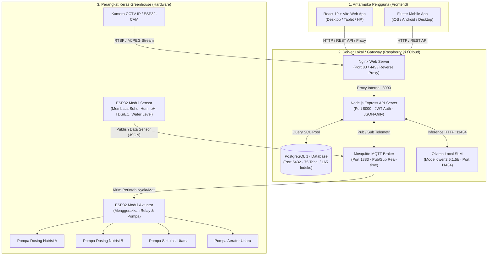

# Panduan Arsitektur & Alur Data Lengkap Sistem Vertonik Smart Farm
*(Dokumen Spesifikasi Lengkap untuk Pemahaman Manusia & Rujukan Prompt AI)*

Dokumen ini membedah seluruh arsitektur, logika bisnis, dan alur teknis sistem **Vertonik Smart Farm (GARAP - Green Autonomous Responsive Agriculture Platform)**. Dokumen ini dirancang agar dapat dibaca oleh orang awam, pengembang, maupun diunggah sebagai bahan analisis untuk model AI lainnya (ChatGPT, Claude, DeepSeek, dsb.).

---

## 1. Peta Arsitektur Menyeluruh (End-to-End Data Flow)

Sistem Vertonik Smart Farm menghubungkan antarmuka digital di tangan pengguna langsung ke perangkat keras mekanis di dalam greenhouse:



### Rantai Alur Kerja 4 Langkah:
1. **Sensor Membaca**: Sensor di tandon mencelup di air, ESP32 membaca voltase analog -> mengonversi ke angka nyata (pH 6.2, EC 1.8 mS/cm, Suhu 26°C) -> mengirim pesan MQTT ke topik `garap/telemetri`.
2. **Server Mencatat**: Server Node.js menangkap pesan MQTT -> memvalidasi batas aman -> menyimpannya ke tabel `sensor_readings` di PostgreSQL.
3. **Pengguna Melihat**: Aplikasi Web (React) dan HP (Flutter) mengambil data lewat REST API `GET /dashboard` atau `GET /sensor-realtime` -> menampilkan jarum status dan grafik.
4. **Perintah Balik (Aktuasi)**: Saat pengguna menekan tombol "Tuang Pupuk 50 ml" atau mode otomatis mendeteksi nutrisi kurang -> Web mengirim `POST /dosing` -> Server menerbitkan perintah MQTT ke topik `garap/aktuator/perintah` -> ESP32 Aktuator menyalakan pompa selama durasi yang ditentukan -> Pupuk tertuang ke tandon air.

---

## 2. Bedah Lengkap Seluruh Halaman per Kategori Sidebar

---

### KATEGORI 1: PANTAU (Monitoring Kondisi Real-Time)

Tujuan utama kelompok ini adalah memberikan informasi terkini secara visual tanpa risiko mengubah setelan sistem.

---

#### 1.1. Halaman Dashboard (`/dashboard`)
* **Fungsi Bahasa Awam**: Ruang kendali utama yang merangkum seluruh kondisi pertanian dalam 1 layar.
* **Komponen & Widget Tampilan**:
  1. *Banner Status Koneksi IoT*: Menampilkan status Online (hijau) atau Offline (abu-abu/merah) lengkap dengan catatan detik terakhir data diterima (*seconds ago*).
  2. *6 Kartu KPI Sensor Terkini*: Suhu Air (°C), Keasaman (pH), Kepekatan Nutrisi (TDS ppm / EC mS/cm), Suhu Udara (°C), Kelembaban Udara (%), dan Level Ketinggian Air Tandon (Tinggi/Sedang/Rendah).
  3. *Pipeline 4 Tahap Budidaya*: Menampilkan jumlah kelompok tanaman aktif pada tahap Semai, Peremajaan, Pendewasaan, dan Total Panen yang telah diraih.
  4. *Ringkasan Saklar Aktuator*: Status saklar pompa utama dan aerator (ON/OFF).
  5. *Tren Batang Mini*: Grafik ringkas 14 bacaan terakhir untuk melihat arah pergerakan nutrisi.
* **Alur Eksekusi Data**:
  - `Frontend`: Memanggil `GET /dashboard` secara berkala (polling setiap 5–10 detik).
  - `Backend`: Rute [`src/routes/dashboard.js`](file:///Users/rizki/Project/Vertoniksmartfarm/backend-nodejs/src/routes/dashboard.js) melakukan agregasi SQL paralel dari tabel `sensor_readings` (data terbaru), `semai`, `peremajaan`, `pendewasaan`, `panen`, dan `saklar_aktuator`.
  - `Database`: Mengambil baris data sensor terbaru dengan indeks `created_at DESC LIMIT 1`.
  - `Hardware`: Data bersumber dari siaran berkala ESP32 Sensor di greenhouse.

---

#### 1.2. Halaman Sensor Real-Time (`/sensor-realtime`)
* **Fungsi Bahasa Awam**: Rekam medis grafik dan arsip pembacaan sensor air dan iklim secara kronologis.
* **Komponen & Widget Tampilan**:
  1. *Filter Rentang Waktu*: Tombol cepat `6 Jam`, `24 Jam`, `7 Hari`, dan `Kustom` (pilih tanggal awal-akhir).
  2. *Selektor Metrik Interaktif*: Kartu klik untuk menyalakan/mematikan garis grafik pH, EC/TDS, Suhu Air, Suhu Udara, atau Kelembaban.
  3. *Canvas Grafik Tren*: Menampilkan kurva visual lengkap dengan garis ambang batas aman (garis putus-putus batas bahaya atas dan bawah).
  4. *Tabel Riwayat Bacaan*: Menampilkan baris demi baris pembacaan per menit dengan penanda status (Normal / Kritis).
  5. *Tombol Ekspor Laporan*: Mengunduh tabel ke format Excel/CSV.
* **Alur Eksekusi Data**:
  - `Frontend`: Mengirim `GET /monitoring/riwayat?rentang=24j&parameter=ph,tds`.
  - `Backend`: Rute [`src/routes/monitoring.js`](file:///Users/rizki/Project/Vertoniksmartfarm/backend-nodejs/src/routes/monitoring.js) menjalankan query rentang waktu `WHERE created_at >= NOW() - INTERVAL '24 hours'` ke tabel `sensor_readings`.
  - `Hardware`: Menggambarkan stabilitas ekosistem nutrisi hidroponik nyata di kebun.

---

#### 1.3. Halaman Peringatan (`/peringatan`)
* **Fungsi Bahasa Awam**: Pusat penanganan insiden ketika parameter kebun melewati batas aman atau mesin mengalami anomali.
* **Komponen & Widget Tampilan**:
  1. *Badge Masalah Aktif*: Angka penanda berapa banyak masalah merah (kritis) dan kuning (waspada) yang belum diselesaikan.
  2. *Kartu Masalah Kritis (Merah)*:
     - `AIR_DIGANTI`: Nutrisi otomatis ditahan karena lonjakan tajam pada pembacaan sensor (mencegah tanaman overdosis pupuk).
     - `AIR_TANDON_KRITIS`: Ketinggian air di bawah batas minimum (risiko pompa terbakar jika tetap menyala).
  3. *Kartu Masalah Waspada (Kuning)*: Mode pemeliharaan sedang aktif atau target EC disetel 0 (mode istirahat).
  4. *Daftar Riwayat Kejadian*: Catatan riwayat alarm lampau.
  5. *Form Tombol "Tandai Selesai / Reset Peringatan"*: Kolom input catatan tindakan petani dan tombol reset alarm.
* **Alur Eksekusi Data**:
  - Saat alarm muncul: Logika backend mendeteksi anomali saat menerima data sensor -> menyisipkan baris baru ke tabel `alert_logs`.
  - Saat tombol "Tandai Selesai" ditekan:
    - `Frontend`: Mengirim `POST /iot-v41/reset-peringatan` atau `PUT /alert-logs/:id/selesai` membawa ID pengguna dan catatan inspeksi.
    - `Backend`: Memperbarui status baris di tabel `alert_logs` menjadi `selesai = true`, `resolved_at = NOW()`, `resolved_by = user_id`.
    - `MQTT`: Menerbitkan perintah pemulihan status ke ESP32 jika diperlukan.

---

#### 1.4. Halaman CCTV (`/cctv`)
* **Fungsi Bahasa Awam**: Pemantau visual video langsung ke tanaman dan pipa greenhouse dari jarak jauh.
* **Komponen & Widget Tampilan**:
  1. *Papan Grid Kamera*: Menampilkan kotak-kotak siaran video langsung dari berbagai sudut kamera (Meja Tanam, Tandon Nutrisi, Pintu Masuk).
  2. *Badge Status Siaran*: Hijau (*Live*) atau Merah (*Terputus*).
  3. *Tombol Perbesar Layar Penuh*: Membuka dialog pratinjau resolusi tinggi.
  4. *Tombol Kelola & Tambah Kamera (Khusus Admin)*: Menambah tautan kamera baru (protokol RTSP dari IP Cam komersial atau MJPEG dari ESP32-CAM).
* **Alur Eksekusi Data**:
  - `Frontend`: Meminta daftar kamera lewat `GET /cctv`.
  - `Backend`: Menyediakan proxy gambar/stream melalui `GET /cctv/:id/gambar` menggunakan `ffmpeg` di server Raspberry Pi. Hal ini melindungi kata sandi kamera RTSP agar tidak bocor ke sisi browser pengguna.

---

#### 1.5. Halaman Asisten AI (`/asisten-ai`)
* **Fungsi Bahasa Awam**: Pakar agronomi cerdas berbasis AI lokal yang siap menjawab pertanyaan dan memberi saran langkah budidaya berikutnya.
* **Komponen & Widget Tampilan**:
  1. *Strip Konteks Kebun*: Menampilkan data tanaman yang sedang hidup dan parameter sensor terakhir yang dibaca oleh sistem secara otomatis.
  2. *Kartu Rekomendasi Langkah Selanjutnya*: Menampilkan keputusan instan (contoh: *"Prioritas Tinggi: Segera kuras 20% air tandon karena EC melebihi 2.8 mS/cm"*).
  3. *Kolom Chat Percakapan*: Antarmuka obrolan tanya jawab seputar penyakit tanaman, pemupukan, dan teknik hidroponik.
* **Alur Eksekusi Data**:
  - `Frontend`: Mengirim prompt pertanyaan ke `POST /api/ai/chat` atau meminta aksi via `POST /api/ai/langkah-selanjutnya`.
  - `Backend`: Rute [`src/routes/ai.js`](file:///Users/rizki/Project/Vertoniksmartfarm/backend-nodejs/src/routes/ai.js) merangkai prompt berbobot (*system prompt + konteks data kebun terkini dari PostgreSQL*) -> mengirimkan payload ke runtime Ollama lokal (`http://127.0.0.1:11434/api/generate`) dengan model `qwen2.5:1.5b`.
  - *Mekanisme Cadangan (Fallback)*: Jika layanan Ollama mati atau melebihi batas waktu (timeout 30 detik), sistem otomatis beralih mengeksekusi *mesin aturan heuristik agronomi* baku, sehingga sistem tidak pernah gagal memberi jawaban.

---

### KATEGORI 2: KENDALI (Instruksi & Penggerak Fisik Greenhouse)

---

#### 2.1. Halaman Kebun Saya / Meja Tanam (`/tanam`)
* **Fungsi Bahasa Awam**: Manajemen meja hidroponik, pendaftaran bibit baru, dan pemantauan umur tanaman (HST - Hari Setelah Tanam).
* **Komponen & Widget Tampilan**:
  1. *Daftar Kartu Meja*: Meja 1, Meja 2, dst., lengkap dengan jenis tanaman yang sedang tumbuh, tanggal tanam, dan persentase progres menuju panen.
  2. *Tombol "Mulai Tanam Baru"*: Membuka form dialog untuk memilih meja kosong, varietas benih, dan tanggal semai.
  3. *Tombol "Pindah Tahap / Panen"*: Mengalirkan tanaman ke fase berikutnya.
* **Alur Eksekusi Data**:
  - `Frontend`: Mengirim `POST /tanam` dengan data `{ id_meja, id_tanaman, tanggal_tanam, target_ppm }`.
  - `Backend`: Menyimpan baris baru di tabel `siklus_budidaya`, menandai status meja di tabel `meja` menjadi `terisi = true`.
  - `Sistem Otomatis`: Memulai perhitungan umur tanaman harian dan menyetel profil nutrisi aktif untuk meja tersebut.

---

#### 2.2. Halaman Saklar Aktuator (`/saklar`)
* **Fungsi Bahasa Awam**: Tombol stop-kontak manual untuk menyalakan/mematikan pompa air, pompa nutrisi, lampu ultraviolet, atau aerator.
* **Komponen & Widget Tampilan**:
  1. *Daftar Kartu Saklar*:
     - Saklar Pompa Sirkulasi Talang.
     - Saklar Pompa Dosing Pupuk A.
     - Saklar Pompa Dosing Pupuk B.
     - Saklar Pompa Dosing pH Up / pH Down.
     - Saklar Aerator Gelembung Tandon.
  2. *Toggle Switch (ON / OFF)*: Indikator visual status terkini dan tombol pengubah status.
* **Alur Eksekusi Data**:
  - Saat tombol switch digeser:
    - `Frontend`: Mengirim `POST /saklar/ubah` membawa `{ kode_saklar: "POMPA_SIRKULASI", aktif: true }`.
    - `Backend`: Memeriksa otorisasi (khusus Admin) -> memperbarui baris di tabel `saklar_aktuator` -> mencatat jejak di tabel `audit_logs`.
    - `MQTT`: Menerbitkan pesan JSON ke broker Mosquitto pada topik `garap/aktuator/saklar`:
      ```json
      { "perangkat": "POMPA_SIRKULASI", "perintah": "ON", "timestamp": 1794183547 }
      ```
    - `Hardware`: ESP32 Aktuator menerima pesan -> mengaktifkan relay optocoupler -> motor pompa menyala secara fisik.

---

#### 2.3. Halaman Nutrisi Manual (`/dosing-manual`)
* **Fungsi Bahasa Awam**: Tombol injeksi pupuk darurat untuk menambahkan cairan pupuk pekat secara terukur saat itu juga.
* **Komponen & Widget Tampilan**:
  1. *Input Volume Dosis*: Kotak angka mililiter pupuk (misal: `30 ml`).
  2. *Input Durasi Pompa*: Batasan detik pompa menyala (misal: `10 detik`).
  3. *Tombol Eksekusi "Tuangkan Pupuk Sekarang"*: Tombol dengan konfirmasi ganda guna mencegah kesalahan tekan.
* **Alur Eksekusi Data**:
  - `Frontend`: Mengirim `POST /api/dosing/manual` `{ volume_ml: 30, durasi_detik: 10, jenis: "AB_MIX" }`.
  - `Backend`: Melakukan validasi pengaman (apakah volume < ambang batas bahaya) -> mencatat antrean dosing di tabel `dosing_logs`.
  - `MQTT`: Menerbitkan perintah `{ "aksi": "DOSING_SEKETIKA", "durasi_ms": 10000 }` ke ESP32.
  - `Hardware`: Pompa peristaltik A dan B menyala berbarengan selama 10 detik lalu otomatis berhenti.

---

#### 2.4. Halaman Pengaturan Nutrisi / Dosing Otomatis (`/dosing`)
* **Fungsi Bahasa Awam**: Menyetel sistem otopilot pemberian makan tanaman secara mandiri oleh komputer kebun.
* **Komponen & Widget Tampilan**:
  1. *Saklar Pilihan Mode*: Geser antara mode `OTOMATIS` atau `MANUAL`.
  2. *Input Target Setpoint*: Target EC (mS/cm) atau Target PPM (misal: `1100 PPM`).
  3. *Input Rentang Histeresis / Toleransi*: Batas toleransi (misal: `± 50 PPM`).
  4. *Jeda Siklus Aduk (Mixing Delay)*: Durasi waktu tunggu pengadukan air tandon setelah pupuk disuntikkan sebelum sensor membaca ulang (misal: `180 detik`).
* **Alur Eksekusi Data**:
  - `Frontend`: Mengirim `PUT /iot-v41/pengaturan` berisi parameter setpoint baru.
  - `Backend`: Memperbarui tabel konfigurasi `konfigurasi_dosis` dan `sensor_thresholds`.
  - `Sinkronisasi IoT`: Perubahan dikirim ke memori internal ESP32. Mikrokontroler selanjutnya bekerja mandiri: jika air terbaca < 1050 PPM, pompa menyala otomatis; jika sudah menyentuh 1100 PPM, pompa berhenti.

---

### KATEGORI 3: DATA (Pemeriksaan Akurasi, Riwayat, & Audit)

---

#### 3.1. Halaman Kalibrasi Sensor (`/kalibrasi`)
* **Fungsi Bahasa Awam**: Menyetel ketepatan alat ukur pH dan EC dengan cairan standar pabrik (buffer) agar angka tidak meleset seiring waktu.
* **Komponen & Widget Tampilan**:
  1. *Panel Kalibrasi pH*:
     - Titik Asam (pH 4.01).
     - Titik Netral (pH 6.86 / 7.00).
     - Titik Basa (pH 9.18).
  2. *Panel Kalibrasi EC*: Titik standar larutan 1413 µS/cm.
  3. *Tombol Rekam Titik Kalibrasi*: Menghitung nilai tegangan ADC mentah menjadi rumus kalibrasi baru.
* **Alur Eksekusi Data**:
  - Petani mencelupkan probe sensor ke cairan buffer standar -> menunggu nilai stabil -> menekan "Kalibrasi Titik Ini".
  - `Frontend`: Mengirim `POST /kalibrasi/langsung` `{ sensor: "ph", titik_acuan: 6.86, nilai_adc_mentah: 2150 }`.
  - `Backend`: Menghitung koefisien *slope* dan *offset* baru -> memperbarui tabel `kalibrasi_sensor`.
  - `MQTT`: Mengirim nilai offset baru ke ESP32 agar formula perhitungan analog-ke-digital di papan mikrokontroler diperbarui seketika.

---

#### 3.2. Halaman Data (`/data`)
* **Fungsi Bahasa Awam**: Arsip tabel database seluruh histori meja, pembagian lot, dan pengujian laboratorium hasil panen.
* **Komponen & Widget Tampilan**:
  1. *Tab Pilihan Kategori Data*: Data Meja Tanam, Data Panen, Data Uji Lab Kandungan Gula (Brix).
  2. *Bilah Pencarian & Filter Tanggal*: Menemukan data historis spesifik.
  3. *Tabel Interaktif*: Dilengkapi paginasi dan status ringkas tiap baris.
* **Alur Eksekusi Data**:
  - `Frontend` -> `GET /api/v1/data-arsip` -> `PostgreSQL` (query terindeks `lot_budidaya` & `uji_lab`).

---

#### 3.3. Halaman Catatan Aktivitas (`/audit`)
* **Fungsi Bahasa Awam**: Buku log jejak digital (*black box*) yang mencatat siapa yang melakukan apa, dari IP mana, dan jam berapa.
* **Komponen & Widget Tampilan**:
  1. *Tabel Jejak Audit*: Kolom Waktu Kejadian, Nama Petani/Admin, Jenis Aksi (CREATE, UPDATE, DELETE, LOGIN, DOSING), dan Rincian Data Sebelum vs Sesudah Diubah.
  2. *Penyaring Berdasarkan Pengguna atau Aksi*: Memfilter aktivitas pengguna tertentu.
* **Alur Eksekusi Data**:
  - Setiap request `POST/PUT/DELETE` yang masuk ke backend otomatis dicegat oleh *middleware* [`src/audit.js`](file:///Users/rizki/Project/Vertoniksmartfarm/backend-nodejs/src/audit.js).
  - Data lama dan data baru dicatat secara otomatis ke tabel `audit_logs`. Catatan ini bersifat kekal (*append-only*, tidak dapat diubah atau dihapus).

---

#### 3.4. Halaman Laporan (`/laporan`)
* **Fungsi Bahasa Awam**: Generator dokumen laporan berkala untuk kebutuhan evaluasi manajemen, mitra CSR PT Arutmin Indonesia, atau riset kampus.
* **Komponen & Widget Tampilan**:
  1. *Pilihan Periode Laporan*: Harian, Mingguan, Bulanan, atau Per Siklus Tanam.
  2. *Preview Grafik Kinerja*: Ringkasan efisiensi pupuk, kestabilan pH, dan bobot panen melon.
  3. *Tombol "Unduh Laporan Excel (.xlsx)"*: Mengunduh berkas spreadsheet terformat rapi.
* **Alur Eksekusi Data**:
  - `Frontend`: Memanggil `GET /laporan/ringkasan` dan menggunakan pustaka `exceljs` di peramban untuk menyusun sel data, tabel, dan formula kalkulasi ke berkas XLSX secara instan tanpa membebani prosesor server.

---

### KATEGORI 4: SISTEM (Konfigurasi Mesin & Otorisasi Pengguna)

---

#### 4.1. Halaman Pengaturan Alat (`/pengaturan-alat`)
* **Fungsi Bahasa Awam**: Mengatur batas pengaman operasional perangkat keras agar mesin tidak rusak akibat eror sistem.
* **Komponen & Fitur**:
  - Pengaturan batas maksimal waktu menyala pompa (*Max Pump Runtime*, misal maksimal 90 detik berturut-turut).
  - Penyetelan waktu jeda pengaman (*Safety Cooldown*).
  - Alur data disimpan di tabel `aturan_fail_safe` dan disinkronkan ke ESP32.

---

#### 4.2. Halaman Pemulihan Papan (`/pemulihan-papan`)
* **Fungsi Bahasa Awam**: Tombol *Restart* jarak jauh (*remote reboot*) jika mikrokontroler sensor/aktuator di greenhouse mengalami *freeze* atau kehilangan sinkronisasi.
* **Alur Eksekusi Data**:
  - Admin menekan tombol "Reboot ESP32".
  - `Frontend` -> `POST /iot-v41/pulihkan-papan`.
  - `Backend` -> Menerbitkan perintah MQTT topik `garap/sistem/reboot`.
  - `Hardware` -> ESP32 mengeksekusi instruksi perangkat lunak `ESP.restart()`.

---

#### 4.3. Halaman Koneksi Alat / MQTT Diagnostik (`/mqtt-diagnostik`)
* **Fungsi Bahasa Awam**: Radar pemantau sinyal data radio nirkabel antara sensor greenhouse dan komputer Raspberry Pi.
* **Komponen & Fitur**:
  - Menampilkan status koneksi broker Mosquitto (Terhubung / Terputus).
  - Menampilkan grafik latensi sinyal (*ping* ms) dan jumlah paket data yang diterima per menit.

---

#### 4.4. Halaman Manajemen User (`/user`)
* **Fungsi Bahasa Awam**: Buku registrasi karyawan kebun (khusus Admin).
* **Komponen & Fitur**:
  - Daftar seluruh akun terdaftar beserta perannya (`admin`, `petani`, `user/demo`).
  - Form pendaftaran pengguna baru (Username, Email, Password, Peran).
  - Tombol edit hak akses dan hapus pengguna.
* **Alur Data**:
  - Data tersimpan di tabel `users` dengan kata sandi terenkripsi aman algoritma `bcrypt` (cost factor 10-12).

---

#### 4.5. Halaman Akun Saya (`/profil`)
* **Fungsi Bahasa Awam**: Halaman pribadi pengguna untuk memperbarui data diri dan mengganti kata sandi login.
* **Alur Data**:
  - Form ubah password memvalidasi kecocokan sandi lama, memeriksa panjang minimal sandi baru (8 karakter), lalu mengirim `POST /profil/password`.

---

### KATEGORI 5: SIKLUS TANAM (Perjalanan Hidup Tanaman 4 Fase)

Kategori ini membagi alur budidaya tanaman melon dan sayuran menjadi 4 tahapan kronologis:

```
[Tahap 1: Semai] ──> [Tahap 2: Peremajaan] ──> [Tahap 3: Pendewasaan] ──> [Tahap 4: Panen]
```

1. **Semai (`/semai`)**: Pencatatan bibit bayi pada spons/rockwool (Hari ke-1 sampai ke-7). Kebutuhan nutrisi: Air bersih atau nutrisi minimal (< 400 PPM).
2. **Peremajaan (`/peremajaan`)**: Pemindahan bibit berdaun 3–4 ke talang peremajaan (Hari ke-8 sampai ke-20). Kebutuhan nutrisi: Pupuk konsentrasi sedang (600–800 PPM).
3. **Pendewasaan (`/pendewasaan`)**: Pembesaran tanaman dan pembentukan buah melon (Hari ke-21 sampai ke-65). Kebutuhan nutrisi: Pupuk pekat maksimal (1000–1400 PPM).
4. **Panen (`/panen`)**: Pemetikan hasil panen, penimbangan bobot total kilogram, pencatatan tanggal selesai panen, dan pengosongan meja untuk siklus tanam berikutnya.
5. **Durasi Siklus (`/siklus`)**: Menentukan standar target jumlah hari di tiap fase untuk masing-masing komoditas.

---

### KATEGORI 6: MASTER DATA (Kamus Baku & Standar Operasional)

1. **Jenis Tanaman (`/tanaman`)**: Katalog varietas bibit yang dibudidayakan (Melon Golden, Melon Inthanon, Selada Romaine, Pakcoy, Cabai Hidroponik) lengkap dengan standar PPM, target pH, dan deskripsi tanaman.
2. **Ambang Sensor (`/ambang`)**: Pagar pengaman batas minimum dan maksimum absolut untuk tiap parameter (Suhu Air Min/Max, pH Min/Max, TDS Min/Max). Jika pembacaan sensor keluar dari batas ini, sistem otomatis membunyikan alarm peringatan.

---

## 3. Rangkuman Peta Rute API Backend & Tabel Database Terkait

| Halaman Frontend | Rute API Backend Terkait | Tabel Database PostgreSQL Utama | Jalur IoT / MQTT Terkait |
|---|---|---|---|
| `/dashboard` | `GET /dashboard` | `sensor_readings`, `saklar_aktuator`, `semai`, `panen` | - |
| `/sensor-realtime` | `GET /monitoring/riwayat` | `sensor_readings`, `sensor_thresholds` | `garap/telemetri` |
| `/peringatan` | `GET /alert-logs`, `POST /iot-v41/reset-peringatan` | `alert_logs`, `parameter_operasi` | `garap/peringatan` |
| `/cctv` | `GET /cctv`, `GET /cctv/:id/gambar` | `cctv_cameras` | RTSP / MJPEG Camera Stream |
| `/asisten-ai` | `POST /api/ai/langkah-selanjutnya` | `sensor_readings`, `tanaman`, `aturan_budidaya` | Local Ollama Engine |
| `/tanam` | `GET /tanam`, `POST /tanam` | `meja`, `tanaman`, `siklus_budidaya` | - |
| `/saklar` | `GET /saklar`, `POST /saklar/ubah` | `saklar_aktuator`, `audit_logs` | `garap/aktuator/saklar` |
| `/dosing-manual` | `POST /api/dosing/manual` | `dosing_logs`, `audit_logs` | `garap/aktuator/perintah` |
| `/dosing` | `GET /dosing`, `PUT /iot-v41/pengaturan` | `konfigurasi_dosis`, `sensor_thresholds` | `garap/konfigurasi/set` |
| `/kalibrasi` | `POST /kalibrasi/langsung` | `kalibrasi_sensor`, `audit_logs` | `garap/kalibrasi/offset` |
| `/audit` | `GET /audit-logs` | `audit_logs`, `users` | - |
| `/laporan` | `GET /laporan/ringkasan` | Seluruh tabel historis | - |
| `/user` | `GET /user`, `POST /user`, `PUT /user/:id` | `users` | - |
| `/semai` s/d `/panen` | `GET /semai`, `GET /panen`, dst. | `semai`, `peremajaan`, `pendewasaan`, `panen` | - |
