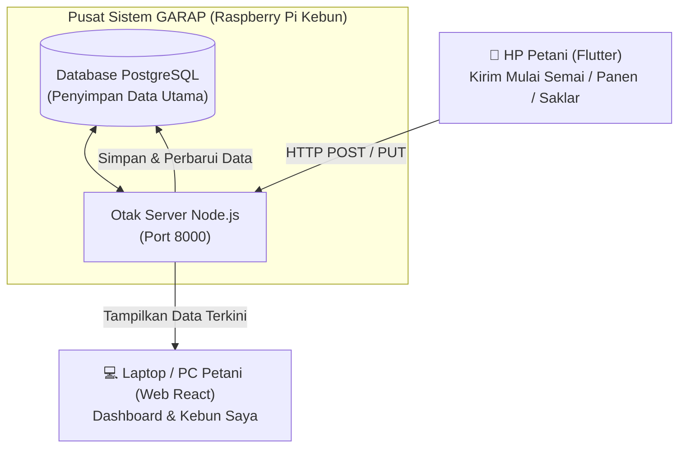

# Panduan Mandiri: Menguji Alur Greenhouse Baru & Sinkronisasi Flutter ke Web

Panduan ini disusun untuk **orang awam** agar Anda dapat menguji seluruh sistem **GARAP Smart Farm** secara mandiri dengan mudah, mulai dari kondisi **database baru/kosong**, mengatur greenhouse baru, hingga membuktikan langsung bahwa **data yang dikirim dari HP (Flutter) langsung tampil dan sinkron di Website**.

---

## 1. Konsep Dasar: "Satu Otak, Dua Layar"

Banyak orang awam mengira aplikasi HP mengirim data langsung lewat Bluetooth atau kabel ke Laptop. Pada GARAP, cara kerjanya jauh lebih andal dan modern:



- **Aplikasi HP (Flutter)** dan **Website (React)** adalah **dua jendela yang melihat ruangan yang sama**.
- Ruangan tersebut adalah **Otak Pusat (Backend Node.js & Database PostgreSQL)**.
- Setiap kali Anda memencet tombol *"Mulai Semai"*, *"Pindah Tahap"*, atau *"Catat Panen"* di HP:
  1. HP mengirim data ke Otak Server.
  2. Otak Server menyimpannya ke Database.
  3. Website yang sedang terbuka otomatis membaca data baru tersebut dan menampilkannya di layar tanpa jeda!

---

## 2. Persiapan Sebelum Menguji

Pastikan kedua layanan utama sudah berjalan di laptop/komputer Anda:

### A. Pastikan Backend Server Aktif
Buka Terminal dan jalankan:
```bash
cd /Users/rizki/Project/Vertoniksmartfarm/backend-nodejs
npm start
```
*Tanda berhasil:* Muncul tulisan `GARAP API (HTTP) : http://127.0.0.1:8000`.

### B. Pastikan Website Aktif
Buka tab Terminal baru:
```bash
cd /Users/rizki/Project/Vertoniksmartfarm/react-web-app
npm run dev
```
*Tanda berhasil:* Muncul alamat `http://localhost:5173`. Buka alamat ini di Chrome.

### C. Pastikan Aplikasi Flutter Aktif
Buka tab Terminal baru:
```bash
cd /Users/rizki/Project/Vertoniksmartfarm/flutter_mobile_app
flutter run -d macos
# Atau jika ingin dijalankan di peramban web: flutter run -d chrome
# Atau jika dijalankan di HP fisik yang tersambung kabel USB: flutter run
```

> [!TIP]
> **Fitur Baru Pemilihan Server di HP:**
> Di halaman Login aplikasi HP, di bawah tombol *"Demo"*, sekarang ada tombol:
> `Server: http://garap.local [Ubah]`
> Bila Anda sedang menguji coba di laptop yang sama, cukup ketuk tombol tersebut dan pilih **Lokal (127.0.0.1:8000)**. Aplikasi HP langsung terhubung ke backend lokal Anda!

---

## 3. Langkah 1: Pengaturan Greenhouse Baru dari Nol (di Website)

Bila database masih baru/kosong, petani belum bisa langsung menanam karena sistem belum tahu nama meja dan varietas yang ditanam. Mari kita buat data pondasinya terlebih dahulu lewat Website sebagai Superadmin:

### 1. Login sebagai Superadmin
- Buka Website di peramban: `http://localhost:5173/login`
- Masukkan:
  - **Username:** `garap`
  - **Password:** `garapkankitale`
- Tekan **Masuk**.

### 2. Buat Meja Tanam
1. Di bilah menu samping (Sidebar), klik **Master Data** ➔ **Meja**.
2. Klik tombol hijau **"+ Tambah Meja"**.
3. Isi data meja baru:
   - **Nama Meja:** `Meja NFT-01 Melon`
   - **Jumlah Lubang:** `120`
   - **Jenis Talang:** `NFT`
   - **Kapasitas Tandon:** `200` Liter
4. Klik **Simpan**.

### 3. Buat Master Tanaman
1. Klik **Master Data** ➔ **Tanaman**.
2. Klik tombol hijau **"+ Tambah Tanaman"**.
3. Isi formulir:
   - **Nama Tanaman / Varietas:** `Melon Inthanon RZ`
   - **Meja Bawaan:** Pilih `Meja NFT-01 Melon`
4. Klik **Simpan**.

### 4. Tentukan Waktu Siklus Tumbuh Tanaman
1. Klik **Master Data** ➔ **Siklus**.
2. Klik tombol **"+ Tambah Siklus"** untuk tanaman `Melon Inthanon RZ`:
   - Tambah siklus 1: Nama = `Semai`, Durasi = `10` hari.
   - Tambah siklus 2: Nama = `Peremajaan`, Durasi = `15` hari.
   - Tambah siklus 3: Nama = `Pendewasaan`, Durasi = `35` hari.
3. Klik **Simpan**.

*Kini greenhouse baru Anda sudah 100% siap untuk mulai menanam!*

---

## 4. Langkah 2: Uji Coba Sinkronisasi Nyata (Flutter HP ➔ Website)

Sekarang mari kita buktikan bahwa data yang Anda masukkan di HP langsung muncul di Web!

### Skenario A: Mulai Semai di HP ➔ Periksa di Website

```
[ HP Flutter ]                        [ Web Browser ]
Tekan "+ Mulai Semai"                 Buka menu "Kebun Saya"
Isi 100 benih Melon Inthanon  ───▶   MUNCUL KARTU BARU:
Klik "Mulai"                          "Melon Inthanon RZ (100 benih)"
                                      di Kolom Penyemaian!
```

1. **Di Aplikasi HP (Flutter):**
   - Masuk sebagai Petani:
     - **Username:** `petani`
     - **Password:** `rSxo4mz1NcMJNd_k_GJ1`
   - Masuk ke tab **Tanam** (ikon daun di dock bawah).
   - Ketuk tombol hijau besar **"+ Mulai Semai"**.
   - Pilih:
     - Tanaman: `Melon Inthanon RZ`
     - Meja: `Meja NFT-01 Melon`
     - Jumlah Benih: `100`
   - Ketuk tombol **"Mulai"**.
   - Muncul notifikasi hijau di HP: *"Semai 100 benih dimulai hari ini"*.

2. **Periksa di Website:**
   - Di laptop Anda, buka halaman **"Kebun Saya"** (`/tanam`).
   - **HASIL:** Kartu baru bertuliskan **Melon Inthanon RZ** langsung hadir di kolom pertama **"Penyemaian"** dengan angka **100 benih** dan status **Hari ke-1**!

---

### Skenario B: Pindah Tahap di HP ➔ Periksa Kolom di Website

Setelah beberapa hari disemai, benih siap dipindahkan ke meja peremajaan.

```
[ HP Flutter ]                        [ Web Browser ]
Buka kartu Melon di HP                KARTU BERPINDAH:
Ketuk "Pindah ke Peremajaan"  ───▶   Kolom Semai kosong,
Isi 95 sehat, 5 gagal                Kini kartu berada di kolom
Klik "Simpan"                         "Peremajaan (95 tanaman)"!
```

1. **Di Aplikasi HP (Flutter):**
   - Pada kartu Melon tadi di tab Tanam, ketuk tombol **"Pindah ke Peremajaan"**.
   - Masukkan jumlah benih yang sehat dan berhasil tumbuh: `95` (sistem otomatis menghitung 5 benih gagal).
   - Ketuk **"Simpan"**.
   - HP memunculkan pesan: *"95 tanaman pindah ke peremajaan (5 gagal)"*.

2. **Periksa di Website:**
   - Lihat layar Website di menu **"Kebun Saya"**.
   - **HASIL:**
     - Kartu di kolom "Penyemaian" sudah tidak ada (telah selesai).
     - Kartu otomatis berpindah ke kolom kedua: **"Peremajaan"** dengan jumlah **95 tanaman** aktif!

---

### Skenario C: Catat Panen di HP ➔ Periksa Statistik & Riwayat di Web

Ketika tanaman sudah besar dan buah melon dipanen:

```
[ HP Flutter ]                        [ Web Browser ]
Ketuk "Catat Panen"                   Buka "Dashboard"
Isi 88 pohon dipanen, 2 gagal ───▶   - Total Panen bertambah!
Ketik "Manis & grade A"               - Riwayat Panen menampilkan baris:
Klik "Simpan"                          "Melon Inthanon RZ - 88 pohon"
```

1. **Di Aplikasi HP (Flutter):**
   - Pindahkan tahap dari Peremajaan ke Pendewasaan, lalu ketuk tombol **"Catat Panen"**.
   - Masukkan:
     - Pohon Berhasil Dipanen: `88` pohon
     - Pohon Gagal: `2` pohon
     - Catatan: *"Panen pertama melon manis grade A"*
   - Ketuk **"Simpan Panen"**.

2. **Periksa di Website:**
   - Buka halaman utama **Dashboard** (`/dashboard`).
   - **HASIL:**
     - Kotak indikator **Panen Berhasil** di bagian atas otomatis terisi data panen baru.
     - Di tabel bawah **"Riwayat Panen Terakhir"**, muncul baris baru yang mencatat:
       - Varietas: `Melon Inthanon RZ`
       - Jumlah: `88 berhasil / 2 gagal`
       - Tanggal: `Hari ini`
       - Catatan: *"Panen pertama melon manis grade A"*

---

### Skenario D: Mengubah Saklar Pompa di HP ➔ Periksa Switch di Web

```
[ HP Flutter ]                        [ Web Browser ]
Buka tab "Kontrol Air"                Buka menu "Saklar Aktuator"
Geser saklar "Pompa Sirkulasi" ───▶  Toggle saklar di layar Web
menjadi ON (Hijau)                    otomatis ikut bergeser ke ON!
```

1. **Di Aplikasi HP:**
   - Buka tab **Kontrol** atau **Air**.
   - Temukan saklar **Pompa Sirkulasi** lalu ketuk untuk menyalakannya (posisi ON).
2. **Di Website:**
   - Buka halaman **Saklar Aktuator** (`/saklar`) atau **Kendali Air** (`/kontrol-air`).
   - **HASIL:** Saklar Pompa Sirkulasi di layar monitor laptop Anda ikut berubah posisi menjadi aktif (berwarna hijau).

---

## 5. Cara Pengujian Cepat 1 Klik (Automated Simulator)

Bila Anda ingin memverifikasi sinkronisasi tanpa perlu mengetik manual di dua layar satu per satu, kami sudah menyediakan skrip penguji mandiri:

Buka Terminal Anda dan ketik perintah berikut:
```bash
node backend-nodejs/scripts/test-sinkronisasi-flutter-web.js
```

**Apa yang dilakukan skrip ini?**
1. Membuat greenhouse uji coba otomatis di database.
2. Mensimulasikan HP Flutter mengirim Semai 100 benih.
3. Memeriksa Web apakah data semai muncul.
4. Mensimulasikan HP Flutter memindahkan 95 tanaman ke Peremajaan.
5. Memeriksa Web apakah kartu berpindah kolom.
6. Mensimulasikan HP Flutter mencatat panen 88 pohon melon.
7. Memeriksa Dashboard Web apakah data panen tercatat presisi.
8. Membersihkan data pengujian sehingga database Anda tetap rapi seperti semula.

*Hasil yang Anda lihat di layar:*
```
======================================================
🧪 PENGUJIAN SINKRONISASI DATA: FLUTTER (HP) ➔ WEB
======================================================
📦 Langkah 0: Menyiapkan Master Data Greenhouse Baru...
   ✅ Meja & Tanaman siap di database.

📱 Langkah 1 [FLUTTER]: Petani menekan "+ Mulai Semai"
   ✅ Flutter berhasil mengirim! id_semai = 1059

💻 Langkah 2 [WEB]: Pengguna membuka halaman "Kebun Saya"
   🎉 SINKRON! Web langsung menampilkan kartu batch semai baru.

📱 Langkah 3 [FLUTTER]: Petani menekan "Pindah ke Peremajaan"
   ✅ Flutter memindahkan tahap!

💻 Langkah 4 [WEB]: Halaman Web menerima pembaruan data
   🎉 SINKRON! Kartu otomatis pindah ke kolom "Peremajaan".

📱 Langkah 5 [FLUTTER]: Petani menyelesaikan siklus & "Catat Panen"
   ✅ Panen tercatat dari HP! 88 pohon berhasil.

💻 Langkah 6 [WEB]: Pengguna melihat Dashboard Web
   🎉 SINKRON! Dashboard Web langsung mendeteksi panen baru.

======================================================
🏆 KESIMPULAN: SINKRONISASI FLUTTER ➔ WEB 100% SUKSES!
======================================================
```

---

## 6. Rangkuman Tabel Akun Pengujian

Simpan catatan kredensial ini untuk melakukan pengujian kapan saja:

| Peran | Username | Password | Digunakan Untuk |
| :--- | :--- | :--- | :--- |
| **Superadmin (Web)** | `garap` | `garapkankitale` | Mengatur Meja, Tanaman, Siklus, Akun Petani, Ambang Sensor |
| **Petani (HP & Web)** | `petani` | `rSxo4mz1NcMJNd_k_GJ1` | Mulai Tanam, Pindah Tahap, Catat Panen, Nyalakan Saklar Pompa |
| **Demo (Tamu)** | `demo` | `p9wE06aG1pMQzdBQKxzz` | Mode pameran/hanya lihat (semua tombol aksi dikunci aman) |

---

*GARAP Smart Farm — Sistem Cerdas, Andal, dan Terintegrasi Penuh Antara Kebun dan Genggaman Tangan Anda.*
