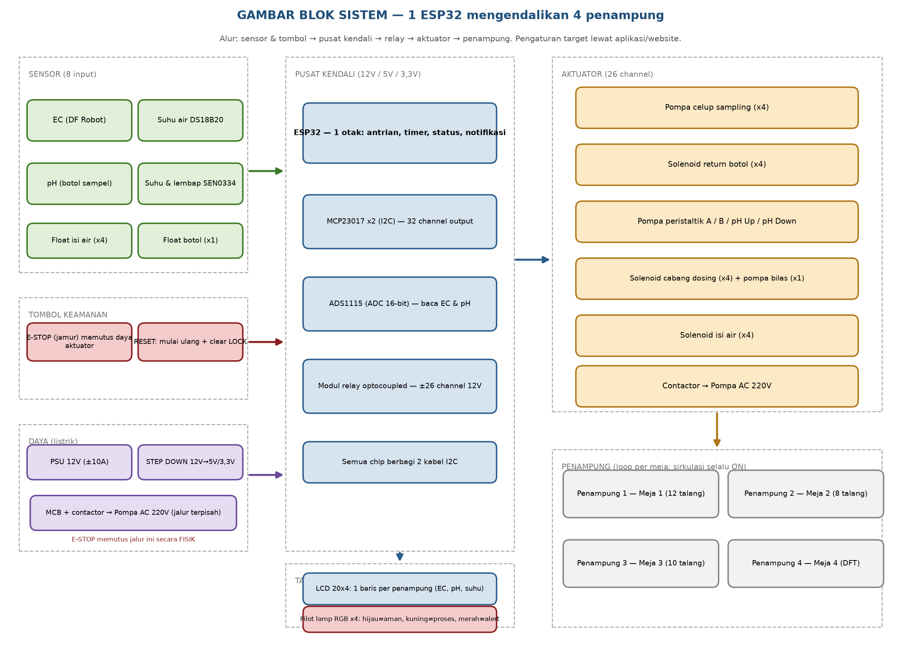
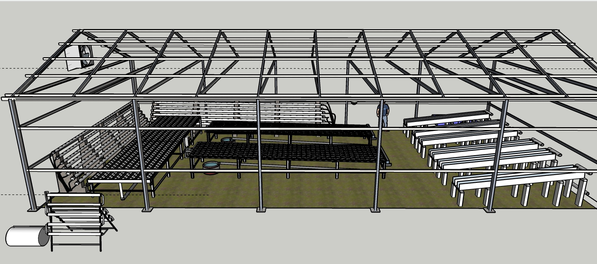
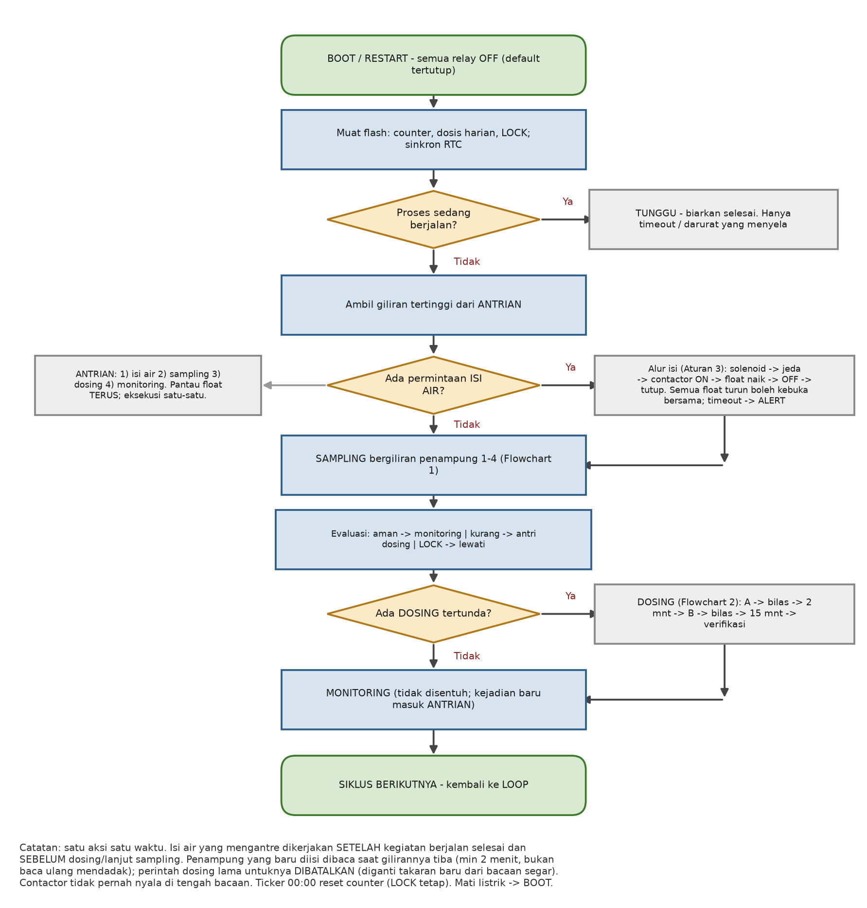
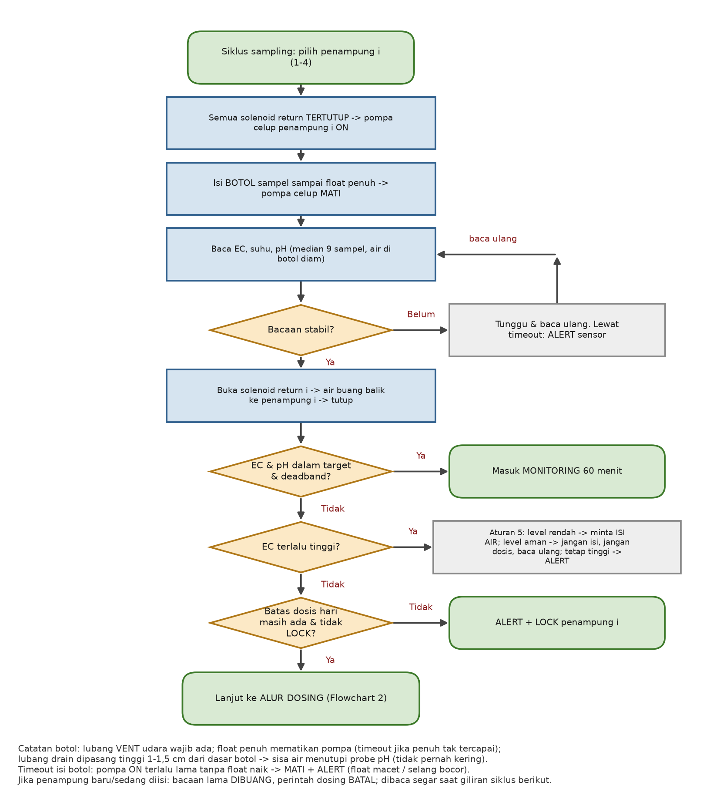
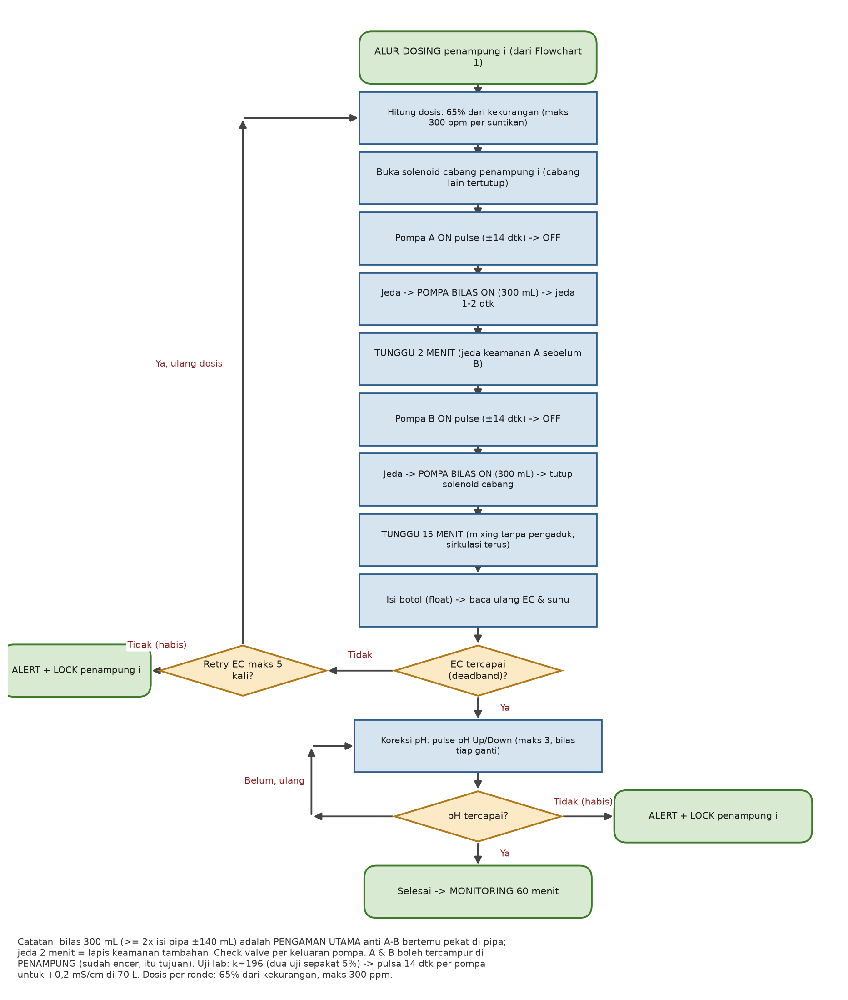
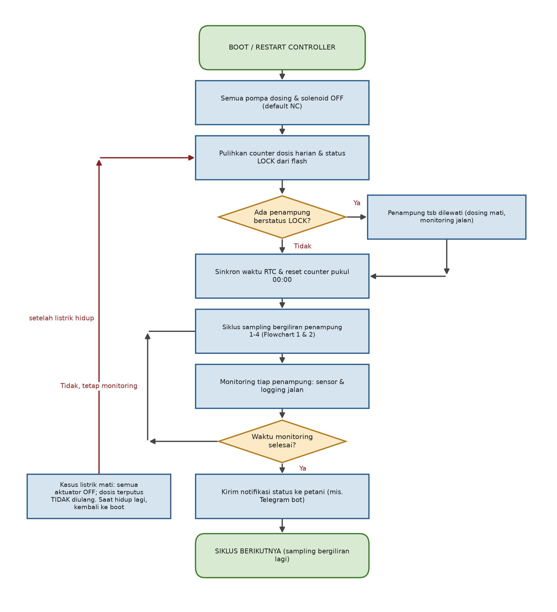

# DOKUMEN PERANCANGAN SISTEM

# IoT HIDROPONIK MULTI-PENAMPUNG — 4 MEJA (3 NFT + 1 DFT)

*Pemberian Nutrisi (EC) Otomatis & Pemantauan pH — ATURAN MAIN FINAL + TIMING FINAL*

Catatan: tanda "…" pada tabel berarti nilai belum ditentukan dan akan diisi setelah pengukuran lapangan dan kalibrasi.

Ruang lingkup: dokumen ini mencakup sistem alat IoT (sensor, aktuator, jalur perpipaan), aturan main/logika kontrol, alur kerja (flowchart), timing operasi final, dan hasil uji laboratorium AB mix. Penentuan target nutrisi per umur tanaman serta pengembangan web/aplikasi petani dikerjakan terpisah oleh tim website.

| **Item** | **Keterangan** |
|---|---|
| Nama dokumen | Perancangan Sistem IoT Hidroponik — Pemberian Nutrisi (EC) & pH Otomatis |
| Tanggal | 13 Oktober 2026 |
| Status | FINAL — siap implementasi; nilai "…" menyusul kalibrasi lapangan |
| Pembagian peran | Alat ini = penjaga level air + penjaga EC/pH terhadap target yang diberikan + kontrol & notifikasi jarak jauh. Target EC per umur tanaman = kewenangan tim website/aplikasi (perlu konfirmasi cara penyerahan target ke alat — lihat Lampiran B). |

## Ringkasan Sistem

Sistem ini menjaga nutrisi air untuk 4 meja hidroponik (3 NFT + 1 DFT). Setiap meja punya penampung air sendiri (±70–75 liter) karena tiap meja berisi tanaman berbeda (daun bawang, selada, pakcoy) dengan kebutuhan nutrisi yang berbeda pula. Satu alat kontrol (ESP32) bergiliran merawat keempatnya: membaca kadar nutrisi (EC), pH, dan suhu tiap penampung, lalu menyuntik nutrisi atau mengisi air secukupnya — tanpa perlu petani menakar sendiri.

Cara kerja singkatnya: tiap penampung punya satu pelampung (float) yang memantau air. Kalau air surut, air bersih otomatis ditambah. Nutrisi dijaga oleh sensor EC: kurang → disuntik nutrisi A lalu B (sudah terhitung dari hasil uji lab), lebih → petani diberi tahu. Semua kejadian dikirim ke HP petani sebagai notifikasi, dan ada tombol darurat di lapangan.

*Gambar blok — alur sinyal: sensor & tombol → ESP32 → modul relay → aktuator → penampung.*

*Tata letak fisik greenhouse (model 3D): talang tanam di atas, penampung dan jaringan pipa di bawah — air naik dari penampung ke talang lalu kembali (loop tertutup).*

## 1. Kondisi Greenhouse dan Konsep

### 1.1 Latar belakang

Setiap meja berisi jenis dan umur tanaman berbeda (daun bawang, selada, pakcoy) sehingga target EC/pH tiap meja berbeda. Karena itu sistem ini memakai penampung terpisah ±70 liter per meja (Meja 4: 75 liter) dengan setpoint, counter dosis, dan status LOCK sendiri, diatur oleh satu sistem pusat yang bekerja bergiliran (sequential).

### 1.2 Konfigurasi meja dan penampung (data final)

| **Meja** | **Jenis** | **Talang** | **Lubang/talang** | **Panjang talang** | **Laju per talang** | **Penampung** |
|---|---|---|---|---|---|---|
| Meja 1 | NFT | 12 | 26 | 8,1 m (jarak netpot 20,5 cm) | 1 L/menit | ±70 L |
| Meja 2 | NFT | 8 | 26 | 8,1 m | 1 L/menit | ±70 L |
| Meja 3 | NFT | 10 | 52 | 8,1 m (jarak netpot 10 cm) | 1 L/menit | ±70 L |
| Meja 4 (DFT) | DFT bertingkat | 10 | 18 | 4 m | … (diisi sendiri) | 75 L |
| Kenaikan air penampung → meja | Semua meja: 40 cm |  |  |  |  |  |

- Data lubang & jarak sudah final: zona tanam = lubang × jarak netpot (Meja 1: 26 × 20,5 cm ≈ 5,33 m; Meja 3: 52 × 10 cm ≈ 5,20 m) — sisanya dari talang 8,1 m adalah ruang pipa masuk/keluaran. Total lubang: Meja 1 = 312, Meja 2 = 208, Meja 3 = 520, Meja 4 = 180 → TOTAL 1.220 lubang.
- Meja 4 (DFT) datanya BELUM LENGKAP (laju per talang, dsb.) — akan diisi sendiri oleh pengguna; logika sistem tidak berubah, hanya parameter mixing/urutan yang mengikuti. Penambahan meja masa depan modular: penampung + jalur cabang sendiri.

### 1.3 Aliran air per meja dan asumsi

- Loop tertutup per meja: penampung → pompa sirkulasi meja → talang (naik 40 cm) → kembali ke penampung. Pompa sirkulasi dan aerator menyala terus, langsung listrik (tanpa relay) — DI LUAR lingkup panel alat ini: disediakan dan dialiri oleh pengelola greenhouse.
- Tidak ada pompa pengaduk — pencampuran dosis mengandalkan putaran sirkulasi; karena itu waktu mixing cukup lama (15 menit, lihat 4.4).
- Air bersih pengisi penampung: tandon di posisi lebih rendah → pompa AC 220V (lewat contactor) → jalur distribusi → solenoid cabang per penampung → float ±200 mm di level kerja (±20 cm dari dasar).
- Bilas pipa dosing: pompa celup mini yang terendam di TANDON AIR BERSIH menyuntikkan air ke jalur dosing — tanpa wadah khusus, tanpa solenoid tambahan, tanpa float tambahan.
- Pengisian botol A/B dan air bersih ke wadah masing-masing: manual oleh petani; sistem hanya mengeksekusi dosing dari kondisi hasil ukur.

### 1.4 Cara kerja satu siklus (versi sederhana)

1. Sistem membaca air tiap penampung bergiliran: pompa celup mengisi botol sampai float naik → pompa berhenti → EC, suhu, pH dibaca → air dibuang balik ke penampung.
1. Kalau EC/pH sudah sesuai target → penampung diistirahatkan 60 menit (monitoring), tidak disuntik apa-apa.
1. Kalau kurang → disuntik A lalu B sesuai kekurangan (65% per ronde, maks 300 ppm), dibilas pipa dengan pompa celup air bersih di antaranya, jeda 2 menit antara A dan B.
1. Tunggu 15 menit biar tercampur rata → baca lagi. Belum cukup → ulangi sampai 5 suntikan dalam satu kejadian. Tetap tidak tercapai → alert & LOCK untuk penampung itu, siklus lanjut ke penampung berikut.
1. Di latar belakang, float tiap penampung selalu dipantau: air surut → float turun → keran listrik (solenoid) jalur itu terbuka → pompa AC mengisi → float naik → matikan.
1. Semua kerja berjalan satu per satu: isi air yang mengantre dikerjakan lebih dulu sebelum dosing. Penampung yang baru diisi tidak dibaca mendadak — dibaca saat gilirannya tiba; bila perlu dosing, perintah dosing lamanya dibatalkan dan diganti takaran baru dari bacaan segar.
1. Pukul 00:00 hitungan dosis harian direset. Kalau mati listrik → semua mati; hidup lagi mulai dari awal, hitungan tidak hilang.

### 1.5 Kamus istilah

| **Istilah** | **Arti sederhana** |
|---|---|
| Float (pelampung) | Saklar di dalam air: air naik → mengapung; air turun → turun. Tidak tahu kedalaman, cuma tahu penuh/kosong |
| Solenoid | Keran listrik: dialiri listrik → terbuka; tanpa listrik → tertutup (NC) |
| Contactor | Relay besar khusus untuk pompa AC 220V |
| Pulse | Pompa menyala beberapa detik saja (mis. 14 detik) = takaran suntik |
| Bilas | Menyemprot air bersih ke pipa dosing supaya sisa A tidak ketemu B (mencegah endapan) |
| Mixing | Waktu tunggu 15 menit supaya nutrisi tercampur rata sebelum dibaca |
| Monitoring | Masa istirahat 60 menit: penampung tidak disuntik, hanya dicatat |
| Retry | Percobaan ulang dosing, maks 5 kali (EC) |
| LOCK | Suntikan nutrisi mati total untuk penampung itu sampai petani mereset |
| Alert | Notifikasi ke HP petani (mis. Telegram) bahwa ada yang perlu dicek |
| Dead-head | Pompa mendorong jalur yang tertutup — dilarang, bikin pompa panas |
| Median | Ambil nilai tengah dari 9 bacaan → nilai aneh otomatis terbuang |
| Timeout | Batas waktu; lewat dari itu → berhenti + alert (biar tidak nyangkut) |
| Check valve | Katup satu arah: air hanya boleh jalan maju, tidak boleh mundur |
| E-STOP | E-STOP (tombol jamur merah): ditekan → listrik dosing, pompa celup, solenoid & contactor isi air terputus seketika (darurat); sirkulasi tetap jalan; diputar untuk melepas |
| Reset (tombol) | Tombol untuk menghidupkan sistem lagi setelah darurat dan membersihkan status LOCK |
| Pilot lamp | Lampu RGB di panel, 1 per penampung: hijau=aman, kuning=sedang diproses, merah=perlu perhatian |
| LCD 20×4 | Layar kecil 4 baris: 1 baris per penampung (EC, pH, suhu). Hanya tampilan — tanpa menu; pengaturan lewat aplikasi/website |
| Step down (buck) | Penurun tegangan: 12V diubah jadi 5V/3,3V untuk elektronik kecil |
| ADS1115 | Pembaca sensor analog yang lebih teliti dari bawaan ESP32 — dipakai untuk EC & pH |
| EC | Bacaan asli sensor: kepekatan nutrisi dalam mS/cm — dipakai teknisi untuk kalibrasi |
| Ppm | EC × 500 — angka yang biasa dipakai petani. Contoh: EC 1,5 = 750 ppm. Sama saja, beda satuan |
| Kejadian dosing | Satu sesi perbaikan untuk satu penampung: boleh sampai 5 suntikan dengan baca ulang di antaranya. Dihitung 1 dari jatah 8 kejadian/hari; semua suntikan tetap dihitung ke volume 500 mL |
| Mode pemeliharaan | Status jeda untuk satu/semua penampung saat kalibrasi atau bersih probe: dosing & sampling berhenti, hitungan dibekukan, pengisian air tetap jalan |

### 1.6 Pertanyaan umum

- Monitoring itu apa? → Jeda istirahat 60 menit setelah target tercapai. Sistem TIDAK menyuntik apa-apa selama itu, hanya mengawasi dan mencatat — supaya tidak overdosis karena bacaan sesaat.
- Ada batas dosis maksimal harian? → Ya, dua macam: (1) maks 8 KEJADIAN dosing per hari (1 kejadian = 1 sesi sampai 5 suntikan dengan baca ulang; retry TIDAK memotong jatah kejadian); (2) maks 500 mL cairan per hari (semua suntikan termasuk retry dihitung — pagar utama). Reset pukul 00:00. Kalau habis → alert + LOCK. Nilai default, disesuaikan setelah target petani diketahui.
- Alert dan LOCK itu apa? → Alert = pesan ke HP petani. LOCK = suntikan nutrisi mati untuk penampung itu; sensor, pencatatan, dan sirkulasi tetap jalan; reset dilakukan petani setelah memeriksa.
- LCD dan pilot lamp untuk apa? → Tampilan cepat untuk petani di panel alat: LCD menampilkan EC/pH/suhu keempat penampung sekaligus (tanpa menu), pilot lamp warna memberi status sekilas (hijau/kuning/merah). Semua pengaturan tetap di aplikasi/website.
- EC atau ppm, mana yang dipakai? → Dua-duanya bacaan yang sama (ppm = EC × 500). Dokumen menulis keduanya; LCD memakai ppm supaya petani langsung paham, EC disertakan untuk kalibrasi teknisi.
- Kenapa tidak sekali tembak saja kalau kurangnya banyak? → Karena hitungan bisa meleset. Kalau kurang → tinggal tambah (aman); kalau kelebihan → susah ditarik balik (bahaya). Makanya 65% per ronde + baca ulang tiap ronde — cepat tetapi tidak pernah nekat.
- Setelah isi air, kenapa tidak langsung dibaca? → Supaya siklus tetap rapi dan bacaannya benar: air baru harus tercampur dulu (±2 menit), dan penampung tetap dibaca pada gilirannya seperti biasa. Takaran dosis dihitung dari bacaan segar itu — perintah dosing lama (kalau ada) dibatalkan, dibuat baru.
- Kalau WiFi mati bagaimana? → Kontrol lokal jalan terus (semua aturan ada di ESP32). Alert ditahan di antrian lalu dikirim ulang saat WiFi hidup; LCD "WIFI OFF" + pilot lamp jadi tanda. Setpoint baru dari website menunggu sampai online.
- Saat kalibrasi atau probe dibersihkan, sistem tidak kacau? → Nyalakan MODE PEMELIHARAAN dulu (dari aplikasi): sampling & dosing dijeda, hitungan jatah dibekukan, air isi tetap jalan. Matikan mode setelah selesai — sistem lanjut dengan bacaan segar.

## 2. Uji Laboratorium AB Mix (dasar perhitungan dosis)

### 2.1 Hasil dua kali uji

|  | **Uji 1 (volume 1 L)** | **Uji 2 (volume 70 L)** |
|---|---|---|
| Air awal | 103 ppm (≈0,21 mS/cm), pH 7,4 | 250 ppm (≈0,50 mS/cm) |
| Penambahan | 5 mL A + 5 mL B (jeda ±2 menit), diaduk | 128 mL A + 128 mL B (jeda 2 menit + aduk setelah masing-masing) |
| Hasil | 1.110 ppm (≈2,22 mS/cm), pH 6,4 | 600 ppm (≈1,20 mS/cm) |
| ΔEC | +2,0 mS/cm = +1.000 ppm | +0,7 mS/cm = +350 ppm |
| Faktor k (= ΔEC × volume ÷ dosis) | 201 | 191 |
| Kesimpulan |  | Dua uji sepakat dalam 5% → rumus linier & divalidasi. K dipakai = RATA-RATA 196 mS/cm. |

### 2.2 Tabel dosis final (penampung 70 L, k = 196)

| **Target ΔEC per dosis** | **Total A+B** | **Tiap pompa (A / B)** | **Durasi pulse (100mL/menit)** |
|---|---|---|---|
| +0,1 mS/cm = 50 ppm | ±36 mL | 18 mL | ±11 detik |
| +0,2 mS/cm = 100 ppm (takaran umum) | ±71 mL | 36 mL | ±21 detik per pompa |
| +0,3 mS/cm = 150 ppm | ±107 mL | 53 mL | ±32 detik |
| Referensi cepat | 1 detik pulsa A+B ≈ +4,7 ppm (≈ +0,009 mS/cm) di 70 L |  |  |

- Penampung DFT 75 L: volume 71× lebih besar dari 1 L uji — dosis diskalakan volume (kali 75/70 ≈ +7%).
- Uji 1 membuktikan pH turun 7,4 → 6,4 (masuk range ideal 5,5–6,5): pH DOWN kemungkinan jarang; awasi pH rendah pada tanaman dewasa (pH UP).
- Konversi ppm memakai faktor 0,5; pembacaan operasional HARUS memakai sensor EC langsung (mS/cm), ppm hanya untuk uji manual.
- Pembulatan jeda: uji 2 memakai jeda 2 menit A→B — jeda ini dipertahankan di sistem sebagai lapis keamanan tambahan (pengaman utama = bilas, lihat 4.2).

### 2.3 Aturan takaran dosis final (65% per ronde)

Setiap ronde dosing = 65% dari kekurangan saat itu, dengan batas maksimum 300 ppm (0,6 mS/cm ≈ 214 mL) per suntikan. TIDAK PERNAH menembak 100% kekurangan sekaligus: kalau ternyata kurang, tinggal ditambah ronde berikutnya; kalau kelebihan, susah ditarik balik. Setiap ronde selalu diverifikasi dulu (tunggu mixing 15 menit → baca ulang) sebelum memutuskan ronde berikutnya — verifikasi inilah pengaman utamanya, bukan kekecilan dosis. Ronde-ronde (suntikan) dalam satu kejadian tidak memotong jatah 8 kejadian harian, tetapi seluruh volumenya dihitung ke jatah 500 mL.

| **Contoh nyata: 102 → 700 ppm (penampung 70 L)** | **Aksi** | **Hasil** |
|---|---|---|
| Kebutuhan total | ±430 mL AB mix (214 mL A + 214 mL B) | pompa ±130 detik per pompa |
| Ronde 1 (65% = +389 ppm) | suntik 278 mL → mixing 15 menit → baca | sisa kurang ±209 ppm |
| Ronde 2 (65% = +136 ppm) | suntik 97 mL → mixing → baca | sisa 73 ppm → masuk deadband → SELESAI |
| TOTAL | 2 ronde, ±375 mL | ±48 menit — jalan otomatis, tanpa petani |
| (pembanding: cap lama 150 ppm) | 4 ronde | ±76 menit — terlalu lambat |

Kenapa tidak sekali tembak saja (±20 menit)? Karena hitungan lab bisa meleset (sensor kurang kalibrasi, suhu beda, pompa tersumbat). Kekurangan aman diperbaiki (suntik lagi); kelebihan bahaya (garam tidak bisa diambil kembali dari air). Cara 65%: cepat untuk gap besar (2 ronde) tetapi tetap aman — dan semua ini jalan otomatis, petani tidak perlu menunggu.

## 3. Sensor dan Aktuator

### 3.1 Sensor

| **Sensor** | **Fungsi** | **Keterangan** |
|---|---|---|
| Sensor EC (DF Robot) | Kepekatan nutrisi | 1 unit di jalur botol sampel; dibaca bergiliran per penampung |
| Sensor suhu air | Kompensasi suhu EC | Satu jalur dengan EC |
| Sensor pH | Keasaman | 1 unit di botol sampel yang sama (baca dari sampel penampung yang sama) |
| Sensor suhu & kelembaban ruangan | Memantau kondisi greenhouse | DFRobot SEN0334 (SHT31-F, I2C) — dicatat di log; alert suhu ekstrem opsional |
| Float switch isi air | Pemicu isi air | 1 per penampung (4 total), batang ±200 mm, posisi level kerja ±20 cm dari dasar |
| Float switch penuh (botol) | Pemicu pompa celup MATI saat botol penuh | 1 unit kecil di botol sampel |
| Float switch dasar (opsional) | Pelindung pompa sirkulasi kering | Disarankan |
| Tombol E-STOP (jamur merah) | Darurat mematikan semua aktuator | Diputus FISIK ke seluruh daya aktuator (bukan lewat program); diputar untuk melepas |
| Tombol RESET | Menghidupkan sistem setelah darurat | Tekan untuk mulai siklus baru + membersihkan semua LOCK |

### 3.2 Aktuator

| **Aktuator** | **Jumlah** | **Fungsi** |
|---|---|---|
| Pompa celup mini sampling | 4 + spare | 1 per penampung; mengisi botol sampel (berhenti oleh float penuh) |
| Pompa peristaltik A | 1 | Dosis nutrisi A (100 mL/menit, pulse per detik) |
| Pompa peristaltik B | 1 | Dosis nutrisi B (bergantian dengan A) |
| Pompa peristaltik pH Up | 1 | Dosis pH Up |
| Pompa peristaltik pH Down | 1 | Dosis pH Down |
| Solenoid return botol | 4 | NC; membuang sampel kembali ke penampung asal (satu terbuka, tiga tertutup) |
| Solenoid cabang dosing | 4 | NC; cabang penampung tujuan dosing |
| Pompa celup mini bilas | 1 | Menyuntik air bersih dari tandon ke jalur dosing saat ganti cairan (ON … detik per bilas) |
| Solenoid isi air | 4 | NC; 1 cabang per penampung dari jalur distribusi |
| Contactor + MCB | 1 set | Pompa AC 220V pengangkat air; digerakkan relay 12V |
| Pompa sirkulasi meja | 4 | Pompa sirkulasi meja \| 4 \| Langsung listrik, selalu ON (tanpa relay); punya saklar sendiri per pompa (urusan pengelola greenhouse) — di luar panel alat & di luar E-STOP |
| Controller | 1 set | ESP32 + modul relay (Lampiran A) |
| LCD 20×4 (I2C) | 1 | 4 baris, 1 per penampung (EC/pH/suhu) — tampilan saja, tanpa menu |
| Pilot lamp indikator | 4 (RGB 12V) | Status cepat per penampung: hijau=aman, kuning=proses, merah=alert |

## 4. Jalur Perpipaan dan Timing Operasi

### 4.1 Jalur sampel — model BOTOL

1. Semua solenoid return TERTUTUP → pompa celup penampung i ON.
1. Botol terisi sampai float penuh mengapung → pompa celup MATI.
1. Baca EC, suhu, pH dari air diam di botol (median 9, tunggu stabil; lewat timeout → ALERT sensor). Sanity check: buang bacaan mustahil (EC di luar 0,1–5 mS/cm, pH di luar 3–9, suhu air di luar 5–45 °C) — tanda probe lepas/kabel putus; lonjakan EC > 0,5 mS/cm antar bacaan berurutan → baca ulang dulu, jangan dosing.
1. Buka solenoid return penampung i → air buang balik ke penampung i → tutup (botol kosong untuk giliran berikutnya = purge otomatis).
1. Lanjut penampung i+1.
- Urutan pipa: dari penampung → NAIK ke atas → sensor di bagian naik/puncak → TURUN → solenoid → kembali ke penampung. Air dipaksa naik karena titik keluar selalu dipasang SETELAH sensor (kalau ada keluaran lebih rendah sebelum sensor, air tidak mau naik).
- LUBANG VENT (lubang udara) di botol: waktu pompa mengisi botol, udara di dalam botol harus bisa keluar. Tanpa lubang ini, udara terjepit menahan air — botol tidak pernah terasa penuh dan float tidak pernah naik.
- LUBANG DRAIN tinggi 1–1,5 cm dari dasar botol: waktu solenoid dibuka air dituang balik ke penampung, tapi karena lubangnya agak tinggi sisa ±10–20 mL tetap tertinggal — persis kondisi 'dikit aja belum kering'. Sisa inilah yang menutupi probe pH supaya tidak pernah kering; isian berikutnya tinggal menambah sedikit.
- Timeout isi botol = 60 detik (awal; final = 2× hasil ukur). Pompa nyala melewati itu tapi float tidak naik → pompa mati + alert (float macet / selang bocor).
- Bacaan hanya dipakai kalau sudah stabil dan penampung sedang TIDAK diisi/dosing; kalau tidak, bacaannya dibuang.
- Botol selalu hampir kosong tiap giliran → ganti penampung, botol diisi penuh dengan air penampung berikutnya, sisa sampel lama ikut terbuang — tidak ada pencampuran antar penampung.

### 4.2 Jalur dosing — bilas wajib + jeda keamanan

1. Buka solenoid cabang penampung tujuan (lain tertutup).
1. Pompa A ON pulse → OFF. (check valve mencegah rembes balik)
1. Jeda 2–3 detik.
1. BILAS #1: pompa celup bilas ON selama … detik (acuan ±300 mL; aturan ≥ 2× isi pipa; durasi detik dari kalibrasi pompa Anda; cabang TERBUKA supaya sisa A terdorong keluar) → OFF.
1. Jeda 1–2 detik, lalu TUNGGU 2 MENIT (jeda keamanan A sebelum B).
1. Pompa B ON pulse → OFF.
1. Jeda 2–3 detik.
1. BILAS #2: pompa celup bilas ON lagi … detik (cabang terbuka) → OFF → baru tutup solenoid cabang.
1. TUNGGU 15 MENIT (mixing) → ambil sampel & verifikasi.
- Kenapa perlu bilas? A dan B tidak boleh ketemu PEKAT di dalam pipa — kalau ketemu di pipa bisa endapan dan menyumbat. Sisa A yang tertinggal didorong keluar oleh air bersih lewat cabang yang TERBUKA (jalan masuk A = jalan keluar A). Cabang terbuka terus dari A sampai bilas selesai, tutup sekali di akhir. Volume bilas ≥ 2× isi pipa (acuan ±300 mL); lama detiknya dari kalibrasi pompa bilas Anda.
- A dan B MEMANG boleh tercampur di dalam penampung 70 liter — di sana keduanya sudah encer ratusan kali, itu justru tujuannya.
- Check valve (katup satu arah) dipasang di keluaran tiap pompa: air hanya boleh jalan keluar, tidak boleh masuk balik. Untuk pompa bilas, katup ini mencegah air dosing merembes balik ke tandon air bersih.
- Pompa bilas mengambil air langsung dari tandon air bersih — tidak perlu wadah khusus, tidak perlu solenoid, tidak perlu float. Air bilas ikut masuk ke penampung yang sedang didosis (tambah sedikit air, tidak masalah).
- Urutan: EC didahulukan sampai stabil, baru pH. pH Up dan pH Down tidak pernah menyala bersamaan.

### 4.3 Jalur pengisian air bersih

- Tiap penampung punya SATU float saja: air turun → float turun → solenoid jalur penampung itu langsung terbuka → contactor menyala → pompa AC mengisi.
- Float cuma pelampung saklar (turun/naik), jadi tidak tahu penampung mana yang paling kosong — makanya tidak ada urutan 'paling kosong dulu'. Kalau dua float turun bersamaan, dua jalur kebuka bersamaan, pompa AC hidup satu kali, air terbagi dua (lebih lambat per jalur — tidak masalah, ini mengisi, bukan menyuntik takaran).
- Contactor (pompa AC) hanya boleh menyala kalau minimal satu solenoid isi terbuka. Semua float sudah naik → semua solenoid tutup → contactor mati.
- Timeout 15 menit = 'jam pasir pengaman', seperti timer saat merebus air. Normalnya float naik lagi dalam beberapa menit (timeout = 2× waktu isi normal hasil ukur). Kalau lewat 15 menit belum naik juga, berarti ada yang salah (tandon air bersih habis, keran sumber lupa dibuka, atau selang lepas) → sistem berhenti sendiri: contactor mati + ALERT ke HP petani. Tanpa timeout ini, pompa terus nyala dan air bisa membanjiri tanpa ada yang tahu.
- Isi air dikerjakan SATU-SATUAN di sela siklus: setelah kegiatan yang sedang berjalan selesai, isi air yang mengantre DULUAN dikerjakan sebelum dosing atau lanjut sampling. Contactor tidak pernah menyala di tengah bacaan sensor (eksekusi selalu mengantre sampai bacaan selesai).
- Kalau penampung yang diisi ternyata juga kurang nutrisinya: perintah dosing LAMA DIBATALKAN (takarannya sudah basi karena air baru mengencerkan). Setelah isi, siklus lanjut seperti biasa; saat giliran penampung itu tiba (minimal ±2 menit setelah isi), baca SEGAR → masih kurang → buat perintah dosing BARU dengan takaran baru.
- Air surut hampir murni karena penguapan. Karena setiap surut langsung diisi, EC yang naik karena penguapan otomatis terencer lagi — kasus 'EC naik karena penguapan' hampir selalu teratasi sendiri (lihat matriks Aturan 5).

### 4.4 Waktu mixing setelah dosing

Tanpa pengaduk, pencampuran mengandalkan putaran sirkulasi. 1 putaran = volume penampung ÷ laju total:

| **Meja** | **Talang** | **Laju total** | **Volume** | **1 putaran** | **NILAI PAKAI (awal)** |
|---|---|---|---|---|---|
| Meja 1 | 12 | 12 L/menit | 70 L | 5,8 mnt | 15 menit (seragam) |
| Meja 2 | 8 | 8 L/menit | 70 L | 8,8 mnt | 15 menit (seragam) |
| Meja 3 | 10 | 10 L/menit | 70 L | 7,0 mnt | 15 menit (seragam) |
| Meja 4 (DFT) | 10 | … (laju menyusul; sementara asumsi 10 L/menit) | 75 L | … (smentara 7,5 mnt) | 15 menit (seragam) |

- Nilai awal 15 menit SERAGAM untuk semua penampung (≥1,5–2 putaran) — disederhanakan dulu biar mudah; diverifikasi uji mixing (Bab 9): dosis kecil → sampel tiap 2 menit → EC berhenti berubah = angka final. Bisa dipangkas per meja (mis. Meja 1 mungkin cukup 10 menit).
- Uji manual dengan diaduk (uji lab 2) memakai 5 menit — TIDAK dipakai karena sistem tidak punya pengaduk; 15 menit sudah memperhitungkan hal ini.

## 5. ATURAN MAIN (final)

Empat belas aturan adalah sumber tunggal logika kontrol; setiap aturan jadi unit terpisah saat implementasi/pengujian. penampung i = penampung ke-i; antrian = daftar tunggu kejadian; alert = notifikasi petani; lock = dosing mati per penampung sampai reset petani.

> Aturan 0 — Aturan dasar

- SATU AKSI SATU WAKTU untuk eksekusi utama (sampling & dosing berurutan, tidak campur). Semua kejadian masuk antrian.
- PENGAWASAN berjalan terus-menerus: float isi air dibaca tiap putaran program, kapan pun.
- Aksi yang berjalan tidak dipotong setengah jalan (kecuali timeout/darurat).
- Default semua pompa & solenoid & contactor = OFF/tertutup saat boot, error, restart. Sirkulasi & aerator selalu ON.
- Status (counter harian, total dosis, LOCK) di memori permanen — mati listrik tidak menghapus.

> Aturan 1 — Urutan gerakan (semua aksi melibatkan air)

1. Buka jalan dulu (solenoid cabang tujuan terbuka, lain tertutup).
1. Jeda ±1 detik.
1. Nyalakan pompa.
1. ...menjalankan tugasnya...
1. Matikan pompa dulu.
1. Jeda ±1 detik.
1. Tutup jalan.

Larangan: pompa ON saat jalur tertutup (dead-head); jalur ditutup saat pompa masih ON.

> Aturan 2 — Antrian dan prioritas

1. Prioritas 1: PENGISIAN AIR (semua float turun boleh diajukan bersama; eksekusi menunggu kegiatan berjalan selesai, dan didahulukan sebelum dosing).
1. Prioritas 2: SAMPLING (bergiliran 1→4).
1. Prioritas 3: DOSING (penampung yang terbukti kurang — verifikasi sampai selesai sebelum sampling berikutnya).
1. Prioritas 4: MONITORING (kejadian datang → antrian; monitoring penampung tsb dibatalkan setelah ditangani).

Urutan satu giliran: sampling penampung i (isi botol → baca → buang) → jika ada antrean ISI AIR: kerjakan lebih dulu (kalau penampung yang sama dengan yang akan didosis: perintah dosing lama DIBATALKAN) → dosing penampung i (jika masih boleh) → verifikasi → baru sampling i+1. Setelah LOCK penampung X: sampling penampung lain tetap lanjut normal.

> Aturan 3 — Pengisian air

- Float turun → langsung DETEKSI & dicatat ke antrian; eksekusi (buka solenoid + contactor) menunggu kegiatan yang sedang berjalan selesai. Banyak float turun → banyak jalur kebuka bersama, contactor ON sekali.
- Contactor ON hanya jika ≥1 solenoid isi terbuka; semua float naik → tutup semua → contactor OFF.
- Timeout isi air = 15 menit (awal; final = 2× waktu isi normal hasil ukur). Float tidak naik melewati itu → contactor mati + ALERT (tandon habis / keran lupa / selang lepas).
- Isi air yang mengantre dikerjakan lebih dulu sebelum dosing atau lanjut sampling; contactor tidak pernah menyala di tengah bacaan sensor.
- Jika penampung yang diisi ternyata kurang nutrisinya: perintah dosing LAMA dibatalkan (takarannya basi). Perintah dosing BARU dibuat saat giliran penampung itu tiba di siklus (baca segar, minimal ±2 menit setelah isi).
- Setelah isi: monitoring penampung tsb dibatalkan, TAPI tidak perlu baca ulang mendadak — penampung tetap dibaca saat gilirannya tiba di siklus seperti biasa (minimal ±2 menit setelah isi selesai; kalau gilirannya datang terlalu cepat, lewati dulu di putaran itu).

> Aturan 4 — Sampling (model botol, bergiliran)

- Urutan: solenoid return tertutup → pompa celup ON → isi sampai float penuh → pompa MATI → baca EC/suhu/pH (air diam, median, stabil) → buka solenoid return i → buang ke penampung i → tutup → lanjut i+1.
- Botol: vent wajib; drain tinggi 1–1,5 cm (probe pH basah terus); timeout isi botol → pompa MATI + ALERT.
- Bacaan tidak stabil lewat timeout → ALERT sensor, bacaan dibuang.
- Bacaan yang diambil saat penampung sedang diisi/dosing = tidak sah (dibuang).

> Aturan 5 — Keputusan setelah baca (per penampung)

| **Kondisi** | **Tindakan** |
|---|---|
| EC & pH dalam target & deadband | MONITORING 60 menit |
| EC kurang (tidak sedang/sesudah isi air) | Aturan 6 → DOSING |
| EC tinggi + level air RENDAH | Minta ISI AIR (pengenceran menyelesaikan dua masalah) → baca saat giliran berikut di siklus |
| EC tinggi + level AMAN | JANGAN isi, JANGAN dosis → baca ulang → tetap tinggi → ALERT (kelebihan dosis/sensor error) |
| Bacaan tidak valid | Buang, baca ulang |
| Penampung LOCK | Dilewati (dosing mati, monitoring jalan) sampai reset petani |

> Aturan 6 — Dosing (timing final)

1. Hitung kekurangan (target − bacaan). Dosis per ronde = 65% dari kekurangan, MAKS 300 ppm per suntikan. Tidak pernah menembak 100% sekaligus — kurang bisa ditambah, kelebihan susah ditarik balik.
1. Buka solenoid cabang penampung tujuan (cabang TERBUKA terus dari sini sampai bilas selesai; tutup sekali di akhir). Pulsa A sesuai takaran → OFF → jeda 2–3 dtk.
1. BILAS #1: pompa celup bilas ON … detik (cabang TERBUKA; acuan ±300 mL = ≥2× isi pipa) → OFF → jeda 1–2 dtk → TUNGGU 2 MENIT.
1. Pulsa B sesuai takaran → OFF → jeda 2–3 dtk → BILAS #2: pompa bilas ON … detik → OFF → BARU tutup solenoid cabang.
1. TUNGGU 15 MENIT (mixing) → ambil sampel & baca ulang (Aturan 7).
1. Sirkulasi tetap ON; keputusan TIDAK pernah diambil selama dosing/mixing.
1. EC didahulukan; pH (retry maks 3) hanya bila perlu — uji lab: pH 7,4→6,4 dengan AB mix.
1. Bilas wajib setiap ganti cairan — tanpa bilas, dosing tidak boleh dijalankan.

> Aturan 7 — Verifikasi dan retry

- Verifikasi = isi botol & baca ATAU langsung setelah mixing selesai (botol model baru).
- Masih kurang → ulangi dosing (retry): maks 5× EC, 3× pH, per penampung.
- Retry habis → ALERT + LOCK penampung i (penampung lain tidak terpengaruh). Siklus sampling lanjut ke penampung berikutnya (tidak berhenti menunggu).
- Target tercapai → MONITORING 60 menit.

> Aturan 8 — Monitoring

- 60 menit (dapat diatur) penampung TIDAK disentuh walaupun EC/pH turun.
- Pengecualian: terjadi PENGISIAN AIR → monitoring penampung tsb dibatalkan → penampung dibaca saat gilirannya tiba di siklus (setelah ±2 menit), bukan baca ulang mendadak.
- Selesai → kembali sampling bergiliran.

> Aturan 9 — Alert dan LOCK

ALERT dikirim saat: (1) EC/pH/suhu di luar batas aman; (2) sensor tidak merespons/tidak stabil lewat timeout; (3) retry habis; (4) batas dosis/volume harian habis; (5) timeout isi air; (6) EC tinggi + level aman tetap tinggi; (7) timeout isi botol sampel.

LOCK otomatis (dosing mati) untuk alert 3, 4, dan 6. Sensor/logging/sirkulasi tetap jalan. Reset hanya oleh petani. Penampung lain tidak terpengaruh. PERINGATAN DINI (belum LOCK): bila satu penampung mencapai 3 kejadian dosing berturut-turut dalam sehari, kirim INFO ke petani — cek kebocoran talang, sensor, atau kebutuhan tanaman — sebelum jatah harian benar-benar habis.

> Aturan 10 — Mati listrik / restart

- Boot: semua pompa dosing/celup, solenoid & contactor isi air OFF; sirkulasi & aerator ON (jalur terpisah).
- Pulihkan counter, dosis harian, LOCK dari flash; waktu dari RTC.
- Tunggu sensor stabil → baca ulang → siklus dari awal. Dosis terputus TIDAK diulang.
- Notifikasi sistem menyala + lama mati.

> Aturan 11 — Reset harian

- Pukul 00:00: counter dosis & volume harian semua penampung direset.
- LOCK TIDAK ikut direset — tetap sampai petani reset.

> Aturan 12 — Tombol keamanan (E-STOP dan RESET)

1. E-STOP ditekan → aktuator dosing & air langsung mati (pompa dosing A/B/pH, pompa celup, seluruh solenoid, contactor isi air) — dayanya diputus secara fisik, tetap bekerja walau program error. Sirkulasi & aerator TIDAK ikut mati: jalurnya terpisah, karena aliran air yang berhenti berjam-jam bisa mengeringkan akar NFT.
1. E-STOP dilepas → aktuator dosing & air tetap diam; dibutuhkan tombol RESET untuk mulai lagi. Sirkulasi & aerator tidak terpengaruh sejak awal.
1. RESET ditekan → semua status LOCK dibersihkan → siklus mulai dari awal (counter harian TIDAK ikut direset). Notifikasi dikirim: "sistem direset oleh petani".
1. Setelah reset, semua aturan dosing (tabel, batas, retry) tetap berlaku seperti biasa — tombol ini lapisan terakhir, bukan pengganti aturan.
1. Darurat di pompa sirkulasi atau selang meja (macet, selang pecah): matikan saklar pompa itu sendiri (urusan pengelola greenhouse) — E-STOP memang sengaja tidak memutus sirkulasi.

Aturan 13 — Mode pemeliharaan (kalibrasi & bersih probe)

- Diaktifkan dari aplikasi/website (LCD tidak punya menu): bisa untuk satu penampung atau semua.
- Efek untuk penampung dalam mode: sampling & dosing DIJEDA; bacaan tidak dicatat ke riwayat; hitungan jatah (kejadian & volume) DIBEKUKAN — tidak direset, tidak bertambah.
- Penampung lain berjalan normal. PENGISIAN AIR tetap jalan (float tetap dipantau — mencegah meluap saat sibuk kalibrasi).
- Tanda jelas: LCD "MAINT - PENAMPUNG i" + pilot lamp kuning berkedip.
- Keluar mode (dari aplikasi): sistem lanjut dengan bacaan segar; jatah dilanjutkan dari angka yang dibekukan.
- Kalibrasi & pembersihan probe WAJIB memakai mode ini (Bab 10) — supaya sistem tidak membaca probe yang sedang dicabut lalu mendosis dari data sampah.

Aturan 14 — WiFi putus / komunikasi

- Kontrol lokal TIDAK bergantung WiFi: semua aturan jalan di ESP32, setpoint terakhir tetap dipakai selama offline.
- WiFi mati: alert TIDAK hilang — disimpan di antrian (maks 20 pesan terakhir beserta stempel waktu); LCD "WIFI OFF" + pilot lamp kuning berkedip sebagai penanda utama.
- WiFi hidup lagi: alert tertunda dikirim ulang dengan stempel waktu aslinya.
- Setpoint baru dari website tidak masuk selama offline; begitu online, website mengirim ulang setpoint terbaru.
- LOCK & tombol RESET tetap berfungsi lokal seperti biasa.

## 6. Alur Kerja (Flowchart)

### 6.1 Flowchart master — loop utama & antrian

*Gambar 1 — Loop utama: pantau float terus, eksekusi satu-satu; isi air mengantre, dikerjakan sebelum dosing.*

### 6.2 Flowchart sampling (model botol) & evaluasi

*Gambar 2 — Isi botol sampai float → baca → buang; evaluasi per penampung termasuk matriks EC tinggi.*

### 6.3 Flowchart dosing — timing final

*Gambar 3 — A → bilas 300 mL → 2 menit → B → bilas 300 mL → 15 menit → verifikasi → retry/LOCK.*

### 6.4 Flowchart sistem global & fail-safe

*Gambar 4 — Boot, pemulihan flash, jadwal siklus, monitoring, listrik mati.*

## 7. Contoh Kasus

### 7.1 Satu hari kerja (ilustrasi)

| **Waktu** | **Kejadian** | **Tindakan sistem** |
|---|---|---|
| 06:00 | Mulai | Sampling 1→2→3→4; semua aman → monitoring |
| 06:10 | Float penampung 3 turun | Dicatat → antre sampai kegiatan berjalan selesai → solenoid 3 buka → contactor ON (isi didahulukan sebelum dosing) |
| 06:14 | Float 3 naik | Contactor OFF → solenoid OFF (tanpa baca ulang mendadak — 3 dibaca saat gilirannya) |
| 06:16 | Giliran penampung 3 tiba: baca segar — EC 1,3 (target 1,5) | Dosing: pulsa A 14 dtk → bilas 300 mL → 2 mnt → pulsa B 14 dtk → bilas 300 mL → tunggu 15 mnt |
| 06:33 | Verifikasi: EC 1,5 ✓ pH 6,3 ✓ | Penampung 3 → monitoring 60 mnt → lanjut sampling 4 |
| 06:50 | Dua float (1 & 4) turun bersamaan | Dua solenoid kebuka bersama → contactor ON sekali → isi dua jalur → tutup masing-masing saat float naik |
| 21:00 | EC penampung 2 terus tinggi | EC tinggi + level aman → jangan isi/jangan dosis → baca ulang tetap → ALERT + LOCK penampung 2 |
| 00:00 | Tengah malam | Reset counter harian (LOCK tidak direset) |

### 7.2 Skenario tabrakan / antrian

| **Skenario** | **Jawaban sistem** |
|---|---|
| Sedang baca penampung 2, float 3 turun | Dicatat → bacaan 2 diselesaikan (detik) → eksekusi isi 3 → 3 dibaca saat gilirannya tiba (tanpa baca ulang mendadak) |
| Isi air berjalan, float/sampling penampung lain | Tidak tabrakan — isi air mengantre, dieksekusi setelah kegiatan berjalan selesai; contactor tidak pernah nyala di tengah bacaan |
| Nutrisi kurang terdeteksi di penampung yang SEDANG diisi | Bacaan lama DIBUANG + perintah dosing lama BATAL → lanjut siklus → giliran berikut: baca segar → perintah dosing BARU (takaran baru) |
| Dosing penampung 2, float penampung 2 turun | Isi mengantre sampai dosing+verifikasi 2 selesai → isi → perintah dosing baru dibuat saat giliran berikut (baca segar) |
| Dua pompa peristaltik nyala bersama | Dilarang — A dan B selalu berurutan dengan bilas |
| Setelah LOCK penampung 2 | Sampling 1/3/5 tetap normal; dosing 2 mati sampai reset petani |
| Penampung kurang terus setiap monitoring habis | Dicek jatah kejadian (8/hari) & volume (500 mL/hari) sebelum tiap dosing; 3 kejadian berturut-turut → INFO dini ke petani; jatah habis → ALERT + LOCK, reset 00:00 |
| WiFi mati saat ada masalah | Alert ditahan di antrian (maks 20) + LCD "WIFI OFF" + pilot lamp berkedip; kontrol & dosing tetap jalan lokal; alert dikirim ulang saat WiFi hidup (stempel waktu asli) |
| Probe dilepas untuk dibersihkan/dikalibrasi | Aktifkan MODE PEMELIHARAAN (aplikasi) → sampling/dosing dijeda, jatah dibekukan, bacaan tidak dicatat; isi air tetap jalan; keluar mode → lanjut dengan bacaan segar |
| Sensor error / probe lepas / kabel putus | Bacaan mustahil dibuang (sanity check) → 3× invalid berturut-turut → ALERT sensor + LOCK dosing; sirkulasi & isi air tetap jalan |

## 8. Ringkasan Timing Operasi (kompak)

| **Kegiatan** | **Waktu** |
|---|---|
| Pulse dosis A atau B (ΔEC 0,2, 70 L) | 65% dari kekurangan (maks 300 ppm ≈ 214 mL); contoh 100 ppm = ±14 dtk per pompa |
| Jeda A → bilas | 2–3 detik |
| Bilas (per ganti cairan) | Pompa celup bilas ON … detik (kalibrasi Anda; acuan ±300 mL = ≥2× isi pipa; cabang TERBUKA saat bilas) |
| Jeda A (setelah bilas) → B | 2 MENIT |
| Mixing setelah B (seragam, tanpa pengaduk) | 15 MENIT (divalidasi Bab 9) |
| Isi botol sampel | sampai float penuh (±15–30 detik, terkalibrasi) |
| Baca (median 9 + stabil) | ±10–30 detik |
| Satu ronde dosing (dosing + mixing + baca) | ±20 menit |
| Monitoring antar siklus | 60 menit |
| Retry maks | 5× EC, 3× pH |
| Timeout: isi air / isi botol / baca | isi air 15 mnt ; isi botol 60 dtk ; baca stabil 2 mnt |
| Reset counter | 00:00 (RTC) |
| Gap besar (102→700 ppm) | 2 ronde ≈ 48 menit (otomatis) |

## 9. Aturan Batas dan Fail-safe

| **Parameter** | **Nilai** |
|---|---|
| Dosis per ronde | 65% dari kekurangan; MAKS 300 ppm (0,6 mS/cm ≈ 214 mL) per suntikan |
| Dosis per ronde | 65% dari kekurangan; MAKS 300 ppm (0,6 mS/cm ≈ 214 mL) per suntikan |
| Maks retry | EC 5; pH 3 (per penampung) |
| Mixing | 15 menit seragam (awal) |
| Deadband EC / pH | EC ±100 ppm (±0,1 mS/cm) ; pH ±0,2 |
| Batas aman EC / pH / suhu | EC: MENUNGGU riset petani + tim web (default 400–1.250 ppm); pH 5,0–7,0; suhu air 18–30 °C; suhu udara 15–33 °C; kelembaban 50–85 % |
| Kejadian dosing per hari | 8 kejadian (1 kejadian = 1 sesi sampai 5 suntikan + baca ulang; retry TIDAK memotong jatah kejadian). Default — disesuaikan target petani |
| Maks volume per hari | 500 mL AB mix (SEMUA suntikan termasuk retry dihitung — pagar utama); pH Up/Down: 100 mL (per penampung, reset 00:00) |
| Target EC/pH per tanaman & umur | … (ditentukan tim website — Lampiran B) |
| Waktu timeout (botol / baca) | isi air 15 menit ; isi botol 60 detik ; baca stabil 2 menit (semua → ALERT bila lewat; final = 2× hasil ukur) |

### Fail-safe wajib

- Semua pompa dosing/celup, solenoid & contactor OFF saat boot/restart (default NC); sirkulasi & aerator ON terus (jalur terpisah milik pengelola greenhouse, di luar panel alat).
- Batas waktu ON maksimum per pompa peristaltik + watchdog controller.
- Counter, dosis, LOCK di flash.
- Check valve per keluaran TIAP pompa dosing DAN pompa bilas; injeksi air gap bila memungkinkan.
- Urutan dosing: EC dulu, baru pH.
- Kabel 220V (contactor/pompa) terpisah dari kabel sensor — anti noise EC/pH.
- MCB jalur 220V pompa AC.
- Timeout di setiap proses berjalan (isi air, isi botol, baca) — tidak ada proses tanpa batas waktu.
- LOCK per penampung; penampung lain normal.
- Tombol E-STOP memutus daya semua aktuator secara fisik (seri dengan daya relay/contactor) — bekerja walau program error; tombol RESET dibutuhkan untuk mulai lagi.
- Sanity check sensor: bacaan yang mustahil secara fisik DIBUANG (EC di luar 0,1–5 mS/cm; pH di luar 3–9; suhu air di luar 5–45 °C). Median 9 hanya untuk noise kecil, bukan untuk probe lepas/kabel putus.
- 3 kali bacaan invalid berturut-turut → ALERT sensor + LOCK dosing penampung — jangan pernah mendosis dari sensor yang dicurigai rusak. Sirkulasi & pengisian air tetap jalan.

## 10. Kalibrasi dan Uji Coba Bertahap

1. Kalibrasi EC (larutan 1413 µS/cm) & pH (buffer 4,0 / 6,86); probe disimpan larutan KCl.
1. Ukur debit sirkulasi per meja (ember: liter/menit) → konfirmasi tabel 4.4.
1. Ukur durasi pompa celup bilas untuk menghasilkan ±300 mL (stopwatch) → parameter program.
1. Ukur waktu isi botol per penampung + timeout penuh yang aman.
1. Uji pulsa peristaltik: timbang mL per detik → cocokkan tabel 2.2.
1. Uji mixing TANPA aduk: dosis kecil → sampel tiap 2 menit → EC stabil = konfirmasi 15 menit (boleh dipangkas).
1. Uji bilas anti-endapan: dosis A → bilas → cek EC air keluar bilas (harus mendekati air bersih) sebelum B.
1. Uji bertahap: (a) botol + jalur air biasa, (b) 1 penampung air biasa, (c) 1 penampung tanaman, (d) 4 penampung + isi air otomatis.
1. Jadwal: kalibrasi pH tiap 1–2 minggu, EC tiap 4 minggu; bersihkan kerak probe/float/bilas berkala.

## 11. Jadwal Perawatan Rutin

| **Kapan** | **Yang dikerjakan** | **Lama** |
|---|---|---|
| HARIAN | Lihat notifikasi HP; pastikan air penampung cukup; pastikan botol sampel terisi dan float responsif; kuras kerak ringan bila kelihatan | ±5 menit |
| MINGGUAN | Kalibrasi pH (buffer 4,0 / 6,86); bersihkan probe EC & pH dari kerak; cek pompa bilas & wadah air bersih; cek float isi air | ±20 menit |
| 2 MINGGU | Uji takaran peristaltik (timbang 1 pulse) — cocokkan tabel dosis; cek check valve & selang dosing | ±30 menit |
| BULANAN | Kalibrasi EC (larutan 1413 µS/cm); bersihkan seluruh selang & manifold; cek baut/klamp; uji tombol E-STOP & RESET | ±1 jam |
| KAPAN PERLU | Kalibrasi ulang setelah pindah posisi sensor / ganti probe / mati listrik panjang | sesuai keperluan |

Jadwal ini menjaga umur probe pH (yang paling rentan) dan menjaga ketepatan dosis. Kalibrasi yang konsisten lebih murah daripada mengganti probe dan tanaman yang rusak.

## 12. Komponen Utama (BOM ringkas)

| **Komponen** | **Jumlah** | **Catatan** |
|---|---|---|
| Controller ESP32 | 1 | 1 pusat (Lampiran A) |
| Modul relay optocoupled 8–16 ch, 12V | 3–4 | ±22 channel |
| Contactor 1 fasa + MCB | 1+1 | Pompa AC 220V |
| PSU 12V (±10A) + STEP DOWN (buck) 2–3 modul (mis. LM2596/XL4015) | 1 set | Step down: 12V→5V (relay, LCD) dan 5V→3,3V bila sensor butuh; PSU utama tetap 12V |
| Sensor EC DF Robot + probe | 1 set | Di botol sampel |
| Sensor suhu DS18B20 | 1 | Satu jalur EC |
| Sensor pH + probe | 1 | Di botol sampel |
| Pompa celup mini sampling | 4+spare | 1 per penampung |
| Pompa peristaltik 100 mL/menit | 4 | A, B, pH Up, pH Down |
| Float switch tegak ±200 mm (isi air) | 4+spare | Level kerja penampung |
| Float switch kecil (penuh botol) | 1+spare | Di botol sampel |
| Pompa celup mini bilas | 1 | Terendam di tandon air bersih — bilas jalur dosing |
| Solenoid NC 12/24V | 12 | 4 return + 4 cabang dosing + 4 isi |
| Check valve | 5 | Keluaran pompa A/B/pH + pompa bilas |
| Botol sampel (vent + drain tinggi 1,5 cm) | 1 | Dilengkapi dudukan sensor & float penuh |
| Tandon air bersih + pompa AC pengangkat | 1 | Posisi rendah → angkat ke jalur distribusi |
| Sensor suhu & kelembaban ruangan DFRobot SEN0334 | 1 | I2C — log kondisi greenhouse |
| RTC module | 1 | Reset counter 00:00 |
| Tombol E-STOP jamur merah (latching) | 1 | Tombol E-STOP (jamur merah) \| 1 \| Dipasang di panel depan; memutus daya dosing, celup, solenoid & contactor isi air secara fisik (sirkulasi/aerator tidak ikut) |
| Tombol RESET (tekan) | 1 | Panel depan; mulai ulang siklus + clear LOCK |
| ADS1115 (ADC 16-bit, I2C) | 1 | Pembacaan EC & pH lebih halus/stabil dari ADC bawaan ESP32 — WAJIB untuk sensor analog EC & pH |
| LCD 20×4 + modul I2C | 1 | Tampilan EC/pH/suhu 4 penampung (1 baris per penampung) — TANPA menu; semua pengaturan lewat aplikasi/website |
| Pilot lamp (indikator) | 4 (RGB 12V) | 1 per penampung, warna: hijau=aman, kuning=proses, merah=alert/LOCK; semua DC 12V (aman, tidak ada 220V di panel depan) |
| Printilan (klem, sekrup, terminal, box panel, kabel) | 1 paket | Perlengkapan rakitan kecil; beli berlebih sedikit untuk cadangan |

## 13. Estimasi Biaya & Checklist Perakitan

### 13.1 Estimasi biaya (perkiraan harga pasar — cek ulang saat pengadaan)

| **Kelompok** | **Estimasi (Rp)** | **Catatan** |
|---|---|---|
| Controller ESP32 + ADC & I2C (MCP23017 x2) | 300.000 – 500.000 | Beli cadangan 1 buah |
| Modul relay + PSU 12V + step down (buck) | 300.000 – 600.000 | Relay optocoupled, PSU ±10A, step down 5V/3,3V |
| Contactor + MCB + tombol E-STOP & RESET | 250.000 – 450.000 | E-STOP jamur latching |
| Sensor EC + suhu air + SEN0334 | 500.000 – 800.000 | Probe EC + SHT31-F |
| Sensor pH + probe | 250.000 – 600.000 | Bagian paling rentan — siap dana cadangan |
| Pompa celup mini (sampling + bilas) | 400.000 – 700.000 | 4+1 + spare |
| Pompa peristaltik 100 mL/menit (x4) | 600.000 – 1.200.000 | A, B, pH Up, pH Down |
| Solenoid NC 12V (12 unit) | 600.000 – 1.000.000 | Tipe untuk air, bukan udara |
| Float switch (5 unit) + check valve (5) | 250.000 – 500.000 | Float tegak ±200 mm + kecil botol |
| Pompa AC + selang/fittings/panel | 800.000 – 1.500.000 | Pompa pengangkat air bersih |
| ADS1115 + LCD 20×4 + pilot lamp 4 | 200.000 – 450.000 | ADC EC/pH, tampilan panel, indikator per penampung |
| Printilan (klem, sekrup, terminal, box panel) | 150.000 – 300.000 | Beli berlebih sedikit untuk cadangan |
| TOTAL KIRA-KIRA | 4.600.000 – 8.600.000 | Belum termasuk pompa sirkulasi & aerator (biasanya sudah ada) |

### 13.2 Checklist perakitan (urutan kerja)

1. Pasang rangka & penampung; uji kebocoran semua penampung dan talang.
1. Pasang jalur pipa sesuai urutan: penampung → naik → sensor → turun → solenoid return (lihat 4.1); jangan lupa LUBANG VENT botol dan DRAIN tinggi 1–1,5 cm.
1. Pasang botol sampel + float penuh + dudukan sensor EC/suhu/pH.
1. Pasang jalur dosing: pompa peristaltik → check valve → solenoid cabang; jalur A dan B terpisah; pompa bilas di tandon air bersih.
1. Pasang jalur pengisian air: pompa AC + contactor + MCB + solenoid cabang + float per penampung.
1. Rakit panel listrik: PSU 12V, modul relay, MCP23017, ESP32; pasang E-STOP seri di jalur daya aktuator, tombol RESET di panel.
1. Wiring sesuai tabel pin (Lampiran A) — pisahkan kabel daya dan kabel sensor.
1. Uji kering: jalankan simulasi tanpa air (pastikan urutan relay benar: buka solenoid dulu baru pompa).
1. Uji air biasa: isi botol, baca sensor, dosing dengan air biasa, uji bilas.
1. Isi nutrisi, jalankan uji dosis (tabel 2.2), uji mixing 15 menit.
1. Kalibrasi semua sensor (Bab 10), isi parameter '…' hasil ukur.
1. Operasikan penuh + pantau notifikasi minggu pertama lebih sering.

## Lampiran A — Kebutuhan Channel Controller (ESP32)

| **Kelompok** | **Isi** | **Channel** |
|---|---|---|
| Isi air | 4 solenoid + 1 contactor | 5 |
| Sampling | 4 pompa celup + 4 solenoid return | 8 |
| Dosing | 4 peristaltik + 4 solenoid cabang + 1 pompa bilas | 9 |
| Sirkulasi & aerator | Langsung listrik | 0 |
| TOTAL OUTPUT |  | 26 |
| Indikator | Pilot lamp 4 (sisa channel MCP23017) | 4 |
| INPUT | 4 float isi + 1 float botol + tombol E-STOP & RESET | 8 |

- 1 ESP32 SANGGUP untuk seluruh beban ini (waktu kerja CPU mendekati nol; antrean & timer bukan beban). Pemecahan 2 ESP TIDAK disarankan — justru menimbulkan masalah koordinasi; aturan 'satu aksi satu waktu' lebih mudah dijaga dari satu otak.
- 22 output > pin aman ESP32 (±18) → 2× pengeras I2C (MCP23017, 16 ch tiap chip) atau modul relay ber-expander; ESP32 cukup 2 kabel I2C (SDA/SCL).
- EC & pH via ADC eksternal (ADS1115) atau ADC1 (GPIO 32–39); hindari ADC2 (bentrok WiFi).
- Hindari GPIO 6–11 dan GPIO 12 untuk output relay. Float switch ke input 34–39.
- Relay optocoupled; kumparan dari PSU, bukan pin ESP32. Relai aktif bersamaan maksimal ±3–4 (karena satu aksi satu waktu) → beban kumparan sangat ringan.
- Pembagian tugas logis dalam 1 ESP: (A) siklus sampling/dosing utama; (B) pengawasan float isi air yang selalu jalan — perintah isi dieksekusi lewat antrian, tidak menyela aksi berjalan.
- WiFi/Telegram notifikasi aman berjalan bersama loop kontrol (asal ADC eksternal).

### Tabel pin & kabel (rancangan awal)

| **Kabel dari ESP32 / daya** | **Menuju** | **Keterangan** |
|---|---|---|
| GPIO 21 (SDA) + GPIO 22 (SCL) | Bus I2C bersama: MCP23017 #1 & #2, SEN0334, ADS1115, LCD 20×4 | Semua perangkat I2C berbagi 2 kabel; alamat chip berbeda-beda |
| ADS1115 (I2C) | Sensor EC & pH | Analog dibaca ADS1115; ADC1 bawaan cadangan |
| GPIO 4 (digital) | Sensor suhu air DS18B20 | Kabel 3 inti + resistor pull-up |
| GPIO 34–39 (input) | Float isi 4 + float botol | 5 kabel input, 1 kabel ground bersama |
| GPIO 18 & 19 (input) | Tombol E-STOP (status) & Tombol RESET | E-STOP yang memutus daya adalah jalur fisis (lihat bawah) |
| MCP23017 #1 (16 out) | Relay: solenoid return (4) + solenoid cabang dosing (4) + solenoid isi (4) + contactor (1) | 12V ke kumparan relay, bukan dari pin |
| MCP23017 #2 (16 out) | Relay: pompa celup sampling (4) + pompa peristaltik (4) + pompa bilas (1) | Sisa channel cadangan |
| PSU 12V | Semua relay, pompa & solenoid 12V | Pisah dari jalur sensor |
| MCB → contactor | Pompa AC 220V | MCB → contactor \| Pompa AC 220V \| E-STOP seri di jalur 12V & contactor ISI AIR saja; sirkulasi/aerator di luar E-STOP (MCB sendiri per pompa) |
| MCP23017 sisa channel | Pilot lamp 4 (via transistor/relay kecil) | 1 lampu per penampung; channel masih cukup (32 total, 26 terpakai) |

## Lampiran B — Hal yang Perlu Dikonfirmasi / Diisi

1. Target EC & pH per jenis tanaman per umur/tahap — ditentukan TIM WEBSITE; perlu konfirmasi: pada umur berapa nutrisi dinaikkan, dan CARA MENYERAHKAN target ke alat (setpoint manual di aplikasi petani vs dikirim otomatis ke controller — perlu kesepakatan API dengan tim web).
1. Data Meja 4 (DFT) yang belum lengkap — diisi sendiri oleh pengguna (laju per talang, parameter lainnya).
1. Batas aman EC (pagar) & maks volume harian final — riset bersama PETANI + TIM WEBSITE (default: 400–1.250 ppm, 500 mL/hari; pagar harus selalu lebih lebar dari target tertinggi).
1. Hasil ukur lapangan: debit sirkulasi per meja, durasi bilas 300 mL, waktu isi botol & timeout, validasi mixing 15 menit (uji tanpa aduk), kalibrasi EC/pH.
1. Jumlah total lubang tanam & volume sistem aktual.
1. Spesifikasi pompa AC, tekanan jalur distribusi, ketinggian tandon air bersih.
