# RANCANGAN DATABASE V2 — GARAP

> Perancang database (subagend `deleg_cccb7846`) · 19 Okt 2026 · **STATUS: RANCANGAN TERVERIFIKASI — sudah di-commit (f638c22 dokumen, 3c8f70d DDL); **EKSEKUSI SELESAI 19 Okt 2026** (persetujuan user, semua rekomendasi §12) — 4 migrasi + proposal berjalan OK ke live, verifikasi paska penuh di docs/VERIFIKASI/EKSEKUSI_V2.md**
> Berkas pendamping SQL: **`backend-nodejs/database/proposal_skema_v2.sql`** (DI LUAR `database/migrations/`, tidak dijalankan ke mana pun)
> Sumber: `docs/ANALISIS_DB_PERANCANGAN.md` (13 gap perancangan vs live) · `backend-nodejs/database/schema.sql` (13 tabel live) · `AUDIT_PERFORMA_GARAP.md` (monitorings 100k+ terisi→terhapus, 371.128 seq_scan, indeks duplikat, `/laporan` non-sargable 8,2 ms) · `/tmp/perancangan_text.json` (dokumen FINAL: §1.4 bacaan bergiliran, §2.2 EC mS/cm, §4 timing, §5 aturan dosing di ESP32, §9 fail-safe, §10 kalibrasi, Aturan 9/13) · `docs/KONTRAK_API.md`
> Ruang lingkup: **6 butir** yang diminta user (bacaan per meja, override, dosing, isi air, laporan, audit). Tabel perancangan lain (`penampung_states`, `konfigurasi_dosis`, `timing_operasi`, `aturan_fail_safe`, `target_nutrisi`, `kalibrasi_sensor`, `jadwal_perawatan`, `mapping_channel_esp32`) **bukan** bagian rancangan ini — sudah ditangani 4 file migrasi `2026-10-19_perancangan_*.sql` yang sedang diverifikasi pihak lain dan **tidak disentuh**.

---

## 0. Ringkasan eksekutif

| # | Butir | Tabel V2 | Inti desain |
|---|---|---|---|
| 1 | Bacaan sensor per meja | `sensor_readings` (partisi bulanan) + `sensor_readings_hourly` + `sensor_readings_latest` | 5 metrik × per meja, PK sargable `(id_meja, created_at, id)`, retensi = **DROP partisi** + rollup hourly |
| 2 | Override sensor | `sensor_overrides` + view `v_bacaan_efektif` | 1 baris **aktif** per `(id_meja, field)` (partial unique), alasan wajib, jendela waktu; prioritas override > sensor saat **baca** (bukan saat tulis) |
| 3 | Dosing | `dosing_events` (kejadian) + `dosing_rounds` (suntikan) | mulai/selesai, volume, hasil (sukses/gagal/LOCK), pemicu ESP32/manual; **counter harian turunan** dari log + cache di `penampung_states` |
| 4 | Isi air | `water_fill_events` | mulai/selesai/durasi, pemicu AUTO/FORCE_FILL/manual, transisi valve, snapshot timeout 15 mnt |
| 5 | Laporan | `report_logs` | jenis, periode, filter JSONB, pembuat, waktu, status, referensi file/JSON |
| 6 | Audit | `audit_logs` | actor (user/system/ESP32), aksi CRUD+login+override+command, tabel/row, before/after JSONB, IP+UA; **tulis async batch** dari middleware, retensi 365 hari |

9 tabel baru + 2 view + **4 fungsi** (partisi, pensiun/retensi, rollup, override-aktif). Tabel lama **tidak ada yang di-drop**; `monitorings` berhenti ditulis dan menjadi arsip (lihat §10).

---

## 1. Landasan & batasan

- **Batas**: SELECT-only pada DB live `vertonik_smartfarm`; rancangan dieksekusi orang lain setelah review. Dilarang menyentuh `src/`, `database/migrations/2026-10-19_perancangan_*.sql`, commit/push.
- **Fakta volume (audit performa)**: ukuran terukur `monitorings` = **171 B/baris** (heap 96 B + index 75 B); pola tulis IoT 5 detik → **17.280 baris/hari**, proyeksi **84,6 MiB/30 hari, 253,8 MiB/90 hari**; 1,55 juta baris → seq scan ±139 ms; query `/laporan` memakai `date_trunc(...)=` **tidak sargable** (8,2 ms walau cuma 12 baris); `monitorings` punya **2 index `created_at` redundan**; semua list `crudRouter` tanpa `LIMIT`.
- **Fakta fisik (dokumen FINAL)**: 1 alat ESP32 membaca **4 penampung bergiliran** (§1.4), EC **mS/cm** (§2.2), reset counter 00:00 (Aturan 11), LOCK per penampung (Aturan 9), mode pemeliharaan (Aturan 13), timeout isi air 15 menit (Tabel 13/Aturan 3), dosing 8 kejadian/hari + 500 mL + 5 suntikan (Tabel 13).
- **Konvensi**: `timestamp without time zone` (konsisten 13 tabel live), `IF NOT EXISTS`/`CREATE OR REPLACE` (idempoten), forward-only, setiap COMMENT ON mencantumkan sumber dokumen.

---

## 2. ERD

```mermaid
erDiagram
    users ||--o{ sensor_overrides : "dibuat_oleh (wajib)"
    users ||--o{ sensor_overrides : "dihentikan_oleh"
    users ||--o{ dosing_events : "dipicu_oleh (USER_MANUAL)"
    users ||--o{ water_fill_events : "dipicu_oleh (FORCE_FILL)"
    users ||--o{ report_logs : "dibuat_oleh"
    users ||--o{ audit_logs : "actor_user_id (NULL=system/ESP32)"

    mejas ||--o{ sensor_readings : "bacaan per meja (FK CASCADE)"
    mejas ||--o{ sensor_readings_hourly : "rollup per jam"
    mejas ||--o{ sensor_readings_latest : "snapshot terakhir (1 baris)"
    mejas ||--o{ sensor_overrides : "override per field"
    mejas ||--|| penampung_states : "state LOCK/counter (cache)"
    mejas ||--o{ dosing_events : "log dosing (FK RESTRICT)"
    mejas ||--o{ water_fill_events : "log isi air (FK RESTRICT)"
    mejas ||--o{ alert_logs : "alert per penampung"

    dosing_events ||--|{ dosing_rounds : "1 kejadian = maks 5 suntikan"
    alert_logs ||--o{ dosing_events : "id_alert (retry habis -> LOCK)"

    konfigurasi_dosis ||--o{ v_dosing_harian : "pagar 8 kejadian / 500 mL"
    sensor_thresholds ||--o{ sensor_overrides : "validasi sanity_min/max saat buat"
    sensor_readings ||--o{ v_bacaan_efektif : "nilai sensor (fallback)"
    sensor_overrides ||--o{ v_bacaan_efektif : "nilai override (prioritas)"

    sensor_readings {
        bigint id_meja PK
        bigint id PK
        timestamp created_at PK "partisi bulanan"
        numeric ph "pH"
        numeric ec_ms_cm "EC mS/cm (§2.2)"
        numeric suhu_air_c
        numeric suhu_ruangan_c
        numeric kelembapan_pct
        boolean valid "FALSE = gagal sanity (§9)"
        varchar device_id "esp32-a/b"
    }
    sensor_overrides {
        bigint id PK
        bigint id_meja FK
        varchar field "ph|ec_ms_cm|suhu_*|kelembapan"
        numeric nilai
        text alasan "WAJIB"
        varchar status "aktif|selesai|dibatalkan"
        timestamp mulai_pada
        timestamp berakhir_pada "NULL = sampai dihentikan"
        bigint dibuat_oleh FK "user"
    }
    dosing_events {
        bigint id PK
        bigint id_meja FK
        date hari "reset 00:00"
        timestamp mulai_pada
        timestamp selesai_pada
        varchar pemicu "ESP32_OTOMATIS|USER_MANUAL"
        varchar hasil "sukses|gagal|lock|timeout"
        numeric volume_total_ml "SUM rounds"
        boolean lock_terpicu
    }
    dosing_rounds {
        bigint id PK
        bigint id_kejadian FK
        smallint ronde_ke "1..5"
        varchar jenis "A|B|PH_UP|PH_DOWN"
        numeric volume_ml
        numeric volume_bilas_ml "300 mL"
        varchar hasil
    }
    water_fill_events {
        bigint id PK
        bigint id_meja FK
        uuid id_sesi_kontaktor "jalur isi bareng"
        timestamp mulai_pada
        timestamp selesai_pada
        varchar pemicu "AUTO_FLOAT|FORCE_FILL"
        varchar valve_sebelum
        varchar valve_sesudah
        varchar hasil "selesai|timeout|force_stop"
        numeric timeout_menit "15"
    }
    report_logs {
        bigint id PK
        varchar jenis "harian|bulanan|csv_export|..."
        date periode_dari
        date periode_sampai
        jsonb filter
        bigint dibuat_oleh FK "NULL=sistem"
        varchar status "pending|selesai|gagal"
        text file_path
    }
    audit_logs {
        bigint id PK
        timestamp terjadi_pada
        bigint actor_user_id FK "NULL=system/ESP32"
        varchar aksi "CRUD|login|override|command|..."
        varchar tabel
        varchar row_id
        jsonb before_data
        jsonb after_data
        inet ip
        text user_agent
    }
    penampung_states {
        bigint id_meja PK
        boolean status_lock
        integer kejadian_dosis_hari "CACHE turunan"
        numeric volume_ab_hari_ml "CACHE turunan"
        boolean mode_pemeliharaan "Aturan 13"
    }
    sensor_thresholds {
        varchar sensor PK
        numeric min "batas aman"
        numeric max
        numeric deadband "±0,1 mS/cm / ±0,2 pH"
        numeric sanity_min "EC 0,1-5 mS/cm"
        numeric sanity_max
    }
```



> Tabel lama `semais`/`peremajaans`/`pendewasaans`/`panens`/`tanamen`/`sikluses`/`wa_settings`/`water_controls`/`monitorings` tidak digambar agar ERD tetap terbaca — daftar statusnya di §10.

---

## 3. BUTIR 1 — Bacaan sensor per meja

### 3.1 Kegagalan desain lama
`monitorings` = **satu baris global** tanpa `id_meja` (kolom `id_meja` baru ditambah migrasi perancangan, semua data lama NULL), tanpa `ec_ms_cm`, tanpa index `(id_meja, created_at DESC)`, dengan **dua index `created_at` redundan**, ditulis tiap 5 detik, dibaca dengan `date_trunc('month', created_at)=` yang tidak sargable (8,2 ms + 371.128 seq_scan).

### 3.2 Matematika volume (angka, bukan perkiraan karangan)

| Skenario tulis | Baris/meja/hari | Total/hari | 30 hari | 90 hari | 365 hari |
|---|---:|---:|---:|---:|---:|
| ESP32 menulis tiap 5 dtk **untuk tiap meja** (5 meja) | 17.280 | 86.400 | 2,59 juta ≈ **371–423 MiB** | 7,78 juta ≈ **1,1 GiB** | 31,5 juta ≈ **4,4–5,0 GiB** |
| Rotasi 4 penampung @5 dtk (bacaan per meja tiap ±20 dtk) | 4.320 | 17.280 | 518 rb ≈ **74–85 MiB** | 1,56 juta ≈ **223–254 MiB** | 6,3 juta ≈ **0,9–1,0 GiB** |
| **Rollup hourly** (5 metrik × 5 meja) | 24 | 120 | 3.600 baris | 10.800 | 43.800 baris ≈ **8 MB** |

Rentang ukuran per baris 130/171 B mengikuti dua batas pengukuran audit (struktur V2 sedikit lebih lebar: 5 metrik + flag). Angka paling penting: **tanpa retensi, skenario kasar menembus 1 juta baris/bulan → setiap scan mentah ratusan ms** (audit: 1,55 juta baris ≈ 139 ms seq scan).

### 3.3 Opsi retensi/rotasi — perbandingan

| Kriteria | **A. Partisi bulanan + DROP partisi** | B. Tabel biasa + DELETE berkala + rollup | C. TimescaleDB hypertable |
|---|---|---|---|
| Pembersihan | `DETACH`+`DROP` partisi: **instan, tanpa dead tuple, tanpa VACUUM lama** | `DELETE` jutaan baris → bloat heap+index, autovacuum tertinggal (audit sudah mencatat index bloat 7,3 MB utk 12 baris) | `drop_chunks()` setara A |
| Kecepatan baca | pruning ke 1 partisi + index per partisi → index kecil | index tunggal raksasa | chunk kecil + compressed |
| Index sargable | PK `(id_meja, created_at, id)` per partisi = persis saran audit | perlu `CREATE INDEX CONCURRENTLY` ulang setelah besar | otomatis |
| Dependensi | **vanilla PostgreSQL 17** (aman di Pi/Homebrew, backup `pg_dump` biasa) | vanilla | **butuh ekstensi** (install, upgrade, dump khusus) |
| Biaya tulis | 1 routing partisi (nol sampai kecil) | normal | normal + chunk management |
| Risiko | query yang lupa `created_at` tetap jalan (default partisi) tapi lintas partisi tanpa pruning; unique harus memuat kunci partisi | DELETE race dengan tulis IoT 5 dtk | lock-in, operasi DB berbeda dari dokumentasi sekarang |

**REKOMENDASI: Opsi A** (partisi bulanan) **ditambah rollup hourly** (bukan pengganti — rollup untuk jangka panjang, partisi untuk data mentah segar).
Alasan: satu-satunya yang membersihkan data 86 ribu baris/hari **tanpa menimpa beban tulis**, cocok dengan pola query sargable yang sudah direkomendasikan audit, dan tidak menambah dependensi di deployment Pi. Rollup hourly menutup kebutuhan laporan/chart > 24 jam dengan 120 baris/hari (retensi 2 tahun ≈ 8 MB).

### 3.4 Desain

- **`sensor_readings`** — `PARTITION BY RANGE (created_at)`, partisi bulanan (`sensor_readings_2026_10`, …) + `DEFAULT` untuk tulis telat; helper `fn_partisi_readings_bulanan(target)` (detach-default→buat→angkut→attach, idempoten) dan `fn_pensiun_readings(N)` (detach+drop partisi > N hari).
- Kolom: `id`, `id_meja` (FK `mejas`), `device_id` (kompatibel 2 ESP32, KONTRAK §6), `created_at`, **`ph numeric(4,2)`, `ec_ms_cm numeric(5,3)`, `suhu_air_c`, `suhu_ruangan_c`, `kelembapan_pct`**, `water_level`, `valid` + `alasan_invalid` (bacaan gagal sanity disimpan bertanda, **tidak dipakai hitungan** — §9/§4.1), `sumber` (ESP32/IMPORT/MANUAL/SIMULASI), CHECK rentang fisik + CHECK `valid=FALSE → alasan_invalid wajib`.
- **Index**: `PRIMARY KEY (id_meja, created_at, id)` — satu btree per partisi yang melayani `WHERE id_meja=$1 AND created_at>=$2 AND created_at<$3 ORDER BY created_at DESC LIMIT n` **dan** wajib memuat kunci partisi. **Tidak** menambah index `created_at` kedua (pelajaran audit: duplikat 5,1 MB + write amplifikasi).
- **`sensor_readings_hourly`** — PK `(id_meja, bucket_start)`, `n_bacaan/n_valid/n_override`, avg/min/max tiap metrik; diisi `fn_rollup_readings(jam_awal, jam_akhir)` idempoten (`ON CONFLICT DO UPDATE`) — job tiap jam + saat backfill.
- **`sensor_readings_latest`** — 1 baris/meja, diupsert tiap tulis → `/api/latest-sensor` & `/dashboard` index-only tanpa menyenggol partisi (menggantikan pola cache 2 dtk yang tetap query DB).
- **Kebijakan retensi (disarankan awal)**: mentah **60 hari** (`fn_pensiun_readings(60)`), rollup **2 tahun**, mentah yang sudah lewat rentang laporan jadi tidak pernah disentuh karena semua query rentang panjang memakai rollup. *(Angka = keputusan user, lihat §12.)*

### 3.5 Pola query (sargable, menggantikan pola lama)

```sql
-- chart per meja (pengganti date_trunc non-sargable + LIMIT tanpa rentang)
SELECT created_at, ph, ec_ms_cm, suhu_air_c, suhu_ruangan_c, kelembapan_pct
  FROM sensor_readings
 WHERE id_meja = $1 AND created_at >= $2 AND created_at < $3
 ORDER BY created_at DESC LIMIT $4;                 -- pruning + index per partisi

-- laporan bulanan (pengganti SubPlan 8,2 ms) — baca rollup bila rentang > 24 jam
SELECT bucket_start, ph_avg, ec_avg, suhu_air_avg
  FROM sensor_readings_hourly
 WHERE id_meja = $1 AND bucket_start >= $2 AND bucket_start < $3;

-- 12 baris terakhir semua meja (pengganti 'LIMIT 288' tunggal)
SELECT * FROM sensor_readings_latest ORDER BY id_meja;
```

---

## 4. BUTIR 2 — OVERTAKE / override sensor

### 4.1 Tabel `sensor_overrides`
| Kebutuhan user | Kolom / mekanisme |
|---|---|
| siapa | `dibuat_oleh` **NOT NULL FK `users`** (+ `dihentikan_oleh`), `dipicu_dari` (web/api) |
| kapan | `mulai_pada` (default `CURRENT_TIMESTAMP`), `berakhir_pada` (NULL = sampai dihentikan manual), `durasi_rencana_menit`, `dihentikan_pada` |
| kenapa | `alasan text NOT NULL` + CHECK `length(btrim(alasan)) >= 5` |
| berapa lama aktif | jendela `[mulai_pada, LEAST(berakhir_pada, dihentikan_pada))` + kolom turunan `durasi_rencana_menit` |
| field apa | `field` CHECK IN `('ph','ec_ms_cm','suhu_air_c','suhu_ruangan_c','kelembapan_pct')` + `nilai numeric(8,3)` + `satuan` |
| status | `aktif \| selesai \| dibatalkan` — CHECK `status<>'aktif' → dihentikan_pada IS NOT NULL` |
| **anti-dobel** | `CREATE UNIQUE INDEX uq_sensor_overrides_aktif ON sensor_overrides (id_meja, field) WHERE status='aktif'` — **partial unique**: histori selesai tetap tersimpan, tapi hanya boleh **satu override aktif per meja per field** |

### 4.2 Bagaimana bacaan live memilih nilai

**Penyimpanan tetap mentah**: `sensor_readings` selalu menulis nilai sensor asli (jejak audit tidak pernah ditimpa). Resolusi terjadi **saat dibaca**, lewat view `v_bacaan_efektif`:

```
nilai efektif (field, waktu t) =
    nilai sensor_overrides.nilai   bila ada baris non-dibatalkan dengan
                                   mulai_pada <= t < LEAST(berakhir_pada, dihentikan_pada)
    SELAINNYA sensor_readings.<field>
```

Urutan pemrosesan (penting untuk interaksi dengan sanity-check/deadband `sensor_thresholds`):

1. **Sanity check (raw)** — di ESP32 saat sampling (EC 0,1–5 mS/cm, pH 3–9, suhu 5–45 °C; §4.1/§9) dan saat INSERT (`valid=false` + `alasan_invalid`). **Override TIDAK boleh dipakai untuk menyembunyikan sensor rusak**: alert "3× invalid → LOCK" (Aturan 9) tetap dihitung dari nilai **mentah**.
2. **Override** — mengalahkan nilai sensor **hanya untuk tampilan laporan/keputusan aplikasi**, dengan `id_override` ikut terbawa di respons (UI wajib menampilkan "nilai manual") dan `sensor_readings_hourly.n_override` mencatat pemakaian.
3. **Deadband & ambang** — dihitung dari nilai **efektif** (deadband EC ±0,1 mS/cm / pH ±0,2, Tabel 13): override memang dipakai supaya keputusan "sudah sesuai → MONITORING" tidak terus-menerus memicu dosing dari bacaan sensor yang sedang dikalibrasi.
4. **Validasi saat membuat override**: nilai wajib berada di dalam `sensor_thresholds.sanity_min/max` (aplikasi mengecek sebelum INSERT — CHECK lintas tabel butuh trigger, sengaja tidak dipakai agar tulis tetap murah).
5. **Mode pemeliharaan (Aturan 13)**: saat `penampung_states.mode_pemeliharaan = true`, bacaan tidak dicatat; override manual justru alat yang dipakai teknisi — keduanya tidak bertabrakan (beda tabel, beda tujuan).

**Rekomendasi**: override **hanya memengaruhi sisi web/laporan pada tahap ini**. Pengiriman nilai efektif ke ESP32 (agar dosing ikut memakai nilai manual) adalah **keputusan user** (§12 no. 4) karena §5 menempatkan seluruh aturan dosing di alat.

---

## 5. BUTIR 3 — Waktu pemberian nutrisi (dosing)

### 5.1 Dua tingkat: `dosing_events` (kejadian) + `dosing_rounds` (suntikan)
`dosing_events` — 1 baris per **kejadian** (sesi sampai 5 suntikan + baca ulang, Aturan 6/7):

- `id_meja`, **`mulai_pada` / `selesai_pada` / `durasi_detik`**, `hari` (tanggal menurut reset 00:00 RTC — Aturan 11)
- `pemicu` = `ESP32_OTOMATIS | USER_MANUAL | SISTEM | API`, `aktor_tipe` (`esp32|user|system`), `dipicu_oleh` FK `users` (CHECK: `USER_MANUAL` → wajib `dipicu_oleh` + `aktor_tipe='user'`), `alasan`
- `ronde_total` (0–5), `volume_total_ml` (turunan `SUM(dosing_rounds.volume_ml)` saat ditutup), `ec_sebelum/ec_sesudah/target_ec`
- **`hasil`** = `berjalan | sukses | gagal | lock | timeout | dibatalkan` + `lock_terpicu` + `id_alert` FK `alert_logs` (retry habis/jatah habis → LOCK, Aturan 9; perintah dosing lama batal karena isi air → `dibatalkan`, Aturan 3)

`dosing_rounds` — 1 baris per **suntikan/ronde**: `ronde_ke` 1–5 (UNIQUE per kejadian), `jenis` `A|B|PH_UP|PH_DOWN`, `target_delta_ec`, **`volume_ml`**, `durasi_pulse_detik`, **`volume_bilas_ml`** (bilas wajib ±300 mL, §4.2), `mulai/selesai`, `ec_setelah` (baca ulang setelah mixing 15 mnt), `retry_ke` (maks EC 5 / pH 3), `hasil`.

Volume: maks 8 kejadian × 5 suntikan × 5 meja = **≤ 32 kejadian + 160 suntikan/hari** (58 rb baris/tahun) → tabel kecil, **tidak perlu partisi/retensi agresif**.

### 5.2 Counter harian: turunan atau kolom? — pilihan saya

| | (i) Hitung dari event log | (ii) Kolom counter saja | (iii) **Hybrid (DIPILIH)** |
|---|---|---|---|
| Kejujuran data | selalu benar | gampang nyasar (crash di tengah tulis, reset 00:00 lupa) | benar + murah |
| Biaya query | `COUNT/SUM` 32 baris/hari via index `(id_meja, hari)` — **<1 ms** | instan | instan (baca cache) |
| Pagar 8 kejadian/500 mL | harus dihitung sebelum insert | langsung | cache dibaca, **diverifikasi ulang ke log** |
| Sumber kebenaran offline | — | ESP32 flash (Aturan 0: counter di memori permanen) | ESP32 flash tetap primat saat offline; log adalah **rekonsiliasi** |

**Keputusan: (iii) Hybrid.** Sumber kebenaran = `dosing_events`/`dosing_rounds` (dihitung view `v_dosing_harian` yang juga mengambil pagar dari `konfigurasi_dosis`: `maks_kejadian_per_hari`, `maks_volume_ab_hari_ml`); kolom `penampung_states.kejadian_dosis_hari` / `volume_ab_hari_ml` **tetap dipertahankan sebagai cache** yang di-update pada transaksi yang sama saat event ditutup, lalu di-rekonsiliasi dari view saat reset 00:00 dan saat audit harian. Pagar di **aplikasi** dicek dari cache + konfirmasi log; pagar di **alat** tetap flash ESP32 (§5, keputusan sumber kebenaran tetap milik user — analisis sebelumnya no.5). Alasan tidak memilih (ii) murni: counter tanpa log tidak bisa menjawab "kenapa LOCK jam 14.00" dan log tanpa counter membuat setiap pengecekan pagar harus JOIN.

---

## 6. BUTIR 4 — Waktu pengisian air (isi air / FORCE_FILL)

`water_fill_events`, 1 baris per **jalur meja** yang diisi:

- **`mulai_pada` / `selesai_pada` / `durasi_detik`**
- **`pemicu`** = `AUTO_FLOAT` (float turun — Aturan 3) | `FORCE_FILL` (perintah `/watercontrol/fill`) | `FORCE_STOP` | `MANUAL`; `dipicu_oleh` FK `users` wajib untuk 3 pemicu manual (CHECK)
- **Transisi valva**: `valve_sebelum`, `valve_sesudah` (`ON|OFF`) + `kontaktor_akhir boolean` — mencatat buka/tutup solenoid cabang & status contactor (Aturan 3: contactor ON hanya bila ≥1 solenoid terbuka)
- **`hasil`** = `berjalan | selesai | timeout | dibatalkan | force_stop` + `alert_terpicu boolean`
- **`timeout_menit` DEFAULT 15** = snapshot `timing_operasi.isi_air_timeout_menit` (Tabel 13) — kalau nilai timing berubah, riwayat lama tetap menjelaskan ambang yang berlaku saat itu; `hasil='timeout'` = contactor mati + ALERT (tandon habis/keran lupa/selang lepas)
- `id_sesi_kontaktor uuid` — mengelompokkan jalur yang terisi **bersamaan** (dua float turun → dua solenoid kebuka, contactor menyala satu kali)

Index `(id_meja, mulai_pada DESC)` + `(mulai_pada DESC)`. `water_controls` (1 baris global: `command/mode/valve_state`) **tetap dipertahan** sebagai antrean perintah ke perangkat; tabel ini menambah **riwayat** yang selama tidak ada.

---

## 7. BUTIR 5 — Report log

`report_logs`:

- `jenis` CHECK `dashboard|enam_jam|chart|harian|mingguan|bulanan|csv_export|custom`
- **`periode_dari`/`periode_sampai` (date) + `filter jsonb`** (mis. `{"id_meja":3,"per_page":25}`) → bisa mereproduksi laporan
- **`dibuat_oleh` FK `users` NULL = sistem/scheduler** + `aktor_tipe` (`user|system|scheduler`) + `ip`
- **`dimulai_pada`/`selesai_pada`/`durasi_ms`**, `status` `pending|berjalan|selesai|gagal` (CHECK: `selesai → selesai_pada wajib`, `gagal → error_message wajib`)
- **Referensi hasil**: `file_path`, `file_size_bytes`, `file_sha256`, `format` (`json|csv|pdf|xlsx`), `jumlah_baris`, `hasil_json` (ringkasan; opsi simpan file fisik = keputusan user)

Cukup untuk "siapa kapan membuat laporan apa": `SELECT * FROM report_logs ORDER BY created_at DESC`. Index `(created_at DESC)`, `(dibuat_oleh, created_at DESC)`, `(jenis, created_at DESC)`. Saat ini `/laporan` dan `/monitoring/getReport6Jam` **tidak mencatat apa pun** (audit: tanpa cache, SubPlan 8,2 ms) — endpoint itu diusulkan menulis baris `report_logs` (dengan penomoran baris + durasi), yang sekaligus jadi bahan cache.

---

## 8. BUTIR 6 — Audit trail

`audit_logs` (generik):

| Kebutuhan | Kolom |
|---|---|
| siapa | `actor_user_id` FK `users` **NULL = sistem/ESP32** + `actor_tipe` `user\|system\|esp32\|api_key\|anonymous` + `actor_label` (snapshot username/API key — tahan rename/hapus) |
| apa | `aksi` CHECK `create, update, delete, login, logout, login_failed, override_start, override_stop, command, export, reset_lock, maintenance_on, maintenance_off, config_change, report_generate` |
| di mana | `tabel` + `row_id varchar` (CHECK: aksi CRUD wajib keduanya) — `row_id` text agar cocok dengan PK `bigint`/`date` campuran |
| perubahan | `before_data jsonb` / `after_data jsonb` (INSERT: before NULL) |
| konteks | `ip inet`, `user_agent text`, `request_id uuid` (satu request → banyak baris), `meta jsonb` |
| kapan | `terjadi_pada timestamp(0)` + index `terjadi_pada DESC`, `(tabel, row_id, terjadi_pada DESC)`, `(actor_user_id, terjadi_pada DESC)`, `(aksi, terjadi_pada DESC)` |

### 8.1 Cara memicu tanpa memperlambat tulis — perbandingan

| Jalur | Latensi tulis | Cakupan | Penilaian |
|---|---|---|---|
| (a) INSERT sinkron di dalam request | **+1 round-trip query tiap tulis** | penuh | ditolak — bertabrakan dengan target performa (p50 9–14 ms sudah didominasi overhead) |
| (b) **Middleware/service async batch (DIPILIH)** | **nol** (setelah response, antrian dalam proses, batch INSERT tiap 200–500 ms atau 100 baris) | CRUD, login, override, command, export, report | ditulis setelah `res.send`, gagal = log hilang **untuk baris itu** (bukan request gagal) |
| (c) Trigger DB `AFTER ... FOR EACH ROW` | +sedikit tiap baris | semua tabel tanpa kecuali | hanya utk tabel kritis ber-volume rendah (`mejas`, `users`, `sensor_thresholds`, `water_controls`) — contoh fungsi dikomentari di file SQL |
| (d) Logical decoding / pgaudit | nol di aplikasi | butuh superuser + ekstensi | di luar jangkauan deployment Pi sekarang; bisa ditinjau belakangan |

**Aturan volume (wajib)**: `POST /api/save-sensor` (±5 dtk) **TIDAK ditulis per baris** ke `audit_logs` — hanya perubahan `command`/`mode` dari hasil endpoint itu yang dicatat sebagai aksi `command`. Tanpa aturan ini tabel audit ikut meledak mengikuti pola `monitorings`.

**Retensi**: hapus `terjadi_pada < now() - interval '365 days'` (keputusan user: 180/365/730/tanpa hapus). Enkripsi/PIN `before_data` kolom sensitif: middleware **membuang** `password`, `api_key`, `token` sebelum masuk `before/after` (allow-list kolom, bukan deny-list).

---

## 9. Perbandingan desain lama vs baru (per butir)

| Butir | Desain lama (live) | Rancangan V2 | Dampak |
|---|---|---|---|
| 1 Bacaan per meja | `monitorings` 1 baris global, tanpa `ec_ms_cm` asli, 2 index `created_at` ganda, tulis 5 dtk tanpa retensi, baca pakai `date_trunc` tak sargable (8,2 ms) + `LIMIT` tanpa pagination | `sensor_readings` partisi bulanan PK `(id_meja, created_at, id)`, 5 metrik/meja, `valid`+`alasan_invalid`, rollup hourly + latest; retensi DROP partisi 60 hari | ukuran mentah terkunci ≤300–400 MiB; chart/laporan turun ke index-only; tulis tetap 1 baris/event |
| 2 Override | **tidak ada** — tidak bisa mengambil alih nilai sensor; `sensor_thresholds` cuma `min/max` (deadband/sanity baru ditambah migrasi perancangan) | `sensor_overrides` + partial unique `(id_meja, field)` + view `v_bacaan_efektif`; raw tetap tersimpan; sanity tetap dari raw | jejak audit utuh; "siapa/kapan/kena berapa lama" terjawab dari tabel |
| 3 Dosing | **tidak ada log sama sekali**; `water_controls` 1 baris global; counter hanya di flash ESP32 | `dosing_events` + `dosing_rounds`, pemicu/hasil/LOCK, `hari` reset 00:00; counter = turunan view + cache `penampung_states` | audit dosis harian, bukti LOCK, rekonsiliasi dengan flash alat |
| 4 Isi air | **tidak ada riwayat**; `water_controls.valve_state` hanya status terakhir (51.606 UPDATE, 0 riwayat) | `water_fill_events` mulai/selesai, pemicu, transisi valve, timeout snapshot 15 mnt, sesi contactor | bukti timeout & FORCE_FILL; `water_controls` tetap sebagai antrean perintah |
| 5 Laporan | **tidak ada** — `/laporan` & `getReport6Jam` tanpa jejak & tanpa cache | `report_logs` jenis/periode/filter/pembuat/status/file | "siapa kapan membuat laporan apa" + bahan cache |
| 6 Audit | **tidak ada** — perubahan master/CRUD tak terlacak (hanya `updated_at`) | `audit_logs` generik, actor+aksi+target+before/after+IP/UA, retensi 365 h, tulis async batch | ketertelusuran tanpa menambah latensi tulis |

---

## 10. Jalur migrasi dari skema sekarang (13 tabel live)

### 10.1 Status tiap tabel

| Tabel live | Status V2 | Rincian |
|---|---|---|
| `monitorings` | **DIUBAH → ARSIP** (berganti fungsi) | Berhenti ditulis; dibaca hanya sementara saat transisi; opsional `RENAME TO monitorings_arsip` setelah 1 siklus (keputusan user). 12 baris data (audit: 100.001 sudah terhapus saat restore) |
| `water_controls` | **DIPERTAHANKAN** | Tetap antrean `command/mode/valve_state` (kontrak lama); riwayat pindah ke `water_fill_events` |
| `alert_logs` | **DIPERTAHANKAN** (+kolom dari migrasi perancangan) | `id_alert` kini dirujuk `dosing_events` |
| `sensor_thresholds` | **DIPERTAHANKAN** (+`deadband/sanity_min/sanity_max`) | Divalidasi saat membuat override |
| `mejas` | **DIPERTAHANKAN** (+7 kolom fisik) | FK target `sensor_readings`, `sensor_overrides`, `dosing_events`, `water_fill_events` |
| `users` | **DIPERTAHANKAN** | Referensi pembuat override/event/laporan/audit |
| `semais`, `peremajaans`, `pendewasaans`, `panens`, `tanamen`, `sikluses`, `wa_settings` | **DIPERTAHANKAN** | Tak tersentuh rancangan ini |
| — | **BARU** | `sensor_readings` (+partisi), `sensor_readings_hourly`, `sensor_readings_latest`, `sensor_overrides`, `dosing_events`, `dosing_rounds`, `water_fill_events`, `report_logs`, `audit_logs`, view `v_bacaan_efektif`, `v_dosing_harian` |

### 10.2 Fase eksekusi

| Fase | Isi | Risiko / rollback |
|---|---|---|
| **0 (prasyarat)** | 4 file `2026-10-19_perancangan_*.sql` **terpasang & diverifikasi pihak lain lebih dulu** (menyediakan `penampung_states`, `konfigurasi_dosis`, `timing_operasi`, kolom `monitorings.id_meja/ec_ms_cm`, `sensor_thresholds.deadband/sanity_*`). V2 dibangun di atasnya — jangan dijalankan berurutan tanpa fase ini. | mundur = jangan lanjut ke fase 1 |
| **1** | Jalankan `database/proposal_skema_v2.sql` (tabel baru murni; tidak menyentuh tabel lama) di **DB scratch**, uji idempoten + uji negatif (FK/CHECK/unique override) | `DROP` 9 tabel baru + 2 view + 4 fungsi |
| **2** | **Backfill** `monitorings` → `sensor_readings` (hanya baris `id_meja IS NOT NULL`; **tanpa kolom `id`** agar sequence identity tidak perlu `setval`; `sumber='IMPORT'`; `suhu_air="waterTemp"`, `suhu_ruangan="airTemp"`, `kelembapan=humidity`, **`ec_ms_cm` hanya bila kolom hasil migrasi perancangan terisi — `tds` (ppm) TIDAK dijadikan EC agar tidak menebak**). Lalu `fn_rollup_readings(awal::timestamp, akhir::timestamp)` untuk rentang tersebut (signature `timestamp without time zone` — pemanggilan literal `now()` perlu cast `::timestamp`). | hapus `WHERE sumber='IMPORT'` |
| **3** | **Ganti jalur tulis/baca aplikasi** (di luar berkas ini): `POST /api/save-sensor` INSERT `sensor_readings` + UPSERT `sensor_readings_latest`; `chart-data`/`tarik`/`latest-sensor` membaca tabel baru. `monitorings` jadi read-only. | kembali membaca `monitorings` sementara (masih ada) |
| **4** | **Event dosing & isi air** mulai diisi (laporan ESP32 via endpoint baru, atau diisi server saat menerima `notif-hardware`); sinkronkan cache `penampung_states` dari `v_dosing_harian` | tabel murni tambahan |
| **5** | **Middleware audit async** + `report_logs` pada `/laporan` & `getReport6Jam` + cron retensi (`fn_pensiun_readings(60)`, DELETE rollup/audit/laporan kadaluarsa) | matikan korsleting middleware |
| **6** | Regenerasi `database/schema.sql` dari live (setelah semua terpasang), jalankan `scripts/smoke-test.sh`, perbarui `docs/DB_SCHEMA.md` + `docs/openapi.yaml` | — |
| **7 (opsional, keputusan user)** | `ALTER TABLE monitorings RENAME TO monitorings_arsip;` setelah 1 siklus tanpa tulis + backup | rename balik |

> Semua fase **forward-only** (tidak ada DROP tabel lama di dalam file draft), sehingga kegagalan di fase mana pun tidak menghilangkan data.

---

## 11. Dampak kontrak API (USULAN saja — nama rute lama tidak boleh diganti, `KONTRAK_API.md` §1)

### 11.1 Endpoint yang ada

| Endpoint | Usulan perubahan | Sifat |
|---|---|---|
| `POST /api/save-sensor` | Tulis ke `sensor_readings` + upsert `sensor_readings_latest`; body **tambahan opsional** `id_meja` (fallback: meja aktif/giliran) — respons tetap `{status, command, mode, server_time}` | kompatibel |
| `GET /api/latest-sensor` | Sumber = `sensor_readings_latest`; **tambahan opsional** `?id_meja=`; field lama dipertahankan + tambah `per_meja: [...]` dan `override_aktif: [...]` | kompatibel (tambahan field) |
| `GET /api/get-thresholds` | tak berubah (deadband/sanity sudah ditambah migrasi perancangan) | — |
| `GET /monitoring/chart-data` | baca `sensor_readings`; **`dari`/`sampai` mulai dihormati** (bug audit: diabaikan), default tetap 288 baris terakhir; bila rentang > 24 jam → `sensor_readings_hourly` | perbaikan bug, bentuk respons sama |
| `GET /monitoring/tarik` + `/tarik/csv` | predicate `created_at >= $dari AND < $sampai` (sargable) + `LIMIT/OFFSET` beneran (audit: pagination halaman 1 saja) | perbaikan bug |
| `GET /laporan`, `/laporan/csv` | baca rollup utk rentang panjang + **menulis `report_logs`** (durasi, jumlah baris) | tambahan internal |
| `GET /monitoring/getReport6Jam` | idem, `jenis='enam_jam'` | tambahan internal |
| `POST /watercontrol/fill`, `/stop` | menulis `water_fill_events` (`pemicu=FORCE_FILL/FORCE_STOP`, `dipicu_oleh`) | tambahan internal |
| CRUD `/meja` | saat CREATE meja → siapkan `penampung_states` + `sensor_readings_latest` + partisi (via aplikasi) | tambahan internal |
| whitelist `master.js` & `TABLE_SPECS _validate.js` | daftar tabel/kolom baru ditambah **bila** memakai `crudRouter` generik (pelajaran analisis §e) | wajib bila dipakai |

### 11.2 Endpoint baru (usulan)

| Method | Path | Guard | Keterangan |
|---|---|---|---|
| GET | `/sensor-overrides?status=aktif&id_meja=` | JWT admin/petani | daftar override |
| POST | `/sensor-overrides` | **JWT admin** | body `{id_meja, field, nilai, alasan, durasi_menit?}` → 201; 409 bila sudah ada aktif untuk `(id_meja, field)` |
| POST | `/sensor-overrides/:id/selesai` | JWT admin | tutup override + `alasan_penutup` |
| GET | `/monitoring/bacaan?id_meja=&dari=&sampai=` | JWT | nilai **efektif** (override > sensor) per meja |
| GET | `/events/dosing?id_meja=&dari=&sampai=` | JWT | `dosing_events` + rounds (pagination) |
| GET | `/events/isi-air?id_meja=&dari=&sampai=` | JWT | `water_fill_events` |
| GET | `/laporan/riwayat?page=` | JWT | `report_logs` |
| POST | `/laporan/riwayat` | JWT | tandai laporan manual/poll status |
| GET | `/audit-logs?tabel=&aksi=&actor=&dari=&sampai=` | **JWT admin** | `audit_logs`, wajib paginasi |
| POST | `/api/save-event` | `X-API-KEY` | laporan ESP32: dosing/isi-air (bentuk batch opsional) |
| GET | `/api/effective-values?id_meja=` | `X-API-KEY` | nilai efektif utk alat (hanya bila keputusan user §12 no.4 = YA) |

---

## 12. Keputusan yang butuh user

1. **Retensi bacaan mentah**: 30 / **60 (saran)** / 90 hari, dan retensi rollup (1 / **2 tahun (saran)**); tanpa retensi = 4,4–5,0 GiB/tahun pada skenario tulis 5 dtk penuh.
2. **Granularitas rollup**: hourly (**saran**) vs 5-menit vs harian; dan apakah semua meja atau hanya metrik tertentu.
3. **Siapa boleh membuat override**: admin saja (**saran**) vs admin+petani; durasi maks override (mis. 60 menit) vs tanpa batas (`berakhir_pada` NULL).
4. **Apakah nilai efektif (override) dikirim ke ESP32** sehingga dosing ikut memakainya? Saya sarankan **TIDAK untuk tahap ini** (sanity & alert tetap dari sensor mentah; §5 menaruh aturan dosing di alat) — kalau YA, perlu kontrak baru `/api/effective-values` + aturan batal-otomatis.
5. **Retensi `audit_logs` & `report_logs`**: 180 / **365 hari (saran)** / 730 / tanpa hapus; apakah audit perlu diarsipkan ke file sebelum dihapus.
6. **Nasib `monitorings`**: biarkan nama lama sebagai arsip read-only, atau `RENAME monitorings_arsip` di fase 7; dan apakah 12 baris lama perlu di-backfill (saya sarankan ya, gratis).
7. **Sumber kebenaran counter dosis** (meneruskan analisis sebelum no.5): flash ESP32 (§5) vs `dosing_events` DB — rancangan saya memakai **hybrid** (flash untuk eksekusi, DB untuk rekonsiliasi); perlu dinyatakan eksplisit.
8. **Simpan file laporan fisik?** `file_path` diisi (CSV/PDF tersimpan) vs hanya `hasil_json` — memengaruhi kebutuhan disk & backup.
9. **Batas aman `sensor_thresholds.min/max`** (EC 400–1.250 ppm masih "MENUNGGU riset", Lampiran B) — belum disentuh siapa pun; nilai override divalidasi terhadap sanity, bukan terhadap batas aman ini.
10. **Partisi per bulan vs per hari**: bulanan disarankan (86 rb baris/hari → partisi harian 12 ribu partisi/tahun, berlebihan); kalau tulis ternyata jauh lebih besar dari proyeksi, partisi harian bisa dipertimbangkan.
11. **Water control per meja?** `water_controls` tetap 1 baris global (kontrak lama) — bila ingin `FORCE_FILL` per meja, perlu kolom `id_meja` (mengubah kontrak).

---

## 13. Kebijakan retensi ringkas (untuk cron)

| Tabel | Retensi | Mekanisme |
|---|---|---|
| `sensor_readings` (mentah) | **60 hari** (saran) | `SELECT fn_pensiun_readings(60)` → DETACH+DROP partisi; cron bulanan + `fn_partisi_readings_bulanan(now()::date + 30)` untuk partisi depan (tipe date; `now()+30` invalid) |
| `sensor_readings_hourly` | **2 tahun** (saran) | `DELETE ... bucket_start < now() - interval '2 years'` (±8 MB total) |
| `sensor_readings_latest` | tak habis | 1 baris/meja |
| `audit_logs` | **365 hari** (saran) | `DELETE ... terjadi_pada < now() - interval '365 days'` |
| `report_logs` | **365 hari** (saran) | `DELETE ... created_at < now() - interval '365 days'` |
| `dosing_events`/`dosing_rounds`/`water_fill_events`/`sensor_overrides` | **tanpa hapus** (≤60 rb baris/tahun gabungan, nilai audit tinggi) | opsional arsip `_arsip` bila kelak wajib |

---

## 14. Berkas & langkah berikut

| Berkas | Isi |
|---|---|
| **`docs/RANCANGAN_DB_V2.md`** (berkas ini) | ERD, alasan desain 6 butir, perbandingan lama-vs-baru, jalur migrasi, dampak API, keputusan user |
| **`backend-nodejs/database/proposal_skema_v2.sql`** | DDL lengkap: 9 tabel + 1 partisi helper/fungsi retensi + 2 view + 4 fungsi (partisi/retensi/rollup/override), `IF NOT EXISTS`, FK, CHECK, index, `COMMENT ON` sumber — **sudah di-commit `3c8f70d`, BELUM dieksekusi ke live** |

Langkah berikut (setelah review user): (1) putuskan 11 butir §12, (2) uji file SQL di DB scratch bersama 4 file migrasi perancangan, (3) jalankan fase 1–2, (4) implementasi kode (fase 3–5, di luar rancangan ini), (5) regenerasi `schema.sql` + `openapi.yaml`.
