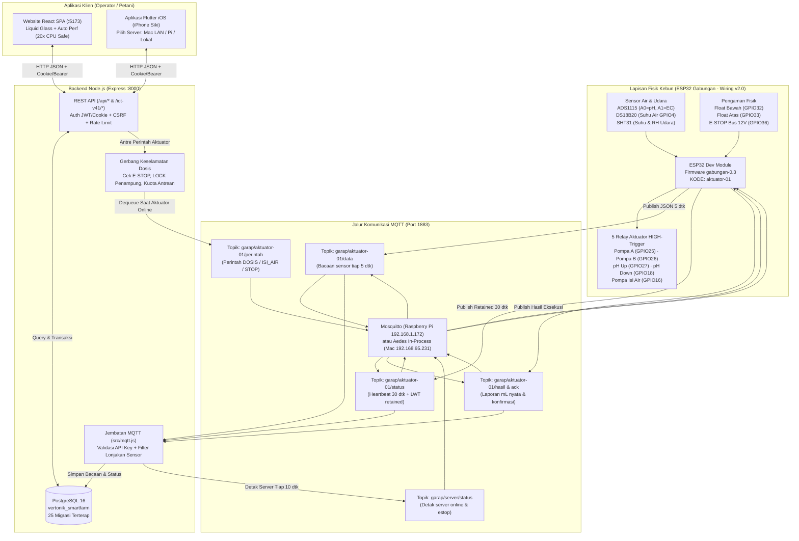
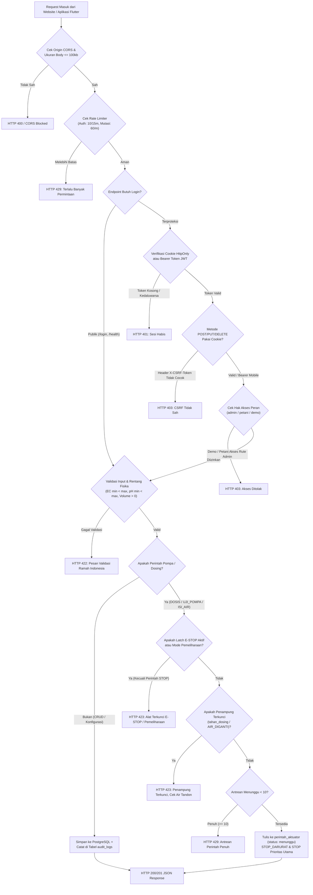
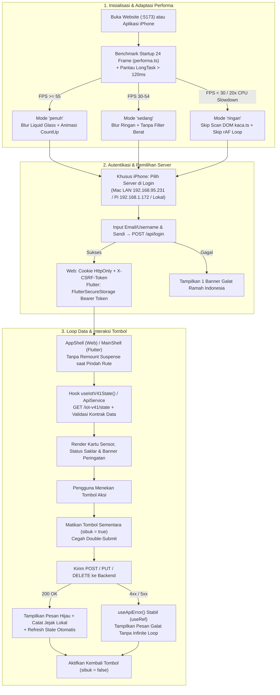
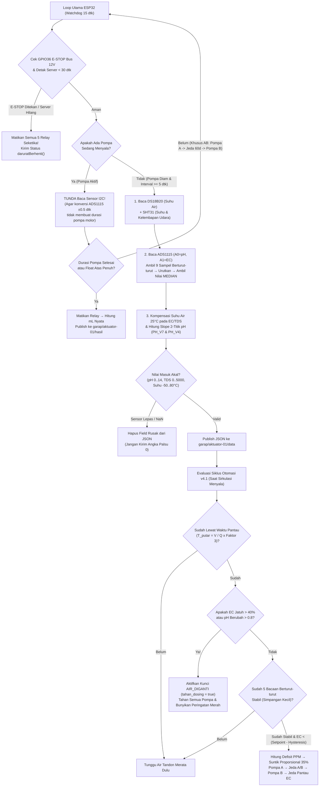
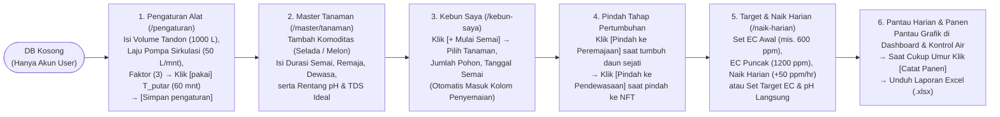
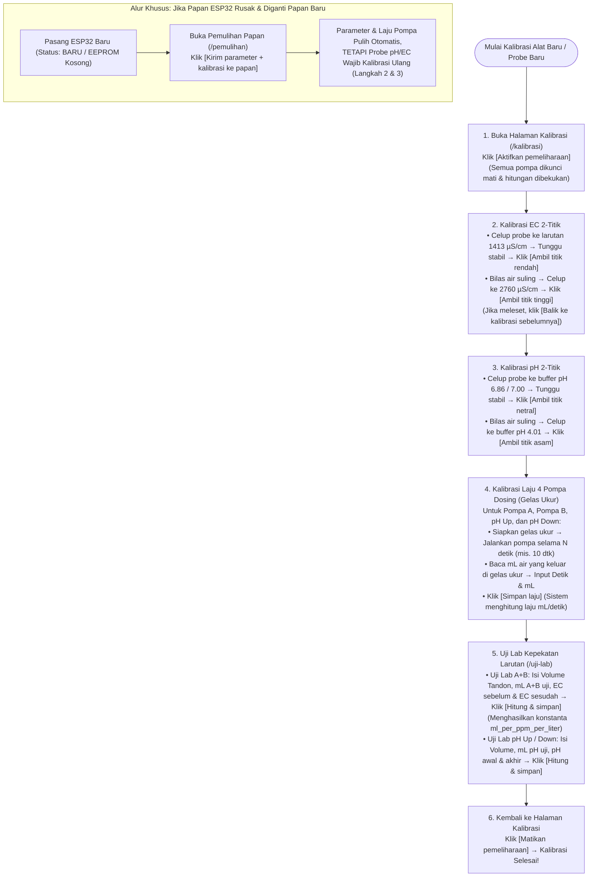

# Master Blueprint Debugging, Flowchart Sistem, Logika Use Case & To-Do List — Vertonik Smart Farm (Hidro IoT v4.1)

> [!IMPORTANT]
> **Status Verifikasi Otomatis Saat Ini (7 November 2026):**
> - **Backend Node.js (`garap-backend`)**: Lulus **100%** (`iot-v41-alur-petani.test.js`, `mqtt.test.js`, `containment-dosis-db.test.js`, `sensor-filter.test.js`, `siklus-aturan.test.js`).
> - **Website React (`react-web-app`)**: Lulus **22/22 berkas tes (160/160 unit & button tests)** + **Benchmark Chrome 20x CPU Slowdown** (`0` runtime error, `0` request bocor, `CLS = 0.0792`, auto-downgrade mode `'ringan'`).
> - **Aplikasi Mobile Flutter (`flutter_mobile_app`)**: Lulus **`flutter analyze` (0 issues)** + **75/75 widget & button tests** + terpasang di **iPhone Siki (`Release`)**.

---

## Bagian 1 — 7 Flowchart Lengkap Sistem (Panduan Apa yang Harus Di-Debug)

### 1. Flowchart Arsitektur Sistem & Aliran Data End-to-End (IoT ↔ Backend ↔ Web & Aplikasi)

Diagram ini memetakan seluruh jalur komunikasi perangkat keras, broker MQTT, server API, database PostgreSQL, hingga tampilan di Website dan iPhone.



---

### 2. Flowchart Logika Backend (Request Lifecycle, Keamanan & Gerbang Aktuator)

Gunakan flowchart ini saat men-debug error HTTP (`401`, `403`, `404`, `422`, `423 Locked`, `429 Too Many Requests`).



---

### 3. Flowchart Frontend Website (React) & Aplikasi Mobile (Flutter iOS)

Gunakan flowchart ini untuk men-debug masalah tampilan, performa lag/freeze, navigasi halaman, atau sinkronisasi tombol.



---

### 4. Flowchart Cara Sensor & Otomasi IoT Bekerja (Siklus Fisik di Kebun)

Diagram ini menjelaskan bagaimana ESP32 membaca sensor secara akurat dan memutuskan kapan harus menyuntik nutrisi atau menahan dosing.



---

### 5. Flowchart Pengisian Data & Siklus Budidaya Petani (Dari Nol Sampai Panen)

Urutan kerja petani/admin setelah database di-reset ke nol (`reset-db-nol.js`).



---

### 6. Flowchart Kalibrasi Alat, Uji Lab Larutan & Pemulihan Papan

Jangan pernah menyalakan saklar otomasi sebelum melewati alur kalibrasi ini!



---

### 7. Flowchart Pengujian Alat Fisik & Fail-Safe Keselamatan (Sebelum Dipakai ke Tanaman)

Urutan wajib saat menguji perangkat keras dengan **air bersih** sebelum memasukkan larutan nutrisi A/B dan asam/basa.

```mermaid
flowchart TD
  START(["Persiapan Uji Fisik<br/>(Isi Tandon & Botol Dosing dengan AIR BERSIH)"]) --> TEST_PUMP["1. Uji Pompa Manual (/nutrisi-manual)<br/>• Kirim dosing A+B kecil (mis. +10 ppm) → Pastikan Relay Pompa A (GPIO25) menyala,<br/>  lalu jeda, lalu Relay Pompa B (GPIO26) menyala.<br/>• Kirim koreksi pH Up/Down (5 mL) → Pastikan Relay GPIO27 / GPIO18 menyala."]

  TEST_PUMP --> TEST_STOP["2. Uji Tombol STOP Darurat Software<br/>• Saat pompa sedang berputar, klik tombol merah [STOP — matikan semua pompa]<br/>• Pastikan relay langsung klik MATI dalam < 1 detik!"]

  TEST_STOP --> TEST_ESTOP["3. Uji Tombol E-STOP Fisik (GPIO36 Bus 12V)<br/>• Tekan jamur E-STOP fisik di panel box<br/>• Pastikan daya 12V pompa terputus & status web berubah menjadi E-STOP Aktif<br/>• Coba kirim dosing dari web → Harus DITOLAK (HTTP 423)<br/>• Lepas E-STOP fisik & reset dari Admin"]

  TEST_ESTOP --> TEST_FLOAT["4. Uji Pelampung Air (Float Switch GPIO32 & GPIO33)<br/>• Turunkan Float Bawah → Status level_rendah harus aktif & menahan pompa dosing<br/>• Nyalakan Pompa Isi Air (GPIO16) → Angkat Float Atas (GPIO33 HIGH)<br/>• Pompa Isi Air WAJIB berhenti seketika saat Float Atas terangkat!"]

  TEST_FLOAT --> TEST_LOCK["5. Uji Deteksi Kuras / Ganti Air (AIR_DIGANTI)<br/>• Celupkan probe EC dari larutan pekat ke air tawar (penurunan > 40%)<br/>• Pastikan sistem mengaktifkan tahan_dosing (Banner Merah AIR_DIGANTI)<br/>• Buka halaman Saklar / Peringatan → Konfirmasi & Lepas kunci setelah air dicek"]

  TEST_LOCK --> GO_LIVE(["LULUS SEMUA UJI FISIK!<br/>Buka Halaman Saklar & Mode (/saklar)<br/>Nyalakan Saklar yang Diinginkan → Klik [Simpan pengaturan]"])
```



---

## Bagian 2 — Matriks Lengkap Logika Use Case & Debugging Lewat Tombol

Tabel ini adalah panduan **debugging tombol demi tombol** untuk mengecek apakah setiap tombol di Website (`react-web-app`) dan Aplikasi iPhone (`flutter_mobile_app`) memanggil endpoint yang tepat, menjalankan logika validasi yang benar, dan menghasilkan perubahan state yang diharapkan.

| No | Halaman (Web & iPhone) | Nama Tombol di UI | Endpoint Backend | Logika Validasi & Aturan Bisnis | Efek ke Database / MQTT | Status Uji Otomatis |
| :-: | :--- | :--- | :--- | :--- | :--- | :-: |
| **1** | **Login** (`/login`) | `Masuk` + Pilih Server (iPhone) | `POST /api/login` | Cek email/username & password bcrypt; rate limit 10x/15m; jika gagal tampilkan 1 banner tanpa duplikasi pesan kolom. | Buat JWT Cookie (`HttpOnly`) + CSRF token (Web) atau Bearer token (Mobile); catat `audit_logs`. | ✅ Lulus |
| **2** | **Pengaturan Alat** (`/pengaturan`) | `[pakai]` (Saran waktu pantau) | Lokal UI (`hitungWaktuPantauMenit`) | Rumus: $\lceil (V_{\text{tandon}} / Q_{\text{pompa}}) \times \text{Faktor} \rceil$. Contoh: $(1000 / 50) \times 3 = 60\text{ menit}$. | Mengisi otomatis kolom input `Waktu pantau (menit)` sebelum disimpan. | ✅ Lulus |
| **3** | **Pengaturan Alat** (`/pengaturan`) | `Simpan pengaturan` | `PUT /iot-v41/pengaturan-alat` | Validasi $V > 0$, $Q > 0$, `ec_aman_min < ec_aman_max`, `ph_aman_min < ph_aman_max`. Hanya `admin`. | Update tabel `iot_v41_state` (`params`), hitung ulang `waktu_putar_menit`, catat `audit_logs`. | ✅ Lulus |
| **4** | **Pengaturan Alat** (`/pengaturan`) | `Batalkan` | Lokal UI | Mengembalikan seluruh nilai input form ke data terakhir dari server (`iot.data.params`). | Reset state form lokal tanpa request jaringan. | ✅ Lulus |
| **5** | **Kalibrasi** (`/kalibrasi`) | `Aktifkan pemeliharaan` / `Matikan pemeliharaan` | `POST /iot-v41/pemeliharaan` | Saat `aktif: true`, semua perintah pompa ditolak dan siklus dosing dibekukan. | Set `params.pemeliharaan = true/false` di DB + muncul/hilang banner kuning `MODE_PEMELIHARAAN`. | ✅ Lulus |
| **6** | **Kalibrasi** (`/kalibrasi`) | `Ambil titik rendah (1413)` & `Ambil titik tinggi (2760)` | `POST /iot-v41/kalibrasi/titik` | Merekam tegangan/bacaan mentah sensor EC pada larutan standar 1413 & 2760 µS/cm; simpan cadangan kalibrasi lama. | Update `kalibrasi.ec` di `iot_v41_state`, simpan snapshot sebelumnya untuk fitur rollback. | ✅ Lulus |
| **7** | **Kalibrasi** (`/kalibrasi`) | `Ambil titik asam (4.01)` & `Ambil titik netral (6.86)` | `POST /iot-v41/kalibrasi/titik` | Merekam bacaan pH pada buffer 4.01 dan 6.86/7.00; validasi selisih tegangan tidak nol. | Update `kalibrasi.ph` di `iot_v41_state`, simpan cadangan rollback. | ✅ Lulus |
| **8** | **Kalibrasi** (`/kalibrasi`) | `Balik ke kalibrasi sebelumnya` (EC / pH) | `POST /iot-v41/kalibrasi/balik` | Mengembalikan parameter kalibrasi sensor (`ec` atau `ph`) ke nilai sebelum kalibrasi terakhir. | Tukar `kalibrasi[sensor]` dengan cadangan sebelumnya di `iot_v41_state`. | ✅ Lulus |
| **9** | **Kalibrasi** (`/kalibrasi`) | `Simpan laju` (Pompa A, B, pH Up, pH Down) | `POST /iot-v41/kalibrasi/pompa` | Validasi `detik > 0` dan `ml > 0`; menghitung $\text{laju} = \text{ml} / \text{detik}$ (mL/dtk). | Update `kalibrasi.pompa[kode]` di `iot_v41_state` sehingga pompa diizinkan menyuntik berbasis mL. | ✅ Lulus |
| **10** | **Uji Lab Larutan** (`/uji-lab`) | `Hitung & simpan` (Kartu EC / A+B) | `POST /iot-v41/uji-lab/ec` | Validasi `volume_liter > 0`, `ml_ab_uji > 0`, `ec_sesudah > ec_sebelum`. Rumus: $\text{ml\_per\_ppm\_per\_L} = \frac{\text{ml}}{\Delta\text{EC} \times V}$. | Simpan ke `params.ml_per_ppm_per_liter` & tabel riwayat uji lab. | ✅ Lulus |
| **11** | **Uji Lab Larutan** (`/uji-lab`) | `Hitung & simpan` (Kartu pH Up / Down) | `POST /iot-v41/uji-lab/ph` | Validasi arah perubahan pH sesuai jenis cairan (`ph_up` harus naik, `ph_down` harus turun). | Simpan ke `params.ml_ph_up_per_01_per_liter` atau `ml_ph_down_per_01_per_liter`. | ✅ Lulus |
| **12** | **Saklar & Mode** (`/saklar`) | 5 Toggle (`role="switch"`) + `Simpan pengaturan` | `PUT /iot-v41/saklar` | Mengatur `saklar_ab`, `saklar_ph_up`, `saklar_ph_down`, `saklar_pengenceran`, dan `mode_isi` (`otomatis`/`manual`/`mati`). Bawaan wajib OFF. | Simpan ke `iot_v41_state.params`; catat jejak perintah lokal & `audit_logs`. | ✅ Lulus |
| **13** | **Kebun Saya** (`/kebun-saya`) | `+ Mulai Semai` → `Simpan` | `POST /seedings` | Validasi tanaman dipilih, jumlah > 0, tanggal valid. | Buat baris baru di `seedings` (kolom Penyemaian). | ✅ Lulus |
| **14** | **Kebun Saya** (`/kebun-saya`) | `Pindah ke Peremajaan` → `Pindah ke Pendewasaan` → `Catat Panen` | `POST /seedings/:id/promote` (dll.) | Transisi tahap satu arah: `seeding` → `rejuvenation` → `maturation` → `harvest` (dengan input berat/jumlah hasil panen). | Pindahkan record antar tabel siklus budidaya dalam 1 transaksi DB. | ✅ Lulus |
| **15** | **Target & Naik Harian** (`/naik-harian`) | Pilih Tanaman + `Simpan target` / `Simpan naik harian` | `PUT /iot-v41/naik-harian` & `PUT /iot-v41/target` | Validasi `ec_awal <= ec_puncak`, `naik_per_hari >= 0`, serta peringatan bila target di luar ambang aman tanaman. | Simpan jadwal rampa EC harian (`ec_awal`, `ec_puncak`, `ec_setpoint`, `ph_setpoint`). | ✅ Lulus |
| **16** | **Nutrisi Manual** (`/nutrisi-manual`) | `Kirim dosing A + B` | `POST /iot-v41/dosing-manual` (`jenis: 'ab'`) | Cek tidak sedang pemeliharaan/LOCK; validasi `ppm > 0`; hitung kebutuhan mL dari volume tandon & hasil uji lab. | Catat perintah manual & antre ke aktuator bila terhubung. | ✅ Lulus |
| **17** | **Nutrisi Manual** (`/nutrisi-manual`) | `Kirim koreksi pH` (`pH Up` / `pH Down`) | `POST /iot-v41/dosing-manual` (`jenis: 'ph_up' \| 'ph_down'`) | Validasi `ml > 0` dan tidak melebihi batas suntik tunggal (`MAKS_ML_PH_SUNTIK = 10 mL`). | Catat perintah koreksi pH manual & antre ke aktuator. | ✅ Lulus |
| **18** | **Nutrisi Manual** (`/nutrisi-manual`) | `STOP — matikan semua pompa` | `POST /iot-v41/stop-semua` | **Prioritas tertinggi**: selalu diterima walau antrean penuh atau E-STOP aktif. | Batalkan perintah berjalan & terbitkan perintah `STOP` ke aktuator. | ✅ Lulus |
| **19** | **Pemulihan Papan** (`/pemulihan`) | `Kirim parameter + kalibrasi ke papan` | `POST /iot-v41/pulihkan` | Mengirim ulang parameter operasional dan laju pompa dari DB ke papan pengganti. | Update status papan & catat jejak `pulihkan_kalibrasi`. | ✅ Lulus |
| **20** | **Koneksi Alat / MQTT** (`/mqtt`) | `Catat uji (tidak diterbitkan)` | `POST /iot-v41/mqtt-uji` | Mencatat simulasi payload topik MQTT tanpa membahayakan pompa fisik di kebun. | Catat ke log diagnostik & riwayat jejak perintah lokal. | ✅ Lulus |
| **21** | **Peringatan** (`/peringatan`) | `Catat permintaan RESET` & `tandai selesai` | `POST /iot-v41/reset-peringatan` & `POST /alert-logs/:id/ack` | Menandai alert di DB sebagai `acknowledged = true` dan melepas kunci `tahan_dosing` bila aman. | Update `alert_logs` dan bersihkan indikator merah `AIR_DIGANTI`. | ✅ Lulus |

---

## Bagian 3 — To-Do List Debugging Terstruktur (Dari Persiapan Sampai Siap Pakai di Kebun)

### Fase 1: Stabilitas Kode, Database & Otomasi Pengujian (Di Mac — SELESAI 100%)
- [x] **1.1. Reset Database Bersih Kecuali Akun Pengguna**: Menjalankan `backend-nodejs/scripts/reset-db-nol.js` dan migrasi terbaru (`2026-11-05_01_nama_kontroler_gabungan.sql`).
- [x] **1.2. Stabilisasi Performa Website (20x CPU Slowdown)**: Memperbaiki stabilitas referensi `useApiError()`, deteksi `longtask` otomatis ke mode `'ringan'`, menghapus remount `<Suspense>` saat pindah halaman, dan menguji dengan Chrome CDP `20x CPU Throttling` (`0` error, `CLS = 0.0792`).
- [x] **1.3. Sinkronisasi Fitur v4.1 di Website & Aplikasi iPhone**: Menambahkan pemilih server di halaman Login iPhone (`Mac LAN 192.168.95.231`, `Raspberry Pi 192.168.1.172`, `Lokal`) dan pintasan 1-ketuk di halaman Kontrol Air (`Saklar`, `Nutrisi Manual`, `Naik Harian`, `Uji Lab`).
- [x] **1.4. Verifikasi Otomatis Seluruh Tombol & Logika Use Case**:
  - [x] Backend: `iot-v41-alur-petani.test.js`, `mqtt.test.js`, `containment-dosis-db.test.js` lulus 100%.
  - [x] Website: `oxlint` (0 error), `vitest` (22/22 file, 160/160 tes lulus), `vite build` sukses.
  - [x] Flutter: `flutter analyze` (0 issue), `flutter test` (75/75 tes lulus), terpasang di iPhone `Siki`.
- [x] **1.5. Penyelarasan Konfigurasi Firmware ESP32 (`gabungan.ino`)**: Menambahkan pencarian mDNS ganda (`garap.local` lalu `vertonik.local`) dan menyamakan IP cadangan `SERVER_IP` ke `192.168.1.172` di `rahasia.h.contoh`.
- [x] **1.6. Perapihan File Proyek, Commit & Push GitHub, dan Update Excel Progress**: Membersihkan file sampah di root workspace, push ke repositori `greenhouse_arutmin_backend` dan `greenhouse_arutmin_frontend`, serta memperbarui `docs/LOG_PERUBAHAN_VERTONIK_SMART_FARM.xlsx`.

---

### Fase 2: Setup Raspberry Pi (`192.168.1.172`) dari Kartu SD
- [ ] **2.1. Flash Raspberry Pi OS Lite (64-bit)** menggunakan Raspberry Pi Imager (hostname `garap.local`, user `garap`, Wi-Fi 2.4 GHz aktif, SSH aktif).
- [ ] **2.2. Jalankan Skrip Otomatis Kartu SD**:
  ```bash
  cd /Users/rizki/Project/Vertoniksmartfarm
  bash deploy-pi/siapkan-sd.sh
  ```
- [ ] **2.3. Boot Pertama Raspberry Pi** (tunggu ±5–8 menit hingga instalasi PostgreSQL, Mosquitto, Node.js, dan Nginx selesai otomatis).
- [ ] **2.4. Verifikasi Kesehatan Server Pi**:
  - [ ] Buka `http://192.168.1.172` dari browser Mac/iPhone.
  - [ ] Di aplikasi iPhone (`Siki`), ketuk tombol pemilih server di halaman Login → pilih **Raspberry Pi (`192.168.1.172`)** → pastikan indikator titik berubah **Hijau**.

---

### Fase 3: Flash & Koneksi Papan ESP32 Gabungan (`aktuator-01`)
- [ ] **3.1. Siapkan `rahasia.h`**:
  - Salin `deploy-pi/firmware/gabungan/rahasia.h.contoh` menjadi `deploy-pi/firmware/gabungan/rahasia.h`.
  - Isi SSID/Sandi Wi-Fi 2.4 GHz, `SERVER_IP "192.168.1.172"`, dan `API_KEY_AKTUATOR` dari menu Perangkat/skrip Pi.
  - Jika masih di meja uji tanpa rangkaian pembagi tegangan E-STOP 12V di GPIO36, tambahkan `#define AKTIFKAN_BACA_ESTOP 0` sementara di `rahasia.h` (wajib dikembalikan ke `1` saat dipasang di panel kebun).
- [ ] **3.2. Upload `gabungan.ino` dari Arduino IDE** (Board: `ESP32 Dev Module`, Baud `115200`).
- [ ] **3.3. Cek Serial Monitor (`115200 baud`)**:
  - [ ] Pastikan muncul `ADS1115 ada, SHT31 ada`.
  - [ ] Pastikan muncul `MQTT aktuator tersambung ke 192.168.1.172`.
  - [ ] Pastikan muncul baris `[...] kirim=OK ph=... tds=... air=...` setiap 5 detik.

---

### Fase 4: Pengisian Data Awal & Kalibrasi Fisik (Wajib Menggunakan Air & Larutan Standar)
- [ ] **4.1. Isi Pengaturan Alat (`/pengaturan`)**:
  - [ ] Masukkan Volume Tandon nyata (Liter) dan Laju Pompa Sirkulasi (L/menit).
  - [ ] Klik `[pakai]` pada saran Waktu Pantau → klik **[Simpan pengaturan]**.
- [ ] **4.2. Kalibrasi Probe EC & pH (`/kalibrasi`)**:
  - [ ] Klik **[Aktifkan pemeliharaan]**.
  - [ ] Kalibrasi EC pada larutan standar `1413 µS/cm` dan `2760 µS/cm`.
  - [ ] Kalibrasi pH pada larutan buffer `6.86` (atau `7.00`) dan `4.01`.
- [ ] **4.3. Kalibrasi Gelas Ukur 4 Pompa Dosing (`/kalibrasi`)**:
  - [ ] Isi selang pompa A, B, pH Up, dan pH Down dengan **air bersih**.
  - [ ] Ukur keluaran mL selama 10 detik ke gelas ukur untuk masing-masing pompa → masukkan nilai mL & detik → klik **[Simpan laju]**.
  - [ ] Salin juga nilai `ML_PER_DETIK` ke `gabungan.ino` baris 78 agar proteksi batas perangkat keras di ESP32 aktif.
- [ ] **4.4. Isi Uji Lab Larutan (`/uji-lab`)**:
  - [ ] Masukkan hasil uji kenaikan EC per mL larutan A+B → klik **[Hitung & simpan]**.
  - [ ] Masukkan hasil uji perubahan pH per mL larutan pH Up/Down → klik **[Hitung & simpan]**.
- [ ] **4.5. Matikan Mode Pemeliharaan (`/kalibrasi`)**:
  - [ ] Klik **[Matikan pemeliharaan]**.

---

### Fase 5: Pengujian Fail-Safe & Aktuator dengan Air Bersih (Dry/Water Run)
- [ ] **5.1. Uji Suntik Manual & Tombol STOP (`/nutrisi-manual`)**:
  - [ ] Uji **[Kirim dosing A + B]** kecil → pastikan Pompa A menyala, jeda, lalu Pompa B menyala.
  - [ ] Uji **[Kirim koreksi pH]** → pastikan Pompa pH menyala sesuai durasi.
  - [ ] Uji tombol merah **[STOP — matikan semua pompa]** saat pompa menyala → pastikan pompa berhenti seketika.
- [ ] **5.2. Uji Pengaman Fisik (Float Switch & E-STOP)**:
  - [ ] Angkat **Float Atas (GPIO33)** saat Pompa Isi Air menyala → pastikan Pompa Isi Air langsung mati.
  - [ ] Tekan tombol **E-STOP fisik (GPIO36)** → pastikan semua pompa mati dan perintah dosing baru ditolak (`423 Locked`).
  - [ ] Cabut kabel LAN/Wi-Fi server selama > 30 detik saat pompa jalan → pastikan fail-safe `FAILSAFE_MS` di ESP32 mematikan pompa otomatis (`server_hilang`).

---

### Fase 6: Go-Live Budidaya Tanaman Pertama
- [ ] **6.1. Tambahkan Master Tanaman (`/master/tanaman`)** dan mulai batch pertama di **Kebun Saya (`/kebun-saya` → `+ Mulai Semai`)**.
- [ ] **6.2. Atur Target EC/pH & Kenaikan Harian (`/naik-harian`)** sesuai umur semai/tanam.
- [ ] **6.3. Nyalakan Saklar Otomasi (`/saklar`)**: Aktifkan saklar A+B dan pH yang diinginkan → klik **[Simpan pengaturan]**.
- [ ] **6.4. Pantau Siklus Otomatis Pertama** melalui Dashboard Website dan Aplikasi iPhone `Siki`.
